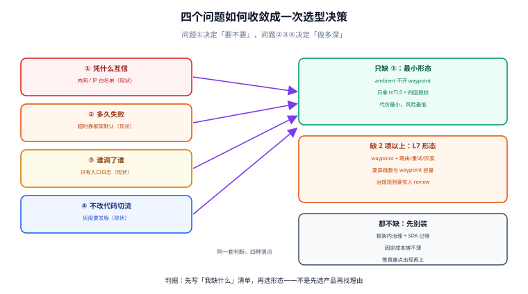

# 概述：四个问题、三段链路与五档成熟度

装网格之前要先能回答一个问题：**你现在到底缺什么**。缺的如果是「服务之间没有可信身份」，那 mTLS 一项就够；缺的是「每次灰度都要改代码里的开关」，那需要的是流量切分；缺的是「出事了查不出是谁调了谁」，需要的是统一遥测。这三件事可以只做一件，不必整套上。

本页把「值不值得上网格」拆成四个可判断的问题、一条请求实际走过的三段链路、以及一张从「完全没有治理」到「治理已下沉」的五档成熟度表——先定位自己，再决定买什么。



本页判据族 `SMO-A` ~ `SMO-H`，共 8 条。定义表在第八节「本页判据」。

## 一、先问四个问题

| 问题 | 现状为「是」时的信号 | 网格能给的答案 | 不能给的 |
| --- | --- | --- | --- |
| ① 服务之间凭什么互相信任？ | 靠内网、靠 IP 白名单、靠一个共享的静态 token | 每个工作负载一张短证书（SPIFFE 身份），mTLS 自动轮换 | 「谁有权做这笔退款」这类业务授权 |
| ② 下游变慢时，上游多久能知道？ | 上游线程池被拖死、超时靠框架默认值 | 统一超时、重试预算、异常实例摘除（`outlierDetection`） | 「这次调用能不能重试」的幂等判断 |
| ③ 一次请求跨了几个服务、各段多久？ | 只有入口一条日志，跨语言各写一套埋点 | 与语言无关的统一指标、访问日志、trace 传播 | 业务语义的 span（订单号、租户号）要业务自己打 |
| ④ 能不能不改代码切 5% 流量？ | 要发版、要改配置中心开关、灰度靠人肉盯 | 权重路由、请求头路由、镜像流量 | 数据库 schema 兼容、消息格式兼容 |

四个问题里，**只有 ① 是「没有替代方案」的**：不装网格也可以用服务间 TLS，但那意味着每套语言的客户端都要接一遍证书分发。②③④ 在框架内（Spring Cloud、gRPC 拦截器、OpenTelemetry SDK）都有成熟解法，网格的优势是**一次配置、全语言一致、不重启业务**。

::: tip 判断口径
把上面四个问题逐条打分（1~5）。如果只有 ① 低，做「网格只做 mTLS」的最小形态（Istio ambient 不开 waypoint，见 [架构形态](../Architecture/index.md)）；如果 ②③④ 也低，才考虑完整的 L7 治理。
:::

## 二、一次请求实际走过的三段链路

网格的「一跳」不是一跳。以 Istio ambient 为例，`A → B` 的请求要经过：

| 段 | 经过什么 | 典型端口 | 这一段的失败长什么样 |
| --- | --- | --- | --- |
| 出向 | A 的 Pod 网络被节点上的 ztunnel 接管，封装成 HBONE（mTLS 上的 HTTP/2 CONNECT） | `15008`（ztunnel）、`15001`/`15006`（sidecar 模式） | 连接被拒、`upstream connect error`、目标身份校验失败 |
| 跨节点 | ztunnel 到 ztunnel（或到 waypoint）的加密隧道 | `15008` | 隧道建不起来（证书/端口/网络策略），请求在源端就失败 |
| 入向 | 目标节点的 ztunnel 解封装，按目标身份再校验一次，交给 B | 本地回环 | 目标侧授权拒绝（403）、目标未加入网格（明文放行或被拒） |

Sidecar 模式下这三段被压成两跳 Envoy（A 的 sidecar → B 的 sidecar），排障时的 `curl` 目标端口与日志字段完全不同——这是**迁移时最容易踩的差异**，详见 [架构形态](../Architecture/index.md)。

::: danger 三个高频误判
1. **「网格装好了，服务间就自动加密了」**：只在**加入网格的工作负载之间**加密。没打标签的命名空间、`hostNetwork` 的 Pod、直接从宿主机发起的调用，全都绕开网格，仍是明文。
2. **「有了 mTLS 就不用 NetworkPolicy」**：mTLS 保证「对端是谁」，不保证「只能连谁」。四层可达性仍要靠 NetworkPolicy，两者互补（见 [身份与 mTLS](../Identity/index.md)）。
3. **「网格能重试，所以下游可以不稳定」**：网格重试默认只覆盖「请求大概率没到应用」的失败（`connect-failure`、`refused-stream`、`unavailable`、`cancelled`），对 5xx 默认**不重试**——这是刻意的，因为 5xx 可能已经产生了副作用。
:::

## 三、五档成熟度：你现在在第几档

| 档 | 形态 | 判定特征（可勾选） | 典型代价 |
| --- | --- | --- | --- |
| **L0** | 无治理 | 服务间明文；超时靠框架默认；没有统一指标 | 「出事查不出」的常态 |
| **L1** | 框架内治理 | 每个服务引 SDK（重试/熔断/埋点）；**多语言就要多套** | 升级 SDK 要所有服务跟着发版 |
| **L2** | 网格只做 L4 | 全量 mTLS + 四层授权；无 L7 路由 | 没有按请求切流量的能力 |
| **L3** | 网格做 L7 | 权重/头路由、超时重试集中在网格；指标口径统一 | 多一层跳数；waypoint 要单独扩容 |
| **L4** | 治理已下沉且有账本 | L3 + 每项治理都有 SLO 与成本账（延迟、资源、故障面） | 需要专职平台团队 |

::: warning 别跳档
从 L0 直接做 L4 的团队，最后大多停在「装上了但没人敢改配置」。**L1 → L2 的收益最大、风险最小**（只加密不改路由），L2 → L3 才是真正的治理迁移，L3 → L4 是组织能力问题而不是技术问题。
:::

## 四、什么时候不该上网格

| 场景 | 为什么不建议 | 替代方案 |
| --- | --- | --- |
| 服务数 < 10、单一语言 | 框架内治理一套就够，网格的固定成本（控制面、升级、跳数）摊不薄 | 统一 SDK + OpenTelemetry |
| 团队没有 K8s 平台能力 | 网格把「网络问题」变成「网络 + 控制面 + 证书」三类问题 | 先用网关 + 服务内 TLS |
| 主要是南北向流量、东西向调用很少 | 网格的收益在东西向，入口问题网关就能解 | [网关深入](../../GatewayDeep/Overview/index.md) |
| 有严格的请求延迟预算（P99 < 1 ms） | 每跳都会加延迟（量级见 [性能](../Performance/index.md)） | 只对非核心链路开网格 |
| 存量是 VM / 非容器 | 网格对 VM 的支持要额外组件，运维面翻倍 | Kuma / Consul 的 VM 模式，或先容器化 |

## 五、代价清单（上之前先认账）

1. **每 Pod 一个代理的固定开销**：Sidecar 模式默认 requests `cpu 100m / memory 128Mi`。420 个 Pod 的集群，仅 requests 就是 **42 vCPU / 52.5 GiB**（算例，不是实测）；Ambient 把 L4 部分收成每节点一个 ztunnel，同一规模常见说法是降到「每节点百毫核级」，但 L7 仍要 waypoint。
2. **多一层排障面**：`curl` 通但应用报错时，要依次判断「请求有没有进网格 → 有没有过授权 → 有没有被重试/超时截断」。三份日志（源 sidecar、目标 sidecar、应用）缺一不可。
3. **升级不再是「改个版本号」**：控制面、数据面（ztunnel / sidecar revision）、waypoint 三条版本线要各自灰度，见 [网格自身故障](../Failure/index.md)。
4. **一份新的 YAML 治理面**：`VirtualService` / `DestinationRule` / `AuthorizationPolicy` 会长期存在，需要 review 规则与所有权（谁能改生产路由）。

## 六、验证：三条命令判断「我这套网格到底生效了没有」

```shell
# 1) 哪些命名空间真的在网格里（ambient 看 dataplane-mode，sidecar 看 injection）
kubectl get ns -L istio.io/dataplane-mode -L istio-injection
# 期望：目标命名空间 dataplane-mode=ambient，或 istio-injection=enabled

# 2) 代理版本与形态（Sidecar 模式）
istioctl proxy-status
# 期望：每行 SYNCED；版本列与 istiod 一致，出现 STALE/NOT SENT 就是下发没成功

# 3) 身份真的签出来了（ambient 看 ztunnel 视角的工作负载）
istioctl ztunnel-config workloads
# 期望：目标工作负载的 NAMESPACE/SERVICE ACCOUNT 正确，协议列是 HBONE
```

读数判据：

| 读数 | 正常 | 异常含义 |
| --- | --- | --- |
| `proxy-status` 全 `SYNCED` | 控制面与数据面配置一致 | `STALE`：数据面没收到最新配置，先看 istiod 日志 |
| `ztunnel-config workloads` 里有目标 Pod | 已在网格内 | 缺失：标签没打对，或 Pod 用了 `hostNetwork` |
| 应用日志里出现对端 IP | 明文直连 | 网格没接管这条路（常见于跨命名空间调用未纳入） |

## 七、一张对账表：四个问题 ⇄ 本专题章节

| 你缺的 | 先读 | 再读 |
| --- | --- | --- |
| 服务间可信身份 | [身份与 mTLS](../Identity/index.md) | [架构形态](../Architecture/index.md) |
| 快速失败与容量保护 | [东西向流量治理](../Traffic/index.md) | [性能](../Performance/index.md) |
| 跨服务可观测 | [可观测性](../Observability/index.md) | [常见问题](../FAQ/index.md) |
| 不改代码切流量 | [东西向流量治理](../Traffic/index.md) | [从 SDK 治理到网格](../Migration/index.md) |
| 已经装了但不敢动 | [网格自身故障](../Failure/index.md) | [实战](../Practice/index.md) |

## 八、本页判据

| 编号 | 判据 | 看什么现象 | 不满足时改哪里 |
| --- | --- | --- | --- |
| `SMO-A` | 四个问题各有明确打分 | 有一份「缺什么」的清单，不是「别人都装了」 | 按第一节逐条打分后再选型 |
| `SMO-B` | 能画出自己的三段链路 | 说得出出向 / 跨节点 / 入向各经过什么 | 按第二节补图，标出端口 |
| `SMO-C` | 成熟度档位已定位 | 明确当前是 L0~L4 中的哪一档 | 别跳档，先做 L1→L2 |
| `SMO-D` | 有「不该上」的排除条件 | 服务数、语言数、延迟预算三条有结论 | 按第四节对照 |
| `SMO-E` | 代价清单已认账 | 资源、跳数、升级、YAML 所有权四项有人负责 | 补责任人与预算 |
| `SMO-F` | 生效范围可验证 | `ztunnel-config workloads` / `proxy-status` 能列出目标 | 补齐标签与注入配置 |
| `SMO-G` | 重试不覆盖有副作用的 5xx | 重试策略里没有默认重试 5xx | 保持「只在能确认未到达时重试」 |
| `SMO-H` | mTLS 与 NetworkPolicy 并列 | 文档里两者都有，不是二选一 | 补四层策略，见 [容器编排安全](../../Ops/ContainerOrchestration/Security/index.md) |

## 参考资料

- Istio 官方：*Service Mesh 概念*、*Ambient Mode Overview*（L4/L7 能力边界）、*Prepare for production deployments*（ztunnel 默认值与限额建议）
- Istio 官方：*Traffic Management*（默认重试 2 次、默认超时行为）、*Security*（mTLS 与授权模型）
- CNCF 博客与项目页：Istio / Linkerd / Cilium 的毕业与版本节奏（2026-10 核对）
- 本仓库：[网关深入](../../GatewayDeep/Overview/index.md)（南北向边界）、[微服务](../Microservices/Overview/index.md)（框架内治理）、[容器编排安全](../../Ops/ContainerOrchestration/Security/index.md)（四层策略）
