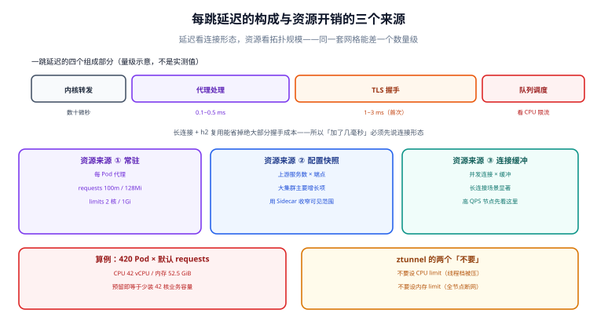

# 性能账本：每跳延迟、每 Pod 资源与节点密度

「网格会加多少延迟」这个问题，问法本身就有问题：延迟增量取决于**请求的形态**（长连接还是短连接、HTTP/1.1 还是 h2、有没有 TLS 会话复用），资源开销取决于**拓扑的形态**（多少服务、多少端点、多少命名空间互相可见）。同一套网格，在小集群里可能只加 0.3 ms，在大集群里能加 3 ms——差别不在网格版本，在**每个代理要维护多少上游**。

本页给的不是一个数字，而是一套**能自己量出来、也能自己算出来**的账本。



本页判据族 `SMP-A` ~ `SMP-H`，共 8 条。定义表在第八节「本页判据」。

## 一、一跳延迟由四段构成

| 段 | 量级 | 受什么影响 | 能不能省 |
| --- | --- | --- | --- |
| 内核转发与 socket 复制 | 数十微秒 | 是否走 iptables 重定向、是否用 eBPF 加速 | 部分可省（eBPF/ambient 路径更短） |
| 用户态代理处理 | 0.1~0.5 ms | 请求头大小、路由规则条数、是否开 WAF 类插件 | 减少规则可省 |
| TLS 加解密 | 首次握手 1~3 ms，复用后 0.05~0.2 ms | 会话复用、证书链长度 | **长连接能省掉绝大部分** |
| 队列与调度 | 不确定 | CPU 限额、节点负载 | 不给代理设过低 CPU limit |

结论很直接：**短连接 + 不复用 = 每跳都要付握手成本**；**长连接 + h2 多路复用 = 每跳只付代理处理成本**。所以「网格加了几毫秒」的读数，如果不说明连接复用情况，就没有可比性。

::: warning 公开口径与量级的正确用法
社区与厂商材料里常见的说法是「Sidecar 每 Pod 增加 50~100 MB 内存、每跳 1~3 ms 延迟」（2026 年的第三方对比文章的常见口径）。这类数字的正确用法是**判断量级**，不是当预算用：
- 它通常对应「默认配置 + 短连接 + 首次握手」；
- 换成 h2 长连接后，延迟增量往往降一个数量级；
- 内存里的常驻部分与「上游数量 × 端点数量」强相关，拓扑一变就变。
本专题**不在本机给实测数**（本机无 Kubernetes），只给测量方法与你自己的账本。
:::

## 二、资源账：三个来源，一个算例

| 来源 | 与什么成正比 | 默认值/量级 |
| --- | --- | --- |
| 代理进程常驻 | Pod 数 | Sidecar requests `cpu 100m / memory 128Mi`；limits `cpu 2 / memory 1Gi` |
| 配置快照 | 上游服务数 × 端点数 | 每个 cluster/endpoint 都要占内存；大集群是主要增长项 |
| 连接与缓冲 | 并发连接数 × 缓冲区大小 | 高并发长连接场景显著 |

**算例（算术，不是实测）**：420 个 Pod、Sidecar 模式、只用默认 requests。

```text
CPU：420 × 100m = 42,000m = 42 vCPU
内存：420 × 128Mi = 53,760Mi ≈ 52.5 GiB
```

这 42 vCPU 是**被预留**的，不一定被用掉——但调度器会按它算容量，所以它直接等于「少装了 42 核的业务容量」。同一规模换 Ambient（每节点一个 ztunnel，14 节点）：

```text
ztunnel：14 × 200m = 2.8 vCPU（chart 默认 requests 200m）
内存：14 × 512Mi ≈ 7 GiB（按生产建议的 512Mi 估）
L7 waypoint：每个被治理的命名空间/服务一组，按需计
```

差了一个数量级——这就是 Ambient 存在的全部理由。但要注意：**一旦大量命名空间需要 L7，waypoint 数量会上去**，账要重算，别把「L4 的节省」当成「L7 也省」。

## 三、配置快照：大集群真正的瓶颈

每个代理都要知道「我能调谁」。默认情况下，Envoy 会为**全网格的每个服务**建 cluster，为每个端点建 endpoint。40 个服务 × 平均 10 个副本 = 400 个端点，这对内存影响还不大；到 500 个服务 × 20 副本 = 10,000 个端点时，单个 sidecar 的内存会明显上升，配置下发也更慢。

最有效的解法是 **`Sidecar` 资源收窄可见范围**：

```yaml
apiVersion: networking.istio.io/v1
kind: Sidecar
metadata:
  name: default
  namespace: shop
spec:
  # 只允许本命名空间的服务 + 控制面（遥测与证书需要）
  egress:
    - hosts:
        - "./*"
        - "istio-system/*"
```

::: danger 收窄 `Sidecar` 是一个「会静默打断调用」的高危操作
`egress.hosts` 没列到的服务，代理**根本没有对应 cluster**，调用会以 `NR`（no route）或 `UF` 失败——但错误发生在**运行时**，`apply` 时不会有任何提示。上线前必须：① 用 [可观测性](../Observability/index.md) 的实际调用关系导出「谁调谁」清单；② 在预发验证；③ 分批应用（每次一个命名空间）。
:::

## 四、线程与并发：`concurrency` 与 ztunnel 的工作线程

| 组件 | 并发控制 | 默认 | 建议 |
| --- | --- | --- | --- |
| Envoy sidecar | `concurrency`（工作线程数） | 跟随 Pod 的 CPU limit（未设则跟随节点核数） | 给业务 Pod 设合理 CPU limit，否则代理会开满节点核数 |
| ztunnel | 工作线程数 | **1.31 起按 Pod 的 CPU request 定**（向上取整到整核，最小 2 线程）；1.31 之前固定 2 线程 | 给 ztunnel 设 CPU request（如 `500m` → 1 线程档，`1` → 1 核），**别设 CPU limit** |

ztunnel 的官方建议非常明确：**不要给 ztunnel 设 CPU limit，也不要设内存 limit**。原因是它服务整台节点的所有 Pod——被限流或被 OOM kill 的后果不是「一个服务慢」，而是**这台节点上的所有网络一起坏**。

| 给 ztunnel 的配置 | 后果 |
| --- | --- |
| 不设 request / limit | 用节点 25% 逻辑核（最少 2 线程），无上限 |
| 只设 request `200m` | 螺纹数向上取整到 1 核（chart 默认值，实际偏小） |
| 设 limit `1`（1 核） | 线程档压到最低，高流量节点成为瓶颈 |
| 设内存 limit | 超限即被杀，全节点网络中断 |

## 五、密度与 P99：什么时候该拆节点

以下三条读数出现任意两条，就该考虑**按流量密度拆节点池**，而不是继续加代理资源：

1. 单节点 ztunnel 的 CPU 使用率长期 > 60%（`container_cpu_usage_seconds_total` 按 Pod 聚合）。
2. 代理侧 `upstream_rq_pending`（排队）持续 > 0，同时业务侧 CPU 未满。
3. P99 与 P50 的差距在启用网格后扩大 2 倍以上（说明尾部被代理排队放大）。

Ambient 官方给的容量参考点（超过这些值建议先分析用量再垂直扩容）：集群 > 10 万 Pod 或 > 2 万 Service；单节点 > 2 万连接、> 10 万 RPS 或 > 5 Gb/s。这些**不是硬上限**，是「该看一眼」的阈值。

## 六、怎么量：一套可复跑的测法

```shell
# 1) 建立基线（未进网格的命名空间）与对照（已进网格），同镜像、同副本、同节点池
kubectl create ns bench-plain
kubectl create ns bench-mesh
# 分别部署同一个 echo 服务 + fortio 客户端

# 2) 固定变量：h2 长连接、固定 QPS、固定并发
kubectl exec -n bench-mesh deploy/fortio -- \
  fortio load -quic=false -http2 -c 32 -qps 2000 -t 60s \
  http://echo.bench-mesh.svc.cluster.local:8080/echo
# 期望输出：Latency P50/P99、实际 QPS、错误率

# 3) 关掉长连接再跑一次，观察握手成本
kubectl exec -n bench-mesh deploy/fortio -- \
  fortio load -http2=false -disable-keepalive -c 32 -qps 500 -t 60s \
  http://echo.bench-mesh.svc.cluster.local:8080/echo

# 4) 代理自身开销（CPU/内存），按 Pod 聚合
kubectl top pod -n bench-mesh --containers | grep istio-proxy
```

判读规则：

| 现象 | 含义 |
| --- | --- |
| 长连接下增量 < 0.5 ms/跳 | 正常，代理处理成本为主 |
| 短连接下增量 2~3 ms/跳 | 主要是 TLS 握手，考虑连接复用而不是换网格 |
| P99 增量远大于 P50 增量 | 代理在排队/被 CPU 限流，调 `concurrency` 或去掉 limit |
| 代理内存随上游数线性增长 | 该收窄 `Sidecar` 可见范围 |

## 七、常见「性能优化」的真相

| 做法 | 是否有效 | 说明 |
| --- | --- | --- |
| 关掉访问日志 | 有效（降低 I/O 与 CPU） | 但排障能力一起没了，按命名空间开 |
| 删掉不用的指标标签 | 有效（基数下降） | 见 [可观测性](../Observability/index.md) |
| 调大 Envoy `concurrency` | 看情况 | 超过业务线程数只是多抢 CPU |
| 给代理设 CPU limit | **通常有害** | 限流会把延迟尖峰放大，且 Envoy 不擅长被节流 |
| 用 eBPF 加速数据面 | 有效但看场景 | 省掉部分转发开销；L7 仍要 Envoy |
| 把 mTLS 关掉换性能 | **不要** | 收益是毫秒级，代价是安全模型整体崩塌 |

## 八、本页判据

| 编号 | 判据 | 看什么现象 | 不满足时改哪里 |
| --- | --- | --- | --- |
| `SMP-A` | 延迟增量按「连接形态」分开量 | 有长连接与短连接两组读数 | 按第六节补对照 |
| `SMP-B` | 资源账用算例而非印象 | 有「Pod 数 × requests」的算式 | 补算式与预算 |
| `SMP-C` | 上游可见范围有收窄 | 大集群配了 `Sidecar` 资源 | 按调用关系导出清单后分批应用 |
| `SMP-D` | 代理并发与业务匹配 | `concurrency` 或 CPU limit 有依据 | 调限值，不要给代理低 limit |
| `SMP-E` | ztunnel 不设 limit | ztunnel 只有 CPU request | 去掉 limit，避免整节点断网 |
| `SMP-F` | P99 与 P50 分开看 | 看板有两条分位线 | 补分位，别看均值 |
| `SMP-G` | 有密度拆分阈值 | 明确写出三条拆分条件 | 按第五节定义 |
| `SMP-H` | 优化项有取舍记录 | 关日志/删标签都写了代价 | 补取舍说明 |

## 参考资料

- Istio 官方：*Performance and Scalability*（benchmark 方法与已知瓶颈）、*Prepare for production deployments*（ztunnel 线程与限额建议、容量阈值）
- Istio 官方：*Sidecar* 资源参考（`egress.hosts` 语义）
- Envoy 文档：*Concurrency* 与 *Listener/Cluster 内存模型*
- 本仓库：[架构形态](../Architecture/index.md)（两种形态的拦截路径）、[可观测性](../Observability/index.md)（指标成本）、[东西向流量治理](../Traffic/index.md)（熔断参数对排队的影响）
