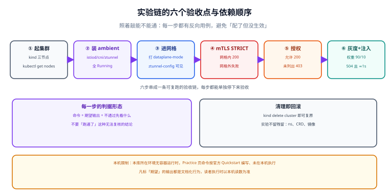

# 实战：本地集群跑通 mTLS、灰度与故障注入

前九页讲的是「应该怎样」，这一页是「照着敲能不能通」。整条实验链在本机用 `kind` 起一个三节点集群，装 Istio ambient，验证五件事：**工作负载进网格、mTLS 强制生效、越权被 403、灰度按权重切、故障注入能被观测到**。

每一步都给「命令 → 期望输出 → 不通过时先看什么」。全流程在一个小时内可跑完，跑完 `kind delete cluster` 就干净了。



本页判据族 `SMX-A` ~ `SMX-H`，共 8 条。定义表在第九节「本页判据」。

::: warning 本页的执行状态
本机没有可用的 Kubernetes 集群（无容器运行时），因此**本页命令未在本机实际执行**。命令与期望输出按 Istio 官方 *Quickstart* 与 *Ambient Mode* 文档编写（2026-10 核对，Istio 1.31.1），并按本库惯例**逐条给出判据**，便于读者执行时对照。凡标「期望」的输出，都是文档化行为，不是本机读数。
:::

## 一、前置检查：四样东西必须齐

| 依赖 | 版本要求 | 检查命令 | 期望 |
| --- | --- | --- | --- |
| Docker | 运行中的守护进程 | <span v-pre>`docker version --format '{{.Server.Version}}'`</span> | 输出一个版本号 |
| kind | ≥ 0.20 | `kind version` | `kind v0.2x.x` |
| kubectl | 与集群版本差 ≤ 1 | `kubectl version --client` | 输出客户端版本 |
| istioctl | **与要装的控制面同版本** | `istioctl version --remote=false` | `1.31.1` |

::: danger 版本不一致是最常见的「跑不通」
`istioctl` 必须与集群里的控制面同版本（小版本也要一致）。版本不一致时，`istioctl` 会拒绝执行或给出误导性的诊断结果——尤其是 `analyze` 与 `proxy-config`，它们读的是控制面下发的结构，字段变了就解读错。
:::

## 二、起集群：三节点、给足资源

```shell
cat > /tmp/mesh-lab.yaml <<'YAML'
kind: Cluster
apiVersion: kind.x-k8s.io/v1alpha4
nodes:
  - role: control-plane
  - role: worker
  - role: worker
YAML

kind create cluster --name mesh-lab --config /tmp/mesh-lab.yaml
kubectl get nodes
# 期望：三行 Ready（control-plane 可能带 NoSchedule 污点，属正常）
```

**不通过时先看**：`docker ps` 有没有 kind 的容器；Docker 的可用内存是否 ≥ 8 GB（3 节点 + 控制面 + 网格组件，低于这个值会 OOM）。

## 三、装控制面（ambient profile）

```shell
istioctl install --set profile=ambient -y
kubectl get pod -n istio-system
# 期望：istiod、istio-cni-node（每节点一个）、ztunnel（每节点一个）全部 Running
```

| 组件 | 数量 | 作用 |
| --- | --- | --- |
| `istiod` | 1（生产 ≥ 2） | 控制面：签发证书、下发配置 |
| `istio-cni-node` | 每节点 1 | 把 Pod 流量接入 ztunnel（替代 init 容器改 iptables） |
| `ztunnel` | 每节点 1 | L4：mTLS、四层授权、TCP 指标 |

## 四、部署被测服务

用官方 `httpbin` 与 `curl` 客户端，省掉自己写镜像：

```shell
kubectl create ns shop
kubectl label ns shop istio.io/dataplane-mode=ambient --overwrite

kubectl apply -n shop -f - <<'YAML'
apiVersion: apps/v1
kind: Deployment
metadata:
  name: httpbin
spec:
  replicas: 2
  selector: { matchLabels: { app: httpbin, version: v1 } }
  template:
    metadata:
      labels: { app: httpbin, version: v1 }
    spec:
      containers:
        - name: httpbin
          image: docker.io/kennethreitz/httpbin
          ports: [{ containerPort: 80 }]
---
apiVersion: v1
kind: Service
metadata:
  name: httpbin
spec:
  selector: { app: httpbin }
  ports: [{ name: http, port: 8000, targetPort: 80 }]
---
apiVersion: v1
kind: ServiceAccount
metadata: { name: client }
---
apiVersion: apps/v1
kind: Deployment
metadata: { name: client }
spec:
  replicas: 1
  selector: { matchLabels: { app: client } }
  template:
    metadata: { labels: { app: client } }
    spec:
      serviceAccountName: client
      containers:
        - name: client
          image: curlimages/curl
          command: ["sleep", "365d"]
YAML

kubectl rollout status deploy/httpbin -n shop
kubectl rollout status deploy/client -n shop
# 期望：两个 deployment successfully rolled out
```

```shell
# 验证：两个工作负载都在网格里（ztunnel 视角）
istioctl ztunnel-config workloads -n shop
# 期望：httpbin 与 client 各出现一行，PROTOCOL 列含 HBONE
```

**不通过时先看**：命名空间标签是否 `dataplane-mode=ambient`；Pod 是否用了 `hostNetwork`（用了就不进网格）。

## 五、验收点 1：mTLS 强制生效

```shell
kubectl apply -f - <<'YAML'
apiVersion: security.istio.io/v1
kind: PeerAuthentication
metadata: { name: default, namespace: shop }
spec:
  mtls: { mode: STRICT }
YAML

# 网格内调用：应当通
kubectl exec -n shop deploy/client -- \
  curl -s -o /dev/null -w '%{http_code}\n' http://httpbin.shop.svc.cluster.local:8000/get
# 期望：200

# 从「未进网格」的命名空间调用：应当失败
kubectl create ns plain
kubectl run -n plain probe --image=curlimages/curl --restart=Never -- \
  curl -s -m 5 -o /dev/null -w '%{http_code}\n' http://httpbin.shop.svc.cluster.local:8000/get
kubectl logs -n plain probe
# 期望：连接失败（超时或 reset）——STRICT 下明文被拒
```

| 结果 | 含义 | 动作 |
| --- | --- | --- |
| 网格内 200，网格外失败 | STRICT 生效 | 通过 |
| 两侧都 200 | 策略没生效（命名空间错了） | 查 `kubectl get peerauthentication -A` |
| 两侧都失败 | mTLS 没起来 | 查 ztunnel 日志与证书 |

## 六、验收点 2：越权被 403

```shell
kubectl apply -f - <<'YAML'
apiVersion: security.istio.io/v1
kind: AuthorizationPolicy
metadata: { name: allow-nothing-but-client, namespace: shop }
spec:
  selector: { matchLabels: { app: httpbin } }
  action: ALLOW
  rules:
    - from:
        - source:
            principals: ["cluster.local/ns/shop/sa/client"]
      to:
        - operation: { methods: ["GET"], paths: ["/get", "/headers"] }
YAML

# 许可的路径与方法
kubectl exec -n shop deploy/client -- \
  curl -s -o /dev/null -w '%{http_code}\n' http://httpbin.shop.svc.cluster.local:8000/get
# 期望：200

# 未列出的路径
kubectl exec -n shop deploy/client -- \
  curl -s -o /dev/null -w '%{http_code}\n' http://httpbin.shop.svc.cluster.local:8000/status/418
# 期望：403
```

::: danger 「有 ALLOW 策略就默认拒绝」这条必须亲手验一次
最常见的失败是「策略写好了但路径/方法不匹配，于是所有请求都 403」，而团队以为是网格坏了。上面两个用例一正一反，就是这个语义的最小验证。
:::

## 七、验收点 3：灰度按权重切（需要 waypoint）

```shell
# L7 需要 waypoint：为 shop 命名空间挂一个
istioctl waypoint apply -n shop --enroll-namespace
kubectl get gateway -n shop
# 期望：出现一个 gatewayClassName=istio-waypoint 的资源

# 造一个 v2 版本：只改标签，镜像不变（验证路由用得到）
kubectl -n shop patch deploy httpbin --type merge \
  -p '{"spec":{"template":{"metadata":{"labels":{"version":"v2"}}}}}'

kubectl apply -f - <<'YAML'
apiVersion: networking.istio.io/v1
kind: DestinationRule
metadata: { name: httpbin, namespace: shop }
spec:
  host: httpbin.shop.svc.cluster.local
  subsets:
    - { name: v1, labels: { version: v1 } }
    - { name: v2, labels: { version: v2 } }
---
apiVersion: networking.istio.io/v1
kind: VirtualService
metadata: { name: httpbin, namespace: shop }
spec:
  hosts: ["httpbin.shop.svc.cluster.local"]
  http:
    - route:
        - destination: { host: httpbin.shop.svc.cluster.local, subset: v1 }
          weight: 90
        - destination: { host: httpbin.shop.svc.cluster.local, subset: v2 }
          weight: 10
      timeout: 2s
      retries: { attempts: 2, perTryTimeout: 700ms }
YAML

# 验证：打 100 次，看 v2 的比例（httpbin 会回显 Host 头，用 pod 名区分更直观）
for i in $(seq 1 100); do
  kubectl exec -n shop deploy/client -- \
    curl -s -H 'x-probe: 1' http://httpbin.shop.svc.cluster.local:8000/get >/dev/null
done
# ambient 下没有 per-pod 代理：L7 计数器在 waypoint 上
kubectl exec -n shop deploy/waypoint -c istio-proxy -- \
  pilot-agent request GET stats | grep -c 'httpbin'
```

**判据**：权重是否生效，**看路由表比看流量分布更可靠**（100 次采样的统计误差太大）：

```shell
istioctl proxy-config route deploy/client -n shop -o json \
  | jq '.[].virtualHosts[] | select(.name|test("httpbin")) | .routes[].route.weightedClusters'
# 期望：两个 cluster 的权重分别为 90 / 10
```

## 八、验收点 4：故障注入与观测

```shell
kubectl apply -f - <<'YAML'
apiVersion: networking.istio.io/v1
kind: VirtualService
metadata: { name: httpbin-fault, namespace: shop }
spec:
  hosts: ["httpbin.shop.svc.cluster.local"]
  http:
    - fault:
        delay: { percentage: { value: 100 }, fixedDelay: 3s }
      route:
        - destination: { host: httpbin.shop.svc.cluster.local, subset: v1 }
      timeout: 1s
YAML

time kubectl exec -n shop deploy/client -- \
  curl -s -o /dev/null -w '%{http_code}\n' http://httpbin.shop.svc.cluster.local:8000/get
# 期望：504（注入 3s 延迟，但路由超时 1s 先到）
```

这条用例同时验证了两件事：**故障注入生效**（延迟真的注入了）与**超时预算生效**（1s 就放弃，不是等 3s）。排障读数：

```shell
kubectl logs -n shop deploy/waypoint -c istio-proxy --tail=3 | grep -o 'response_flags=[A-Z-]*'
# 期望：response_flags 出现超时/上游相关标记（如 UT/UF），而不是 -
```

## 九、本页判据

| 编号 | 判据 | 看什么现象 | 不满足时改哪里 |
| --- | --- | --- | --- |
| `SMX-A` | 四个工具的版本互相匹配 | `istioctl version` 与控制面一致 | 重装同版本 istioctl |
| `SMX-B` | 三节点集群起得来 | `kubectl get nodes` 三行 Ready | 加 Docker 内存或减节点 |
| `SMX-C` | 控制面组件齐全 | istiod / cni-node / ztunnel 全 Running | 查 `kubectl describe` 事件 |
| `SMX-D` | 工作负载真的在网格里 | `ztunnel-config workloads` 有目标 | 检查命名空间标签与 `hostNetwork` |
| `SMX-E` | STRICT 有正反两个用例 | 网格内 200、网格外失败 | 补反向用例 |
| `SMX-F` | 授权有 200 与 403 两条 | 允许的路径 200、未列出的 403 | 修 `paths`/`methods` |
| `SMX-G` | 灰度以路由表为判据 | `proxy-config route` 里权重正确 | 别用 100 次采样判断 |
| `SMX-H` | 故障注入与超时同时验证 | 504 且耗时 ≈ 1s | 检查 `timeout` 是否被覆盖 |

## 十、清理与复跑

```shell
kubectl delete ns shop plain --ignore-not-found
istioctl uninstall --purge -y
kind delete cluster --name mesh-lab
# 期望：集群删除完成，docker ps 不再有 mesh-lab 容器
```

整套流程可重复执行，且**每一步都能独立验收**——这正是把它写成文档而不是脚本的原因：读者可以在任意一步停下来，用该步的判据确认状态。

## 参考资料

- Istio 官方：*Getting Started*（`kind` 集群与 `istioctl install`）、*Ambient Mode*（`dataplane-mode` 标签与 waypoint）
- Istio 官方：*Authorization* 任务（`ALLOW` 语义与 `principals` 写法）、*Traffic Management* 任务（权重路由、故障注入）
- kind 官方文档：多节点集群配置（`kind: Cluster` 配置格式）
- 本仓库：[架构形态](../Architecture/index.md)（waypoint 的必要性）、[身份与 mTLS](../Identity/index.md)（策略语义）、[东西向流量治理](../Traffic/index.md)（超时与重试预算）
