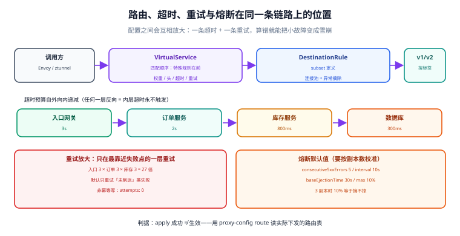

# 东西向流量治理：路由、灰度、超时与重试预算

入口网关能解决的问题（鉴权、限流、南北向路由）在门里面全都不复用：`order` 调 `inventory` 是一个普通的 gRPC/HTTP 调用，没人为它配超时，也很少有人为它想「下游挂了要多久才失败」。网格把这些能力变成**一份可以 review 的配置**，代价是配置之间会互相放大——一条超时、一条重试、一条熔断参数，算错就能把一个局部故障放大成雪崩。

本页按「路由 → 灰度 → 超时 → 重试 → 熔断」的顺序讲，每一节都给可验证的读数。



本页判据族 `SMT-A` ~ `SMT-H`，共 8 条。定义表在第八节「本页判据」。

## 一、路由的两层：VirtualService 与 DestinationRule

| 资源 | 决定什么 | 关键点 |
| --- | --- | --- |
| `VirtualService` | **请求怎么走**：匹配条件（host/uri/headers）、目标 subset、权重、超时、重试、故障注入、镜像 | 规则**自上而下匹配，第一条命中即生效** |
| `DestinationRule` | **连接怎么建**：subset 定义、负载均衡、连接池、异常实例摘除、TLS 设置 | 必须存在，`VirtualService` 才能引用 subset |

::: danger 顺序与引用两个坑
1. **`subset` 未定义**：`VirtualService` 引用 `subset: v2` 而 `DestinationRule` 里没有——`apply` 成功，流量**静默不匹配**（回落到默认路由），页面表现是「灰度没生效」而不是报错。
2. **规则顺序写反**：先写「全部流量 → v1 100%」，再写「`x-canary: true` → v2」——第二条永远不会命中，因为第一条已经兜底。**特殊规则必须写在兜底规则之前。**
:::

```yaml
apiVersion: networking.istio.io/v1
kind: DestinationRule
metadata:
  name: order
  namespace: shop
spec:
  host: order.shop.svc.cluster.local
  trafficPolicy:
    connectionPool:
      tcp: { maxConnections: 200 }
      http: { http1MaxPendingRequests: 100, http2MaxRequests: 500 }
    outlierDetection:
      consecutive5xxErrors: 5
      interval: 10s
      baseEjectionTime: 30s
      maxEjectionPercent: 30
  subsets:
    - name: v1
      labels: { version: v1 }
    - name: v2
      labels: { version: v2 }
---
apiVersion: networking.istio.io/v1
kind: VirtualService
metadata:
  name: order
  namespace: shop
spec:
  hosts: ["order.shop.svc.cluster.local"]
  http:
    # ① 内部测试流量固定打 v2（必须写在兜底之前）
    - match:
        - headers:
            x-canary: { exact: "true" }
      route:
        - destination: { host: order.shop.svc.cluster.local, subset: v2 }
    # ② 其余流量 95/5
    - route:
        - destination: { host: order.shop.svc.cluster.local, subset: v1 }
          weight: 95
        - destination: { host: order.shop.svc.cluster.local, subset: v2 }
          weight: 5
      timeout: 2s
      retries:
        attempts: 2
        perTryTimeout: 700ms
        retryOn: connect-failure,refused-stream,unavailable
```

## 二、灰度：权重切的是「请求」不是「用户」

权重路由是**按请求**分配的，同一个用户的相邻两个请求可能分别落在 v1 和 v2。这带来两个必须提前想清楚的问题：

| 情况 | 权重灰度是否安全 | 正确做法 |
| --- | --- | --- |
| 无状态读接口（商品详情） | 安全 | 权重即可 |
| 写接口但两版写同一份数据、格式兼容 | 基本安全 | 权重 + 双写兼容期 |
| 会话/购物车存在本地内存 | **不安全** | 按 cookie/用户 ID 粘性路由 |
| v2 改了响应结构 | **不安全** | 先让调用方兼容两种结构，再灰度 |

**灰度推进的正确节奏是「改一次、看一段时间」**：5% → 25% → 50% → 100%，每一档至少覆盖一个完整的指标采样窗口，并且**对比的是调用方视角的错误率与延迟**（`reporter="source"`），不是被调方自己的指标。

## 三、超时：默认值已经不是 15 秒了

一个必须更新的认知：**当前 Istio 的 HTTP 路由默认不设超时**（早期版本默认 15s，现在默认关闭）。这意味着「什么都不配」时，一个卡住的下游会一直占着调用方的连接，直到调用方自己的超时生效——而很多语言客户端的默认超时是**无限**。

| 层 | 谁设 | 该设多少 |
| --- | --- | --- |
| 网格路由（`VirtualService.timeout`） | 平台/SRE | 略大于下游 P99.9，留 20% 余量 |
| 每次重试（`perTryTimeout`） | 平台/SRE | `timeout / attempts` 的 70% 左右 |
| 业务层（HTTP 客户端/DB 驱动） | 业务团队 | 必须存在，且**小于上游给它的预算** |

**预算从外向内递减**：入口网关 3s → 订单服务 2s → 库存服务 800ms → 数据库 300ms。任何一层反向（内层比外层大），内层的超时就永远不会触发，等于没设。

::: danger 超时预算的三个反例
1. **内层比外层大**：外层 2s 已经放弃并返回 504，内层还在等 5s——用户看到失败，后端还在空转。
2. **重试总时长 > 路由超时**：`timeout: 2s` + `attempts: 3` + `perTryTimeout: 1s`，第三次重试必然被路由超时截断，**只增加了负载、不增加成功率**。
3. **只在网格设、业务不设**：网格超时只覆盖「经过 Envoy 的那一跳」，业务代码里的 `ExecutorService` 等待、连接池借用等待都不受它管。
:::

## 四、重试：先算放大倍数，再决定要不要开

默认重试行为是**最多 2 次**（即总共 3 次尝试），只对 `connect-failure`、`refused-stream`、`unavailable`、`cancelled` 等「请求大概率没到应用」的条件生效。这个默认值的设计意图很清楚：**只重试安全的失败**。

真正的风险在多层叠加：

```text
入口重试 3 次 × 订单重试 3 次 × 库存重试 3 次 = 27 倍
```

一次用户请求在最坏情况下会变成 27 次对库存服务的调用，而且**恰好发生在库存服务最扛不住的时候**。四条约束把放大控制在可接受范围：

1. **只在最靠近失败点的一层重试**（通常是直接调用方），上层不要重复重试。
2. **重试次数 ≤ 2**，且必须配 `perTryTimeout`。
3. **只重试幂等操作**；非幂等写操作的重试要么关掉，要么在业务侧用幂等键兜住（见 [幂等与状态机](../../IdempotencyStateMachine/index.md)）。
4. **用连接池的 `maxRetries` 限住同时在飞的重试**（Envoy 的 retry 预算），超出的重试直接丢弃。

| 条件 | 是否可重试 | 理由 |
| --- | --- | --- |
| `connect-failure` | 是 | 连接都没建起来，请求肯定没到 |
| `refused-stream` / `unavailable` | 是 | 对端明确拒绝，无副作用 |
| `5xx` | **默认不重试** | 服务端可能已经处理完（扣了款、发了消息） |
| `4xx` | 否 | 重试也不会变 |
| 超时 | 谨慎 | 不知道是否已执行，需业务幂等保证 |

## 五、熔断与异常摘除：参数之间是有约束的

`outlierDetection`（异常实例摘除）的默认值：
`consecutive5xxErrors: 5`、`interval: 10s`、`baseEjectionTime: 30s`、`maxEjectionPercent: 10`、`minHealthPercent: 0`。

三个参数的关系决定了它的实际效果：

| 参数 | 调大的后果 | 调小的后果 |
| --- | --- | --- |
| `consecutive5xxErrors` | 坏实例被摘除得更慢，错误更多 | 抖动实例被误摘，容量变少 |
| `maxEjectionPercent` | 大面积故障时可能摘光所有实例 | 少数实例坏了摘不掉，流量继续打过去 |
| `baseEjectionTime` | 实例恢复后仍长时间不接流量 | 坏实例被反复摘除/恢复，形成振荡 |

::: warning `maxEjectionPercent: 10` 在小集群里等于 0
一个服务只有 3 个副本时，10% 向上取整后**一个实例都摘不掉**（不同实现处理细节不同，但「比例太小导致摘除不生效」是常态）。小集群应显式调到 `30~50`，并同时用 `minHealthPercent` 或整体限流兜住「全挂」的情况。
:::

连接池（`connectionPool`）是熔断的另一半：`tcp.maxConnections`、`http.http1MaxPendingRequests`、`http.http2MaxRequests` 三个上限决定了「排队多深」。**它们不是越大越好**——排队深只是把「快速失败」换成「慢慢失败」，而且会占满调用方的连接。

## 六、镜像与故障注入：只在受控环境用

| 能力 | 用途 | 风险 |
| --- | --- | --- |
| `mirror`（流量镜像） | 把真实流量复制一份给新版本，不影响主链路 | 新版本会**真的写库/发消息**，必须用只读副本或影子表 |
| `fault.delay` | 注入固定延迟 | 忘了删就会一直生效，建议带到期时间与工单号 |
| `fault.abort` | 注入错误码 | 同上；别用在共享的预发环境 |

镜像流量的正确姿势是「影子链路」：镜像目标指向一套**连接影子库、影子 topic**的部署，并且明确写出「镜像响应被丢弃」。否则一次镜像上线就能把生产库写脏。

## 七、验证：四条读数证明「配置真的在生效」

```shell
# 1) 路由表里能看到两条规则，且特殊规则在前
istioctl proxy-config route deploy/api-gateway -n shop -o json \
  | jq '.[].virtualHosts[] | select(.name|test("order")) | .routes[].match'
# 期望：第一条含 header 匹配，第二条是 prefix "/" 兜底

# 2) 权重真的按 95/5 分布（打 200 次看 subset 分布）
for i in $(seq 1 200); do
  curl -s -o /dev/null -w '%{http_code}\n' http://order.shop/api/v1/orders
done | sort | uniq -c
# 期望：v2 的版本头出现约 10 次（5%）；0 次说明 subset 没匹配上

# 3) 重试计数器（是否真的在重试、有没有被预算丢弃）
kubectl exec deploy/api-gateway -n shop -c istio-proxy -- \
  pilot-agent request GET stats | grep -E 'upstream_rq_retry(_success|_overflow)?'
# 期望：overflow 持续增长说明预算打满，先降 attempts

# 4) 异常实例摘除是否发生
kubectl exec deploy/api-gateway -n shop -c istio-proxy -- \
  pilot-agent request GET stats | grep -E 'outlier_detection.ejections_active'
# 期望：故障注入期间 > 0，恢复后回到 0
```

## 八、本页判据

| 编号 | 判据 | 看什么现象 | 不满足时改哪里 |
| --- | --- | --- | --- |
| `SMT-A` | 特殊路由写在兜底之前 | `proxy-config route` 里第一条是 header 匹配 | 调整 YAML 顺序 |
| `SMT-B` | 每个 subset 都有定义 | `istioctl analyze` 无 subset 告警 | 先建 `DestinationRule` |
| `SMT-C` | 超时预算自外向内递减 | 网关 > 服务 > 依赖，且每层都有值 | 按第三节补预算表 |
| `SMT-D` | 重试总时长 < 路由超时 | `attempts × perTryTimeout < timeout` | 调小 `perTryTimeout` 或 `attempts` |
| `SMT-E` | 只在一层重试 | 链路上只有一处配了 `retries` | 去掉上游的重复重试 |
| `SMT-F` | 非幂等写不重试 | POST/支付类接口 `attempts: 0` 或有幂等键 | 补幂等或关闭重试 |
| `SMT-G` | 摘除参数与副本数匹配 | 小集群 `maxEjectionPercent` ≥ 30 | 按第五节调整 |
| `SMT-H` | 灰度对比取自调用方视角 | 用 `reporter="source"` 的指标判定成败 | 改查询口径 |

## 参考资料

- Istio 官方：*Traffic Management*（默认重试 2 次、超时默认关闭、重试间隔 25ms+）
- Istio 官方：*Destination Rule* 参考（`outlierDetection` 五个默认值、`connectionPool` 字段）
- Istio 官方：*Traffic Management* 的 *Mirroring* 与 *Fault Injection* 章节
- 本仓库：[身份与 mTLS](../Identity/index.md)（L7 策略需要 waypoint）、[性能](../Performance/index.md)（多一跳的延迟成本）、[幂等与状态机](../../IdempotencyStateMachine/index.md)（能不能重试的判定）
