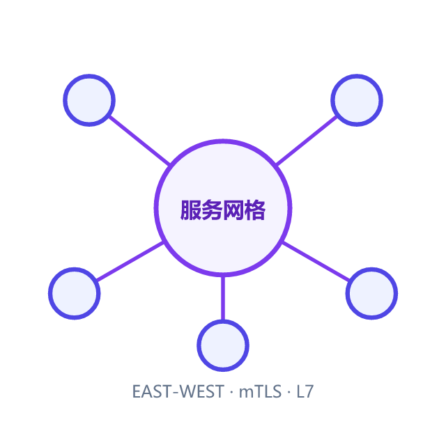
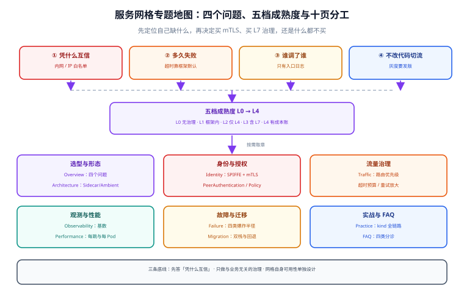

# 服务网格与东西向流量

南北向流量（用户 → 入口网关 → 你的服务）早就有了一套成熟答案：网关、限流、证书、鉴权都挂在门口。真正难的是**门里面**——`order` 调 `inventory`、`payment` 回调 `order`、`notify` 订阅四个 topic 的回流，这些调用没有统一入口，也没有统一的证书、超时、重试和追踪。

服务网格就是把「门里面这段路」的基础设施从业务代码里抽出来，交给一个**与语言无关的数据面**：同一份 mTLS、同一份超时、同一份重试预算、同一份指标，对所有服务、所有语言一致生效。

但这笔交易的代价也很具体：**每个 Pod 多一个进程（或每节点多一个 DaemonSet）、多一层排障跳数、多一套要跟着 Kubernetes 升级的控制面**。本专题不推销服务网格，只回答「什么时候值、怎么算这笔账、出问题怎么定位」。

::: tip 一句话理解
服务网格不是「更好的 RPC 框架」，而是**把治理下沉到基础设施层的组织决策**——它换来的是一致性与语言无关性，付出的是每跳延迟、每 Pod 资源与一套新的运维面。
:::

::: info 本专题与相邻专题的分工
- **入口网关（Kong / APISIX）、南北向流量治理** → [网关深入](../GatewayDeep/Overview/index.md)：那页讲「门」的设计与选型；本专题只讲**门里面**的东西向流量，以及两者在策略上如何避免重复施加。
- **服务怎么拆、注册中心、配置中心、熔断限流的应用层写法** → [微服务](../Microservices/Overview/index.md)：那套是**框架内治理**（Spring Cloud / Go-Micro / SDK），本专题讲**框架外治理**（Sidecar、ztunnel、waypoint），迁移取舍见 [从 SDK 治理到网格](Migration/index.md)。
- **Spring Cloud 全家桶的具体配置** → [Spring Cloud](../SpringCloud/index.md)：本专题只引用其能力边界，不展开配置项。
- **容器运行时安全、NetworkPolicy、eBPF 与 CNI** → [容器编排安全](../../Ops/ContainerOrchestration/Security/index.md)：本专题讲「身份与授权在七层/四层怎么做」，那页讲「主机与容器边界」。
- **证书签发与到期治理（非网格场景）** → [证书生命周期](../../Ops/CertificateLifecycle/index.md)：网格内的证书由控制面自动轮换，机制见 [身份与 mTLS](Identity/index.md)。
- **重试与幂等的业务侧约束** → [幂等与状态机](../IdempotencyStateMachine/index.md)：网格能重试，但**能不能重试是业务语义决定的**，那页给判定表。
:::

## 目录

- [概述：四个问题、三段链路与五档成熟度](Overview/index.md)
- [架构形态：Sidecar、Ambient 与 xDS 下发](Architecture/index.md)
- [身份与 mTLS：SPIFFE、证书轮换与授权策略](Identity/index.md)
- [东西向流量治理：路由、灰度、超时与重试预算](Traffic/index.md)
- [可观测性：指标基数、访问日志与链路](Observability/index.md)
- [性能账本：每跳延迟、每 Pod 资源与节点密度](Performance/index.md)
- [网格自身故障：控制面宕机、证书过期与升级事故](Failure/index.md)
- [从 SDK 治理到网格：双栈迁移与回退](Migration/index.md)
- [实战：本地集群跑通 mTLS、灰度与故障注入](Practice/index.md)
- [常见问题与分诊](FAQ/index.md)

## 专题地图

## 判据纪律

沿用全库写法：**每页 8 条，编号形如 `SMO-A`**，逐页前缀唯一，可被 `utils/audit` 下的判据类巡检机械核对。每条判据都要能回答三件事：**看什么现象、判成什么、不满足时改哪里**。

| 页 | 判据族 | 条数 | 这一族管什么 |
| --- | --- | --- | --- |
| 概述 | `SMO-A` ~ `SMO-H` | 8 | 是否需要网格、四类收益、五档成熟度、代价清单 |
| 架构形态 | `SMA-A` ~ `SMA-H` | 8 | Sidecar / Ambient 选型、拦截路径、xDS、注入与就绪 |
| 身份与 mTLS | `SMI-A` ~ `SMI-H` | 8 | SPIFFE 身份、模式切换、证书轮换、授权最小化 |
| 流量治理 | `SMT-A` ~ `SMT-H` | 8 | 路由优先级、灰度、超时预算、重试放大、熔断参数 |
| 可观测性 | `SMV-A` ~ `SMV-H` | 8 | 四类信号、指标基数、采样、口径对齐 |
| 性能 | `SMP-A` ~ `SMP-H` | 8 | 每跳延迟、每 Pod 资源、线程与连接、密度上限 |
| 故障 | `SMF-A` ~ `SMF-H` | 8 | 控制面不可用、证书过期、ztunnel 故障、升级回退 |
| 迁移 | `SMG-A` ~ `SMG-H` | 8 | 能力对账、双栈并行、按命名空间迁移、回退预案 |
| 实战 | `SMX-A` ~ `SMX-H` | 8 | 可执行验收：mTLS、灰度、注入、指标、清理 |
| 常见问题 | `SMQ-A` ~ `SMQ-H` | 8 | 症状分诊、误诊清单、上线自查 |

合计 **10 族 80 条**。

## 事实与版本速览（2026-10 核对）

| 项 | 现状 | 对本专题的影响 |
| --- | --- | --- |
| Istio | 主线 **1.31.1**（2026-09-21 发布）；1.29 的支持窗口在 **2026-10-12** 结束 | 本文所有 YAML 以 `networking.istio.io/v1` / `security.istio.io/v1` 为准；`v1alpha3` 那批老写法不再示例 |
| Istio Ambient | 自 **1.24**（2024-11）GA，**无 Sidecar** | 「网格 = 每 Pod 一个 Envoy」这个前提已经不成立，选型必须先问「L4 够不够」 |
| Istio 1.31 新能力 | `MeshConfig.defaultTrafficPolicy`（网格级 `connectionPool` / `outlierDetection` 基线）、`zoneAwareLbSetting`、waypoint 金丝雀权重（`istio.io/use-waypoint-canary-weight`）、`ALLOW_ANY_DYNAMIC_DNS` | 「每个 DestinationRule 各写一遍熔断」可以收成一份基线；waypoint 也能灰度升级了 |
| Sidecar 默认资源 | `requests: cpu 100m / memory 128Mi`，`limits: cpu 2 / memory 1Gi` | 420 个 Pod 的集群，默认 requests 就是 **42 vCPU / 52.5 GiB**（算术，非实测） |
| ztunnel | Rust 实现，DaemonSet 每节点一个；**默认不给 limit**，`1.31` 起按 Pod 的 CPU request 决定工作线程数（向上取整到整核） | 给 ztunnel 设 1 核以下的 CPU limit 会把它压到 2 线程以下，等于给全节点网络限速 |
| Linkerd | **2.20**（2026-06），当前只发布 edge（最新 `edge-26.10.1`），**稳定版由厂商提供**（50 人以下免费） | 「开源即免费稳定版」的老印象在 Linkerd 上已不成立，选型要算许可 |
| Cilium | **1.20.2**；1.20 起**弃用原有 mutual authentication**，改推基于 ztunnel 的 mTLS（beta） | 想「用 CNI 顺带做网格」的，L7 部分仍要 Envoy，且 mTLS 方案正在换轨 |
| 其他 | Kuma 2.14.5（Apache 2.0，Envoy Sidecar）；Consul 2.0.4（BSL 1.1） | 有 VM / 非 K8s 负载时这两家仍是现实选项 |

::: warning 关于「实测」的诚实标注
本专题的量化分三类，正文逐处标注来源：

- **公开口径**：Istio / Linkerd / Cilium 官方文档与 release notes 的参数默认值、版本时间线（标注日期）。这类数字可以核对，但**不保证适用于你的集群**。
- **算例**：由参数直接乘出来的账（如「420 Pod × 100m = 42 vCPU」）。算例只保证算术正确，不代表实测占用——实际用量通常低于 requests。
- **本机未跑**：本机没有可用的 Kubernetes 集群（无 Docker/K8s 运行时），因此**本专题没有任何「本机实测延迟/内存」读数**。凡涉及具体毫秒与 MiB 的地方，一律给「怎么在你自己的集群上量出来」的命令，而不是给一个抄来的数字。这与本库其他专题「本机可复跑」的写法不同，特此声明。
:::

## 三条底线

1. **先能说清「服务之间现在凭什么互相信任」，再谈装不装网格**。如果答案还是「同一个 VPC 内网、靠 IP 白名单」，那么网格的第一份收益（工作负载身份 + mTLS）就成立；如果已经有 SPIFFE 或成熟的服务间证书体系，网格的边际收益就要重新算。
2. **网格只做「与业务无关」的治理**：超时、重试、mTLS、流量切分、四层授权。**身份语义、幂等、状态机、金额计算永远留在业务侧**——把它们搬进网格，等于把业务规则写进一份没人 review 的 YAML。
3. **网格自身的可用性必须单独设计**：控制面挂了数据面还能跑多久（取决于最后一次下发与证书 TTL）、ztunnel 挂了这台节点上的所有 Pod 还通不通、升级顺序错了会怎样。这三问答不上来，就不要上生产。

## 参考资料

- Istio 官方：*Announcing Istio 1.31*（2026-08-27）、*1.31.1 patch*（2026-09-21）、*Traffic Management*（超时与重试默认行为）、*Destination Rule* 参考（`outlierDetection` 默认值）、*Ambient Mode* 与 *Prepare for production deployments*（ztunnel 线程与限额建议）
- Istio 官方：*Security*（`PeerAuthentication` / `AuthorizationPolicy`）、*SPIFFE* 身份格式
- Linkerd 官方：*2.20 release*（2026-06）、*stable release policy*（2024-02 起稳定版交由厂商）
- Cilium 官方：*1.20 release notes*（mutual authentication 弃用与 ztunnel mTLS beta）
- 本仓库相邻专题：[网关深入](../GatewayDeep/Overview/index.md)（南北向）、[微服务](../Microservices/Overview/index.md)（框架内治理）、[容器编排安全](../../Ops/ContainerOrchestration/Security/index.md)（CNI 与主机边界）
