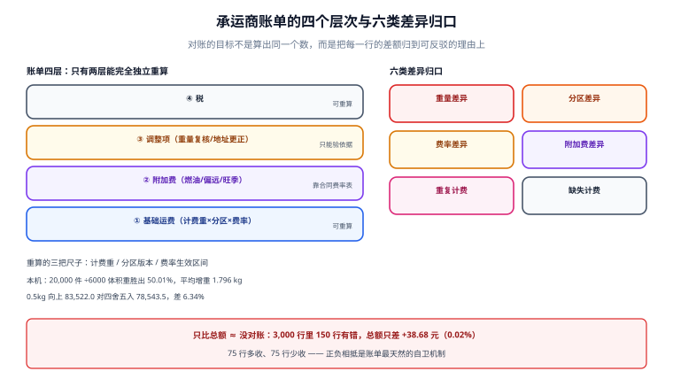

# 承运商账单核对：计费重、附加费与差异归因

**承运商的账单是这段链上唯一一个「你必须按它付钱、又几乎无法当场验证」的数**。它按月来、按千行计、金额看着对、总额误差常年在 0.02% 量级——而这 0.02% 恰恰是最危险的地方：它看起来像四舍五入。

一句话定位：本页回答「一张承运商账单要按哪几把尺子重算，差异怎么归到六类，以及为什么只比总额等于没对账」。



本页判据族 `LGB-A` ~ `LGB-H`，共 8 条。

## 账单的四层结构

一张承运商账单不是一个金额，而是四层相加：

| 层 | 内容 | 谁来定 | 你的可见性 |
| --- | --- | --- | --- |
| 基础运费 | 首重 + 续重 × 计费重 × 分区系数 | 合同价 + 分区表 | 可重算 |
| 附加费 | 燃油、偏远、超区、大件、上楼、旺季 | 承运商公告 + 合同 | 部分可重算 |
| 调整项 | 重量复核、地址更正、退件、二次派送 | 承运商实测 | 只能验，不能算 |
| 税 | 增值税 | 税法 | 可重算 |

四层里只有第一层和第四层能「完全独立重算」，第二层要靠合同附件的费率表，第三层**本质上只能核对「有没有依据」**。所以对账的目标不是「算出同一个数」，而是**把每一行的差额归到一个可反驳的理由上**。

## 为什么只比总额等于没对账

本机实测（3,000 行账单，注入 150 行错误，正负各半）：

| 口径 | 结果 |
| --- | --- |
| 账单合计 | 208,431.99 元 |
| 重算合计 | 208,393.31 元 |
| 总额差 | **+38.68 元（0.02%）** |
| 逐行比对发现的差异行 | **150 行（5.00%）** |

只看总额，你得到「差 38 块，大概是四舍五入」；逐行比对，你得到「150 行错了，其中 75 行多收、75 行少收」。**正负相抵是账单最天然的自卫机制**——它让总额永远看起来正常。

::: danger 注意
1. **不要用「总额差异 < 阈值就不看」作为对账通过条件。** 0.02% 的总额差背后可以是 5% 的行错误，而且方向相反——多收的钱正好被少收的抵掉，承运商没有动力主动纠正。
2. **不要只对「多收」的行。** 少收的行同样要纠正：它是下一次「补收」的来源，而补收往往发生在你已经结账、客户已经签收之后。
3. **不要用四舍五入解释差异。** 单行的舍入误差上限是 0.01 元（分），1,000 行的累计上限是 10 元；总额差超过「行数 × 0.01」就一定有非舍入原因。
:::

## 三把尺子：计费重、分区、费率

重算的核心是三个乘数，每一个都有独立的错法：

### 尺子一：计费重

```text
计费重 = 向上取整( max(实重, 长 × 宽 × 高 ÷ 除数) , 取整单位 )
```

本机重测（20,000 件，22% 大件）：

| 除数 | 体积重胜出 | 平均增重 |
| --- | --- | --- |
| 6000 | **50.01%** | **1.796 kg** |
| 5000 | **55.48%** | **2.312 kg** |

取整单位的影响比除数更被低估：同一批包裹按 0.5 kg **向上取整合计 83,522.0 kg**，按四舍五入合计 **78,543.5 kg**，差 **4,978.5 kg（6.34%）**；且四舍五入口径下 **49.78% 的包裹计费重低于真实值**。也就是说，**用四舍五入做内部估算，几乎一半的包裹都会低估**。

::: warning 说明
「重量复核」（weight audit）是账单里最常见的调整项，也是争议最多的：承运商在自己的分拨中心测得比你重。工程上唯一有效的防守是**留下自己的实测值与时间**（`measured_at` + 设备号 + 秤编号），争议时按「同一时刻、同一设备」比对，而不是互相报数。
:::

### 尺子二：分区

分区必须用承运商的分区表，且带版本号。里程估算在省内看起来还行，跨省必错——分区按分拨中心与线路划，不按直线距离。这张表每年至少调一次，替换时保留版本，否则历史账单无法复算。

### 尺子三：费率

费率包括首重价、续重价、抛比、最低一票、燃油浮动。把它拆成配置，不要写在代码里：

```sql
create table carrier_rate (
  rate_id      bigserial primary key,
  carrier_code text not null,
  product_code text not null,
  zone         text not null,
  valid_from   date not null,
  valid_to     date,
  first_kg     numeric(8,2) not null,
  first_price  numeric(10,2) not null,
  add_kg_price numeric(10,2) not null,
  min_charge   numeric(10,2) not null default 0,
  fuel_pct     numeric(6,4) not null default 0,
  unique (carrier_code, product_code, zone, valid_from)
);
```

`valid_from` / `valid_to` 而不是单个 `updated_at`：账单是历史，重算必须用**当时的费率**。用 `updated_at` 取最新一条，会让上个月的账单按这个月的价格重算——本仓在「供应商协同」一册里实测过同类错误：按现价重算历史订单，**1,000 张订单全部变化**。

## 六类差异归口

| 类型 | 表现 | 归属 | 处置 |
| --- | --- | --- | --- |
| 重量差异 | 账单计费重大于我方实测 | 承运商复核 | 提供实测证据，申诉 |
| 分区差异 | 同一地址算出不同分区 | 分区表版本 | 对齐版本，重算历史 |
| 费率差异 | 单价与合同不符 | 合同/生效日 | 对合同附件逐条核 |
| 附加费差异 | 燃油、偏远、旺季 | 公告时效 | 核公告生效日 |
| 重复计费 | 同一运单出现两行 | 系统 | 去重，退回 |
| 缺失计费 | 我方有运单、账单无行 | 承运商 | 补录或确认未计费 |

只有前三类是「可申诉的算术问题」，后三类是「单据问题」——**单据问题必须在上账之前解决**，一旦入账，追回的成本远高于当期扣减。

```sql
-- 六类归口：把差异打到具体类别，而不是「其他」
with billed as (
  select waybill_no, chargeable_kg, zone, amount, fuel_amt
  from carrier_bill_line where bill_id = $1
), calc as (
  select waybill_no, greatest(real_kg, l*w*h/6000.0) as calc_kg, zone_calc
  from shipment_calc where bill_id = $1
)
select coalesce(b.waybill_no, c.waybill_no) as waybill_no,
       case
         when b.waybill_no is null then 'MISSING_CHARGE'
         when c.waybill_no is null then 'DUPLICATE_OR_UNKNOWN'
         when b.chargeable_kg > c.calc_kg + 0.25 then 'WEIGHT'
         when b.zone <> c.zone_calc then 'ZONE'
         else 'RATE_OR_FUEL'
       end as diff_kind,
       count(*) as n, sum(b.amount) as billed
from billed b
full join calc c using (waybill_no)
where b.amount is null
   or c.calc_kg is null
   or b.chargeable_kg > c.calc_kg + 0.25
   or b.zone <> c.zone_calc
group by 1, 2
order by n desc;
```

## 申诉：窗口比金额重要

承运商的账单争议有明确窗口（常见「账单月后 30~60 天内提出」，超过即视为认可），而你的对账周期往往比窗口长：

```text
账单到达 D+0 → 行级重算 D+3 → 差异归口 D+5 → 申诉 D+10 → 承运商回复 D+20~D+30 → 调整下期账单
```

关键判据是**差异必须在窗口内提出，哪怕金额还没核完**：先按「可疑行清单」整体提交争议，再逐条补证据，比核完再提更安全。

::: danger 注意
**不要为了「对干净」而延后申诉。** 本机口径（2,000 行、7% 被复核改重）：不一致 **150 行（7.50%）**，累计多收 **2,596.81 元（占重算总额 1.74%）**。这笔钱单月不显眼，一年就是三万多；而错过窗口后，它连申诉资格都没有了。
:::

## 本页判据

| 判据 | 看什么现象 | 判成什么 | 不满足时改哪里 |
| --- | --- | --- | --- |
| `LGB-A` | 对账粒度到行（`waybill_no`），不只比总额 | 差异可定位 | 建行级重算表，禁止只用汇总 |
| `LGB-B` | 计费重按产品除数与取整规则重算 | 重量差异可判 | 除数与取整单位进配置 |
| `LGB-C` | 分区来自带版本的 `zone_table` | 分区差异可判 | 落版本号，历史可复算 |
| `LGB-D` | 费率按 `valid_from/valid_to` 取值 | 历史账单可复算 | 用生效区间，不用 `updated_at` |
| `LGB-E` | 差异归到六类，无「其他」桶 | 差异可申诉 | 建归口 SQL，`OTHER` 占比 > 5% 告警 |
| `LGB-F` | 正负差异都列，不只列多收 | 不漏补收 | 差异表带方向列 |
| `LGB-G` | 申诉在承运商窗口内提交，有留痕 | 权利不失效 | 记 `dispute_at` 与窗口截止日 |
| `LGB-H` | 重复计费与缺失计费在入账前拦截 | 单据不污染账 | 上账前做全量差集 |

## 验证方式

```sql
-- 1) 总额差 vs 行级差（LGB-A）：两个数字必须一起看
select count(*)                                              as lines,
       sum(amount)                                           as billed_total,
       sum(recalc_amount)                                    as recalc_total,
       round(sum(amount) - sum(recalc_amount), 2)            as total_diff,
       count(*) filter (where abs(amount - recalc_amount) > 0.01) as diff_lines,
       round(100.0 * count(*) filter (where abs(amount - recalc_amount) > 0.01)
             / nullif(count(*), 0), 2)                       as diff_pct
from carrier_bill_line
where bill_id = $1;
```

预期输出：本机口径是 `total_diff = +38.68`、`diff_lines = 150`、`diff_pct = 5.00`。**只要 `diff_lines > 0` 就必须往下归口**，无论 `total_diff` 多小。

```sql
-- 2) 差异归口分布（LGB-E）：OTHER 桶不应超过 5%
select diff_kind, count(*) as n,
       round(100.0 * count(*) / sum(count(*)) over (), 2) as pct
from recon_diff where bill_id = $1
group by diff_kind order by n desc;
```

预期输出：`WEIGHT` / `ZONE` / `RATE_OR_FUEL` / `DUPLICATE` / `MISSING_CHARGE` 五类；`OTHER` 占比 **≤ 5%**。若 `OTHER` 很高，说明归口规则漏了一类真实成因（最常见的是「燃油浮动按公告日而非账单日」）。

```sql
-- 3) 同一运单在账单中出现多行（LGB-H）
select waybill_no, count(*) as n, sum(amount) as amt
from carrier_bill_line
where bill_id = $1
group by waybill_no
having count(*) > 1
order by amt desc;
```

预期输出：**0 行**。有行时先看是不是「改单重发」（同一 `parcel` 换了 `waybill_no` 不属重复）或「子母件按件计费」（应看是否按件拆行）——两类都是合法多行，但必须能区分。

## 参考资料

- 顺丰开放平台《对账单与费用查询》（账单字段、争议处理时效）：<https://open.sf-express.com/>
- 京东物流开放平台《运费结算与对账》：<https://open.jdl.com/>
- GS1《Logistic Label Guideline》（计费重相关：包裹尺寸与人眼可读数据的规范来源）：<https://www-st.gs1.org/docs/tl/GS1_Logistic_Label_Guideline.pdf>
