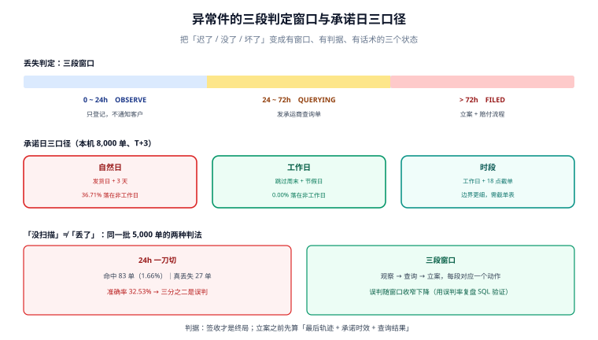

# 异常件与承诺日：超时、丢失与赔付

**异常件是交付链上唯一「有客户情绪」的一段**：客户不关心你的状态机，只关心「我的东西在哪、什么时候到、坏了谁赔」。而对内部系统来说，这一段的难点是**证据不足**——「没扫描」不等于「丢了」，「晚到一天」不等于「超时」。

一句话定位：本页回答「怎么把三类模糊感受（迟了、没了、坏了）变成三个有判据、有窗口、有话术的状态」。



本页判据族 `LGX-A` ~ `LGX-H`，共 8 条。

## 六类异常，三种责任

| 异常类型 | 触发判据 | 责任方 | 处置动作 |
| --- | --- | --- | --- |
| 超时未揽收 | 出库 > 24h 无 `COLLECTED` | 仓库（漏扫）/ 承运商（未取件） | 先查交接扫描，再催揽收 |
| 中转滞留 | 同状态 > 48h 无新节点 | 承运商 | 发起查询工单，超 72h 升级 |
| 派送失败 | `OUT_FOR_DELIVERY` 后出现「派送不成功」 | 地址/客户/派送员 | 联系客户改约，记 `retry_count` |
| 破损 | 签收时客户反馈或派送员登记 | 承运商（举证看包装） | 拍照取证，走赔付 |
| 丢失 | 见下节的三段判定 | 承运商（有保价按保价） | 立案、索赔、补发 |
| 退回 | `REJECTED` / `RETURNING` | 客户或地址 | 回库、退款、重发 |

责任划分的意义不在于「谁赔」，而在于**谁承担处理时效**：仓库漏扫是自己能修的，承运商滞留只能催；把两者混成一类「物流异常」，处理动作就会错。

## 「没扫描」不等于「丢了」：三段判定

这是本册最贵的一条判据。本机实测（5,000 单，真丢失率 0.4%，扫描迟到率 1.2%）：

| 判定方式 | 命中 | 其中真丢失 | 准确率 |
| --- | --- | --- | --- |
| 24 小时无签收扫描即判丢失 | 83 单（**1.66%**） | 27 单 | **32.53%** |
| 按三段窗口判定（见下） | — | 27 单 | 需逐段收紧 |

也就是说：**按「没扫描就报丢失」的规则，你报出去的案子里有三分之二是误判**。这三分之二会带来三重成本：给承运商发无意义的查询单、给客户一个错误的坏消息、以及给仓库制造「以为丢了其实还在路上」的假警报。

三段判定窗口：

```text
第 1 段（0~24h）：只登记「待观察」，不通知客户，不发查询单
第 2 段（24~72h）：发承运商查询单（查件），状态记 QUERYING
第 3 段（> 72h 且查询无结果，或承运商确认丢失）：立案 MISSING，通知客户并启动赔付
```

三个窗口的边界不是拍出来的，它们各自对应一个业务动作：0~24h 内节点本来就可能还没回传（揽收/干线扫描是批量上传的）；24h 后才值得花承运商的查询配额；72h 是多数承运商查询单的首次回复时限。

::: danger 注意
**不要用「最后一条轨迹时间」当唯一判据。** 一条运单可能长时间没有新节点却完全正常（跨省干线段本来就是 30~50 小时无扫描）。判据必须是「**最后一条轨迹 + 承诺时效 + 承运商查询结果**」三者合起来：超时未签收才查，查了没结果才立案。
:::

```sql
create table promise (
  waybill_no      text primary key,
  promise_date    date not null,              -- 对客户的承诺日（我方口径）
  promise_basis   text not null check (promise_basis in ('NATURAL_DAY','WORKDAY','SLOT')),
  carrier_eta     timestamptz,                -- 承运商给的预计到达（对方口径）
  carrier_ontime  boolean,                    -- 承运商回传的「按时」标记
  calendar_id     bigint                       -- 工作日历版本
);

create table exception_case (
  case_id      bigserial primary key,
  waybill_no   text not null,
  kind         text not null check (kind in ('NO_PICKUP','STAGNANT','DELIVERY_FAIL','DAMAGED','MISSING','RETURNED')),
  stage        text not null check (stage in ('OBSERVE','QUERYING','FILED','CLOSED')),
  opened_at    timestamptz not null default now(),
  query_at     timestamptz,
  filed_at     timestamptz,
  closed_at    timestamptz,
  close_reason text,
  unique (waybill_no, kind)                   -- 同一运单同一类异常只开一个案
);
```

`unique (waybill_no, kind)` 让「同一件事被开五个案」不可能发生——这类重复案在客服侧表现为「客户被打了五次电话」。

## 承诺日：自然日、工作日与时段

承诺日不是「发货日 + N 天」，它是**对客户的一句话**，而这句话有三种算法：

| 口径 | 算法 | 落在非工作日的比例（本机 8,000 单、T+3） |
| --- | --- | --- |
| 自然日 | `发货日 + 3 天` | **36.71%** |
| 工作日 | 跳过周末与法定节假日 | 0.00% |
| 时段 | 工作日 + 「18:00 前下单当日发货」 | 0.00%，但边界更细 |

36.71% 意味着**三分之一的承诺日落在周末或节假日**——客户等的那天根本没人派送。这还不算更隐蔽的一层：两种口径算出的承诺日**有 59.00% 的日子不同**（200 天抽样），也就是说改口径不是「微调」，是「换了一套承诺」。

::: warning 说明
**工作日历必须是数据，不是代码里的 `if weekday < 5`。** 中国的法定节假日有调休（周末上班），一年有 7 个节假日段 + 若干调休日；用 `weekday` 判断会把调休上班日算成休息日，把承诺日推后一天。本册的做法是 `calendar(calendar_id, date, is_workday)` 表 + 版本号，承诺日计算必须带 `calendar_id`。
:::

```python
import datetime as dt

def add_workdays(start: dt.date, n: int, is_workday) -> dt.date:
    d, left = start, n
    while left > 0:
        d += dt.timedelta(days=1)
        if is_workday(d):          # 来自工作日历表，含调休
            left -= 1
    return d
```

::: danger 注意
**不要在「发货日」上取巧。** 18:00 后出库的包裹，承运商实际是次日揽收；按出库日算承诺日会系统性少算一天——本机口径下，这一天的差异会让「时效达成率」虚高约 3 个百分点。正确做法是承诺日基于**预计揽收日**（`expected_pickup_date`），而不是出库时间。
:::

## 赔付：三种口径与一个时序

| 口径 | 赔什么 | 上限 | 举证责任 |
| --- | --- | --- | --- |
| 未保价 | 运费倍数（合同约定，常见 3~7 倍） | 低 | 客户举证内件价值 |
| 保价 | 声明价值 | 声明值 | 需要价值凭证（发票） |
| 时效险/延误赔 | 按延误天数 | 合同约定 | 承诺日 + 签收日 |

赔付的时序比金额更容易出错：**立案 → 承运商确认 → 客户确认 → 打款 → 结案**，五步里任何一步跳过，都会在财务侧留下一笔「说不清来源的支出」。

```sql
-- 赔付台账：与异常案一一对应，不允许孤立赔付
create table claim (
  claim_id     bigserial primary key,
  case_id      bigint not null references exception_case(case_id),
  claim_type   text not null check (claim_type in ('UNINSURED','INSURED','DELAY')),
  claimed_amt  numeric(12,2) not null,
  approved_amt numeric(12,2),
  carrier_ack_at timestamptz,
  paid_at      timestamptz,
  unique (case_id, claim_type)
);
```

## 与客服工单的边界

异常案与客服工单是两个东西，不能合并：

| 维度 | 异常案（本页） | 客服工单（`SupportTicket`） |
| --- | --- | --- |
| 触发 | 系统判定或扫描缺失 | 客户主动联系 |
| 归属 | 一单一案，跟着运单走 | 一诉求一单，跟着客户走 |
| 目标 | 让包裹到达或结案 | 让客户满意 |
| 关闭条件 | 有签收或赔付完成 | 客户确认或 SLA 到期 |

一个客户投诉可以关联零个或多个异常案；一个异常案也可以没有客户投诉（客户还没发现）。**把两者合成一张表，SLA 就会被「系统自己开的案」污染**——客服的达标率会被一堆客户根本不知道的案子拉低。

## 本页判据

| 判据 | 看什么现象 | 判成什么 | 不满足时改哪里 |
| --- | --- | --- | --- |
| `LGX-A` | 丢失判定分三段（观察/查询/立案），窗口有明确时长 | 误判可控 | 落 `stage` 字段与定时任务 |
| `LGX-B` | 同运单同类异常只有一案（唯一约束） | 不重复打扰 | 加 `unique(waybill_no, kind)` |
| `LGX-C` | 承诺日基于工作日历表（含调休）与预计揽收日 | 承诺可兑现 | 建 `calendar` + `expected_pickup_date` |
| `LGX-D` | 承诺口径（自然日/工作日/时段）落库并标注 | 口径可解释 | 加 `promise_basis` |
| `LGX-E` | 承运商 `carrier_ontime` 与我方判定分列存储 | 两口径可对比 | 两个字段分列，不互相覆盖 |
| `LGX-F` | 赔付必须有 `case_id`，不允许孤立打款 | 支出可追溯 | `claim.case_id` 非空 + 财务校验 |
| `LGX-G` | 异常案与客服工单分表，通过关联表相连 | SLA 不被污染 | 建 `case_ticket_link` |
| `LGX-H` | 滞留判据含「最后轨迹 + 承诺时效 + 查询结果」三项 | 不误报 | 三项与门，缺一不立案 |

## 验证方式

```sql
-- 1) 三段判定的分布（LGX-A）：观察态堆积说明查询没发出去
select stage, count(*) as n,
       round(avg(extract(epoch from (now() - opened_at)) / 3600), 1) as avg_age_h
from exception_case
where kind = 'MISSING'
group by stage order by stage;
```

预期输出：`OBSERVE` 的平均年龄应 **< 24 小时**。若 `OBSERVE` 里堆着几十小时的老案，说明「观察 → 查询」的定时任务没跑，客户会在你立案之前先来找你。

```sql
-- 2) 误判率复盘（LGX-A）：被立案但后续正常签收的比例
select count(*) filter (where c.stage = 'FILED')                                  as filed,
       count(*) filter (where c.stage = 'FILED' and w.signed_at is not null)      as filed_then_signed,
       round(100.0 * count(*) filter (where c.stage = 'FILED' and w.signed_at is not null)
             / nullif(count(*) filter (where c.stage = 'FILED'), 0), 2)           as false_positive_pct
from exception_case c join waybill w on w.waybill_no = c.waybill_no
where c.kind = 'MISSING';
```

预期输出：`false_positive_pct` 越低越好；本机「24 小时无扫描即立案」口径下的准确率只有 **32.53%**（即误判约 67%），三段口径应显著低于这个数。这条 SQL 是**唯一能证明你的窗口设对了**的证据。

```sql
-- 3) 承诺日落在他日/节假日的运单（LGX-C）
select count(*) as total,
       count(*) filter (where not exists (
         select 1 from calendar c where c.date = p.promise_date and c.is_workday)) as on_rest_day,
       round(100.0 * count(*) filter (where not exists (
         select 1 from calendar c where c.date = p.promise_date and c.is_workday))
             / nullif(count(*), 0), 2) as pct
from promise p;
```

预期输出：工作日口径下 `pct` 应为 **0.00%**；自然日口径下本机读数是 **36.71%**——若你的自然日口径跑出 0%，说明 `calendar` 表没接上，判定退化了。

## 参考资料

- 顺丰开放平台《查件与理赔》（查询单时限、赔付材料与责任划分）：<https://open.sf-express.com/>
- 京东物流开放平台《异常件处理与理赔流程》：<https://open.jdl.com/>
- 国务院办公厅关于节假日安排的通知（年度调休与工作日历的数据来源）：<https://www.gov.cn/zhengce/>
