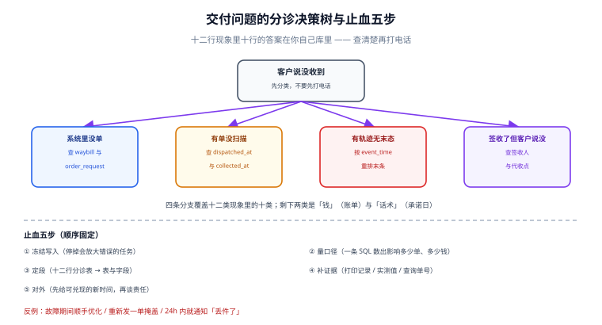

# 常见问题与分诊：交付异常先查哪一段

**交付类问题的共同点是「现象在客户侧，原因在七段里的某一段」。** 客服说「客户没收到」，可能是取号重复、面单错地址、揽收漏扫、轨迹乱序、异常未立案、或者干脆是承运商送错了门。没有分诊表，第一反应永远是「打电话问承运商」，而这条路 80% 的情况问不出结果。

一句话定位：本页给出一张十二行的分诊表、十二个高频问答、一套止血顺序，以及一张不需要问人的术语表。



本页判据族 `LGQ-A` ~ `LGQ-H`，共 8 条。

## 十二行分诊表：现象 → 先查哪张表

| 现象 | 先查 | 判据 | 常见真因 |
| --- | --- | --- | --- |
| 系统显示已发货，承运商查不到单 | `waybill` + `order_request` | `client_ref` 是否重复、`state` 是否 `UNKNOWN` | 取号超时后换了 key 重建 |
| 同一个订单两个运单号 | `waybill` 按 `client_ref` 分组 | `count(*) > 1` | 缺 `unique(client_ref)` |
| 包裹贴了两张一样的面单 | `label_print` 按 `waybill_no` 分组 | 两个 `parcel` 共用一个号 | 号池先查后改，并发重号 |
| 面单扫不出 | `label_print.data_sha256` + 模板版本 | 模块宽是否 ≥ 0.30 mm | 打印被缩放到 80% |
| 客户说地址错了但系统显示对 | `label_print` 首打哈希 vs 请求哈希 | 两哈希是否相等 | 取号后改了地址没重打 |
| 出库三天无揽收 | `shipment.dispatched_at` vs `collected_at` | 间隔 > 24h | 交接漏扫 / 承运商未取件 |
| 轨迹停在「运输中」 | `track_event` 按 `event_time` 排序 | 末条时间 | 派送中节点晚到（乱序） |
| 显示已签收但客户说没收到 | `waybill.signed_at` + 签收人 | 签收节点来源 | 代收点签收未通知 |
| 轨迹条数是别人的两倍 | `track_event` 唯一约束 | 是否有 `(waybill,time,state)` | 重推未去重 |
| 客户催「今天能到吗」 | `promise.promise_date` + `calendar` | 承诺口径 | 自然日 vs 工作日混用 |
| 账单比预期高 | `carrier_bill_line` 行级重算 | 计费重与分区 | 重量复核 / 分区表版本 |
| 账单总额对但财务说不对 | `recon_diff` 六类归口 | 正负差异是否相抵 | 只看总额没看行 |

::: tip 一句话用法
**先定位「哪一段」，再查「那张表」，最后才联系人。** 十二行里有十行的答案在你自己库里——把它们查清楚，打给承运商的那通电话才有内容。
:::

## 十二个高频问答

### 1. 取号接口超时了，我该重试还是新建？

重试，且必须用**同一个** `client_ref`。只有收到明确的业务拒绝（超区、超重、禁运）才允许换 key 新建。本机口径：没有幂等键时，1,000 单重投 3 次会落 3,000 行，且 **1,000 单全部拿到多个运单号**。

### 2. 号池里的号能不能一直存着？

不能。号段有效期常见 30~90 天，过期未用既占配额又可能被承运商回收。库里的 `expire_at` 要参与领取排序，先用快过期的。

### 3. 一张面单到底能不能缩放打印？

不能。缩放同时破坏模块宽与静区：本机换算显示，203 dpi 下「0.30 mm 的模块」实际只能打成 **2 点（0.25 mm）或 3 点（0.375 mm）**；整张缩到 80% 时模块宽变 **0.240 mm**，已低于 GS1 的 0.250 mm 绝对下限。塞不下就换模板，不要缩放。

### 4. 静区到底要留多宽？

每侧至少 **10 个 X 尺寸**（GS1 规范性要求）。X = 0.30 mm 时每侧 3 mm、两侧合计 6 mm。注意「可以打细但不能压白」：低于标准 X 尺寸印刷时，留给符号与静区的**面积不得小于 X = 0.264 mm 时的面积**。

### 5. 轨迹乱序很常见吗？

是。本机 10,000 单、78,135 条事件：按到达顺序取末条与按 `event_time` 取末条**不一致 3.17%**。所以写入时不排序，读取时必须显式 `order by event_time`。

### 6. 重复推送要不要去重？

要，而且只有唯一约束可靠。同一批数据重推让事件行虚增 **3.78%**；去重键是 `(waybill_no, event_time, state_norm)`——少了 `state_norm`，同一时刻的两个不同原始词（「已签收」「本人签收」）会被误删一个。

### 7. 承诺日按自然日还是工作日？

按工作日，且必须用**带调休的工作日历表**。本机 8,000 单 T+3：自然日口径下 **36.71%** 的承诺日落在周末或节假日；两种口径算出的承诺日有 **59.00%** 的日子不同。

### 8. 多久没扫描算丢失？

24 小时内不算。本机按「24h 无签收扫描即判丢失」口径：命中 83 单（1.66%），其中真丢失只有 27 单，**准确率 32.53%**。三段窗口是 0~24h 观察、24~72h 查询、72h 后立案。

### 9. 承运商说「按时」，为什么我的达成率更低？

因为两个「按时」不是同一个承诺。本机同一批单：我方承诺日口径 **55.19%**、承运商回传口径 **63.12%**，差 **7.93 个点**。对外只能用我方口径，承运商口径用于考核结算，两者不能混图。

### 10. 账单总额只差 0.02%，还要对账吗？

必须对。本机 3,000 行里 150 行有错，总额差只有 **+38.68 元（0.02%）**——正负相抵。行级差异率 **5.00%**，其中 75 行多收、75 行少收，少收的那些会在下期以「补收」的形式回来。

### 11. 重量复核（改重）能不能拒？

能，但要靠证据。你的实测值必须带 `measured_at` 与设备号；争议时按「同一时刻、同一设备」比对。用四舍五入做内部估算会系统性低估——本机 20,000 件里 **49.78%** 的包裹在四舍五入口径下低于真实计费重。

### 12. 客户投诉和异常案是同一件事吗？

不是。异常案跟着运单走（一单一案），客服工单跟着客户走（一诉求一单）。合成一张表会让客服的 SLA 被系统自动开的案污染——达标率被一堆客户根本不知道的案子拉低。

## 止血五步：出问题时的固定顺序

```text
1. 冻结写入：先停掉会放大错误的那个任务（取号重试 / 轨迹回写 / 对账入账）
2. 量口径：用一条 SQL 数出「影响多少单、多少钱」，不要凭感觉
3. 定段：用十二行分诊表定位到具体的表与字段，只修那一段
4. 补证据：把该段的证据字段补齐（打印记录、实测值、查询单号）
5. 对外：先给客户一个可兑现的新时间，再谈责任
```

前三步都是内部动作，任何一步跳过都会让「修完又坏」的概率翻倍——尤其是第 1 步：**在对账入账期间修数据，等于把错误写进账**。

::: danger 注意
1. **不要在故障期间「顺手优化」。** 止血只做减法：停任务、改配置、回滚模板。任何「顺便把这段重写一下」都会让下一次故障失去对照基线。
2. **不要用「重新发一单」掩盖问题。** 重发会造出第二个运单号，第一单如果还在路上，客户会收到两件、你付两次运费、账单里出现两条。
3. **不要先通知客户「丢件了」。** 在 24 小时观察窗内，67% 的「疑似丢失」会正常签收（本机口径准确率 32.53%）。先给时间，再给结论。
:::

## 术语表

| 术语 | 含义 | 易混点 |
| --- | --- | --- |
| 计费重（chargeable weight） | `max(实重, 体积重)`，再按规则取整 | 不等于实重，也不等于体积重 |
| 体积重（volumetric weight） | `长 × 宽 × 高 ÷ 除数` | 除数是产品属性，不是常数 |
| 抛比 / 除数 | 计算体积重时的除数（6000 / 5000 / 139） | 越小越容易按体积收费 |
| X 尺寸 | 条码最窄单元的宽度 | 不是条宽，也不是模块数 |
| 静区（quiet zone） | 符号两侧必须留白的区域，≥ 10X | 不能靠缩放获得 |
| 揽收扫描 | 承运商在取件时打的第一个节点 | 与你的「出库」不是同一件事 |
| 首打 / 重打 | `label_print.seq = 1` / `> 1` | 重打率是设备健康度的指标 |
| 号池 | 预取的运单号集合 | 有有效期，不是无限库存 |
| 承诺日 | 你对客户承诺的到达日 | 可能不等于承运商 ETA |
| 时效达成率 | 签收日 ≤ 承诺日 的比例 | 分母必须是「已签收」 |
| 重量复核 | 承运商测重后改计费重 | 账单里最常见的调整项 |
| 差异归口 | 把账单差额归到六类原因 | 不允许留「其他」大桶 |

## 不做清单（本册刻意不覆盖的）

- **不做路径规划与车辆调度**：那是运力调度，不是承运商集成。
- **不做国际清关与关税**：报关单、HS 编码、原产地证属另一条链。
- **不做仓储作业**：库内拣选与打包见「仓储作业与波次拣选工程」。
- **不做承运商侧的分拨算法**：你只能观测，不能干预。
- **不做赔付的财务入账**：本册只到 `claim` 台账，分录见「会计分录与结算」。

## 本页判据

| 判据 | 看什么现象 | 判成什么 | 不满足时改哪里 |
| --- | --- | --- | --- |
| `LGQ-A` | 分诊表覆盖十二类现象，每行落到具体表与字段 | 可自助定位 | 把表名与字段名写进分诊表 |
| `LGQ-B` | 每个高频问题都带一个本机读数或标准条款 | 答案可核 | 补读数或引用，不写「通常」 |
| `LGQ-C` | 止血五步的顺序固定，第一步是冻结写入 | 不放大错误 | 写成 runbook，故障时照做 |
| `LGQ-D` | 陷阱用 `::: danger` 且给出正确写法 | 可执行 | 每条坑配「正确做法」 |
| `LGQ-E` | 术语表区分「易混点」 | 减少口头歧义 | 每个词写一句「不是什么」 |
| `LGQ-F` | 明确列出不做清单与转交专题 | 边界清楚 | 五条以上不做项 + 去处 |
| `LGQ-G` | 问答里的数字能回溯到本册其他页 | 一致 | 与 Overview/各章读数对齐 |
| `LGQ-H` | 每类问题都给出「先查什么」而不是「联系谁」 | 可自助 | 联系方式放最后 |

## 验证方式

```shell
# 1) 分诊表覆盖度：表格行数应 ≥ 12（LGQ-A）
awk '/^## 十二行分诊表/,/^## 十二个高频问答/' docs/Backend/ShippingCarrier/FAQ/index.md \
  | grep -c '^| .* |$'
```

预期输出：**≥ 13**（含表头与分隔行）。少于 13 说明有现象被合并了，读者按现象找不到入口。

```shell
# 2) 术语表的「易混点」列必须非空（LGQ-E）
awk -F'|' '/^## 术语表/,/^## 不做清单/' docs/Backend/ShippingCarrier/FAQ/index.md \
  | awk -F'|' 'NF>4 && $2 !~ /术语/ && $2 !~ /---/ { if (length($4) < 4) print "空易混点: " $2 }'
```

预期输出：**无输出**。有输出说明某个术语只给了定义、没给「容易和什么混」。

```shell
# 3) 数字一致性抽查（LGQ-G）：本页出现的三个关键读数
grep -c '3.17%\|32.53%\|7.93' docs/Backend/ShippingCarrier/FAQ/index.md
grep -c '3.17%\|32.53%\|7.93' docs/Backend/ShippingCarrier/Overview/index.md \
  docs/Backend/ShippingCarrier/Tracking/index.md \
  docs/Backend/ShippingCarrier/ExceptionPromise/index.md
```

预期输出：第一条 **≥ 3**；第二条合计 **≥ 3**（同一读数在 FAQ 与出处页都能查到）。若 FAQ 有而出处页没有，说明读数被记错了页。

## 参考资料

- 国家邮政局《快递电子运单》国家标准解读（面单规格、区域与信息要求的权威口径）：<https://www.spb.gov.cn/gjyzj/c100201/202304/2b0e85d033284333a841e545e216c5af.shtml>
- GS1《Logistic Label Guideline》（静区 10X、X 尺寸与条码高度）：<https://www-st.gs1.org/docs/tl/GS1_Logistic_Label_Guideline.pdf>
- 快递 100 开放平台（多承运商状态词与推送语义的差异对照）：<https://api.kuaidi100.com/>
