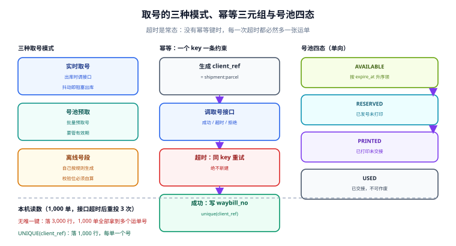

# 取号契约：幂等、号池与错误分类

**取号（下单到承运商）是整条链上唯一一次「你请求、对方发号」的交互**，它决定了后面所有单据的主键。这一段写错的代价不在当下——接口返回 200、单号也拿到了，错在第 3 天：同一个订单在承运商那里挂着两张运单，两张都有揽收，两张都进账单。

一句话定位：本页回答「怎么保证一个包裹只有一个有效运单，以及接口超时的时候你手上那个号到底还算不算数」。



本页判据族 `LGL-A` ~ `LGL-H`，共 8 条。

## 三种取号模式，选错一种就多一类事故

| 模式 | 怎么工作 | 优点 | 代价与事故形态 |
| --- | --- | --- | --- |
| 实时取号 | 每次出库时调接口 | 号与包裹一一对应，作废简单 | 接口抖动会阻塞出库；超时后重试最容易造重复号 |
| 号池预取 | 批量为承运商预取一批号存本地 | 出库不受接口可用性影响 | 号池要管理有效期与回收，作废不及时会被承运商收「号段占用费」 |
| 离线号段 | 承运商分配号段，自己按规则生成 | 完全离线可用 | 号段用完/越界即灾难，且校验位必须自己算对 |

大促场景几乎必然从「实时」切到「号池」，而切换的那一天最容易出问题的不是取号本身，是**号池里的号已经打印过面单但包裹没出库**——这些号既不能再用，也不能直接扔（承运商侧它们已经是有效运单）。所以号池必须有第四个状态：`RESERVED`（发了号、还没打印）、`PRINTED`、`USED`（已交接）、`VOIDED`。

## 幂等：一个 `client_ref` 加一条唯一约束

承运商接口的幂等键各家不同，但**你自己的幂等键必须存在**，因为接口超时时你不知道对方到底建没建单：

```text
取号请求 → 生成 client_ref（= shipment_id + parcel_no + 尝试序号之前的那一个稳定串）
         → 落 order_request(client_ref UNIQUE, state='PENDING')
         → 调接口
         → 成功：state='SUCCESS'，写 waybill_no
         → 超时：state='UNKNOWN'，用同一 client_ref 重试（不是新建）
```

本机实测（1,000 单、模拟接口超时后重投 3 次，SQLite + `UNIQUE(client_ref)`）：

| 方案 | 落库行数 | 拿到多个运单号的订单 |
| --- | --- | --- |
| 无唯一约束 | **3,000** | **1,000 / 1,000（全部）** |
| `UNIQUE(client_ref)` | **1,000** | 0 |

这组读数的重点不是「3 倍」，而是**100%**：接口超时是常态（本机模拟里每次重投都成功建单），没有幂等键时**每一次超时都必然多一张运单**。而多出来的运单在承运商侧是有效单据，不会自己消失。

::: danger 注意
1. **不要用「查询接口查一下有没有建过」来代替幂等键。** 承运商的查询接口通常有延迟（新单查不到），而且很多产品的查询接口**不支持按你的外部单号查**——它只认自己的运单号，而你恰恰还没有。这条兜底只在「取号成功但响应丢了」时有效，不能覆盖「请求到了但建单失败」。
2. **不要在重试时换一个 `client_ref`。** 换 key 等于换请求，幂等守卫立刻失效。重试必须复用原 key，只有**明确收到「建单失败」的响应**才允许用新 key 重来。
3. **不要用时间戳当 `client_ref`。** 时间戳每次调用都不同，天然不幂等；用业务键（`shipment_id:parcel_no`）才稳定。
:::

## 请求契约：字段分组与三个必填组

取号请求体在不同承运商之间差异很大，但字段可以归成五个组，缺组就会在某个环节被拒：

| 组 | 关键字段 | 缺失的后果 |
| --- | --- | --- |
| 寄件 | 姓名、电话、省市区、详址 | 直接拒单 |
| 收件 | 同上 + 邮编（部分产品必填） | 拒单或建单后被判「地址不详」 |
| 包裹 | 件数、实重、长宽高、物品名称 | 建单成功，但计费重按承运商实测追收 |
| 服务 | 产品代码、时效、保价、签收方式 | 默认产品，时效与价格都不是你要的 |
| 回单 | 电子签名、拍照回单、代收货款 | 事后无法补，只能重发 |

用一个显式的请求模型把它固定下来，避免「顺手少传一个字段」：

```python
from dataclasses import dataclass, field
from decimal import Decimal

@dataclass(frozen=True)
class LabelRequest:
    client_ref: str                 # 幂等键，必须由业务键派生
    carrier_code: str
    product_code: str
    sender: dict                    # 五要素齐全才允许提交
    receiver: dict
    parcels: list[dict] = field(default_factory=list)   # 每件独立重量尺寸
    insured_amount: Decimal | None = None
    signature_required: bool = False

    def validate(self) -> list[str]:
        errs = []
        for role in ("sender", "receiver"):
            p = getattr(self, role)
            for k in ("name", "phone", "province", "city", "district", "address"):
                if not p.get(k):
                    errs.append(f"{role}.{k} 缺失")
        if not self.parcels:
            errs.append("parcels 为空：拆包必须在取号前完成")
        for i, p in enumerate(self.parcels, 1):
            if not all(p.get(k) for k in ("real_kg", "length_cm", "width_cm", "height_cm")):
                errs.append(f"parcels[{i}] 缺重量或尺寸")
        return errs
```

::: warning 说明
**尺寸必须来自仓内实测，不能用商品主数据的包装前尺寸。** 本机重测（20,000 件，其中 22% 为大件）：除数取 6000 时体积重胜出 **50.01%**、平均每件增重 **1.796 kg**；除数取 5000 时胜出 **55.48%**、增重 **2.312 kg**。这个比例**完全由包裹结构决定**，不能跨仓比较——同册「选渠道」一页用的小件分布口径是 62.39%，两个数不矛盾，但谁也不能拿去当别人的基准。
:::

## 错误分类：三类，处置动作完全不同

承运商返回的错误码有上百个，但对你的系统只有三类处置：

| 类别 | 例子 | 判定依据 | 处置 |
| --- | --- | --- | --- |
| 可重试 | 系统繁忙、限流、网关超时 | 无业务语义的 5xx / 429 | 同 `client_ref` 退避重试（指数 + 抖动） |
| 不可重试 | 地址超区、超重、禁运品 | 明确的业务拒绝码 | 不重试，转人工/换渠道，**并作废已占的号** |
| 状态未知 | 连接断开、响应体截断 | 无响应或响应不可解析 | 标 `UNKNOWN`，先查后建，**绝不直接新建** |

三类里第三类最危险，因为它长得最像第一类。工程上的判据是：**只有拿到「明确的业务拒绝」才允许换 `client_ref` 重建**，其余一律先查。

```python
import random, time

RETRYABLE = {"SYSTEM_BUSY", "RATE_LIMITED", "GATEWAY_TIMEOUT"}

def call_with_retry(fn, client_ref, max_try=4):
    for i in range(max_try):
        try:
            resp = fn(client_ref=client_ref)
        except TimeoutError:
            # 状态未知：同一 key 重试，绝不新建
            time.sleep(min(8, 0.5 * 2 ** i) * (0.5 + random.random()))
            continue
        if resp.ok:
            return resp
        if resp.code in RETRYABLE:
            time.sleep(min(8, 0.5 * 2 ** i) * (0.5 + random.random()))
            continue
        return resp                      # 业务拒绝：立即返回，交人工
    return None                          # 交给「未知态对账」任务，不在这里新建
```

## 号池：有效期、回收与作废

号池不只是一个 `list`，它有三条硬约束：

1. **有效期**：多数承运商的号段有使用期限（常见 30~90 天），过期号作废会占号段配额。库里存 `expire_at`，取号时按 `expire_at` 升序取（先用快过期的）。
2. **不可回退的状态**：`RESERVED → PRINTED → USED` 单向；`RESERVED → VOIDED` 与 `PRINTED → VOIDED` 都允许，但**`USED` 不允许作废**（已交接的包裹作废会让客户收到一个查不到的号）。
3. **并发领取**：多台打包机同时领号，必须用条件更新，不能先查后改。

```sql
-- 领号：条件更新一次完成，禁止 select ... 再 update
update waybill_pool
   set state = 'RESERVED', reserved_at = now(), reserved_by = $1
 where pool_id = (
        select pool_id from waybill_pool
         where carrier_code = $2 and state = 'AVAILABLE'
         order by expire_at
         for update skip locked
         limit 1)
returning waybill_no;
```

`for update skip locked` 是并发领号的关键：它让两个事务去抢不同的行，而不是排队等同一行。

::: danger 注意
**先查后改在号池上是必失的。** 本仓在「券库存」与「库位余量」两处都实测过同一现象：20 个并发读同一行再写回，最终值只减少 1，而 **20 次都返回了「成功」**。号池的后果更严重——两台打包机拿到同一个号，打印出两张一模一样的面单，包裹 A 与包裹 B 贴在了一起。
:::

## 子母件与拆包：取号前必须定死

拆包一旦发生，取号的语义就有两种，选哪种要想清楚：

| 语义 | 接口形态 | 优点 | 风险 |
| --- | --- | --- | --- |
| 一次请求多件 | 一个 `client_ref` 返回多个子单号 | 子母件关系由承运商维护，轨迹可合并 | 部分承运商不支持；一件失败要整单重来 |
| 每件一次请求 | 每件独立 `client_ref` | 失败隔离好 | 子母件关系要自己存（`parent_no`） |

无论哪种，**`parcel.parent_no` 必须落库**，否则「一个订单五个运单号」在客服侧无法解释，客户会以为是发错货。

## 本页判据

| 判据 | 看什么现象 | 判成什么 | 不满足时改哪里 |
| --- | --- | --- | --- |
| `LGL-A` | 取号有业务键派生的 `client_ref`，且库里有唯一约束 | 重投不重复建单 | 加 `unique(client_ref)`，禁止换 key 重试 |
| `LGL-B` | 拆包后 `parcel.parent_no` 落库，子母件可查 | 客户侧可解释 | 取号前完成拆包，写入母子关系 |
| `LGL-C` | 请求体五组字段齐全，缺组在本地校验就被拦 | 不把错误推给承运商 | 落 `LabelRequest.validate()` 类校验 |
| `LGL-D` | 尺寸用仓内实测值并带 `measured_at` | 计费重有据 | 落实测字段与设备号 |
| `LGL-E` | 错误按「可重试/不可重试/未知」三分，未知态不新建 | 不放大重复 | 建错误码映射表，未知态进对账队列 |
| `LGL-F` | 号池四态单向流转，`USED` 不可作废 | 号段不浪费不越界 | 状态机 + 条件更新 |
| `LGL-G` | 领号用 `for update skip locked` 或等价条件更新 | 并发不重号 | 禁止先查后改 |
| `LGL-H` | 号池有 `expire_at` 且按升序消费 | 不浪费号段配额 | 落有效期，按到期时间排序领取 |

## 验证方式

```sql
-- 1) 同一 client_ref 是否只对应一个有效运单（LGL-A）
select client_ref, count(*) as n, array_agg(waybill_no) as nos
from waybill
where voided_at is null
group by client_ref
having count(*) > 1;
```

预期输出：**0 行**。有行即说明幂等键失效，先看是否存在「重试时换了 key」的代码路径。

```sql
-- 2) 处于「未知态」超过 10 分钟仍未收敛的取号请求（LGL-E）
select client_ref, carrier_code, created_at
from order_request
where state = 'UNKNOWN'
  and created_at < now() - interval '10 minute'
order by created_at;
```

预期输出：稳态下应为 **0 行**。持续有行说明查询兜底没有接上（承运商侧建单了，你这边永远不知道运单号）。

```sql
-- 3) 号池健康度（LGL-F / LGL-H）
select carrier_code, state, count(*) as n,
       min(expire_at) as next_expire,
       round(avg(extract(epoch from (expire_at - now())) / 86400), 1) as avg_days_left
from waybill_pool
group by carrier_code, state
order by carrier_code, state;
```

预期输出：`AVAILABLE` 行数应 ≥ 未来 2 小时的预计出库量；`avg_days_left` 低于 7 天时要提前补号。若 `VOIDED` 持续增长而 `USED` 不涨，说明有大量号「取了不用」，那是拆包策略或取消率出了问题。

## 参考资料

- 顺丰开放平台《下订单接口》与《路由查询接口》（取号请求字段、错误码与幂等约定）：<https://open.sf-express.com/>
- 京东物流开放平台《下单与面单获取》（号池与云打印的接入形态）：<https://open.jdl.com/>
- 快递 100 开放平台（多承运商聚合下的单号与订阅推送差异）：<https://api.kuaidi100.com/>
