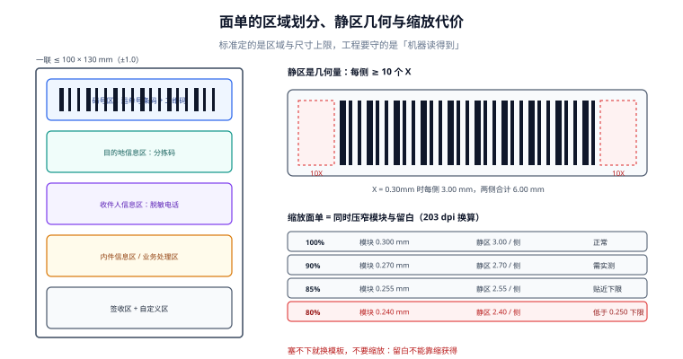

# 面单渲染：模板、静区与打印留痕

**面单是这一册里唯一一件「物理产物」**：前面所有接口都对齐了，只要这张纸上少一块静区、条码被裁掉 3 毫米，包裹在分拨中心就扫不出来，后面七段全部降级成人工。

一句话定位：本页回答「一张能被机器读的面单由哪些几何量决定，以及打印这件事怎么留下可复核的记录」。



本页判据族 `LGR-A` ~ `LGR-H`，共 8 条。

## 面单的区域是标准定的，不是你排版的

《快递电子运单》国家标准（GB/T 41833-2022）把一联电子运单划成若干固定区域，并对成品尺寸给了上限：**一联 ≤ 100 mm × 130 mm，两联 ≤ 100 mm × 165 mm，误差 ±1.0 mm**。区域按标准正文表 2 列，官方解读概括为八个：码号区、快递服务组织信息区、目的地信息区、寄件人信息区、内件信息区、业务类别及业务处理区、签收区、自定义区（标准表 2 另单列「收件人信息区」，因此正文里能数出九个，读到不同说法时看的是同一张表）。

工程上真正要抓住的是**四个区域的耦合**：

| 区域 | 里面有什么 | 出错的表现 |
| --- | --- | --- |
| 码号区 | 运单号条码 + 二维码 | 扫不出 → 全链路手工 |
| 目的地信息区 | 分拣码、目的地网点 | 分拣错 → 慢但不报错 |
| 收件人信息区 | 姓名、电话（脱敏）、地址 | 脱敏过头 → 派送员联系不上 |
| 签收区 | 签收栏/回单 | 缺失 → 电子签收无处落地 |

::: danger 注意
**不要把「自定义区」当成救命空间。** 自定义区是唯一允许自己排版的区域，也是唯一不影响机器识读的区域。把路由信息、促销文案、二维码全塞进自定义区，看起来信息很全，实际上把「机器要读的」和「人想看的」混在了一起——一旦模板改版，条码位置跟着漂移，静区就没地方了。
:::

## 静区：10X 是几何量，不能靠缩放省出来

条码的静区（quiet zone）是符号两侧必须留白的区域，GS1 的规范性要求是**每一侧至少 10 个 X 尺寸**（X 是最窄单元的宽度）。以 `GS1-128` 为例，允许的 X 尺寸区间是 **0.495 mm ~ 0.94 mm**，推荐目标值 0.495 mm；条码最小高度 31.75 mm（不含人眼可读字符），人眼可读部分字符高度不得小于 3 mm。

于是「面单塞不下」时的第一个念头——把整张面单缩到 80%——会同时破坏两件事：

| 缩放 | 模块宽（名义 0.30 mm） | 单侧静区（10X） | 结论 |
| --- | --- | --- | --- |
| 100% | 0.300 mm | 3.00 mm | 正常 |
| 95% | 0.285 mm | 2.85 mm | 可用，边缘 |
| 90% | 0.270 mm | 2.70 mm | 可用，需实测校验 |
| 85% | 0.255 mm | 2.55 mm | 接近下限 |
| 80% | **0.240 mm** | 2.40 mm | **低于 0.250 mm 的绝对下限** |

GS1 对小于标准值的印刷有明确约束：X 尺寸低于 0.264 mm（约 80% 放大）**只在按需打印（热敏、激光）工艺下**才被允许，且下限是 0.249 mm；同时**给符号与静区预留的面积不得小于 X = 0.264 mm 时所需的面积**——也就是说，你可以把条打细，但不能把留白压小。面单缩小 20% 时，留白跟着缩小 20%，这一条就已经违反了。

::: danger 注意
1. **不要用 CSS `transform: scale()` 或打印驱动的「缩放适应页面」来实现「塞进 100×130」。** 缩放是全局的，它会把静区、人眼可读字符高度、二维码模块一起缩。正确做法是**换模板**：重新排版，把可变信息挪进自定义区，条码保持 X = 0.30 mm 以上。
2. **不要用截断的方式修「超长地址」。** 截断发生在字符层，条码不受影响，但派送信息不全导致的二次派送成本远高于换行；正确做法是地址行自动折行 + 缩小字号，**并给地址区设最小行高**。
3. **不要在热敏纸上打浅色背景。** 热敏打印没有「白」，只有「没打」；任何底纹都会降低条空对比度，最终表现为「肉眼能看、扫码枪扫不出」。
:::

## 模板即数据：三件东西必须版本化

面单渲染的输入只有两类：**模板**与**数据**。事故几乎全部来自「模板改了但历史重打对不上」：

| 要素 | 存什么 | 为什么必须版本化 |
| --- | --- | --- |
| 模板 | 模板 ID + 版本号 + 内容哈希 | 客诉时要知道当时打的是哪一版 |
| 渲染器 | 渲染器版本 + 打印语言（ZPL/EPL/PDF/云打印） | 同一模板在不同渲染器下像素不同 |
| 数据 | 取号请求的内容哈希 | 面单内容与接口内容必须一致 |

```sql
create table label_template (
  template_id    bigserial primary key,
  carrier_code   text not null,
  product_code   text not null,
  version        int  not null,
  content_sha256 text not null,
  dpi            int  not null default 203,        -- 热敏常见 203dpi / 300dpi
  width_mm       numeric(6,2) not null,
  height_mm      numeric(6,2) not null,
  created_at     timestamptz not null default now(),
  unique (carrier_code, product_code, version)
);

create table label_print (
  print_id       bigserial primary key,
  waybill_no     text not null,
  template_id    bigint not null references label_template(template_id),
  printer_id     text not null,
  seq            int  not null,                    -- 第几次打印（1 = 首打）
  data_sha256    text not null,                     -- 渲染时用的数据哈希
  printed_at     timestamptz not null default now(),
  result         text not null check (result in ('OK','PAPER_OUT','JAM','TIMEOUT')),
  unique (waybill_no, seq)
);
```

`unique (waybill_no, seq)` 这一条让「重复打印」变成可统计的事实：`seq > 1` 的行就是重打，重打率与作废率是面单段仅有的两个指标。

::: warning 说明
**打印失败必须落一条 `result <> 'OK'` 的记录。** 打印机缺纸、卡纸、超时都不会让「渲染成功」这件事失败，如果只在打印成功后写日志，你会看到一张「渲染成功、打印 0 次」的面单——而包裹正在月台上等着贴标。
:::

## 打印语言与 DPI：三个容易算错的换算

| 换算 | 公式 | 常见错法 |
| --- | --- | --- |
| 毫米 → 点 | `dots = mm / 25.4 * dpi` | 把 dpi 当每毫米点数（差 25.4 倍） |
| 模块宽 → 点 | `module_dots = X_mm / 25.4 * dpi`，**必须取整到整点** | 用浮点写进 ZPL，驱动自行取整后两侧不一致 |
| 条码总宽 | `(modules + 2 × 10) × module_dots` | 只算 `modules × module_dots`，忘了静区 |

203 dpi 下 1 mm ≈ 7.99 点，所以 X = 0.30 mm ≈ 2.4 点——**取整只能取 2 点或 3 点**，取 2 点时实际 X = 0.25 mm（刚好压在绝对下限），取 3 点时 X = 0.375 mm。这就是为什么 203 dpi 打印机的「理论最小条码」在工程上要往上留一档：**别贴着下限打**。

```text
# 一段最小可用的 ZPL 骨架（203 dpi）
^XA
^PW800                    # 打印宽度 800 点 ≈ 100 mm
^LL1040                   # 标签高度 1040 点 ≈ 130 mm
^FO40,40^BY3              # 模块宽 3 点 ≈ 0.375 mm
^BCN,120,Y,N,N            # Code128，高 120 点 ≈ 15 mm
^FD1234567890123^FS
^FO40,40^A0N,28,28^FD  SF1234567890123^FS
^XZ
```

## 脱敏：面单上不该出现的四类信息

| 信息 | 面单上写什么 | 理由 |
| --- | --- | --- |
| 收件人电话 | 中间四位打码或转分机号 | 面单会被人看到、被拍照、被丢弃 |
| 完整地址 | 门牌号可省，楼栋必留 | 派送员需要定位，路人不需要 |
| 商品明细 | 只写品类，不写具体名称与价格 | 「内件信息区」是给分拣看的，不是给小偷看的 |
| 订单号 | 保留内部单号，不写支付流水号 | 支付信息与物流无关 |

::: danger 注意
**脱敏不能脱到派送员联系不上。** 本册的一条硬判据是「脱敏后的号码必须在派送侧可回拨」：常见做法是虚拟号（隐私号）——面单上是虚拟号，派送员拨打转接到真实号码，有效期 3~7 天。直接把中间四位打码而不接虚拟号，等于让派送员在「联系不上就退回」和「违规拆包找号码」之间二选一。
:::

## 本页判据

| 判据 | 看什么现象 | 判成什么 | 不满足时改哪里 |
| --- | --- | --- | --- |
| `LGR-A` | 模板有版本号与内容哈希，`label_print` 记录引用模板版本 | 历史可复现 | 建 `label_template`，打印记录存外键 |
| `LGR-B` | 条码 X 尺寸 ≥ 0.30 mm（203 dpi 下取整到 ≥ 3 点），不贴 0.25 mm 下限 | 可扫 | 换模板或提高 DPI，不改缩放比 |
| `LGR-C` | 静区按 10X 计算并落在模板几何里，不靠缩放获得 | 静区不被裁 | 模板里预留左右各 10 个模块宽 |
| `LGR-D` | 面单内容哈希 == 取号请求内容哈希 | 内容一致 | 渲染前比对哈希，不一致拒绝打印 |
| `LGR-E` | 每次打印（含失败）都落 `label_print`，`seq` 递增 | 重打可统计 | 失败也写日志，`result` 记原因 |
| `LGR-F` | `unique (waybill_no, seq)` 存在 | 重打不乱序 | 加唯一约束，打印前取最大 `seq` + 1 |
| `LGR-G` | 电话用虚拟号或可回拨脱敏，地址保留定位信息 | 派送可联系 | 接隐私号服务，保留楼栋 |
| `LGR-H` | 一联/两联成品尺寸 ≤ 100×130 / 100×165 mm（±1.0 mm） | 合规 | 模板尺寸按标准上限设，超了换排版 |

## 验证方式

```sql
-- 1) 重打率与失败率（LGR-E / LGR-F）
select count(*)                                              as prints,
       count(*) filter (where seq > 1)                        as reprints,
       count(distinct waybill_no)                             as waybills,
       count(*) filter (where result <> 'OK')                 as failed,
       round(100.0 * count(*) filter (where seq > 1) / nullif(count(distinct waybill_no), 0), 2) as reprint_pct
from label_print
where printed_at >= now() - interval '7 day';
```

预期输出：`reprint_pct` 正常在 **1%~5%**。超过 10% 优先查打印设备（缺纸、卡纸会被重打掩盖），低于 0.5% 且 `failed = 0` 时，要怀疑失败没有落库。

```sql
-- 2) 面单内容与取号请求不一致的运单（LGR-D）
select w.waybill_no, w.client_ref
from waybill w
join label_print lp on lp.waybill_no = w.waybill_no
where lp.seq = 1
  and lp.data_sha256 <> w.request_sha256;
```

预期输出：**0 行**。有行意味着「接口里的地址」和「纸上的地址」不是同一份数据——这是错派事故最直接的成因。

```shell
# 3) 条码几何自检：203 dpi 下模块宽换算与静区宽度（LGR-B / LGR-C）
python3 - <<'PY'
dpi = 203
for x_mm in (0.30, 0.375, 0.495):
    dots = x_mm / 25.4 * dpi
    module_dots = max(1, round(dots))
    real_x = module_dots * 25.4 / dpi
    total = (95 + 2 * 10) * module_dots          # 95 模块 + 左右各 10X
    print(f"X={x_mm:.3f}mm -> {dots:.2f} 点 -> 取 {module_dots} 点 -> 实宽 {real_x:.3f}mm，条码+静区 {total*25.4/dpi:.1f}mm")
PY
```

预期输出：`X=0.300mm -> 2.40 点 -> 取 2 点 -> 实宽 0.250mm`。**这一行就是「标称 0.30、实际 0.25」的现场**——203 dpi 打不出 0.30 mm 的模块，只能打 0.25 或 0.375。要 0.30 mm 必须换 300 dpi（`0.30/25.4*300 = 3.54` 点，可取 1 点或 4 点，取 4 点时实宽 0.339 mm）。

## 参考资料

- 《快递电子运单》国家标准（GB/T 41833-2022）正文与官方解读（规格尺寸、区域划分、层数组成）：<https://www.spb.gov.cn/gjyzj/c100201/202304/2b0e85d033284333a841e545e216c5af.shtml>
- GS1《Logistic Label Guideline》（静区 10X、X 尺寸区间、最小条码高度、人眼可读字符高度）：<https://www-st.gs1.org/docs/tl/GS1_Logistic_Label_Guideline.pdf>
- GS1 General Specifications 关于低于标准 X 尺寸的印刷条件（0.264 mm / 80% 放大与按需打印工艺的限制）：<https://ref.gs1.org/standards/genspecs/gscn/2024/GSCN-24-354-SST4-9.pdf>
