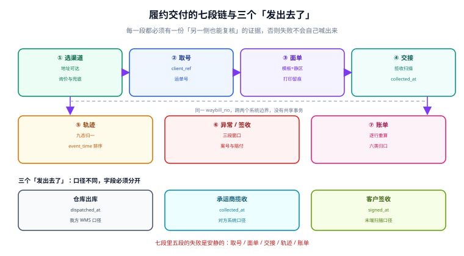

# 履约交付与承运商集成工程：总览、七段链与三个「发出去了」

**包裹离开仓库之后，系统里发生的事才是这一册的主题。**「发货」在订单侧是一个状态，在履约侧是七段动作：取号、打印面单、交接扫描、揽收、转运、签收、账单核对。这七段横跨**你自己的系统**与**承运商的系统**两个边界，中间没有共享事务。

一句话定位：本册回答「一单货从出库到结案，哪些动作必须在哪一侧留下证据，以及每一段失败时你有多久能发现」。



本页判据族 `LGO-A` ~ `LGO-H`，共 8 条；整个专题九个判据族共 72 条，定义在 `docs/Backend/ShippingCarrier/` 各页的「本页判据」一节。

## 为什么这七段必须单独成册

订单状态机管的是「订单在业务上走到哪一步」，库存管的是「同一件货不能卖两次」，都对**包裹在物理世界里的位置**没有发言权。而这七段里有一条共同的危险性质：

::: danger 注意
**七段里有五段的失败是安静的。** 取号成功但面单没打（系统里有一张运单，包裹上什么都没有）；面单打了但没交接扫描（系统认为已发货，承运商认为没收到）；轨迹停在「运输中」（既没到也没丢）；异常件没人登记（客户来问才发现）；账单被追收（运费多付了，当月没人对账）。这五段都不会抛异常、不会报警、不会让订单状态变红——**它们只会在月底的账单和客户的投诉里出现。**
:::

于是本册的写法是：**每一段都必须有一份「另一侧也能复核」的证据**，而不是只在自己库里写一个状态。所谓证据是有具体形态的：运单号、面单打印记录、交接扫描时间、轨迹 `event_time`、异常案号、账单行金额。

## 三个「发出去了」必须分开定义

「发了」这个词在三个角色嘴里意思完全不同，把它们混成一个字段是所有交付事故的起点：

| 口径 | 谁说的 | 判据 | 失败后果 |
| --- | --- | --- | --- |
| 仓库出库 | 你的 WMS | 出库单 + 包裹与面单一一对应 | 少发、错发，且订单侧已显示「已发货」 |
| 承运商揽收 | 承运商 | 揽收扫描（`COLLECTED`） | 包裹在月台上过夜，系统看不出 |
| 客户签收 | 承运商末端 | 签收扫描（`SIGNED`） | 「显示已签收但客户说没收到」 |

三个口径对应三个**不同的时间戳字段**，不能用一个 `shipped_at` 代替。工程上的写法是：`shipment.dispatched_at`、`waybill.collected_at`、`waybill.signed_at` 三个字段各自独立，**并且各自允许为空**——允许为空是刻意的，它让「哪一段还没发生」变成可查询的事实。

::: tip 一句话判断设计对不对
如果一条 SQL 能同时回答「这单发出去了吗、承运商收到了吗、客户签收了吗」，这三个字段就是分开的；如果只能回答一个「已发货」，那么下一个客服电话就会问出你答不上来的问题。
:::

## 七段链：每段的产出、失败形态与证据

| 段 | 动作 | 产出物 | 失败是否安静 | 可复核的证据 |
| --- | --- | --- | --- | --- |
| ① 选渠道 | 地址校验 + 询价 | 渠道与产品决定 | 半安静（贵了不报错） | 询价快照（`rate_quote`）与选定理由 |
| ② 取号 | 调承运商下单接口 | 运单号（`waybill_no`） | 安静 | 承运商返回的 `waybill_no` + 幂等键 |
| ③ 面单 | 渲染 + 打印 | 打印记录（`print_log`） | 安静 | 打印序号、模板版本、打印机号 |
| ④ 交接 | 揽收扫描 | `collected_at` | 安静 | 揽收轨迹节点 |
| ⑤ 轨迹 | 拉取/接收状态 | `track_event` | 安静（停在中间态） | `event_time` + 去重键 |
| ⑥ 签收/异常 | 签收或登记异常 | `signed_at` / `exception_case` | 会喊（客户来问） | 签收节点、案号 |
| ⑦ 账单 | 承运商结算 | `carrier_bill_line` | 安静 | 逐行金额与重算金额 |

七段的关系不是流水线而是**两条独立的账**：前五段是「物流事实」，第六、七段是「钱与责任」。它们共用 `waybill_no` 这一个键，而 `waybill_no` 是**承运商发的**，不是你生成的——所以它天然是外部主键，任何本地唯一约束都要允许「同一单号对应多条本地记录」的极端情况（例如承运商侧作废重发）。

## 四层单据模型：shipment / parcel / waybill / track_event

一单拆成两件、两件走不同承运商、其中一件被退回——这类结构只有分层才能表达：

```text
shipment（一次发货意图，1 个）
  └─ parcel（物理包裹，1..n 个）
       ├─ waybill（运单号，1..n 个，一包裹可能改单/作废重发）
       │    ├─ label_print（打印记录，1..n 次）
       │    └─ track_event（轨迹节点，0..n 条）
       └─ exception_case（异常案，0..n 个）
```

对应的最小 DDL（PostgreSQL）：

```sql
create table shipment (
  shipment_id    bigserial primary key,
  order_id       bigint      not null,
  warehouse_id   bigint      not null,
  status         text        not null default 'CREATED'
                 check (status in ('CREATED','HANDED_OVER','IN_TRANSIT','DELIVERED','CLOSED','CANCELLED')),
  dispatched_at  timestamptz,              -- 仓库出库（我方口径）
  closed_at      timestamptz,
  created_at     timestamptz not null default now()
);

create table parcel (
  parcel_id      bigserial primary key,
  shipment_id    bigint not null references shipment(shipment_id),
  parcel_no      int    not null,           -- 子母件序号，1 开始
  parent_no      int,                       -- 母件序号，子件指向母件
  real_kg        numeric(10,3),
  length_cm      numeric(8,2),
  width_cm       numeric(8,2),
  height_cm      numeric(8,2),
  measured_at    timestamptz,               -- 仓内实测时间（争议时唯一证据）
  unique (shipment_id, parcel_no)
);

create table waybill (
  waybill_id     bigserial primary key,
  parcel_id      bigint not null references parcel(parcel_id),
  waybill_no     text   not null,
  carrier_code   text   not null,
  product_code   text   not null,
  client_ref     text   not null,           -- 幂等键：我方生成的请求号
  state          text   not null default 'CREATED',
  collected_at   timestamptz,               -- 承运商口径：揽收
  signed_at      timestamptz,               -- 客户口径：签收
  voided_at      timestamptz,               -- 作废时间
  unique (carrier_code, waybill_no),
  unique (client_ref)                       -- 取号幂等的唯一守卫
);
```

::: warning 说明
`unique (client_ref)` 这一条不是「优化」，而是**取号段的全部正确性**。本机实测（1,000 单、接口超时后重投 3 次）：没有这条约束时表里落 **3,000 行**，且 **1,000 单全部拿到多个运单号**；加上约束后是 **1,000 行**、每单一个号。多出来的号不是「多打一张面单」这么轻——它在承运商侧是真实存在的运单，会对应真实的揽收与账单。细节见「取号契约」一页。
:::

## 五个角色的边界与三个必失接缝

交付事故的归属纠纷，几乎全部来自「这段谁负责」没有写死：

| 角色 | 负责到哪 | 不负责 |
| --- | --- | --- |
| 仓库 | 出库、称重量方、贴标、交接扫描 | 揽收之后的位置 |
| 承运商 | 揽收之后的运输与末端派送 | 面单内容是否正确、地址是否笔误 |
| 平台（本系统） | 单据一致性、状态归一、对账 | 物理运输、赔付裁定 |
| 客服 | 受理、登记异常、对客户口径 | 判定丢件（需要承运商确认） |
| 财务 | 账单核对、争议申诉、付款 | 单票的物理事实 |

三个必失接缝：

1. **面单内容 vs 承运商数据**：面单上的地址改了但接口里的地址没改，包裹会被送到旧地址。判据是「打印记录的内容哈希 == 取号请求的内容哈希」。
2. **交接扫描 vs 出库时间**：出库了但没扫，承运商不认；扫了但没出库，WMS 账不平。判据是「`dispatched_at` 与首个 `COLLECTED` 节点的间隔有上界并告警」。
3. **轨迹末态 vs 订单状态**：轨迹说签收、订单还停在「运输中」，或反过来。判据是「`signed_at` 非空时 `shipment.status` 必须是 `DELIVERED`」，这条必须是数据库级或对账级的一致性检查，而不是应用代码里的两句 `update`。

## 度量：五个率、四个分母

交付的运营指标最容易在分母上做手脚，本册固定五个率、每个都写明分母：

| 指标 | 分子 | 分母 | 本机读数（非生产压测） |
| --- | --- | --- | --- |
| 揽收及时率 | 承诺时点前有 `COLLECTED` | 已出库包裹 | — |
| 时效达成率 | 签收日 ≤ 承诺日 | **已签收**包裹 | **55.19%**（承诺日口径） |
| 时效达成率（承运商口径） | 承运商回传「按时」 | 已签收包裹 | **63.12%**（同一批单，高 **7.93 个点**） |
| 异常件率 | 有 `exception_case` | 已出库包裹 | — |
| 账单差异率 | 重算与账单不一致的行 | 账单行数 | **7.50%**（2,000 行里 150 行） |

同一批 5,000 单里三个分母算出三个数：**承诺日口径 55.19%**、**承运商回传 63.12%**、**若用发货量当分母则只有 53.90%**（把还没签收的直接算成不达标）。三个数都「没错」，但它们不能放在同一张趋势图上——一张图混用两个口径，会让人误以为服务质量突然变好或变坏。

::: danger 注意
**「承运商回传说按时」不能直接当我方的达成率对外报。** 承运商的「按时」是按它自己的产品承诺算的（可能比你对客户的承诺宽一天），而客户认的是你对他的承诺。对外只能用承诺日口径；承运商口径只用于**和承运商结算考核**。两者差 7.93 个点，谁也不该被抹平。
:::

## 与其他专题的分工

| 这件事 | 本册负责 | 交给谁 |
| --- | --- | --- |
| 订单状态迁移 | 只到「已发货 / 已签收」两个事件 | [订单状态机](../../Ecommerce/OrderStateMachine/index.md) |
| 库存预占与拆包 | 拆包之后的包裹与运单 | [库存与预占](../../Ecommerce/Inventory/index.md) |
| 运费作为成本入账 | 只给出行级金额 | [会计分录与结算](../../Ledger/index.md) |
| 承运商账单与银行流水对账 | 承运商侧逐行差异 | [对账与差异归因](../../Ledger/Reconciliation/index.md) |
| 客户投诉受理 | 只登记异常案并回写 | [客服工单与 SLA](../../SupportTicket/index.md) |
| 通知「已发货」 | 只发事件 | [消息通知与触达](../../NotificationDelivery/index.md) |
| 地址标准化与坐标 | 只做可达判断 | [地理编码与围栏](../../../DB/GeoMap/index.md) |
| 运费账单文件的解析 | 只消费解析后的行 | [批量数据交换](../../BulkDataExchange/index.md) |
| 供应商侧的运输采购 | 只到承运商合同价 | [采购到付款](../../ProcureToPay/index.md) |

## 本页判据

| 判据 | 看什么现象 | 判成什么 | 不满足时改哪里 |
| --- | --- | --- | --- |
| `LGO-A` | `shipment` / `parcel` / `waybill` / `track_event` 四层分开建模 | 结构可表达拆包与改单 | 拆表，`waybill` 允许一包裹多行（含作废行） |
| `LGO-B` | 出库、揽收、签收三个时间戳各自独立且允许为空 | 三段可分别查询 | 加 `dispatched_at` / `collected_at` / `signed_at` |
| `LGO-C` | 每段都有「另一侧可复核」的证据字段 | 争议可举证 | 打印记录、`client_ref`、`event_time` 落库 |
| `LGO-D` | 七段中「失败是否安静」被显式登记 | 监控覆盖到安静段 | 给安静段各配一条对账或阈值告警 |
| `LGO-E` | 时效达成率写明分母（签收/发货），两口径不混用 | 指标可解释 | 报表按分母分列，禁止合并 |
| `LGO-F` | `signed_at` 非空 ⇒ `shipment.status = 'DELIVERED'` | 状态与轨迹一致 | 落一致性检查（对账任务或触发器） |
| `LGO-G` | `dispatched_at` 与首个 `COLLECTED` 的间隔有上界 | 漏扫可发现 | 设阈值（如 24h）并出日报 |
| `LGO-H` | 每个角色边界在文档与权限里写死 | 归属可判 | 角色权限表 + 工单分派规则 |

## 验证方式

四层模型的正确性可以只用一条 SQL 自查（不依赖应用代码）：

```sql
-- 1) 违反了「签收 ⇒ DELIVERED」的运单（LGO-F）
select w.waybill_no, w.signed_at, s.status
from waybill w
join parcel p   on p.parcel_id = w.parcel_id
join shipment s on s.shipment_id = p.shipment_id
where w.signed_at is not null
  and s.status <> 'DELIVERED'
  and w.voided_at is null;
```

预期输出：**0 行**。有行说明存在「轨迹签收但订单没推进」的状态撕裂，通常是轨迹回写失败或订单侧更新被吞。

```sql
-- 2) 出库超过 24 小时仍无揽收扫描的包裹（LGO-G）
select s.shipment_id, p.parcel_no, w.waybill_no, s.dispatched_at
from shipment s
join parcel p  on p.shipment_id = s.shipment_id
left join waybill w on w.parcel_id = p.parcel_id
where s.dispatched_at < now() - interval '24 hour'
  and (w.collected_at is null or w.collected_at > s.dispatched_at + interval '24 hour')
order by s.dispatched_at;
```

预期输出：正常运营下应 **< 出库量的 1%**；若突然变成两位数百分比，先查交接扫描设备或承运商揽收班次，而不是查代码。

```sql
-- 3) 时效达成率两个口径并列（LGO-E）
select count(*) filter (where signed_at is not null)                              as signed_cnt,
       round(100.0 * count(*) filter (where signed_at::date <= promise_date)
             / nullif(count(*) filter (where signed_at is not null), 0), 2)       as ontime_promise_pct,
       round(100.0 * count(*) filter (where carrier_ontime is true)
             / nullif(count(*) filter (where signed_at is not null), 0), 2)       as ontime_carrier_pct
from shipment s join waybill w on w.parcel_id = any (
  select parcel_id from parcel where shipment_id = s.shipment_id);
```

预期输出：两列百分比**不相等**（本机 55.19% 对 63.12%）。若两列完全相同，说明 `carrier_ontime` 是照抄我方判定写的，这个字段没有信息量。

## 参考资料

- 国家邮政局《快递电子运单》国家标准解读（GB/T 41833-2022 的规格与区域划分来源）：<https://www.spb.gov.cn/gjyzj/c100201/202304/2b0e85d033284333a841e545e216c5af.shtml>
- GS1《Logistic Label Guideline》（静区 10X、`GS1-128` 的 X 尺寸区间与条码高度的规范性要求）：<https://www-st.gs1.org/docs/tl/GS1_Logistic_Label_Guideline.pdf>
- 顺丰开放平台《国内丰密电子面单打印规则》（面单字段与脱敏口径的实务参考）：<https://open.sf-express.com/InternalWaybillGuide>
