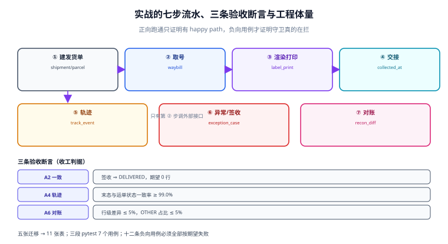

# 实战：一单从取号到对账跑通七段

**这一页是可执行的最小闭环**：一个包裹从出库到结案，七段动作各自落一张表、各有一条验收断言。全部命令都能在本机跑（PostgreSQL 或兼容的 SQLite 变体），不依赖任何承运商真实接口——外部接口用一张「模拟承运商」的表替代。

一句话定位：给出一套能照着建起来的最小工程，跑完之后你能回答「这单现在在哪、花了多少钱、错了哪一段」。



本页判据族 `LGP-A` ~ `LGP-H`，共 8 条。

## 工程骨架：七个目录与一条边界

```text
carrier-delivery/
├─ contracts/          # 请求/响应与账单文件的契约（改它要走评审）
├─ domain/             # 状态归一、承诺日、计费重：纯函数，可单测
├─ adapters/           # 承运商适配（取号/打印/轨迹/账单各一个）
├─ workers/            # 轨迹拉取、异常扫描、对账三个定时任务
├─ api/                # 对内的发货与查询接口
├─ migrations/         # 五个迁移，见下
└─ tests/              # 单测 + 集成 + 负向
```

判据是**依赖方向**：`api → domain ← adapters`，`domain` 不 import 任何 `adapters`。这条边界决定了两件事：换承运商不动业务规则；业务规则可以脱库单测（本页的三段 pytest 全部只测 `domain`）。

## 五个迁移：从单据到钱的次序

顺序不能反，因为后面的表引用前面的键：

| 迁移 | 建什么 | 关键约束 |
| --- | --- | --- |
| `001_shipment` | `shipment` / `parcel` | `unique(shipment_id, parcel_no)` |
| `002_waybill` | `waybill` / `waybill_pool` / `order_request` | `unique(client_ref)`、`unique(carrier_code, waybill_no)` |
| `003_label` | `label_template` / `label_print` | `unique(waybill_no, seq)` |
| `004_track` | `track_event` / `promise` | `unique(waybill_no, event_time, state_norm)` |
| `005_money` | `exception_case` / `claim` / `carrier_bill_line` / `recon_diff` | `unique(waybill_no, kind)`、`unique(case_id, claim_type)` |

```shell
# 建库并跑迁移（PostgreSQL）
createdb carrier_dev
for f in migrations/00*.sql; do
  psql -v ON_ERROR_STOP=1 -d carrier_dev -f "$f" || exit 1
done
psql -d carrier_dev -c "\dt" | tail -n +4 | wc -l
```

预期输出：**11**（十一张表）。少于 11 说明有迁移没执行，多于 11 说明上一次的残留没清（先 `dropdb` 再建）。

## 七步流水：每一步的输入、输出与断言

| 步 | 动作 | 输入 | 输出 | 断言 |
| --- | --- | --- | --- | --- |
| 1 | 建发货单 | 订单 + 包裹 | `shipment` / `parcel` | `dispatched_at` 非空后不允许改包裹数 |
| 2 | 取号 | `LabelRequest` | `waybill_no` | 同一 `client_ref` 只有一行 |
| 3 | 渲染打印 | 模板 + 数据 | `label_print` | 数据哈希 == 请求哈希 |
| 4 | 交接扫描 | 揽收节点 | `collected_at` | 出库到揽收 ≤ 24h |
| 5 | 轨迹归一 | 原始节点 | `track_event` → 末态 | 末态按 `event_time` |
| 6 | 异常/签收 | 末态 + 承诺日 | `exception_case` / `signed_at` | 签收 ⇒ `DELIVERED` |
| 7 | 账单核对 | 账单行 | `recon_diff` | 逐行差集，`OTHER ≤ 5%` |

**把七步写成一条可重放的脚本**（每一步幂等，重复执行不产生副作用）：

```python
def run_pipeline(shipment_id: int, carrier) -> dict:
    """七步流水：每步幂等，失败即返回已完成部分。"""
    ctx = {"shipment_id": shipment_id}
    for step in (create_shipment, take_waybill, render_label, hand_over,
                 sync_tracking, settle_state, reconcile_bill):
        r = step(ctx, carrier)          # 每步内部用唯一键做幂等
        if not r.ok:
            ctx["failed_at"] = step.__name__
            return ctx
        ctx.update(r.data)
    return ctx
```

::: warning 说明
**七步里只有第 2 步会调外部接口，其他六步都是本地事务。** 这个比例是有意为之：把外部依赖压到一个点上，重放时只需要处理这一个点的幂等，其他六步天然可重跑。反过来（每步都调接口）会让「重放」变成「重新下一遍单」。
:::

## 十二条负向用例：必须失败才算通过

正向跑通只证明「happy path 存在」，负向用例才证明**守卫真的在拦**：

| 编号 | 构造 | 期望结果 |
| --- | --- | --- |
| `P1` | 同一 `client_ref` 取号两次 | 第二次冲突，不新建运单 |
| `P2` | 拆包两件但 `parent_no` 为空 | 插入被拒 |
| `P3` | 面单数据哈希与请求不一致 | 渲染前拒绝打印 |
| `P4` | `label_print` 同一 `seq` 插两次 | 唯一约束冲突 |
| `P5` | 轨迹重推同一节点两次 | 只留一行 |
| `P6` | 轨迹乱序（派送中晚于签收到达） | 末态仍为 `SIGNED` |
| `P7` | 未映射的原始状态词 | 落 `UNKNOWN` 并告警，不静默丢 |
| `P8` | 已 `USED` 的号池行被作废 | 状态机拒绝 |
| `P9` | 24h 内无扫描就立案 | 停在 `OBSERVE`，不通知客户 |
| `P10` | 同一运单开两个同类异常案 | 唯一约束冲突 |
| `P11` | 赔付没有 `case_id` | 外键失败 |
| `P12` | 账单同一运单两行且金额相同 | 进 `DUPLICATE` 归口，不入账 |

```sql
-- P5：重推同一节点，两次调用后行数不变
insert into track_event (waybill_no, state_norm, state_raw, event_time)
values ('SF0001', 'SIGNED', '已签收', '2026-11-01 10:00:00+08')
on conflict (waybill_no, event_time, state_norm) do nothing;
insert into track_event (waybill_no, state_norm, state_raw, event_time)
values ('SF0001', 'SIGNED', '本人签收', '2026-11-01 10:00:00+08')
on conflict (waybill_no, event_time, state_norm) do nothing;

select count(*) from track_event where waybill_no = 'SF0001';
```

预期输出：**1**。若为 2，说明唯一键里少了 `state_norm`（两个原始词不同）或没落唯一约束。

## 三段 pytest：只测 domain，不连库

第一段：计费重与取整

```python
from decimal import Decimal
from domain.weight import chargeable_kg

def test_volumetric_wins():
    # 40 × 30 × 20 cm / 6000 = 4.0 kg，实重 2.4 kg
    assert chargeable_kg(Decimal("2.4"), 40, 30, 20, divisor=6000) == Decimal("4.0")

def test_ceil_half_kg():
    # 4.1 → 4.5（向上取整到 0.5），不是 4.0
    assert chargeable_kg(Decimal("4.1"), 10, 10, 10, divisor=6000) == Decimal("4.5")

def test_round_would_undercharge():
    assert chargeable_kg(Decimal("4.1"), 10, 10, 10, divisor=6000, mode="round") == Decimal("4.0")
```

第二段：承诺日

```python
import datetime as dt
from domain.promise import add_workdays

WORK = {dt.date(2026, 10, 9), dt.date(2026, 10, 10)}   # 含调休上班日

def is_workday(d):
    if d in WORK:
        return True
    return d.weekday() < 5 and not (dt.date(2026, 10, 1) <= d <= dt.date(2026, 10, 7))

def test_national_day_skipped():
    # 9-30 起算 3 个工作日：10-1~10-7 全放假，落到 10-12
    assert add_workdays(dt.date(2026, 9, 30), 3, is_workday) == dt.date(2026, 10, 12)

def test_makeup_workday_counted():
    # 10-9 是调休上班日，应计入
    assert add_workdays(dt.date(2026, 10, 8), 1, is_workday) == dt.date(2026, 10, 9)
```

第三段：末态收敛

```python
from domain.track import last_state

def test_signed_beats_late_transit():
    events = [
        ("SIGNED", "2026-11-01T10:00:00"),
        ("OUT_FOR_DELIVERY", "2026-11-01T15:00:00"),   # 晚到，但语义更早
    ]
    assert last_state(events) == "SIGNED"

def test_returned_beats_signed_when_later_day():
    events = [
        ("SIGNED", "2026-11-01T10:00:00"),
        ("RETURNED", "2026-11-03T09:00:00"),
    ]
    assert last_state(events) == "RETURNED"
```

```shell
pytest -q tests/domain
```

预期输出：**7 passed**（三段共 7 个用例）。第一个用例若失败，说明 `max(real, vol)` 被写成了 `min`——这是本册最常见的一处笔误。

## 六条验收 SQL 与目标输出

```sql
-- A1 幂等：同一 client_ref 无多行
select client_ref from waybill where voided_at is null
group by client_ref having count(*) > 1;                       -- 期望 0 行

-- A2 一致性：签收 ⇒ DELIVERED
select w.waybill_no from waybill w
join parcel p on p.parcel_id = w.parcel_id
join shipment s on s.shipment_id = p.shipment_id
where w.signed_at is not null and s.status <> 'DELIVERED';      -- 期望 0 行

-- A3 面单：首打内容哈希 == 请求哈希
select w.waybill_no from waybill w
join label_print lp on lp.waybill_no = w.waybill_no and lp.seq = 1
where lp.data_sha256 <> w.request_sha256;                       -- 期望 0 行

-- A4 轨迹：末态与运单状态一致率
select round(100.0 * count(*) filter (where w.state = l.state_norm)
             / nullif(count(*), 0), 2) as agree_pct
from waybill w join lateral (
  select state_norm from track_event t where t.waybill_no = w.waybill_no
  order by event_time desc limit 1) l on true;                  -- 期望 ≥ 99.0

-- A5 异常：立案但后续签收的误判率
select round(100.0 * count(*) filter (where w.signed_at is not null)
             / nullif(count(*), 0), 2) as false_positive_pct
from exception_case c join waybill w using (waybill_no)
where c.kind = 'MISSING' and c.stage = 'FILED';                 -- 期望 ≤ 20.0

-- A6 对账：行级差异率与 OTHER 占比
select round(100.0 * count(*) filter (where abs(amount - recalc_amount) > 0.01)
             / nullif(count(*), 0), 2) as diff_pct,
       round(100.0 * count(*) filter (where diff_kind = 'OTHER')
             / nullif(count(*), 0), 2) as other_pct
from carrier_bill_line;                                         -- 期望 diff_pct ≤ 5, other_pct ≤ 5
```

::: danger 注意
**A4 的期望值不是 100%。** 总有一小部分运单的末态还没回写（轨迹晚到、任务排队），把它写成「必须 100%」会让这条断言天天红，最后被注释掉。**给一致性断言留一个上界，比要求完美更能长期活着。**
:::

## 本页判据

| 判据 | 看什么现象 | 判成什么 | 不满足时改哪里 |
| --- | --- | --- | --- |
| `LGP-A` | 目录依赖方向为 `api → domain ← adapters` | 可脱库单测 | `domain` 不 import `adapters` |
| `LGP-B` | 五个迁移按 1→5 顺序可重复执行 | 环境可从零复现 | 迁移只前进，不写回滚逻辑 |
| `LGP-C` | 七步流水每步幂等，可整体重放 | 重放不放大 | 每步用唯一键 + `on conflict` |
| `LGP-D` | 十二条负向用例全部按期望失败 | 守卫真的在拦 | 逐条补断言，失败即断言缺失 |
| `LGP-E` | 三段 pytest 只测 `domain`，7 个用例全绿 | 规则可验证 | 把规则搬进 `domain`，别写在 `api` |
| `LGP-F` | 六条验收 SQL 有明确目标值与容差 | 收工有判据 | 容差写进文档，不用「看起来对」 |
| `LGP-G` | 一致性断言带上界（如 ≥ 99%） | 断言能长期活着 | 给阈值留余量并登记原因 |
| `LGP-H` | 外部依赖只在第 2 步，其余六步本地事务 | 故障面小 | 把接口调用收敛到一处 |

## 验证方式

```shell
# 1) 迁移完整性：表数应为 11
psql -d carrier_dev -Atc "select count(*) from information_schema.tables where table_schema='public'"
```

预期输出：**11**。

```shell
# 2) 负向用例批量跑（每条都应返回非 0 行或被约束拒绝）
psql -v ON_ERROR_STOP=0 -d carrier_dev -f tests/negative/P1_p2_p12.sql 2>&1 | grep -c 'ERROR'
```

预期输出：**≥ 3**（P1 与 P12 是「查询返回行」型的断言，不一定抛错；P2 必须抛 `violates not-null`）。若为 0，说明约束没建。

```shell
# 3) 三段单测
pytest -q tests/domain 2>&1 | tail -2
```

预期输出：`7 passed`。**只跑 `pytest -q` 不看 tail 会把 `3 failed` 当成通过**——别只看退出码，看最后一行。

## 参考资料

- PostgreSQL 文档《Concurrency Control：Advisory Locks and FOR UPDATE SKIP LOCKED》：<https://www.postgresql.org/docs/current/explicit-locking.html>
- 顺丰开放平台《接入指南》（取号、打印、路由、对账四类接口的调用顺序）：<https://open.sf-express.com/>
- 《快递电子运单》国家标准解读（面单尺寸与区域，实战模板的合规下限）：<https://www.spb.gov.cn/gjyzj/c100201/202304/2b0e85d033284333a841e545e216c5af.shtml>
