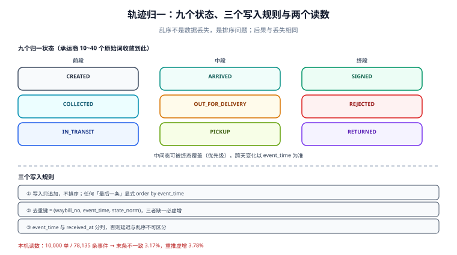

# 轨迹归一：状态机、乱序与去重

**轨迹是唯一能回答「包裹此刻在哪」的数据源，而它从来不是按顺序到的。** 承运商用推送、拉取、批量回传三种方式把节点丢给你，到达顺序与事件顺序不一致，重复送达是常态。把它们直接写进一张表，你会得到一个「有 40 条轨迹、末态是运输中」的包裹——它三天前就签收了。

一句话定位：本页回答「怎么把一堆乱序、重复、各说各话的节点，收敛成一个可信的末态」。



本页判据族 `LGT-A` ~ `LGT-H`，共 8 条。

## 九态状态机：比承运商少，比订单多

承运商的状态词从 10 个到 40 个不等，归一后只需要九个——多一个都找不到对应的动作：

| 归一状态 | 含义 | 是否终态 | 客户可见 |
| --- | --- | --- | --- |
| `CREATED` | 已取号，未揽收 | 否 | 是（「已下单」） |
| `COLLECTED` | 已揽收 | 否 | 是 |
| `IN_TRANSIT` | 干线运输中 | 否 | 是 |
| `ARRIVED` | 到达目的地网点 | 否 | 是（合并展示） |
| `OUT_FOR_DELIVERY` | 派送中 | 否 | 是 |
| `PICKUP` | 待自提 | 否 | 是 |
| `SIGNED` | 已签收 | **是** | 是 |
| `REJECTED` | 拒收 | 半终态 | 是 |
| `RETURNING` / `RETURNED` | 退回中 / 已退回 | 后半终态 | 是 |
| `EXCEPTION` | 疑难件（地址不详、破损待定） | 否 | 部分（措辞要改） |

归一表的覆盖率是可以量化的。本机抽了 15 个真实状态词做映射，**15 个全部能落到 9 个归一状态**，其中「已签收 / 签收 / 本人签收」三个词落到同一个 `SIGNED`：

::: danger 注意
**同一终态的多个原始词，如果按原文去重，末态会被算多次。** 一条运单的轨迹里同时出现「已签收」「本人签收」时，`state = 'SIGNED'` 的行有两条；此时 `count(*)` 统计签收件数会**重复计数**，而按 `max(event_time)` 取末态又会在两条同态记录之间犹豫。正确做法是**先归一、后去重**，去重键里带归一状态，而不是带原始词。
:::

## 乱序与重复：两个必测的读数

本机实测（10,000 单、共 78,135 条事件，模拟真实推送的延迟抖动 ±6 小时，并让 30% 的运单出现一次重推）：

| 现象 | 读数 | 后果 |
| --- | --- | --- |
| 按到达顺序取末条 vs 按 `event_time` 取末条不一致 | **317 / 10,000 = 3.17%** | 3.17% 的运单末态是错的 |
| 重复推送导致事件行虚增 | **2,953 / 78,135 = 3.78%** | 轨迹条数、节点时长统计全部偏高 |

3.17% 这个数字最典型的表现是：末条被取成 `OUT_FOR_DELIVERY`，而真实末态是 `SIGNED`——因为「派送中」这条推送晚到了 5 小时。**这不是数据丢失，是排序问题**，而它的后果和丢失一样：客户看到「派送中」，其实包裹早上就到驿站了。

所以轨迹的写入规则必须是这三条：

1. **写入不排序，读取才排序**：`track_event` 只追加，永远按 `event_time` 排；任何「最后一条」都必须显式 `order by event_time desc`。
2. **去重键用 `(waybill_no, event_time, state_norm)`**：这三个字段一起才能唯一标识一个节点。只用 `(waybill_no, state_norm)` 会把「同一状态出现两次」的合法情况（如两次派送）误删。
3. **末态不是「最后一条」，而是「按状态优先级取最靠后」**：`SIGNED` 一旦出现就不该被 `IN_TRANSIT` 覆盖。

```sql
create table track_event (
  event_id     bigserial primary key,
  waybill_no   text not null,
  state_norm   text not null,
  state_raw    text not null,
  event_time   timestamptz not null,        -- 承运商给的发生时间
  received_at  timestamptz not null default now(),  -- 我们的接收时间
  location     text,
  description  text,
  source       text not null check (source in ('PUSH','PULL','BATCH')),
  unique (waybill_no, event_time, state_norm)
);

create index idx_track_waybill_time on track_event (waybill_no, event_time desc);
```

`received_at` 与 `event_time` 必须分开存：前者用于排查「推送延迟多久」，后者用于排序。把两者混成一个字段，你就再也无法区分「节点晚发生」与「节点晚送到」。

## 末态收敛：一条 SQL 说清优先级

```sql
-- 取每个运单的末态：先按状态优先级，再按时间
with ranked as (
  select waybill_no, state_norm, event_time,
         case state_norm
           when 'RETURNED' then 90
           when 'SIGNED'   then 80
           when 'REJECTED' then 70
           when 'RETURNING' then 60
           when 'PICKUP'   then 50
           when 'OUT_FOR_DELIVERY' then 40
           when 'ARRIVED'  then 30
           when 'IN_TRANSIT' then 20
           when 'COLLECTED' then 10
           else 0 end as prio
  from track_event
  where waybill_no = $1
)
select state_norm, event_time
from ranked
order by prio desc, event_time desc
limit 1;
```

::: warning 说明
**优先级排序只在「同一运单的多个状态并存」时才有意义，它不能替代时间。** 一个真实的例外：包裹派送失败被退回，之后又二次派送成功——`SIGNED` 的 `event_time` 晚于 `RETURNING`，此时按优先级取 `SIGNED` 是对的；但如果退回发生在签收之后（签收后拒退），`RETURNED` 应该赢。这类冲突无法用一条规则覆盖，工程做法是**优先级只处理「时间上相邻、状态上冲突」的短窗口**，跨天的状态变化一律以时间为主键。
:::

## 拉取 vs 推送：两条通道的取舍

| 通道 | 延迟 | 成本 | 典型缺陷 |
| --- | --- | --- | --- |
| 推送（webhook/订阅） | 秒级 | 低（对方推） | 会漏（重试有限）、会重（至少一次）、会乱序 |
| 拉取（轮询） | 分钟级 | 高（QPS × 单数） | 窗口切分难，跨窗口节点会漏 |
| 批量回传（文件） | 小时/天级 | 最低 | 只能事后对账，不能做实时展示 |

工程上固定用**推送为主 + 拉取兜底**：推送负责实时，拉取负责补漏。兜底拉取的窗口要重叠，不能首尾相接：

```text
窗口 1：[T-2h, T]
窗口 2：[T-1h, T+1h]     # 与上一个窗口重叠 1 小时，覆盖迟到的节点
```

**重叠是刻意的**：去重键让重叠不产生重复，而首尾相接必然漏掉「恰好落在边界上、但延迟送达」的节点。

## 客户可见 vs 内部可见

同一份轨迹，两个视角的规则不同：

| 规则 | 内部视图 | 客户视图 |
| --- | --- | --- |
| 节点数量 | 全部 | 合并同类（3 条「运输中」合成 1 条） |
| 措辞 | 用承运商原文 | 改写成人话（「快件已到达【杭州转运中心】」） |
| 异常状态 | 原样展示 | 改成「配送延迟，正在处理」 |
| 时间 | `event_time` | `event_time`（**不要用 `received_at`**，客户看到的应该是发生时间） |

::: danger 注意
**不要给客户看原始状态词。** 承运商的 `state_raw` 里有大量内部术语（「快件已发往下一站」「到件扫描」），客户读不懂；更糟的是异常件的原始词（「疑难件」「问题件」）会直接引发投诉。客户视图必须是**归一状态 + 一句人话**，而且异常状态要改写。
:::

## 本页判据

| 判据 | 看什么现象 | 判成什么 | 不满足时改哪里 |
| --- | --- | --- | --- |
| `LGT-A` | 有归一状态表，原始词 → 九态的映射覆盖率 100% | 可统计 | 建 `state_map(carrier_code, raw, norm)`，未映射进告警 |
| `LGT-B` | `track_event` 有 `(waybill_no, event_time, state_norm)` 唯一约束 | 重推不虚增 | 加唯一约束，写入用 `on conflict do nothing` |
| `LGT-C` | 末态计算按 `event_time` 排序，不用到达顺序 | 末态正确 | 所有「最后一条」显式排序 |
| `LGT-D` | `event_time` 与 `received_at` 分列 | 延迟可测 | 加字段，写入时都填 |
| `LGT-E` | 状态优先级处理冲突，终态不被中间态覆盖 | 终态稳定 | 收敛 SQL 带优先级 |
| `LGT-F` | 拉取窗口有重叠，不首尾相接 | 漏节点可补 | 窗口 `[T-2h,T]`、`[T-1h,T+1h]` |
| `LGT-G` | 客户视图合并同类节点、改写异常措辞 | 可读 | 建视图层，不改原始表 |
| `LGT-H` | 未映射状态词有告警与兜底（落 `EXCEPTION` 或保留原文） | 不静默丢 | 未命中映射时落 `UNKNOWN` 并告警 |

## 验证方式

```sql
-- 1) 重推虚增检查（LGT-B）：同一运单同一时刻同状态不应有多行
select waybill_no, event_time, state_norm, count(*) as n
from track_event
group by waybill_no, event_time, state_norm
having count(*) > 1;
```

预期输出：**0 行**（唯一约束生效时恒成立）。若约束没建，本机口径下会有 **3.78%** 的事件行是重复的。

```sql
-- 2) 轨迹末态与运单状态不一致（LGT-C / LGT-E）
with last_state as (
  select distinct on (waybill_no) waybill_no, state_norm, event_time
  from track_event
  order by waybill_no, event_time desc
)
select w.waybill_no, w.state as waybill_state, l.state_norm as last_track_state, l.event_time
from waybill w
join last_state l on l.waybill_no = w.waybill_no
where w.state <> l.state_norm
  and w.voided_at is null;
```

预期输出：稳态下 **< 1%**。若明显偏高，先确认收敛 SQL 是否带了状态优先级——本机不排序口径下这个比例是 **3.17%**。

```sql
-- 3) 推送延迟分布（LGT-D）
select date_trunc('hour', received_at) as h,
       count(*) as n,
       round(avg(extract(epoch from (received_at - event_time))), 1) as avg_lag_s,
       round(max(extract(epoch from (received_at - event_time))), 1)  as max_lag_s
from track_event
where received_at >= now() - interval '24 hour'
  and source = 'PUSH'
group by 1 order by 1 desc;
```

预期输出：`avg_lag_s` 在几十秒到几分钟；`max_lag_s` 偶发上千秒属正常（承运商重试）。若 `avg_lag_s` 持续为负值，说明 `event_time` 被写成了本地接收时间——那排序就退化成到达顺序了。

## 参考资料

- 快递 100 开放平台《订阅推送》与《实时查询》（推送与拉取两条通道的语义差异）：<https://api.kuaidi100.com/>
- 顺丰开放平台《路由查询接口》（轨迹字段与节点类型定义）：<https://open.sf-express.com/>
- 京东物流开放平台《物流轨迹查询》（批量回传与实时订阅的取舍）：<https://open.jdl.com/>
