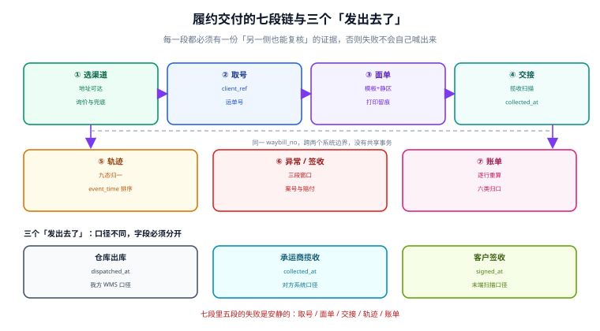

# 履约交付与承运商集成工程

**包裹离仓之后，系统里发生的事才是这一册的主题。** 订单说「已发货」，客户说「没收到」，承运商说「已签收」，财务说「运费涨了」——这四句话描述的是同一个包裹的四个切面，而把它们对齐的唯一办法是：**每一段动作都在另一侧留下可复核的证据**。

这一册覆盖七段链：选渠道、取号、面单、交接、轨迹、异常与签收、账单核对。七段里有五段的失败是安静的（取号重复、面单错址、揽收漏扫、轨迹停在中间态、账单被追收），所以每一段都配一条「怎么发现」的判据，而不是只写「怎么做」。

## 章节

- [总览、七段链与三个「发出去了」](Overview/index.md) —— 四层单据模型、五个角色、必失接缝与度量分母
- [取号契约：幂等、号池与错误分类](LabelAPI/index.md) —— `client_ref` 唯一约束、号池四态、三类错误处置
- [面单渲染：模板、静区与打印留痕](LabelRender/index.md) —— 区域划分、10X 静区、DPI 换算、重打统计
- [选渠道：地址、可达与运价](Sourcing/index.md) —— 计费重、可达三层、地址归一、询价与兜底
- [轨迹归一：状态机、乱序与去重](Tracking/index.md) —— 九态归一、事件排序、推送与拉取的分工
- [异常件与承诺日：超时、丢失与赔付](ExceptionPromise/index.md) —— 三段判定窗口、工作日历、赔付台账
- [承运商账单核对：计费重、附加费与差异归因](BillRecon/index.md) —— 三把尺子、六类归口、申诉窗口
- [实战：一单从取号到对账跑通七段](Practice/index.md) —— 五个迁移、七步流水、十二条负向用例、六条验收 SQL
- [常见问题与分诊](FAQ/index.md) —— 十二行分诊表、十二问、止血五步、术语表

## 判据族一览

九族共 72 条，每页八条（`-A` ~ `-H`），定义在各页「本页判据」一节：

| 页面 | 族 | 约定 | 条数 |
| --- | --- | --- | --- |
| 总览 | `LGO` | 分层建模、三段口径、安静失败登记、度量分母 | 8 |
| 取号契约 | `LGL` | 幂等键、子母件、字段分组、错误三分、号池状态 | 8 |
| 面单渲染 | `LGR` | 模板版本、X 尺寸、静区、内容哈希、打印留痕 | 8 |
| 选渠道 | `LGS` | 计费重、实测尺寸、取整、可达三层、分区版本 | 8 |
| 轨迹归一 | `LGT` | 归一映射、去重键、排序、接收延迟、末态收敛 | 8 |
| 异常与承诺 | `LGX` | 三段窗口、一案一类、工作日历、赔付关联 | 8 |
| 账单核对 | `LGB` | 行级对账、除数与取整、费率生效区间、六类归口 | 8 |
| 实战 | `LGP` | 依赖方向、迁移顺序、幂等重放、负向用例、验收容差 | 8 |
| 常见问题 | `LGQ` | 分诊可定位、读数可回溯、止血顺序、术语易混点 | 8 |

## 与本册相邻的专题

交付横跨订单、库存、账务、客服四个域，本册刻意只写「包裹在物理世界里发生的事」，其余交给相邻专题。下表是唯一的分工口径，遇到判断不清的段落时按它归属：

| 这件事 | 本册负责 | 隔壁专题负责 |
| --- | --- | --- |
| 订单状态迁移 | 只上报「已发货 / 已签收」两个事件 | [订单状态机](../Ecommerce/OrderStateMachine/index.md) |
| 库存预占与拆包决策 | 拆包之后的包裹与运单 | [库存与预占](../Ecommerce/Inventory/index.md) |
| 运费作为成本入账 | 只给出行级金额与差异 | [会计分录与结算](../Ledger/index.md) |
| 承运商账单与银行流水 | 承运商侧逐行差异 | [对账与差异归因](../Ledger/Reconciliation/index.md) |
| 客户投诉受理 | 只登记异常案并回写结果 | [客服工单与 SLA](../SupportTicket/index.md) |
| 「已发货」通知客户 | 只发事件与轨迹摘要 | [消息通知与触达](../NotificationDelivery/index.md) |
| 地址标准化与坐标 | 只做可达性与分区判断 | [地理编码与围栏](../../DB/GeoMap/index.md) |
| 账单文件的解析与校验 | 只消费解析后的行 | [批量数据交换](../BulkDataExchange/index.md) |
| 运输采购与承运商准入 | 只到合同价与线路 | [采购到付款](../ProcureToPay/index.md) |
| 库内拣选、打包与交接 | 从「交到承运商手上」开始 | [仓储作业与波次拣选](../WarehouseOps/index.md) |

一句话区分：**本册把包裹当「一个要去某地的东西」，隔壁各册分别把它当「一个订单状态」「一条库存记录」「一笔成本」「一个客户诉求」**。

## 为什么这里没有版本目录

本册不按 `Spring5/Spring6` 那样建版本目录，三条理由：

1. **换代的是接口与渠道，不是判据。** 承运商从 EDI 换到 API、从纸质面单换到电子面单，`LGT-B`（去重键三要素）与 `LGR-C`（静区 10X）一个字都不用改。
2. **并存差异是「渠道」而不是「代际」。** 同一批包裹会同时走顺丰、京东、通达系，差异是产品代码与字段映射，属于同页的两个分支，不是两套内容线。
3. **可验证的版本差异已经收敛进表格。** 一联/两联的尺寸上限、静区与 X 尺寸、状态词映射，全部在页面里以对照表给出，读者不需要为了一个数字翻两个目录。

真正需要版本目录的是「同一份代码两套写法」——本仓的先例是 [Spring5](../Java/Frame/Spring/Spring5/index.md) / [Spring6](../Java/Frame/Spring/Spring6/index.md)、[Vue2](../../Frontend/Frame/Vue/Vue2/index.md) / [Vue3](../../Frontend/Frame/Vue/Vue3/index.md)，旧版本保留并标注维护状态，不覆盖。

## 阅读路径

| 你的角色 | 建议顺序 |
| --- | --- |
| 后端开发（要接第一个承运商） | 总览 → 取号契约 → 面单渲染 → 实战 |
| 负责事故与客诉 | 总览 → 轨迹归一 → 异常与承诺 → 常见问题 |
| 财务 / 结算 | 总览 → 账单核对 → 选渠道（计费重口径） |
| 技术负责人做选型 | 总览 → 面单渲染（合规） → 账单核对（成本） → 实战（工程骨架） |

## 本机读数的口径说明

本册所有百分比都来自本机脚本（Python 3.13.12 标准库 + SQLite 3，固定种子 `20261102`，脚本不入库、可复跑），**明标「非生产压测」**。三处容易被误读的口径先写在这里：

- **体积重胜出比例依赖包裹结构**：本册总览与取号页用「22% 大件」的分布得到 50.01%，「选渠道」页用的小件分布是 62.39%，两者都对，但不能跨仓比较。
- **时效达成率有两个分母**：承诺日口径 55.19%、承运商回传口径 63.12%，对外只报前者。
- **异常判定的准确率不是越高越好，而是「窗口设对了」的证明**：24 小时一刀切口径的准确率只有 32.53%，三段窗口的意义就是把它压下来。

## 参考资料

- 国家邮政局《快递电子运单》国家标准解读（GB/T 41833-2022）：<https://www.spb.gov.cn/gjyzj/c100201/202304/2b0e85d033284333a841e545e216c5af.shtml>
- GS1《Logistic Label Guideline》：<https://www-st.gs1.org/docs/tl/GS1_Logistic_Label_Guideline.pdf>
- 顺丰开放平台（取号、面单打印、路由查询、对账四类接口）：<https://open.sf-express.com/>
- 京东物流开放平台（产品线路、云打印与结算）：<https://open.jdl.com/>
