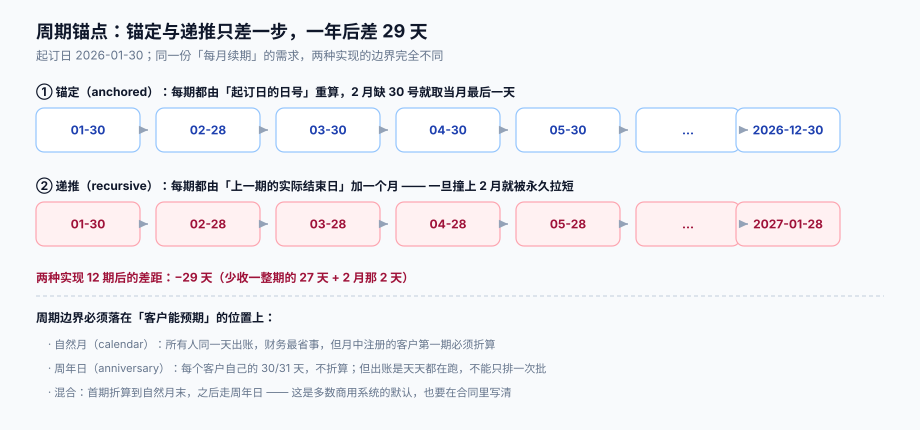

# 周期与闭账：锚点、时区与迟到账

「这个月」在法律上、在客户心里、在数据库里，是三个不同的区间。客户心里是「我 3 月 20 号买的，那就每月 20 号」；财务心里是「自然月，1 号到月底」；数据库里只有一串 UTC 时刻。**周期与闭账这一页要做的，就是把这三者钉死成一个可复算的 `[period_start, period_end)`。**



本页判据族 `SBC-A` ~ `SBC-H`，共 8 条。定义表在第七节。

## 一、四种周期形状

| 形状 | 边界怎么定 | 适合 | 代价 |
| --- | --- | --- | --- |
| **自然月** | 每月 1 日 00:00 ~ 次月 1 日 00:00（本地时区） | 面向大量自助客户，财务对账省事 | 月中注册的客户首期不满一月，必须折算；出账压力集中在一两天 |
| **周年日** | 起订日的「日号」为锚点，逐月推算 | 面向合同客户，账单可预期 | 每天都有客户出账，批处理必须天天跑 |
| **固定天数** | 每 30 天一期，与日历无关 | 国际业务、跨时区简化 | 期数与月份错位，年度对账要额外对齐 |
| **混合** | 首期折算到自然月末，之后转周年日 | 商用系统最常见的默认 | 首期要算两次（折算 + 正常期） |

选哪种是商业决定，但**必须把「锚点」持久化**：`subscription.anchor_day`（1~31）与 `anchor_policy`（`clamp` / `skip`）两个字段。没有它们，每期边界都要从「当前时间倒推」，一旦某期作业晚跑或补跑，边界就会漂。

## 二、锚定与递推：只差一步，一年差 29 天

「每月续期」最容易被写成递推：本期结束日 = 上期结束日 + 1 个月。看似自然，实则会**永久拉短**周期。

以 2026-01-30 起订为例：

| 期数 | 锚定（每期由起订日日号重算） | 递推（上期结束日 + 1 月） |
| --- | --- | --- |
| 第 1 期 | 2026-01-30 | 2026-01-30 |
| 第 2 期 | 2026-02-28（当月无 30 日，取月末） | 2026-02-28 |
| 第 3 期 | 2026-03-30 | **2026-03-28** |
| 第 4 期 | 2026-04-30 | **2026-04-28** |
| 第 12 期 | 2026-12-30 | **2027-01-28** |

第 12 期后两者相差 **29 天**——等于少收一整期（27 天）+ 2 月被压掉的 2 天。而且这个偏差**一旦发生就不可逆**：锚点丢失后，再也无法从递推结果倒推出「本来应该是 30 号」。

```python
# 锚定推算：每期都从 (起订年, 起订月 + n, 起订日) 重算
import calendar, datetime as dt

def period_start(anchor: dt.date, n: int) -> dt.date:
    y, m = anchor.year + (anchor.month - 1 + n) // 12, (anchor.month - 1 + n) % 12 + 1
    day = min(anchor.day, calendar.monthrange(y, m)[1])   # clamp：2 月没有 30 日就取 28/29
    return dt.date(y, m, day)
```

::: danger 注意
1. **不要用「上期结束 + interval '1 month'」算下一期**。PostgreSQL 的 `interval '1 month'` 在 1 月 31 日上加一个月得到 2 月 28 日，再往上加得到 3 月 28 日——正是上表的递推列。锚点必须单独存，每期独立推算。
2. **不要用 `anchor_policy = skip`（跳过没有该日号的月份）而不写进合同**。1 月 31 日起订的客户，2 月直接没有账期，等于一年只收 11 期；客户不会接受，但代码「按日号严格匹配」就是这么实现的。
3. **不要把 `period_end` 存成「下期 `period_start` 减 1 秒」再参与计费**。减法得到的 23:59:59 一旦参与「按秒折算」，会少算 1 秒并让两端都不闭合；统一用**左闭右开**，只在展示层减 1 秒。
:::

## 三、时区：边界属于客户，存储属于 UTC

「每月 1 日 00:00」是客户本地时间。把它写进数据库时必须转 UTC，而转换依赖 IANA 时区库（tzdata）——这意味着**同一个逻辑账期，在不同年份的 UTC 边界可能不同**（夏令时切换）。

| 客户时区 | 本地周期 | UTC 起 | UTC 止 | 备注 |
| --- | --- | --- | --- | --- |
| Asia/Shanghai（UTC+8，无夏令时） | 2026-10-01 ~ 11-01 | 2026-09-30T16:00Z | 2026-10-31T16:00Z | 稳定 |
| America/New_York（有夏令时） | 2026-11-01 ~ 12-01 | 2026-11-01T04:00Z | 2026-12-01T05:00Z | 11-01 结束夏令时，边界偏移变了 |
| Australia/Sydney | 2026-04-01 ~ 05-01 | 2026-03-31T13:00Z | 2026-04-30T14:00Z | 04-05 结束夏令时 |

三个必须写的规则：

1. **账期边界按 `billing_timezone`（客户维度）计算，存储用 `timestamptz`**。用服务器默认时区算边界，是跨区域部署时最常见的一类「账单差一天」。
2. **一个客户的所有账期在同一时区**。中途换时区要显式迁移（并在账单上标注），不能某期按新时区、某期按旧时区。
3. **夏令时当天不是 24 小时**。按天折算的实现在 23 小时/25 小时那天会算错；按秒折算天然正确——这是「按秒」除精度之外的第二个理由。

## 四、闭账：为什么不能「到点就出账」

闭账（close）是「这一期不再接受新的计费输入」的时刻。它必须晚于 `period_end`，因为上游的计量事件会迟到：

| 允许迟到窗口 | 闭账时可见事件 | 漏计事件 | 漏计用量占比 |
| --- | --- | --- | --- |
| 0 小时 | 19,696 / 20,000 | 304 条 | **1.52%** |
| 24 小时 | 19,856 / 20,000 | 144 条 | 0.67% |
| 72 小时 | 20,000 / 20,000 | **0** 条 | 0% |

（本机读数：Python 3.13 + SQLite 3.50.4，20,000 条事件，迟到分布 0~72 小时，闭账时刻 = `period_end`。）

0 小时窗口漏 1.52%，看起来不大，但它是**系统性少收**：每月都漏，客户不会提醒你。72 小时窗口能覆盖本次样本的全部迟到——窗口长度应该由「上游最大重试跨度」决定，而不是拍一个「3 天」。

::: tip 闭账窗口与出账时点要分开写
`period_end`（计费窗口结束）→ `close_at`（不再接受输入）→ `issue_at`（账单发出）→ `due_at`（收款截止）。四个时间点各管一件事，压缩成一个「出账日」的实现，后期加任何一个（比如「账期后 3 天才能发账单」）都要重构。
:::

## 五、迟到账的两种处理，两种代价

窗口用完还有事件进来（消息堆积、客户端离线补传、上游修数据重放），此时只有两条路：

| 做法 | 实现 | 账单侧代价 | 客户侧感受 |
| --- | --- | --- | --- |
| **重开账单**（reissue） | 原账单置 `void`，按新数据生成 `v2`，差额出一张信用票据或补收单 | 影响面大：本机 20,000 条事件里闭账后到达的涉及 **211 / 400 个租户（52.8%）**，即过半账单要重开 | 收到「你的账单已更新」，需要解释 |
| **滚下期**（carryover） | 本期不动，迟到量以 `carryover_amount` 进下期，行项标注「上期补记」 | 影响面小：只写下期一行 | 下期金额偏高，需要解释 |

两种都要在合同里写明，并且都要有**同一件事的判据**：账单上必须能看出「这笔钱属于哪一期」。滚下期时，如果只把金额加进 `usage_amount` 而不留标记，下期的用量明细会比客户自己的日志多，客诉时无法自证。

```sql
-- 滚下期：迟到量单独一行，带来源账期，不混进本期用量
insert into invoice_line (invoice_id, kind, description, quantity, amount, source_period)
values (:invoice_id, 'carryover', '上期补记（2026-09 迟到的 1,200 行导出）',
        :qty, :amount, '2026-09');
```

::: warning 重开账单必须版本化，不能原地改
`invoice` 表要有 `version` 与 `supersedes_id`：重开是**新记录**，旧记录置 `void` 并保留。原地 `update amount` 会让「客户当时收到的是多少」永久消失——而这正是纠纷时唯一有用的证据。
:::

## 六、出账批：一次能跑、能停、能续的作业

出账是一个**按客户遍历的长作业**，必须有批（run）的概念：

```sql
create table bill_run (
  id           bigserial primary key,
  period       text        not null,              -- 2026-10
  scope        text        not null,              -- 全量 / 单租户 / 灰度名单
  status       text        not null check (status in ('running','done','failed','aborted')),
  started_at   timestamptz not null default now(),
  finished_at  timestamptz,
  cursor_tenant bigint,                           -- 断点续跑：上次处理到哪个租户
  stats        jsonb                              -- {ok: 998, skipped: 2, failed: 0}
);
```

三条实现纪律：

1. **每处理完一个租户就推进 `cursor_tenant` 并提交**。整批一个事务的写法，跑到 90% 失败就要全部重来，而重来会撞上唯一键（好事）或产生重复账单（坏事）。
2. **单个租户失败不中止整批**。失败写进 `stats.failed` 与一张 `bill_run_error` 表，跑完再重试失败集；否则一个脏数据客户会让全站当月不出账。
3. **`bill_run` 自身要幂等**：同一 `(period, scope)` 不允许两个 `running` 的批。用部分唯一索引守：

```sql
create unique index uniq_bill_run_active
  on bill_run (period, scope) where status = 'running';
```

顺带说清楚一个常见误解：**「出账批幂等」和「账单幂等」是两件事**。批幂等保证「不会同时跑两批」，账单幂等保证「同一 `(tenant, period)` 只有一张有效账单」。前者防并发，后者防重复；缺一个都会在补跑时出问题。

## 七、本页判据

| 编号 | 看什么现象 | 判成什么 | 不满足时改哪里 |
| --- | --- | --- | --- |
| `SBC-A` | `subscription` 是否持久化 `anchor_day` 与 `anchor_policy` | 缺失即失败：周期必漂 | 补两列，创建订阅时写入并冻结 |
| `SBC-B` | 周期边界是否按「锚点重算」而非「上期 + 1 月」递推 | 用递推即失败：一年差 29 天 | 改 `period_start(anchor, n)` 纯函数 |
| `SBC-C` | 边界是否按客户 `billing_timezone` 计算并转 UTC 存储 | 用服务器时区即失败：跨区差一天 | 引入 tzdata，边界换算显式带时区 |
| `SBC-D` | 区间是否为左闭右开，且只在展示层减 1 秒 | 存储层写 23:59:59 即失败：按秒折算少 1 秒 | 统一左闭右开 |
| `SBC-E` | 是否定义 `close_at` 且晚于 `period_end` | 等于或早于即失败：必漏迟到事件 | 按上游最大重试跨度设窗口（本机 72 小时可覆盖全部样本） |
| `SBC-F` | 迟到账的处理方式（重开 / 滚下期）是否写进合同且账单上可辨认 | 未写明即失败：客诉无法解释 | 补条款 + 行项加 `source_period` |
| `SBC-G` | `bill_run` 是否有断点（`cursor_tenant`）与失败隔离 | 整批一事务即失败：跑到一半失败全废 | 按租户提交、失败写错误表 |
| `SBC-H` | 同一 `(period, scope)` 是否只允许一个 `running` 批 | 允许并发即失败：重复出账 | 加部分唯一索引 |

## 参考资料

- PostgreSQL 18 文档《Date/Time Functions》（`interval` 运算、`date_trunc`、`generate_series`）：<https://www.postgresql.org/docs/18/functions-datetime.html>
- PostgreSQL 18 文档《Partial Indexes》（`where status = 'running'` 的唯一索引写法）：<https://www.postgresql.org/docs/18/indexes-partial.html>
- IANA 时区数据库（tzdata）：<https://www.iana.org/time-zones>
- RFC 3339《Date and Time on the Internet: Timestamps》：<https://www.rfc-editor.org/rfc/rfc3339>
- [多租户 SaaS · 计量与账单](../../MultiTenantSaaS/MeteringBilling/index.md)（迟到事件的上游成因与 `MTR` 族判据）
- [升降配与折算](../Proration/index.md)（首期不满一月时的折算）
