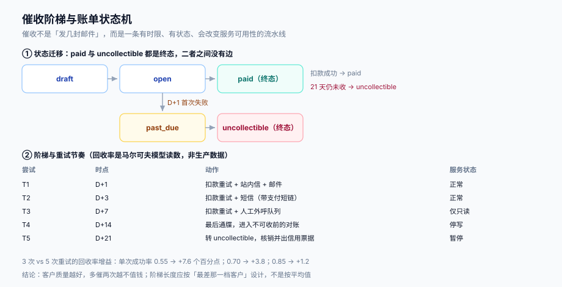

# 催收阶梯、账龄与服务降级

账单开出去不等于钱到手。订阅业务的坏账不是「一次大额违约」，而是**大量小额、分散、逐月累积**的逾期：客户换了卡、财务漏批、预算冻结。催收这一段要做的，是把这件事变成一条**有时限、有状态、会改变服务可用性**的流水线，并且让每一次动作都能被回放。



本页判据族 `SBU-A` ~ `SBU-H`，共 8 条。定义表在第七节。

## 一、账龄与 DSO：两个必须分开的指标

| 指标 | 定义 | 回答什么 | 常见误用 |
| --- | --- | --- | --- |
| **账龄分布**（aging） | 未付金额按「逾期天数」分桶（1~7 / 8~14 / 15~30 / 31~60 / 60+） | 现在的风险敞口长什么样 | 只看总额：总额没变但结构从「1~7 天」滑到「31~60 天」是最危险的信号 |
| **DSO**（Days Sales Outstanding） | 应收账款 / 日均收入 | 平均多少天能收回钱 | 用「平均逾期天数」代替：大额长账期客户会把均值拉偏，看不出小额长期拖欠 |

DSO 的算法有三种（简单法、期末法、账龄加权法），它们的差异在大客户占比高时会很明显。实践用**账龄加权**：`DSO = Σ(账龄桶中值 × 该桶未付金额) / 未付总额`，这样它和账龄分布同源，不会出现「两个指标讲两个故事」。

::: tip 一个反直觉的读数
**回收率不是催得越勤越高**。本机用马尔可夫模型算（每次尝试成功率随次数衰减 15%）：

| 单次成功率 | 3 次催收回收率 | 5 次催收回收率 | 增益 |
| --- | --- | --- | --- |
| 0.55 | 85.6% | 93.2% | **+7.6 个百分点** |
| 0.70 | 94.0% | 97.8% | +3.8 |
| 0.85 | 98.4% | 99.6% | +1.2 |

客户质量越好，多催两次越不值钱。所以阶梯长度应该按「最差那一档客户」设计，而不是按平均值——平均值只告诉你「大多数人第一次就付了」，那部分客户根本不需要催。
:::

## 二、阶梯：五个时点，五件事

| 尝试 | 时点 | 动作 | 服务状态 | 为什么是这个时点 |
| --- | --- | --- | --- | --- |
| T1 | D+1 | 扣款重试 + 站内信 + 邮件 | 正常 | 多数失败是「余额不足/换卡」，隔一天重试成功率最高 |
| T2 | D+3 | 扣款重试 + 短信（带支付短链） | 正常 | 短信是唯一能触达「不登录后台」的人的通道 |
| T3 | D+7 | 扣款重试 + 人工外呼队列 | **仅只读** | 一周未付，先用「降功能」施压，不切断数据 |
| T4 | D+14 | 最后通牒 + 出对账单 | **停写** | 两周未付，停止产生新费用，避免欠款继续扩大 |
| T5 | D+21 | 转 `uncollectible`，核销 + 信用票据 | **暂停** | 三周未付，进入坏账流程，保留数据以便恢复 |

四个设计决定：

1. **时点用「相对 `due_at` 的天数」而不是绝对日期**。合同里 `due_at` 可能是 D+7 或 D+30，阶梯必须跟着 `due_at` 走，否则「D+1」会落在一个还没到期的账单上。
2. **重试与通知必须解耦**。扣款重试失败不代表要发一封新邮件；两个动作各有各的节流（见[消息通知 · 频控](../../NotificationDelivery/Throttling/index.md)），混在一起会出现「一次失败发三封邮件」。
3. **降级分三档，不是「停/不停」两档**。只读、停写、暂停对应三种业务后果，中间那档是绝大多数客户能接受的施压点——直接暂停会把人赶走，完全不降级又收不回钱。
4. **每一档都要有「恢复路径」**。降级时写清「付清哪张账单可以恢复到哪一档」，否则客服每次都要问研发。

## 三、服务降级：与账单状态解耦

降级动作**不应该直接读账单状态**，而应该读一个「服务等级」（`service_tier`）。原因是账单状态会变（付款、红冲、重开），而服务等级只应该在**明确的判定点**变化：

```text
账单 open + 逾期 ≤ 7 天      → service_tier = full
账单 open + 逾期 8~13 天      → service_tier = read_only
账单 open + 逾期 14~20 天     → service_tier = write_blocked
账单 open + 逾期 ≥ 21 天      → service_tier = suspended
账单 paid / 无逾期账单        → service_tier = full
```

```sql
create table dunning_task (
  id          bigserial primary key,
  invoice_id  bigint not null references invoice(id),
  attempt_no  int    not null,
  due_at      timestamptz not null,
  scheduled_at timestamptz not null,
  executed_at timestamptz,
  action      text not null,                       -- retry / notify / call / suspend
  result      text check (result in ('success','failed','skipped')),
  unique (invoice_id, attempt_no)                  -- 同一尝试只能执行一次
);
```

`unique (invoice_id, attempt_no)` 是关键：催收作业也会重跑，没有这条约束就会「同一天给客户打三次电话」。

::: danger 注意
1. **不要把「降级」写成定时任务扫全表**。扫全表更新 `service_tier` 会在账期切换时把刚付清的客户又降一级。正确做法是**由账单状态迁移事件驱动**（`open → past_due` 触发 T3 判定），或用「最后一张未付账单」的派生查询，且带 `updated_at` 守卫。
2. **不要让降级影响数据可读性之外的东西**。只读档必须仍能导出数据——否则客户想付钱前先要备份，反而更不愿意付。
3. **恢复必须幂等**。支付回调会重试，重复回调不能让 `service_tier` 在 `full` 与 `suspended` 之间抖动。恢复逻辑写成「幂等置位」而不是「加减档位」。
:::

## 四、通知：什么时候该发、发几次

催收通知与营销通知是两件事：前者是**交易性**的，通常不受退订约束（合同履约通知），但受频控约束；后者是营销性的，必须尊重退订。

| 通知 | 通道 | 是否受退订约束 | 频控 |
| --- | --- | --- | --- |
| 账单已出 | 邮件 + 站内信 | 否（履约通知） | 每账期 1 次 |
| 扣款失败 | 邮件 + 短信 | 否 | 每次尝试 1 次，同一账单同日不超过 2 次 |
| 即将停服（D+13） | 短信 + 站内信 | 否 | 1 次 |
| 已停服 | 邮件 + 站内信 | 否 | 1 次 |
| 恢复成功 | 站内信 | 否 | 1 次 |

这条边界的判据是「**不发会不会导致客户损失**」：会导致（扣款失败、即将停服）就走交易性通道，不查退订；不会导致（推荐优惠、产品更新）就走营销通道，必须查退订与静默时段。判据 `SBU-F` 专抓「把催收短信混进营销频控，结果客户退订后连扣款失败都收不到」。

## 五、核销与坏账收回

D+21 转 `uncollectible` 之后，钱并没有「消失」，只是从「应收」变成「坏账」：

| 动作 | 账务处理 | 计费系统要做什么 |
| --- | --- | --- |
| 核销（write-off） | 应收账款 → 坏账损失 | 账单置 `uncollectible`，出信用票据冲减应收 |
| 坏账收回（recovery） | 坏账损失冲回 + 现金增加 | **不能把原账单改回 `paid`**，要开一张新账单（金额=收回额）或记一笔专门的回款 |
| 部分收回 | 按比例冲回 | 记 `recovered_amount`，剩余仍为坏账 |

「不能改回 `paid`」这条最容易被违反，因为改状态最省事。但它会让「这张账单什么时候结清的」永久失去答案——而审计要的正是这个时间点。

## 六、度量：四个率，四个分母

| 指标 | 分子 | 分母 | 用错分母的后果 |
| --- | --- | --- | --- |
| 首次扣款成功率 | 首次即成功的账单数 | 全部首次扣款账单 | 用「全部账单」当分母：把没到期的也算进去，虚高 |
| 最终回收率 | 最终付清的账单金额 | 进入催收的账单金额 | 用「全部账单金额」：看起来 99%，实际催收段完全没起作用 |
| 坏账率 | 核销金额 | 同期应收总额 | 用「已收金额」：分母缩水，坏账率虚高 |
| 降级误伤率 | 降级后 24 小时内付清并恢复的客户数 | 全部被降级客户数 | 不统计：不知道降级是不是太早 |

降级误伤率是最容易被忽略的一个。它持续偏高（比如 > 15%）说明阶梯时点太激进：客户不是不付，只是还没看到短信。

## 七、本页判据

| 编号 | 看什么现象 | 判成什么 | 不满足时改哪里 |
| --- | --- | --- | --- |
| `SBU-A` | 阶梯时点是否相对 `due_at` 定义，而非绝对日期 | 用绝对日期即失败：合同账期一变就错位 | 改成 `due_at + interval 'N days'` |
| `SBU-B` | `dunning_task` 是否有 `(invoice_id, attempt_no)` 唯一键 | 缺失即失败：重跑会重复催收 | 加唯一键，作业用 `on conflict do nothing` |
| `SBU-C` | 重试与通知是否各自节流（不因一次失败发多封） | 未解耦即失败：骚扰客户 | 两条链路分开，各自频控 |
| `SBU-D` | 降级是否由账单状态迁移驱动，而非全表扫描 | 全表扫描即失败：账期切换会误伤 | 改为事件驱动或派生查询 + `updated_at` 守卫 |
| `SBU-E` | 服务等级是否三档以上（只读 / 停写 / 暂停） | 只有两档即失败：缺少施压中间态 | 补 `service_tier` 枚举与判定表 |
| `SBU-F` | 交易性通知是否与营销退订解耦 | 混在一起即失败：退订后收不到扣款失败 | 按「不发是否致损」分类，两类走不同通道 |
| `SBU-G` | 恢复是否幂等（重复回调不抖动档位） | 加减档位式实现即失败 | 改为幂等置位 |
| `SBU-H` | 坏账收回是否开新单据，而不是把原账单改回 `paid` | 改回 `paid` 即失败：结清时点丢失 | 开新账单或记收回分录 |

## 参考资料

- Stripe Billing 文档《Recover failed payments》（自动重试与催收配置、`smart retries`）：<https://docs.stripe.com/billing/revenue-recovery/smart-retries>
- Stripe Billing 文档《Subscriptions》（`past_due` / `unpaid` / `canceled` 状态语义）：<https://docs.stripe.com/billing/subscriptions/overview>
- 《企业会计准则第 22 号——金融工具确认和计量》（预期信用损失与坏账准备）
- [消息通知与触达工程](../../NotificationDelivery/index.md)（通道能力与频控窗口）
- [账单结构、税额口径与信用票据](../Invoice/index.md)（`uncollectible` 与信用票据的关系）
- [三向对账](../Reconciliation/index.md)（坏账与收回如何进差异归口）
