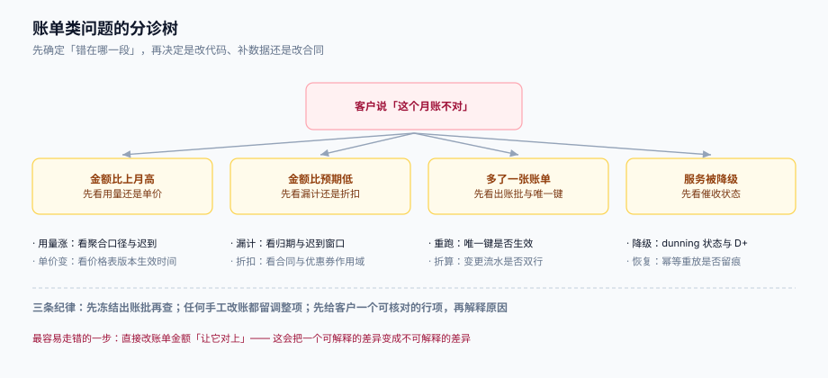

# 常见问题与分诊

账单类问题的共同特征是：**现象永远比原因显眼**。「这个月多了 212 元」是现象，原因可能在折算口径、可能在价格版本切换、可能在迟到账滚入、也可能只是客户自己加了席位。按顺序分诊，比凭经验猜快得多。

本页判据族 `SBQ-A` ~ `SBQ-H`，共 8 条。定义表在第六节。

## 一、分诊表

| 现象 | 第一个要查的 | 第二个要查的 | 跳到 |
| --- | --- | --- | --- |
| 金额比上月高 | 用量是否真的涨了（`usage_agg` 对比） | 单价是否变过（`price_version` 生效时间） | [定价](../Pricing/index.md) |
| 金额比上月低 | 是否漏计（迟到量是否滚入上期） | 是否有未应用的折扣或封顶 | [周期与闭账](../Cycle/index.md) |
| 多出一张账单 | 是否重开过（`supersedes_id`、`version`） | 唯一键是否被绕过（并发出账） | [账单结构](../Invoice/index.md) |
| 账单上出现「看不懂的一行」 | 该行 `kind` 是什么 | `source_ref` 指向什么 | [账单结构](../Invoice/index.md) |
| 升级后金额对不上 | 是否产生 `credit` + `charge` 两行 | 预览与提交是否同一折算时点 | [折算](../Proration/index.md) |
| 客户说「我 25 号才加席位」 | 席位口径是期末快照还是按天折算 | 加席位是否立即折算 | [折算](../Proration/index.md) |
| 账单与发票金额不等 | 税额是按行算还是按总额算 | `amount` 是含税还是不含税 | [账单结构](../Invoice/index.md) |
| 服务被降级 | 逾期天数（相对 `due_at`） | 降级档位与恢复条件 | [催收与降级](../Dunning/index.md) |
| 已付款但仍是欠费 | 回调是否丢失（查单） | 支付是否挂在别的 `bill_id` 上 | [三向对账](../Reconciliation/index.md) |
| 对账差几十元 | 是否只看总额（正负抵消） | 金额漂移是否已归口 | [三向对账](../Reconciliation/index.md) |
| 出账作业跑不完 | 是否整批一事务 | 是否卡在某个脏数据租户 | [实战](../Practice/index.md) |
| 补跑历史账期后数据全错 | 周期是否用了 `now()` | 价格版本是否用了当前价 | [周期与闭账](../Cycle/index.md) |

## 二、十二问

**Q1：按天折算和按秒折算，业务上应该选哪个？**
看合同怎么写。按秒更精确（也是主流商用实现的选择），但客户无法自己复算「剩余秒数」；按天客户能复算，但单笔会多收（16 日 23:00 变更多收 9.27 元）。折中做法：**按秒计算，账单上展示「剩余 N 天」**，并给出公式。

**Q2：为什么不能「升级当月不收费，下期按新价」？**
可以，这就是 `proration_behavior = none` 的语义。但它意味着客户本月用高价功能、付低价，属于商业让利，必须在合同里写。最糟的是系统按 `none` 实现、销售按折算报价。

**Q3：客户升级后立刻降级，会退钱吗？**
按合同。常见做法是「升级立即折算、降级下期生效」，所以当天升降不会产生退款——客户本期仍按高价计费。如果合同允许立即降级退差，就要按「已用天数」算，并且要出信用票据。

**Q4：账单号和发票号可以是同一个吗？**
不要。账单是你开给客户的应收凭证，发票是税务凭证，两者的编号规则、作废规则、留存期限都不同。用同一个号，一旦账单重开（`void` + 新版本），发票号就被迫跟着变，而发票作废需要走税务流程。

**Q5：为什么我的对账每天都是 0 差异，月底却差了几千？**
大概率是增量窗口太短 + 只对行数。月底集中出账时，`updated_at` 落在窗口外的账单不会被扫到；而「行数都在但金额不等」的差异需要逐分比对才能发现。见[三向对账](../Reconciliation/index.md)。

**Q6：迟到事件应该重开账单还是滚下期？**
看影响面。本机 20,000 条事件里闭账后到达的涉及 52.8% 的租户——重开账单意味着过半客户当月收到两张账单。所以实践里多是「小额滚下期、大额重开」，阈值写进合同。

**Q7：账单金额可以是负数吗？**
单张账单的 `total` 不应为负（退款走信用票据）。如果一个月内抵扣大于应收（比如大额红冲），正确做法是把余额结转到下期（`carryover`），而不是开一张负数账单——负数账单在多数发票系统里无法开具。

**Q8：暂停（pause）期间要不要收席位费？**
按合同。三种常见策略：完全不计费、只收固定平台费、按比例收。无论哪种，`subscription.status` 必须能表达「暂停」，且暂停起止时间要落库，否则恢复时无法算「剩余多少天」。

**Q9：客户换卡后自动重试几次合适？**
看客户结构。本机模型显示 3 次到 5 次的增益从 +7.6 个百分点（单次成功率 0.55）降到 +1.2（0.85）。实践是 3~4 次扣款 + 2 次人工触达，之后降级。

**Q10：多币种客户怎么开账单？**
一张账单一个币种。多币种要拆成多张，否则税额与总额无法在同一币种上自洽；如果客户要求合并，就在账单上增加「折算为本位币」的展示字段，但金额仍按原币种结算。

**Q11：价格表可以改历史版本吗？**
不可以。历史版本只读，改价要新建版本并设 `effective_from`。允许改历史版本的系统，在客户要求「按当时价格重算」时永远给不出正确答案。

**Q12：收入什么时候确认？账单开出来就算吗？**
不算。账单是应收，收入按履约进度确认（订阅通常按服务期间摊销）。计费系统要给账务提供 `service_start` / `service_end`，否则账务只能按开票日确认，月度报表会出现尖峰。

## 三、五条错误建议（照做会更糟）

| 错误建议 | 为什么错 | 正确做法 |
| --- | --- | --- |
| 「先把金额改成对的，原因以后再查」 | 差异变成不可解释，之后再也查不出 | 先冻结出账批，再逐条查差异来源 |
| 「对账不平就多加一条调整行」 | 调整行会掩盖真实差异，且越积越多 | 差异归口到六类，每类走自己的修复路径 |
| 「折算先按整月收，客户投诉再退」 | 默认多收，且退款要走红冲流程，成本更高 | 口径写进合同，按合同算 |
| 「出账作业挂了就重跑整个月」 | 重跑会撞唯一键或产生重复账单 | 用断点游标 + 幂等键，从断点续跑 |
| 「账单和发票用同一个号，省事」 | 账单重开会逼发票作废，走税务流程 | 两套编号，用 `bill_id` 关联 |

## 四、止血顺序

线上正在出错时，顺序比方法重要：

1. **冻结出账批**（`bill_run.status = 'aborted'`），别让错误继续扩散；
2. **确认影响面**：多少租户、多少金额、是否已收款、是否已开票；
3. **区分「已收款」与「未收款」**：未收款可以红冲重开；已收款要先退款或出信用票据；
4. **先修数据，再修代码**：数据修完才能验证代码修得对不对；
5. **留证据**：冻结的批、重开的账单、信用票据，三者构成完整链条。

::: danger 排序错了会加倍损失
最常见的错误顺序是「先改代码、再补数据」。代码改完重新出账，会把已经手工修好的数据再覆盖一遍，形成第二轮差异——而这一轮的差异没有任何单据能解释。
:::

## 五、上线前自查（14 项）

| # | 检查项 | 通过标准 |
| --- | --- | --- |
| 1 | 周期锚点是否落库 | `subscription.anchor_day` 有值且不再变 |
| 2 | 周期边界是否左闭右开 | 存储层无 23:59:59 |
| 3 | 时区是否按客户维度 | 边界换算显式带 `billing_timezone` |
| 4 | 闭账窗口是否晚于 `period_end` | `close_at > period_end` |
| 5 | 折算是否两行 | `credit` 与 `charge` 成对出现，共享 `group_id` |
| 6 | 预览与提交是否同一折算时点 | 提交时回传 `proration_at` |
| 7 | 税额是否按行 | `Σ line.tax_amount = invoice.tax_amount` |
| 8 | 账单是否可自洽校验 | 自洽 SQL 返回空集 |
| 9 | 同账期是否唯一 | 部分唯一索引存在 |
| 10 | 出账作业是否可续跑 | `cursor_tenant` 有推进 |
| 11 | 催收阶梯是否相对 `due_at` | 无绝对日期 |
| 12 | 三向对账是否有归口 | `recon_diff` 六类枚举齐全 |
| 13 | 负向验收是否真的失败 | 4 条负向全部失败 |
| 14 | 收入口径是否交代给账务 | 账单带 `service_start` / `service_end` |

## 六、本页判据

| 编号 | 看什么现象 | 判成什么 | 不满足时改哪里 |
| --- | --- | --- | --- |
| `SBQ-A` | 是否有按现象分诊的入口表，且每条都指向具体页 | 只有「常见问题」标题即失败：不可操作 | 补分诊表，每条给「先查什么」 |
| `SBQ-B` | 止血顺序是否「冻结 → 评估 → 修数据 → 修代码 → 留证」 | 先改代码即失败：会二次污染 | 按第四节顺序重写 runbook |
| `SBQ-C` | 是否存在「直接改金额让它对上」的处置建议 | 存在即失败：制造不可解释差异 | 改为红冲 + 重开 |
| `SBQ-D` | 错误建议是否被显式列出（而不是只写正确做法） | 缺失即失败：读者会照旧习惯做 | 补「错误建议 / 为什么错」表 |
| `SBQ-E` | 上线自查项是否都可机械判定 | 出现「视情况而定」即失败 | 每条给通过标准 |
| `SBQ-F` | 分诊表是否覆盖六类差异 | 缺类即失败：有现象无路径 | 补全六类归口对应页 |
| `SBQ-G` | 术语是否与正文一致（`period_end` / `due_at` / `issue_at` 不混用） | 混用即失败：分诊会指错页 | 统一术语表 |
| `SBQ-H` | 每条回答是否给出可验证的读数或判据编号 | 只有结论即失败：无法复核 | 补读数或 `SB*` 判据引用 |

## 参考资料

- Stripe Billing 文档《Billing troubleshooting》（常见账单差异的官方排查路径）：<https://docs.stripe.com/billing/subscriptions/troubleshooting>
- Stripe Billing 文档《Credit notes and refunds》：<https://docs.stripe.com/invoicing/credit-notes>
- [总览：五段计费链与三个金额口径](../Overview/index.md)
- [升降配与折算](../Proration/index.md)
- [账单结构、税额口径与信用票据](../Invoice/index.md)
- [三向对账与收入确认边界](../Reconciliation/index.md)
