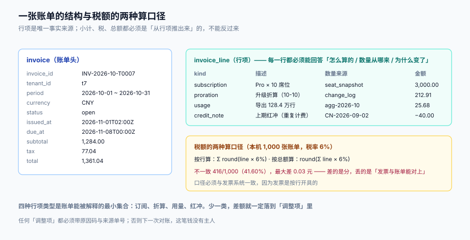

# 账单结构、税额口径与信用票据

账单是计费系统的**对外事实**：客户认的是它，财务开票依据它，催收围绕它，对账以它为准。所以账单结构的第一性要求不是「字段多」，而是**每一分钱都能落到某一行，而每一行都能说出它从哪来**。

这一页讲四件事：行项的最小集合、小计与税额的口径、信用票据与红冲、以及账单状态机与幂等。



本页判据族 `SBI-A` ~ `SBI-H`，共 8 条。定义表在第七节。

## 一、账单头与行项

```sql
create table invoice (
  id            bigserial primary key,
  tenant_id     bigint      not null,
  period        text        not null,             -- 2026-10
  version       int         not null default 1,
  supersedes_id bigint      references invoice(id),-- 重开时指向被替代的账单
  currency      char(3)     not null,
  subtotal      numeric(18,2) not null,
  tax_amount    numeric(18,2) not null,
  total         numeric(18,2) not null,
  status        text        not null check (status in ('draft','open','paid','void','uncollectible')),
  issued_at     timestamptz,
  due_at        timestamptz,
  unique (tenant_id, period, version)
);

create table invoice_line (
  id           bigserial primary key,
  invoice_id   bigint      not null references invoice(id),
  seq          int         not null,
  kind         text        not null check (kind in
                 ('subscription','proration_credit','proration_charge','usage','carryover','adjustment','credit_note')),
  description  text        not null,
  quantity     numeric(18,4),
  unit_price   numeric(18,6),
  tax_rate     numeric(6,4) not null default 0,
  amount       numeric(18,2) not null,            -- 不含税
  tax_amount   numeric(18,2) not null default 0,
  source_ref   text,                              -- agg id / change id / 原账单号
  unique (invoice_id, seq)
);
```

账单头只放**汇总值与状态**，所有金额都必须能从行项推出来。这条约束在数据库层就能守：`subtotal = Σ line.amount`、`tax_amount = Σ line.tax_amount`、`total = subtotal + tax_amount`。三条断言写成一个出账后的校验 SQL，任何一条不成立就让这批账单失败：

```sql
select i.id, i.subtotal, sum(l.amount) as sum_amount,
       i.tax_amount, sum(l.tax_amount) as sum_tax, i.total
  from invoice i join invoice_line l on l.invoice_id = i.id
 group by i.id
having i.subtotal <> sum(l.amount)
    or i.tax_amount <> sum(l.tax_amount)
    or i.total <> i.subtotal + i.tax_amount;
```

返回空集才算这张账单「结构自洽」。这条 SQL 是[实战](../Practice/index.md)里 S4 验收的一部分。

## 二、行项的七种类型，每种一个来源

| 类型 | 含义 | 金额符号 | 来源字段必须指向 |
| --- | --- | --- | --- |
| `subscription` | 本期订阅费（席位 × 单价） | 正 | `seat_snapshot` + `price_version` |
| `proration_credit` | 变更时退未用 | 负 | `sub_change.id` |
| `proration_charge` | 变更时收新增 | 正 | `sub_change.id` |
| `usage` | 按量计费 | 正 | 聚合行 ID（`agg-*`） |
| `carryover` | 上期补记（迟到账滚下期） | 正/负 | `source_period` |
| `adjustment` | 人工调账、补偿、活动减免 | 正/负 | 原因码 + 审批单号 |
| `credit_note` | 红冲（退差、纠错） | 负 | `credit_note.id` |

七种里最容易出问题的是 `adjustment`：它没有业务规则约束，谁都能写。所以必须有**原因码枚举 + 审批单号 + 操作人**三件套，并进对账的差异归口（见[三向对账](../Reconciliation/index.md)）。没有这三件套的 `adjustment` 行，等于在账单上开了个后门。

::: danger 注意
1. **不要用 `adjustment` 承载「应该由规则算出来的金额」**。比如「客户投诉上期多收 40 元」，正确做法是出 `credit_note` 冲原账单，而不是在本期加一条 `adjustment = -40`。后者会让「本期账单金额」与「本期业务量」永久失真。
2. **不要允许 `amount` 为 0 的行**。0 元行不携带信息，只让账单变长；如果是为了「留痕」（比如折扣 100%），把它写成 `discount` 字段或 `description` 里，不要占一行。
3. **不要让行项的顺序随机**。`seq` 必须按「订阅 → 折算 → 用量 → 结转 → 调整 → 红冲」的业务顺序排；客户核对时是按顺序读的，顺序乱了会增加解释成本。
:::

## 三、税额：按行算还是按总额算

这是账单与发票对不上的**第一大原因**。两种口径：

```text
按行算：  tax = Σ round(line.amount × rate, 2)
按总额算：tax = round(Σ line.amount × rate, 2)
```

数学上它们只在「每行的税额都有舍入」时才不同，但业务上差别很大：**发票是按行开具的**，每行的税额必须独立成列，所以发票侧必然是按行算。如果账单侧按总额算，两边就必然对不上。

本机 1,000 张账单（2~8 行、行金额 10~500 元、税率 6%）的结果：

| 项 | 读数 |
| --- | --- |
| 两种口径结果不同的账单 | **416 / 1,000（41.60%）** |
| 最大单张差额 | 0.03 元 |

41.60% 的账单会差不超过 3 分钱。3 分钱本身无所谓，但**发票校验是逐行比对的**：订单行税额 + 账单行税额不一致，开票接口会直接拒绝，或者被迫走「手工开票」——而手工开票是税务风险的起点。

所以口径只有一种合法选择：

> **账单按行算税，且行的 `tax_rate` 必须与开票时使用的税率同源（同一张税率表的同一个版本）。**

例外只有一种：**单一税率、单一行的账单**——此时两种算法等价，可以简化。但只要允许「多行」或「多税率」（不同商品/服务适用不同税率），就必须按行算。

::: warning 价内税与价外税不能混
`amount` 定义成「不含税」还是「含税」，必须在**整个系统里统一**。混用的典型症状是：账单 `total` 与支付金额一致（因为按含税算的），但开票接口报「价税合计不符」（因为它按不含税 + 税额算）。选一种，写进 `invoice.amount_includes_tax` 字段，并让所有下游读这个字段。
:::

## 四、信用票据与红冲

红冲（credit note）是「把已经开出去的账减下来」的正式动作。它必须满足三个条件：

1. **指向原账单/原行**（`source_invoice_id` / `source_line_id`），不能是「凭空一张负数账单」；
2. **带原税率与税额**，否则「退了钱没退税」，申报时税额对不上；
3. **有独立编号**（`CN-2026-10-0007`），与账单号同一套序列规则，且不可重复。

```sql
create table credit_note (
  id                bigserial primary key,
  no                text not null unique,
  tenant_id         bigint not null,
  source_invoice_id bigint not null references invoice(id),
  amount            numeric(18,2) not null,        -- 正数，语义是「冲减」
  tax_amount        numeric(18,2) not null,
  reason_code       text not null,                 -- duplicate_charge / service_credit / correction
  status            text not null check (status in ('draft','issued','applied')),
  issued_at         timestamptz
);
```

红冲之后账单怎么变？三种做法，选一种：

| 做法 | 账单状态 | 客户看到 | 适用 |
| --- | --- | --- | --- |
| 账单保持 `paid`，红冲单独一张单据 | 不变 | 「已退款，附红字单据」 | 已收款、金额小 |
| 账单重开（`void` + 新版本） | 原单 `void`，新单 `open` | 「账单已更新」 | 计费错误、金额大 |
| 账单加一条 `credit_note` 行 | 不变 | 「本期抵减」 | 未收款、同期冲抵 |

第三种最省事，但它会把「上期的错」记在「本期」的账上，跨期对账时会有一段无法解释的差。所以**跨期冲正一律用前两种**，第三种只用于同账期内。

## 五、账单状态机

```text
draft ──issue──> open ──pay──> paid
                   │
                   ├──D+1 失败──> (仍 open，但生成 dunning_task)
                   ├──D+21 未收──> uncollectible
                   └──void（重开/纠错）──> void
```

四条约束：

1. **`paid` 与 `uncollectible` 都是终态**，二者之间没有边。已核销的账单后来收到钱，要开新账单或做「坏账收回」分录，而不是把状态改回 `paid`——否则「这张账单什么时候算结清」就没有答案。
2. **只有 `open` 可以被支付**。`draft` 阶段的支付回调必须拒绝（或先自动 `issue` 再处理），否则会出现「账单还没发出就已经付了」的诡异数据。
3. **`void` 必须带原因**（`void_reason`：`reissued` / `error` / `fraud`），且必须指向新单据（如果重开）。
4. **状态迁移只能前进**，`open → draft` 这类回退一律禁止；需要更正就重开。

## 六、幂等：同一账期只能有一张有效账单

出账作业会重跑（补跑、失败重试、人为触发），所以「同一 `(tenant_id, period)` 只有一张有效账单」必须由数据库守：

```sql
-- 方案 A：唯一键 + insert on conflict（推荐）
create unique index uniq_invoice_active
  on invoice (tenant_id, period) where status <> 'void';

-- 方案 B：应用层先查后插（不推荐）
-- 并发下两个作业都会查到「不存在」，然后各插一张
```

用方案 A 之后，重跑的正确写法是：

```sql
insert into invoice (tenant_id, period, currency, subtotal, tax_amount, total, status)
values (:tenant, :period, 'CNY', :subtotal, :tax, :total, 'open')
on conflict (tenant_id, period) where status <> 'void' do nothing
returning id;
```

`returning id` 为空即表示「本期已有有效账单」，作业跳过并记一条 `skipped`。本机实测：1,000 个租户跑两遍，有唯一键得到 **1,000 张**账单（耗时 0.6 ms），无唯一键得到 **2,000 张**（耗时 0.3 ms）——**快的那 0.3 ms 就是省掉的那道约束**。

::: tip 部分唯一索引中的 `where` 不能省
`unique (tenant_id, period)` 会把 `void` 的旧账单也算进去，导致重开后插不进新版本。加 `where status <> 'void'` 才能让「重开」与「幂等」共存。
:::

## 七、本页判据

| 编号 | 看什么现象 | 判成什么 | 不满足时改哪里 |
| --- | --- | --- | --- |
| `SBI-A` | `subtotal` / `tax_amount` / `total` 是否都等于行项汇总 | 任一条不成立即失败：账单不自洽 | 出账后跑自洽校验 SQL，不过则整批失败 |
| `SBI-B` | 是否每个金额都能追到 `source_ref`（聚合 ID / 变更 ID / 原单据） | 存在无来源的行即失败：不可解释 | 补 `source_ref` 非空校验（`adjustment` 用审批单号） |
| `SBI-C` | 税额是否按行计算，且 `tax_rate` 与开票税率同源 | 按总额算即失败：与发票逐行比对必错 | 改为按行算，税率表单一来源 |
| `SBI-D` | `amount` 的含税语义是否全系统统一（`amount_includes_tax`） | 混用即失败：价税合计不符 | 定一种并落到字段，下游只读该字段 |
| `SBI-E` | `adjustment` 行是否都有原因码、审批单号、操作人 | 缺失即失败：账单有后门 | 三件套非空 + 入对账归口 |
| `SBI-F` | 信用票据是否指向原单、带原税率、有独立编号 | 缺一即失败：红冲不可审计 | 补三个字段与唯一编号 |
| `SBI-G` | 状态机是否存在回退边（如 `open → draft`） | 存在即失败：结清时点无定义 | 删回退边，更正走重开 |
| `SBI-H` | 是否有「同账期唯一有效账单」的数据库约束 | 仅应用层判重即失败：并发重复 | 加部分唯一索引 + `on conflict do nothing` |

## 参考资料

- Stripe Billing 文档《Invoices》（行项、`credit_note`、`void` 与重开语义）：<https://docs.stripe.com/invoicing/integration/workflow-transitions>
- Stripe API 参考《Credit notes》：<https://docs.stripe.com/api/credit_notes>
- PostgreSQL 18 文档《Partial Indexes》（`where status <> 'void'` 的唯一约束）：<https://www.postgresql.org/docs/18/indexes-partial.html>
- 《企业会计准则第 14 号——收入》（2017 修订）：账单是应收，收入按履约进度确认
- [升降配与折算](../Proration/index.md)（`proration_credit` / `proration_charge` 行项的来源）
- [三向对账](../Reconciliation/index.md)（`adjustment` 与 `credit_note` 如何进差异归口）
