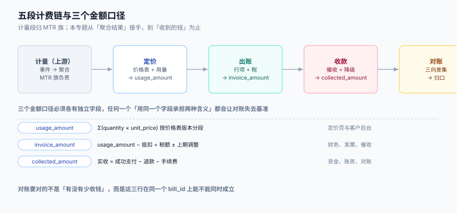

# 总览：五段计费链与三个金额口径

订阅的钱不是「一次算出来的」，而是**五段依次作用的结果**：定价给出单价，周期切出时间窗口，折算处理窗口内的变更，出账把这些压成一张带行项的账单，收款把账单变成现金。任何一段越权——比如在出账段临时改一个金额去「补差」——后面的催收与对账就全部失去基准。

这一页给整条链的全局图，并回答三个所有账单事故都会回到的问题：**哪一段出问题是可以解释的、哪一段是不可解释的、以及三个金额口径各自属于谁**。



本页判据族 `SBO-A` ~ `SBO-H`，共 8 条。定义表在第六节。

## 一、五段链

| # | 段 | 输入 | 输出 | 谁有权改 | 可解释性 |
| --- | --- | --- | --- | --- | --- |
| ① | 计量（上游） | 业务事件 | 按租户 × 指标 × 周期的聚合量 | 业务系统 | 高：能追到事件 |
| ② | 定价 | 聚合量 + 订阅状态 + 价格表 | `usage_amount` | 产品/商务 | 高：能追到价格表版本 |
| ③ | 周期 | 起订日 + 时区 + 闭账规则 | 一个左闭右开的时间窗口 | 合同 | 高：能追到合同条款 |
| ④ | 折算 | 窗口内的变更流水 + 周期 | `credit` / `charge` 两组行项 | 合同 | **中：取决于是否留了变更流水** |
| ⑤ | 出账 | 以上全部 + 税额口径 | `invoice` + `invoice_line` | **没有人**——它是计算结果 | 高：能追到行项 |
| ⑥ | 收款 | 账单 + 支付结果 | `collected_amount` | 支付通道 + 催收策略 | 中：通道口径不在你手里 |

表里第 ⑤ 段「没有主人」是整张表最重要的一句话。任何「直接改账单金额」的代码（客服补偿、财务手工调账、活动减免）都必须落成一条**显式的调整行**（`invoice_line.kind = 'adjustment'`，带原因码与来源单号），否则下一次对账，这笔钱就找不到来源。

::: danger 注意
1. **不要在出账段做「补差」**。`total` 与「行项之和」必须天然相等；如果出现 `total -= 0.01` 这类补差，说明前面的行项已经错了，补差只是把错误藏进一个没人看得见的常数。
2. **不要在折算段「顺手」改订阅的席位或价格**。折算只读变更流水、只写行项；改订阅状态是生命周期动作，它必须已经产生了一条 `sub_change`，否则账单上的钱没有对应的业务事件。
3. **不要把「到期日」当「账期结束」**。`due_at` 是收款时限，`period_end` 是计费窗口结束，两个日期重合只是巧合。混用会让「逾期」判定从账单生成那天开始算，客户还没收到账单就已经逾期。
:::

## 二、三个金额口径，三种读者

同一笔订阅在同一个账期里有三个「金额」，它们经常被混用，而对账事故几乎都源于混用：

| 口径 | 定义 | 谁在看 | 允许的误差 |
| --- | --- | --- | --- |
| **计费金额**（`usage_amount`） | ② 的输出，按价格表算出的「应该收」 | 客户后台、用量明细 | 0（客户会用自家日志逐条核对） |
| **账单金额**（`invoice_amount`） | `usage_amount` − 抵扣 + 税额 ± 上期调整 | 财务、发票、催收 | 0（发票按行开具，逐行要对上） |
| **实收金额**（`collected_amount`） | 成功支付 − 退款 − 通道手续费 | 资金、账务、对账 | 手续费允许按合同扣，其余为 0 |

三个数之间只有两种关系是合法的：

```text
invoice_amount = usage_amount - discount_amount + tax_amount + carryover_amount
collected_amount = sum(successful_payment) - sum(refund) - sum(channel_fee)
```

**除了这两个等式，任何其他调整都必须以独立字段或独立行项出现**。原因是：`usage_amount` 要参与「用量明细」的解释（客户会核），`invoice_amount` 要参与开票与催收（财务会核），`collected_amount` 要参与资金对账（通道会给对账单）。三者混在一个字段里，任何一方来核对时你都拿不出他要的那一版。

::: tip 一条口径纪律
**每个金额字段只能有一个定义者**。若某字段既被「定价」写、又被「客服补偿」写，它就不是一个口径，而是一个垃圾桶——本库把这类字段统一叫「垃圾桶字段」，判据 `SBO-D` 专抓它。
:::

## 三、五个必失点

这五条是**结构性**的，不是「注意一下就好」的实现细节：

1. **周期锚点用递推而不是锚定**。从 1 月 30 日起订，每期由「上期结束日 + 一个月」递推，撞上 2 月 28 日后就永久变成 28 日：本机实测 12 期后累计少 **29 天**，等于少收一整期的钱。见[周期与闭账](../Cycle/index.md)。
2. **折算只收新增、不退未用**。升级时只加 `charge` 行、不写 `credit` 行，客户当期被多收；反向（降级只退不补）则是你少收。两种都常见，因为「少写一行」看起来不影响总额——直到客户把两行加起来对不上。见[折算](../Proration/index.md)。
3. **税额按总额算、发票按行开**。两种口径在 1,000 张账单里有 **416 张（41.60%）**结果不同，最大差 0.03 元；发票行金额与账单行金额逐行比对时必然报错。见[账单结构](../Invoice/index.md)。
4. **出账作业没有唯一键**。跑两遍就是两张账单：无唯一键时 1,000 个租户变成 **2,000 张**；有唯一键仍是 1,000 张。见[实战](../Practice/index.md)。
5. **对账只对行数不对金额**。20,000 张账单里，三方行都在但金额不等的有 **174 条**、净差 **−452.41 元**，只对行数的实现会把它们全判成「已平」。见[三向对账](../Reconciliation/index.md)。

## 四、一次订阅的完整时间线

以「下单 → 首个账期 → 升级 → 续费 → 逾期 → 恢复」为主线，把五段链放进时间里看：

| 时刻 | 动作 | 读了什么 | 写了什么 | 关键风险 |
| --- | --- | --- | --- | --- |
| T0 | 订阅创建 | 价格表 + 起订日 | `subscription`（含 `anchor_day`） | 锚点没存下来，后面每期都要重算，必漂 |
| T1 | 首期出账 | 周期 + 席位快照 | `bill_run` + `invoice` | 首期是「不满一期」，必须折算，不能按整月收 |
| T2 | 月中升级 | 变更流水 + 折算规则 | `sub_change` + 两组行项 | **预览与提交必须同一折算时点**，否则差几分 |
| T3 | 续费出账 | 价格表（当前版本）+ 用量 | 新一期 `invoice` | 价格表在账期中途改版，历史账期不能跟着变 |
| T4 | 逾期 | `due_at` + 支付结果 | `dunning_task` + 账单状态 | 逾期起算点是 `due_at`，不是出账日 |
| T5 | 恢复 / 核销 | 支付成功 / D+21 | 状态迁移 + 信用票据 | 恢复必须幂等，重复回调不能让服务重复开通 |

T2 那一行值得单独说：**预览（客户在页面上看到的「升级需补 212.91 元」）与提交（真正落库的 `sub_change`）必须是同一次折算**。Stripe 的做法是把折算时点显式传进去（`proration_date`），两次调用用同一个值；如果你的实现是「预览时算一次、提交时再算一次」，那么跨越秒级边界就会差几分，而这几分会变成一张客诉工单。

## 五、四问决策

在动手写第一行计费代码前，先回答这四个问题，答案会决定后面所有设计：

| 问题 | 选项 | 选错的代价 |
| --- | --- | --- |
| **周期按自然月还是周年日？** | 自然月 / 周年日 / 首期折算到自然月末再转周年日 | 自然月：月中注册的客户首期必须折算，且所有人在同一天出账（批处理压力集中）；周年日：出账天天都在跑，不能只排一次批 |
| **升级当月收不收钱？** | 立即折算（`always_invoice`）/ 生成待开票项（`create_prorations`）/ 下期起按新价（`none`） | 不写明：销售承诺「升级不额外收费」，财务按折算开票，两边对不上 |
| **按天还是按秒折算？** | 按天 / 按秒 / 按整月不折算 | 按天：单笔最大差 9.27 元（见[折算](../Proration/index.md)）；按整月不折算：合计差 **+103.2%** |
| **逾期多久停服？** | 不停 / 只读 / 停写 / 暂停 | 不停：坏账率上升；太早停：误伤忘记换卡的正常客户，恢复成本高于欠款 |

::: tip 一条判断标准
如果一个问题**在合同评审时没有答案**，它最后一定变成代码里某个 `if` 的默认分支——而这个默认分支没人测过、没人记得、也没人为它的错误负责。订阅计费里绝大多数客诉都出自这种「没答案就默认」。
:::

## 六、本页判据

| 编号 | 看什么现象 | 判成什么 | 不满足时改哪里 |
| --- | --- | --- | --- |
| `SBO-A` | 三个金额口径是否各有独立字段（`usage_amount` / `invoice_amount` / `collected_amount`） | 缺一即失败：口径被混用 | 拆字段，禁止一个字段承担两种含义 |
| `SBO-B` | 是否存在「直接写 `total`」而不经过行项的代码路径 | 存在即失败：账单无主人 | 改为写 `adjustment` 行项，带原因码与来源单号 |
| `SBO-C` | 账单是否记录 `price_version` 与 `period_start` / `period_end` | 缺失即失败：无法复核 | 账单头补三列，出账时从上下文取 |
| `SBO-D` | 是否有字段被两段以上同时写（垃圾桶字段） | 存在即失败：口径不可信 | 拆分为「谁写谁负责」的字段，或改成只读派生 |
| `SBO-E` | 折算是否同时产生 `credit` 与 `charge` 两种情况的行项 | 只有一种即失败：净额不可解释 | 按[折算](../Proration/index.md)的双行写法补齐 |
| `SBO-F` | 逾期起算点是否为 `due_at` 而不是 `issued_at` | 用 `issued_at` 即失败：客户未收到就逾期 | 催收任务的时间基准改为 `due_at` |
| `SBO-G` | 预览与提交是否使用同一个折算时点 | 两次各自取当前时间即失败：必然差几分 | 预览返回 `proration_id` 或折算时点，提交时回传 |
| `SBO-H` | 每一段是否能单独回放（给定输入得到同一输出） | 不能即失败：无法复现事故 | 把「当前时间」与「随机」从链路里剔除，或显式注入 |

## 与「开放平台 · 配额与用量」的分工（第 222 天补充）
| 这一页讲的 | 开放平台专题讲的 |
| --- | --- |
| 价格表、周期锚点、折算、账单生成与催收 | 用量怎么产生、怎么去重、怎么落成 `units` |
| 计费对象是**订阅**（一个套餐一个周期） | 计费对象是**应用**（一次调用一个单位） |
| 出账依赖「计费量」这个输入 | 负责把「调用」变成可信的「计费量」 |

**这一页特有的一个坑**：账单里出现「用量 0 但金额不为 0」（最低消费）或「用量有值但金额为 0」（单价漏配），运营第一反应是改账单。正确顺序是**先查用量表**：如果 `usage` 里同一 `request_id` 有多行，说明唯一键没建，账单没错、计量错了。三类差异的归口见[配额、限流与用量](../../OpenPlatform/QuotaUsage/index.md)。

## 参考资料

- [多租户 SaaS · 计量与账单](../../MultiTenantSaaS/MeteringBilling/index.md)（本专题的上游：事件 → 聚合）
- [营销计价与优惠分摊](../../PricingPromotion/index.md)（单次结算的优惠与分摊）
- [账务与清结算](../../Ledger/index.md)（`invoice_amount` 之后怎么记分录）
- [幂等与状态机工程](../../IdempotencyStateMachine/IdempotencyKey/index.md)（出账与回调的幂等键）
- Stripe Billing《Prorations》（`proration_behavior` 三值与折算时点）：<https://docs.stripe.com/billing/subscriptions/prorations>
- ISO 4217 货币代码与最小单位：<https://www.iso.org/iso-4217-currency-codes.html>
- Fowler, *Analysis Patterns*（Account / Posting Rule 模式：把「什么时候记多少」从记账动作里分离出来）
