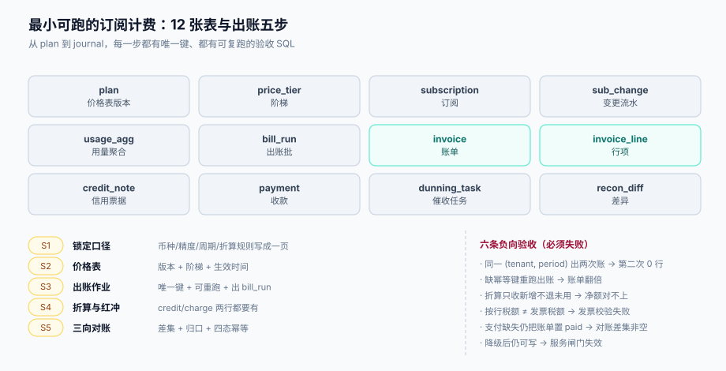

# 实战：一个能跑起来的最小订阅计费

前面六页讲的都是「某一环怎么算对」。这一页把它们拼成一个**能跑、能验收、能重跑**的最小系统：12 张表、5 个作业步骤、10 条验收（其中 4 条必须失败）。



本页判据族 `SBE-A` ~ `SBE-H`，共 8 条。定义表在第七节。

## 一、12 张表

| # | 表 | 作用 | 关键约束 |
| --- | --- | --- | --- |
| 1 | `plan` | 套餐（含功能清单） | `(code, version)` 唯一 |
| 2 | `price` | 价格项（维度、币种、版本、生效区间） | `(plan_id, metric, price_version)` 唯一 |
| 3 | `price_tier` | 阶梯分档 | `(price_id, seq)` 主键，区间连续 |
| 4 | `subscription` | 订阅（含 `anchor_day`、`billing_timezone`） | `(tenant_id)` 有效订阅唯一（部分索引） |
| 5 | `sub_change` | 变更流水（升/降/加席/暂停） | `(subscription_id, seq)` 唯一 |
| 6 | `usage_agg` | 用量聚合（上游 `MTR` 产出） | `(tenant_id, metric, period)` 唯一 |
| 7 | `bill_run` | 出账批 | `(period, scope) where running` 唯一 |
| 8 | `invoice` | 账单头 | `(tenant_id, period) where status<>'void'` 唯一 |
| 9 | `invoice_line` | 行项 | `(invoice_id, seq)` 唯一 |
| 10 | `credit_note` | 信用票据 | `no` 唯一 |
| 11 | `payment` | 收款（含 `bill_id`、`channel_txn_id`） | `channel_txn_id` 唯一 |
| 12 | `recon_diff` | 对账差异 | `(bill_id, diff_type)` 唯一 |

完整的 `plan` / `price` / `price_tier` / `invoice` / `invoice_line` / `credit_note` 定义分别在[定价](../Pricing/index.md#一、价格表的四层结构)、[账单结构](../Invoice/index.md#一、账单头与行项)两页；这里只补三张没出现过的：

```sql
-- 订阅：锚点与时区必须落库，否则每期边界都会重算
create table subscription (
  id              bigserial primary key,
  tenant_id       bigint not null,
  plan_id         bigint not null references plan(id),
  anchor_day      smallint not null check (anchor_day between 1 and 31),
  anchor_policy   text not null default 'clamp' check (anchor_policy in ('clamp','skip')),
  billing_timezone text not null default 'Asia/Shanghai',
  seats           int not null default 1,
  status          text not null check (status in ('active','paused','canceled')),
  started_at      timestamptz not null,
  canceled_at     timestamptz
);
create unique index uniq_active_sub on subscription (tenant_id) where status = 'active';

-- 变更流水：折算的两行都要能指回它
create table sub_change (
  id              bigserial primary key,
  subscription_id bigint not null references subscription(id),
  seq             int    not null,
  change_type     text   not null check (change_type in ('upgrade','downgrade','add_seat','remove_seat','pause','resume','cancel')),
  from_value      jsonb,
  to_value        jsonb,
  effective_at    timestamptz not null,
  created_at      timestamptz not null default now(),
  unique (subscription_id, seq)
);

-- 收款：通道流水号唯一，防止回调重放
create table payment (
  id             bigserial primary key,
  bill_id        bigint not null references invoice(id),
  channel_txn_id text   not null unique,
  amount         numeric(18,2) not null,
  status         text   not null check (status in ('success','failed','refunded')),
  paid_at        timestamptz
);
```

## 二、出账五步

出账不是「一条 INSERT」，而是一个有序流水。每一步都有前置条件，跳过任何一步都会在后面某处露出来。

### S1 锁定口径（一次性）

把五件事写成一页纸并落成配置：币种与 `minor_unit`、金额精度与舍入、周期锚点策略、折算口径（按天/按秒）、迟到账处理（重开/滚下期）。**这一页是所有争议的仲裁依据**，它必须在写代码之前存在。

### S2 建价格表

```sql
insert into plan (code, name, version) values ('pro', '专业版', 1);
insert into price (plan_id, metric, currency, price_version, effective_from, tier_mode)
values (1, 'seat', 'CNY', '2026-07-01', '2026-07-01T00:00:00Z', 'flat');
insert into price_tier (price_id, seq, from_qty, to_qty, unit_price)
values (1, 1, 0, null, 50.000000);
```

价格表建完立刻做一次**回算校验**：拿第 1 期账单的 `price_version` 重算，结果必须逐分相等（判据 `SBP-A`）。

### S3 出账作业（可重跑）

```text
for tenant in scope (order by id, from cursor_tenant):
    begin
      period = period_of(subscription.anchor_day, billing_timezone, target_period)
      if exists(select 1 from invoice where tenant_id=t and period=p and status<>'void'):
          record skipped; commit; continue          -- 幂等：已有有效账单
      lines = []
      lines += subscription_line(seat_snapshot)     -- ① 订阅费
      lines += proration_lines(changes_in(period))  -- ② 折算（credit + charge）
      lines += usage_lines(usage_agg)               -- ③ 用量
      lines += carryover_lines(prev_period)          -- ④ 上期补记
      if sum(lines) == 0: record skipped; commit; continue
      insert invoice + lines (unique(tenant_id, period))
      assert subtotal/tax/total 自洽               -- 不过则整租户失败
      cursor_tenant = tenant; commit
    exception: record bill_run_error; continue        -- 单租户失败不中止整批
```

四个细节决定了它能不能真的重跑：

1. **幂等判据在事务内**（`select ... where status<>'void'` + 唯一索引双保险）；
2. **游标按租户推进并提交**，失败重跑从断点继续；
3. **金额自洽断言在写入后**，不成立就回滚该租户，不让坏账单落库；
4. **`skipped` 与 `failed` 分开统计**，`skipped` 是正常（本期无费用或已出账），`failed` 才要人看。

### S4 折算与红冲

本期内的变更在 S3 里已经算出两行。跨期的更正走红冲：原账单 `void` + 新版本 +（若已收款）`credit_note`。这一步的验收是「红冲后三向仍能对上」。

### S5 三向对账

跑本文[三向对账](../Reconciliation/index.md)的三条 SQL，产出 `recon_diff`，归口后出日报。

## 三、验收：10 条，4 条必须失败

正向 6 条（必须通过）：

| # | 验收 | 怎么验 | 期望 |
| --- | --- | --- | --- |
| V1 | 单租户整月订阅费 | 席位 10 × 50 | `total = 500.00`，行项 1 条 |
| V2 | 月中升级折算 | 10 日 Pro→Max | 两行：`−212.90` / `+425.81`，净额 `+212.91` |
| V3 | 加席位折算 | 10 日加 5 席位（10 月） | `charge = 5 × 50 × 22/31 = 177.42` |
| V4 | 账单自洽 | 跑自洽校验 SQL | 返回空集 |
| V5 | 税额按行 | 多行账单 | `Σ line.tax_amount = invoice.tax_amount` |
| V6 | 三向对账 | 灌 36 条已知差异 | 跑出 36 → 修完 0 |

负向 4 条（**必须失败**，通过了说明守卫不在）：

| # | 负向验收 | 期望的失败现象 |
| --- | --- | --- |
| N1 | 同一 `(tenant, period)` 出两次账 | 第二次 `insert` 返回 0 行 / 抛唯一键冲突，账单数仍为 1 |
| N2 | 无唯一键版本重跑 | 账单数翻倍（2,000 → 用来证明 N1 的约束真的在起作用） |
| N3 | 折算只收新增不退未用 | 净额与「两行合计」不等，验收脚本报错 |
| N4 | 支付缺失仍把账单置 `paid` | 三向差集非空（`MISS_PAY` 条数 > 0） |

N2 单独说明：它的价值是**证明 N1 不是运气**。一个没有唯一键的实现在 N1 上也可能「碰巧」只出一张（因为作业先查了一次），只有把约束去掉再跑一遍，才能确认约束是必要的。

## 四、一次可复跑的验收序列

```shell
# 1. 起库（本地 PostgreSQL 18）
docker run -d --name sb-pg -e POSTGRES_PASSWORD=sb -p 5432:5432 postgres:18
psql "postgres://postgres:sb@localhost:5432/postgres" -f schema.sql
psql "postgres://postgres:sb@localhost:5432/postgres" -f seed.sql

# 2. 建价格表 + 1 个订阅（10 席位，10 月）
psql "$DSN" -f seed_price.sql

# 3. 跑出账
psql "$DSN" -c "select bill_run('2026-10','all')"

# 4. V1 / V2 / V4 / V5
psql "$DSN" -f verify_v1.sql      # 期望 total=500.00
psql "$DSN" -f verify_v2.sql      # 期望两行、净额 212.91
psql "$DSN" -f verify_selfcheck.sql  # 期望空集

# 5. N1：再跑一次，账单数必须不变
psql "$DSN" -c "select bill_run('2026-10','all')"
psql "$DSN" -c "select count(*) from invoice where period='2026-10'"   # 期望 1
```

三次读数的期望值都能一眼判对错——这就是「可验证」的含义：**不需要看代码，只需要看数字**。

## 五、四个常见落地偏差

| 偏差 | 表现 | 后果 |
| --- | --- | --- |
| 把折算写进出账批而不是变更时 | 客户改配置后要等到出账才看到金额 | 无法「立即扣款」，也无法在页面上提示预计金额 |
| 用 `update invoice set total=...` 修账 | 行项与总额不等 | 对账永远差，且差额无来源 |
| 出账作业整批一个事务 | 跑到 90% 失败要全量重来 | 重来撞唯一键，作业「永远跑不完」 |
| 用「当前时间」算周期 | 补跑历史账期时用了今天的日期 | 补出来的账单期间全是错的 |

第四条最隐蔽：补跑（backfill）是常态（新客户导入、历史数据修复），而「用 `now()` 算周期」在正常跑时永远正确。

## 六、本页判据

| 编号 | 看什么现象 | 判成什么 | 不满足时改哪里 |
| --- | --- | --- | --- |
| `SBE-A` | 12 张表是否都在，且关键唯一键齐全（订阅/账单/支付/差异） | 缺表或缺键即失败 | 按第一节补 DDL |
| `SBE-B` | 出账是否按租户提交并有断点游标 | 整批一事务即失败 | 改按租户提交 + `cursor_tenant` |
| `SBE-C` | 幂等判据是否同时有「查询 + 唯一索引」两道 | 只有查询即失败：并发下重复 | 补部分唯一索引 |
| `SBE-D` | 账单写入后是否跑自洽断言 | 无断言即失败：坏账单会落库 | 加 `having` 校验，不过则回滚 |
| `SBE-E` | 4 条负向验收是否都真的失败 | 任一条通过即失败：守卫缺失 | 补约束/守卫，而不是删验收 |
| `SBE-F` | 周期计算是否用「目标账期 + 锚点」，而不是 `now()` | 用 `now()` 即失败：补跑必错 | 改为显式传 `target_period` |
| `SBE-G` | 折算是否在变更时生成（而非出账时补算） | 出账时补算即失败：无法即时收费 | 变更接口内生成两行 |
| `SBE-H` | 验收是否给出「可一眼判对错」的数字 | 只说「跑通了」即失败：不可验收 | 每条验收给出期望值 |

## 参考资料

- PostgreSQL 18 文档《Transactions》与《INSERT … ON CONFLICT》（按租户提交、幂等写入）：<https://www.postgresql.org/docs/18/sql-insert.html>
- PostgreSQL 18 文档《Partial Indexes》：<https://www.postgresql.org/docs/18/indexes-partial.html>
- Docker 官方镜像 `postgres:18`：<https://hub.docker.com/_/postgres>
- [定价模型与价格表](../Pricing/index.md)（`plan` / `price` / `price_tier` 完整 DDL）
- [账单结构、税额口径与信用票据](../Invoice/index.md)（`invoice` / `invoice_line` / `credit_note`）
- [升降配与折算](../Proration/index.md)（折算两行的生成规则）
- [三向对账](../Reconciliation/index.md)（S5 的三条 SQL）
