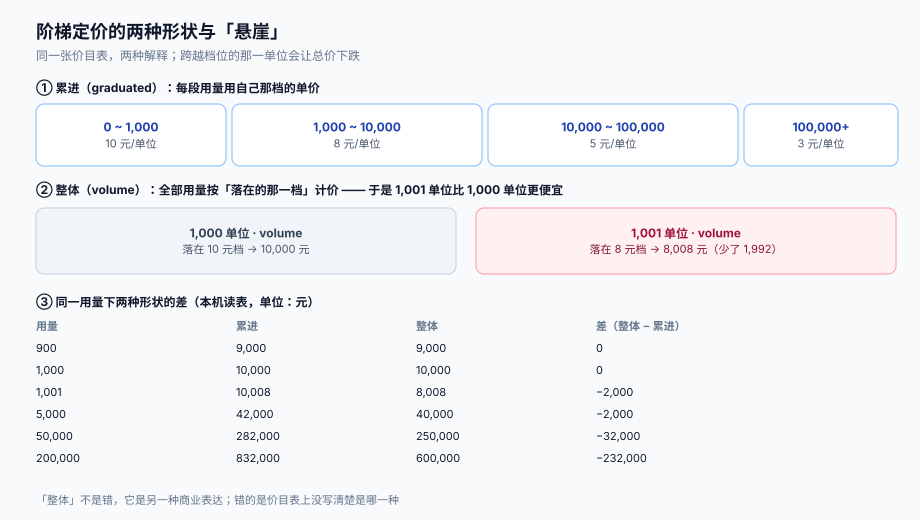

# 定价模型与价格表：阶梯、席位与封顶

价格表不是一张「单价表」，而是一组**带生效时间的规则**：同一个产品在不同时间、不同用量、不同合同下可以有不同单价，而任何一个历史账期都必须能被当时的规则重算出来。所以价格表的第一性要求不是「灵活」，而是**可版本化、可分段、可复算**。

这一页讲清四件事：价格表的形状（阶梯 / 席位 / 用量 / 固定费）、三种阶梯的解释差异（累进 / 整体 / 分段固定）、最低消费与封顶的处理、以及币种精度怎么进价格表。



本页判据族 `SBP-A` ~ `SBP-H`，共 8 条。定义表在第七节。

## 一、价格表的四层结构

| 层 | 放什么 | 变一次影响谁 | 必须带的时间字段 |
| --- | --- | --- | --- |
| **plan**（套餐） | 套餐名、包含的功能、计费周期 | 所有订阅该套餐的客户 | `effective_from` / `effective_to` |
| **price**（价格项） | 计价维度（席位 / 用量 / 固定费）、币种、单位 | 该套餐下所有账期 | `price_version` |
| **tier**（阶梯） | 分档区间与单价（或固定价） | 跨档的客户 | 随 `price_version` 走 |
| **discount**（合同折扣） | 折扣率、作用域、有效期 | 单个客户 | `starts_at` / `ends_at` |

四层里最容易漏的是**时间字段**。没有 `effective_from`，改价就是「就地覆盖」：历史账单重算出来的金额和当初开的不一样，客服复核时无法解释。本库把「改价后历史账单能不能重算成同一个数」作为价格表的头号判据（`SBP-A`）。

```sql
-- 价格表：版本化 + 生效区间，历史版本只读不删
create table price (
  id            bigserial primary key,
  plan_id       bigint      not null references plan(id),
  metric        text        not null,            -- seat / api_call / storage_gb / flat
  currency      char(3)     not null,            -- ISO 4217
  price_version text        not null,            -- 如 2026-07-01
  effective_from timestamptz not null,
  effective_to   timestamptz,                    -- null = 仍然有效
  tier_mode     text        not null check (tier_mode in ('flat','graduated','volume','package')),
  min_commit    numeric(18,4) not null default 0,
  cap_amount    numeric(18,4),                   -- null = 不封顶
  unique (plan_id, metric, price_version)
);

create table price_tier (
  price_id   bigint not null references price(id),
  seq        int    not null,
  from_qty   numeric(18,4) not null,             -- 含
  to_qty     numeric(18,4),                      -- 不含；null = 无穷
  unit_price numeric(18,6) not null,
  flat_price numeric(18,4),                      -- package 模式用：这一档整体多少钱
  primary key (price_id, seq)
);
```

::: warning 单价的小数位要留够
`unit_price` 用 `numeric(18,6)` 而不是 `numeric(18,2)`：按次计费的单价常是 `0.00002` 元/行，两位小数会把它变成 0。存储用 6 位、**结算时按币种最小单位取整**，是两件不同的事——前者是精度，后者是舍入。
:::

## 二、三种阶梯，三种商业含义

同一组区间，三种解释方式给出的钱完全不同。以「0~1,000 收 10 元/单位、1,000~10,000 收 8 元/单位、10,000~100,000 收 5 元/单位、100,000+ 收 3 元/单位」为例：

| 用量 | 累进（graduated） | 整体（volume） | 差（整体 − 累进） |
| --- | --- | --- | --- |
| 900 | 9,000 | 9,000 | 0 |
| 1,000 | 10,000 | 10,000 | 0 |
| 1,001 | 10,008 | **8,008** | **−2,000** |
| 5,000 | 42,000 | 40,000 | −2,000 |
| 50,000 | 282,000 | 250,000 | −32,000 |
| 200,000 | 832,000 | 600,000 | −232,000 |

**「整体」模式在跨越档位时会掉价**：1,001 个单位比 1,000 个单位便宜 1,992 元。这不是 bug，是 volume pricing 的固有形状（全部用量都按落点那一档计价）。它带来的直接后果是**客户会主动把用量停在档位下方**，以及**销售不敢报价**：客户问「我用到 1,001 要付多少」，答案是「比 1,000 少」。

因此：

- 面向自助注册的产品用 **累进**（用量越多单价越低，但总价单调不减）；
- 面向大客户谈判的合同可以用 **整体**，但必须在报价单上写明档位与「跨档重算」，并给出「跨档点前后总价」的对照表；
- **分段固定**（package：这一档整体 8,000 元，含 1,000~10,000 单位）适合「打包卖」，但超量部分要单独定单价，否则超 1 个单位就要跳下一档，客户会觉得被坑。

::: danger 注意
1. **不要在同一张价格表里混用 `graduated` 与 `volume`**。同一产品两个维度各用一种解释，账单上会出现「A 维度按累进、B 维度按整体」，客户核对时无法用同一套算法复现。`tier_mode` 必须在 `price` 层声明，且同一套餐内的同类维度保持一致。
2. **不要用「单价 × 总量」去实现累进**。累进必须**分段求和**：`Σ (min(qty, to_qty) − from_qty) × unit_price`。用平均单价乘总量的写法在小用量上看着对，跨档就错。
3. **不要让档位区间出现缝隙或重叠**。`to_qty` 是开区间（不含），下一档的 `from_qty` 必须等于上一档的 `to_qty`；否则 1,000 这个点要么算两次、要么漏掉。用一条 `CHECK` 或建表时的连续性校验守它。
:::

## 三、席位、最低消费与封顶

三种「非用量」的计价维度，各有各的坑：

### 席位（seat）

席位费的本质是**快照**：账单上的席位数量是「出账时刻的有效席位数」，而不是「这个月出现过的最大席位」或「平均值」。

| 口径 | 怎么算 | 适用 | 坑 |
| --- | --- | --- | --- |
| 期末快照 | 出账时的席位数 | 最常见 | 客户在出账前一天减席位，这个月就按少的收 |
| 期间最大值 | 取账期内任意时刻的最大值 | 防「月底减席位」 | 客户月中试用加了 20 个席位，当天就删了，还是要付 |
| 按天积分 | Σ(每日席位 × 1 天) / 天数 | 最公平 | 计算与解释成本最高，客户看不懂「为什么是 10.4 个席位」 |

实践里多数系统选**期末快照 + 变更折算**：席位变化本身产生一条 `sub_change`，由[折算](../Proration/index.md)在当期补差价。这样「快照」与「公平」两头都占，代价是账单上多两行。

### 最低消费（minimum commit）

合同写「每月最低消费 10,000 元」，实际用量只值 8,000 元。差额 2,000 怎么处理，有两种完全不同的做法：

| 做法 | 账单长什么样 | 客户感受 | 财务口径 |
| --- | --- | --- | --- |
| **罚没**（差额作最低消费补足） | 一行 `minimum_commit_fee = 2,000` | 「没用完也不退」 | 收入确认在本期 |
| **结转**（差额进下期抵扣） | 一行 `carryover_credit = 2,000`，下期减 | 「这个月没用完的下个月还能用」 | 形成负债（预收），不能算本期收入 |

两种都合法，但**必须写进合同**。最糟的是实现按罚没、销售口头承诺结转——这类差异在对账时表现为「账单金额与合同金额一致，但客户坚持少付」，而账上没有任何字段能证明谁对。

### 封顶（cap）

`cap_amount` 是「这张账单最多收这么多」。它看起来无害，实际会**吃掉阶梯的边际信号**：用量涨到封顶线以上，边际单价变成 0，客户没有任何动力继续优化或停止。所以封顶通常只给「防意外」场景（如按量计费的 DDoS 保护），并在合同里约定「封顶仅适用于非恶意用量」。

## 四、改价与账期的关系

改价必须能落在账期**中间**，否则「7 月 15 日调价」只能等 8 月 1 日生效，销售会绕过系统手工补差——那是最坏的结果。

```text
账期: [2026-07-01, 2026-08-01)
价格: P1 有效至 2026-07-15T00:00Z, P2 自 2026-07-15T00:00Z 起
分段: [07-01, 07-15) 用 P1  →  [07-15, 08-01) 用 P2
```

于是「一个账期一次计价」变成「一个账期按价格版本切成 N 段，逐段计价后求和」。这条设计的两个必然后果：

1. 账单行项会变多（每个价格版本至少一行），这是好事——客户能看出「7 月 15 日之后单价变了」；
2. 折算（proration）与分段计价是**两套机制**：前者处理「订阅变更」，后者处理「价格变更」。混成一套，就会出现「价格版本切换时把客户当成升级了一次」的荒唐账单。

::: tip 分段计价的实现顺序
先按 `price.effective_from` 把账期切成若干段 → 每段用该段的 `price_version` 计价 → 段内若还有订阅变更，再由折算拆成 `credit` / `charge`。**先切价格、再切变更**，顺序反了会出现「用旧价算新席位」。
:::

## 五、币种与精度

币种不是「符号」，是**三个约束**：最小单位、舍入规则、报价习惯。

| 币种 | minor unit | 1 个最小单位 | 计价影响 |
| --- | --- | --- | --- |
| CNY / USD | 2 | 0.01 | 常规：整数分运算 |
| JPY | 0 | 1 | 单价 1.5 日元/单位没有意义；必须按整数报价，否则每张账单都要舍入 |
| KWD | 3 | 0.001 | 三位小数；跨币种汇总时不能统一按 2 位截断 |

所以价格表必须存 `currency`，计价函数必须读**币种表**拿到 `minor_unit`，而不是全局写死 `× 100`。这一点与[营销计价](../../PricingPromotion/index.md)的金额纪律同源，但订阅侧多一个要求：**同一客户的同一张账单只能有一个币种**。多币种客户要拆成多张账单，否则税额与总额无法在同一币种上自洽。

## 六、定价函数的形状

把上面的规则写成一个纯函数，是保证「可复算」的最简办法：

```python
# 伪代码：纯函数，不读数据库、不取当前时间
def price_usage(qty, tiers, mode, min_commit=0, cap=None, minor_unit=2):
    if mode == "flat":
        amount = qty * tiers[0].unit_price
    elif mode == "graduated":
        amount = 0
        for t in tiers:                                  # 区间左闭右开、必须连续
            if qty <= t.from_qty:
                break
            top = qty if t.to_qty is None else min(qty, t.to_qty)
            amount += (top - t.from_qty) * t.unit_price
    elif mode == "volume":
        t = last(tiers, where=lambda x: qty > x.from_qty)
        amount = qty * t.unit_price
    elif mode == "package":
        t = last(tiers, where=lambda x: qty > x.from_qty)
        amount = t.flat_price + max(0, qty - t.to_qty) * t.unit_price

    amount = round_half_up(amount, minor_unit)           # 先按币种取整
    amount = max(amount, min_commit)                     # 再套最低消费
    if cap is not None:
        amount = min(amount, cap)                        # 最后套封顶
    return amount
```

三个细节值得注意：

1. **取整发生在最低消费与封顶之前**。顺序反了，`min_commit = 10,000.005` 这种数会留下小数位；
2. **函数不读时间**。`effective_from` 的选择在调用方（按段切分）完成，函数只吃「这一段用哪版价」；
3. **返回金额与使用的 `price_version` 一起返回**。只返回金额，账单就无法记录「按哪版价算的」。

## 七、本页判据

| 编号 | 看什么现象 | 判成什么 | 不满足时改哪里 |
| --- | --- | --- | --- |
| `SBP-A` | 任取一张历史账单，用当时的 `price_version` 能否重算出同一金额 | 重算不等即失败：价格表不可复算 | 给 `price` 加版本与生效区间，禁止就地改价 |
| `SBP-B` | `tier_mode` 是否在 `price` 层显式声明，且同类维度一致 | 混用 `graduated` / `volume` 即失败 | 统一模式，或在报价单上逐维度写明 |
| `SBP-C` | 累进计价是否分段求和，而非「平均单价 × 总量」 | 用平均单价即失败：跨档必错 | 改为分段求和实现 |
| `SBP-D` | 档位区间是否连续（`to_qty` 开区间、下一档 `from_qty` 相接） | 有缝隙或重叠即失败 | 建表校验 + 连续性单测 |
| `SBP-E` | 席位口径是否写明（期末快照 / 期间最大 / 按天积分） | 未写明即失败：客诉无法解释 | 写进合同并在账单行标注口径 |
| `SBP-F` | 最低消费差额是「罚没」还是「结转」，账单上是否有对应行项 | 两者都没有行项即失败：差额下落不明 | 补 `minimum_commit_fee` 或 `carryover_credit` 行项 |
| `SBP-G` | 封顶是否在取整之后应用，且合同写明适用范围 | 顺序颠倒或无条款即失败 | 调整顺序、补条款 |
| `SBP-H` | 计价是否读币种 `minor_unit`，而不是写死 2 位 | 写死即失败：JPY / KWD 必错 | 引入币种表，计价与展示分离 |

## 参考资料

- Stripe Billing 文档《Pricing models》（`tiers_mode` 的 `graduated` / `volume`、`transform_quantity`）：<https://docs.stripe.com/products-prices/pricing-models>
- ISO 4217 货币代码与最小单位（minor unit）：<https://www.iso.org/iso-4217-currency-codes.html>
- PostgreSQL 18 文档《Numeric Types》（`numeric` 的精度与舍入）：<https://www.postgresql.org/docs/18/datatype-numeric.html>
- [营销计价与优惠分摊](../../PricingPromotion/index.md)（单次结算的金额精度纪律）
- [多租户 SaaS · 计量与账单](../../MultiTenantSaaS/MeteringBilling/index.md)（用量从哪来）
