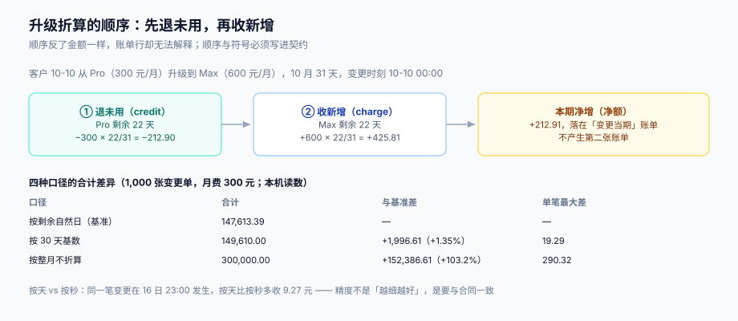

# 升降配与折算：四种口径差多少

折算（proration）是订阅计费里客诉最多的一段。原因不是算错，而是**同一件事有四种都「有道理」的算法**，而合同里通常没写用哪一种。客户按自己的理解算一遍，发现和你差几块钱，于是有了工单。

这一页把四种口径摊开对比，给出它们的差额量级，然后把「折算必须写两行」这条结构性要求讲透。



本页判据族 `SBR-A` ~ `SBR-H`，共 8 条。定义表在第七节。

## 一、四种口径

以「Pro 300 元/月，10 月 31 天，10 月 10 日升级到 Max 600 元/月」为例，剩余 22 天：

| 口径 | 计算 | 退未用（credit） | 收新增（charge） | 净额 |
| --- | --- | --- | --- | --- |
| **按剩余自然日** | `price × 剩余天数 / 当月天数` | −212.90 | +425.81 | **+212.91** |
| **按 30 天基数** | `price × 剩余天数 / 30` | −220.00 | +440.00 | +220.00 |
| **按整月不折算** | 不退不收，下期按新价 | 0 | 0 | 0（本期） |
| **按秒** | `price × 剩余秒 / 当月总秒` | −212.90 | +425.81 | +212.91 |

前两种在「31 天的月份」上就已经不同，在 2 月更明显。第三种不是「算法」，而是**商业条款**：升级当月不多收，从下期起按新价——它是很多 SaaS 的默认，因为它对客户最友好、对账最简单。

用 1,000 张变更单（月费 300 元，随机月份与日期）跑一遍，合计差异是：

| 口径 | 合计 | 与基准差 | 单笔最大差 |
| --- | --- | --- | --- |
| 按剩余自然日（基准） | 147,613.39 | — | — |
| 按 30 天基数 | 149,610.00 | +1,996.61（**+1.35%**） | 19.29 |
| 按整月不折算 | 300,000.00 | +152,386.61（**+103.2%**） | 290.32 |

（本机读数：Python 3.13 标准库，1,000 个随机变更单，月份在 1~12 月均布。）

「按整月不折算」比基准多收一倍——因为基准只收剩余部分，而它收整月。这不是「差几块钱」的量级，所以**它绝不能作为某个分支里的默认行为悄悄生效**：一旦生效，客户当月就会被多收一倍，且账单上没有任何一行能解释这个差额。

::: danger 注意
1. **不要用「按天」去近似「按秒」并宣称等价**。同一天不同时刻变更，按天会比按秒多收：16 日 06:00 多收 **2.42 元**、12:00 多收 **4.84 元**、18:00 多收 **7.26 元**、23:00 多收 **9.27 元**（月费 300 元、31 天）。量级不大，但它随「变更发生得越晚」线性增长，恰好是客户最容易注意到的场景（晚上改配置）。
2. **不要在折算时用「当前价格」而不是「本期的价格快照」**。本期账单的价格版本在开账时已定；折算发生在账期内，必须用同一个版本，否则同一次变更在预览与提交之间会差钱。
3. **不要只写一行**。只写 `charge` 不写 `credit`（升级）或只写 `credit` 不写 `charge`（降级），净额可能碰巧对，但账单上无法解释「为什么这个月多/少了这笔钱」。见第三节。
:::

## 二、四条变更路径，四种语义

| 路径 | 业务动作 | 折算内容 | 常见错误 |
| --- | --- | --- | --- |
| **升级**（upgrade） | Pro → Max，立即生效 | `credit` 退旧套餐未用 + `charge` 收新套餐剩余 | 只收新增；用旧套餐的剩余天数算新套餐 |
| **降级**（downgrade） | Max → Pro | 同上，但通常是**下期生效**（本期继续用高价套餐） | 立即降级并退差，导致「当月按低价用高价功能」 |
| **取消**（cancel） | 终止订阅 | 退未用（按合同是否可退）；不退则只置状态 | 取消即退全款，把「已消费的部分」也退了 |
| **暂停**（pause） | 暂停计费，保留数据 | 暂停期间不计费；恢复时按剩余天数折算 | 暂停仍按整月计费；恢复后重复收整月 |

四条路径里最容易被忽略的是「降级为什么通常下期生效」：本期已按高价套餐提供了服务（席位、额度、SLA），立即降级再退差，等于**用低价享受了高价**。所以降级的默认语义是「本期不变，下期生效」，而升级的默认语义是「立即生效，立即折算」——这种不对称不是设计缺陷，是商业上合理的默认，但**必须在合同和界面上写清**。

## 三、折算必须写两行

一次升级在账单上应该产生两组行项：

```text
2026-10-10  升级 Pro → Max
  credit   Pro 未用 22 天        −212.90   (line_kind = 'proration_credit')
  charge   Max 剩余 22 天        +425.81   (line_kind = 'proration_charge')
  -----------------------------------------
  本期净增                        +212.91
```

为什么不能合成一行 `+212.91`？三个理由：

1. **可解释**：客户问「为什么多收 212.91」，两行能直接对上「退 22 天旧价、收 22 天新价」；一行只能答「系统算的」。
2. **可退款**：如果这次升级后来被撤销（客户投诉、销售改单），需要冲正的正是这两行；合成一行后，冲正无法区分「退旧的」与「收新的」，只能整笔冲，容易多退。
3. **可对账**：财务按行核对时，`credit` 影响的是「已确认收入」的冲减，`charge` 影响的是「新增应收」——两者在账务上的科目不同。

对应的表结构至少要能表达「一组折算」：

```sql
alter table invoice_line
  add column group_id   uuid,          -- 同一次变更的两行共享
  add column change_id  bigint,        -- 指向 sub_change
  add column sign       smallint check (sign in (-1, 1));
```

`group_id` 的用处是「一次变更要么全冲、要么全留」：冲正时按 `group_id` 整组处理，不会只冲掉一行。

## 四、折算的时点必须被传递，不能被重算

客户在页面上看到「升级需补 212.91 元」，点确认后落库的金额必须还是 212.91。如果实现是「预览算一次、提交再算一次」，两次调用之间跨越了秒级边界，结果就会差几分。

商用实现的做法是把折算时点显式化：

| 做法 | 具体 | 优点 | 代价 |
| --- | --- | --- | --- |
| **传折算时点** | 预览返回 `proration_at`（或 `proration_id`），提交时回传 | 两次结果必然一致 | 契约多一个必填字段 |
| **传变更单** | 预览时先落一条 `sub_change(draft)`，提交时只改状态 | 变更流水完整、可审计 | 需要清理草稿单 |
| **服务端缓存预览结果** | 预览结果存 Redis，5 分钟有效 | 实现简单 | 缓存穿透/过期后重算，仍可能差几分 |

Stripe 的做法是第一种：`proration_date` 参数在预算（`create_preview`）与提交（`subscription.update`）时传同一个值，文档明确写「因为按秒折算，预览与提交之间金额可能变化」。

::: tip 一条实现纪律
**凡是「先给客户看、再落库」的金额，都必须带一个可回传的凭据**。凭据可以是一个 ID、一个时间点、一张草稿单——形式不限，但它必须让第二次调用能复现第一次的计算。这条纪律不只适用于折算，也适用于报价、优惠试算（见[营销计价 · 试算与结算同源](../../PricingPromotion/Consistency/index.md)）。
:::

## 五、席位变化：折算与快照的分工

席位是订阅里最常见的变更维度，它的折算有一个额外要求：**先定快照，再算差额**。

| 时刻 | 席位数 | 事件 | 账单影响 |
| --- | --- | --- | --- |
| 10-01 | 10 | 出账，`seat_snapshot = 10` | 10 × 50 = 500（整月） |
| 10-10 | 15 | `sub_change`：加 5 席位 | `charge = 5 × 50 × 22/30 = 183.33` |
| 10-25 | 12 | `sub_change`：减 3 席位 | `credit = 3 × 50 × 7/30 = 35.00` |
| 11-01 | 12 | 下期快照 = 12 | 12 × 50 = 600 |

三条规则：

1. **每次变更都要落 `sub_change`**（含变更前后的值）。没有它，账单上的 `charge` / `credit` 无法对应到业务动作。
2. **快照在出账时取一次**，之后整个账期都用它作为「基线」，变更只在其上做加减。每算一行就读一次当前值，会把中间态混进来。
3. **同一天多次变更要合并成一条净变更，或按时间排序逐条折算**。两种都可以，但不能「按天去重后取最后一个」——那会丢掉中间的加减。

「月中加 5 个席位」的两种商业口径差异（10 席位、50 元/席位/月、30 天月）：

| 加入日期 | 按天折算 | 下期生效（当期不收） | 差 |
| --- | --- | --- | --- |
| 10-05 | 716.67 | 750.00 | −33.33 |
| 10-15 | 633.33 | 750.00 | −116.67 |
| 10-25 | 550.00 | 750.00 | −200.00 |

（本机读数：按 `5 × 50 × 剩余天数 / 30` 计算。）差额从月末往前线性增大——**这正是客户投诉「我 25 号才加，为什么收我全月」的来源**。所以「加席位是否立即折算」必须在合同里写清，并在购买页显式提示「本次将立即收取 183.33 元」。

## 六、退差、税费与信用票据

折算产生的负数行项（`credit`）在账务上不等于「退款」：它只是把**本期应收**减下来。真正退钱需要另一条链路：

| 场景 | 处理 | 产生什么 |
| --- | --- | --- |
| 升级折算 | 负数行项抵减本期应收 | 无需额外单据 |
| 已支付后再退差 | 出信用票据（credit note）+ 退款单 | `credit_note` + `refund` |
| 取消并退未用 | 信用票据 + 退款，或只记 `carryover` 抵扣下期 | 二选一，写进合同 |
| 计费错误需冲正 | 原账单 `void` + 重开，差额走信用票据 | `invoice(supersedes_id)` |

税额要跟着一起退：`credit_note` 必须带上原账单的税率与税额，否则「退了钱但税没退」，申报时对不上。这一点在[账单结构](../Invoice/index.md)的信用票据一节展开。

## 七、本页判据

| 编号 | 看什么现象 | 判成什么 | 不满足时改哪里 |
| --- | --- | --- | --- |
| `SBR-A` | 折算口径（按天 / 按秒 / 30 天基数 / 不折算）是否写进合同与页面提示 | 未写明即失败：客诉无解 | 补条款 + 购买页显示预计金额 |
| `SBR-B` | 一次变更是否产生 `credit` 与 `charge` 两行（或明确 0） | 只有一行即失败：净额不可解释 | 按第三节拆两行，共享 `group_id` |
| `SBR-C` | 折算是否使用本期价格快照，而不是当前价 | 用当前价即失败：预览与提交会差 | 从 `invoice` 或 `price_version` 取 |
| `SBR-D` | 预览与提交是否用同一个折算时点 | 两次各取当前时间即失败 | 传 `proration_at` / `proration_id` / 草稿单 |
| `SBR-E` | 降级是否本期生效（与升级不对称）且写明理由 | 立即降级退差即失败：用低价享高价 | 改为下期生效，或按已用天数折算 |
| `SBR-F` | 席位变更是否落 `sub_change`，出账是否用 `seat_snapshot` | 缺变更流水即失败：账单无法对应业务动作 | 补变更表 + 快照字段 |
| `SBR-G` | 冲正是否按 `group_id` 整组处理 | 可只冲一行即失败：账会歪 | 冲正逻辑按组，加约束 |
| `SBR-H` | 信用票据是否带原税率与税额 | 缺失即失败：退了钱没退税 | `credit_note` 补税率/税额字段 |

## 参考资料

- Stripe Billing《Prorations》（`proration_behavior` 三值、按秒折算、`proration_date` 保证预览一致）：<https://docs.stripe.com/billing/subscriptions/prorations>
- Stripe API《Update a subscription》（`proration_behavior` 与 `proration_date` 参数定义）：<https://docs.stripe.com/api/subscriptions/update>
- [账单结构、税额口径与信用票据](../Invoice/index.md)（`credit` 行项如何进账单与票据）
- [营销计价 · 试算与结算同源](../../PricingPromotion/Consistency/index.md)（「先给客户看、再落库」的凭据纪律）
- [多租户 SaaS · 生命周期](../../MultiTenantSaaS/Lifecycle/index.md)（升降配的业务状态机）
