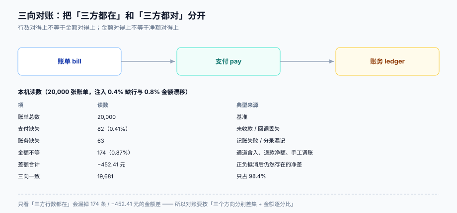

# 三向对账与收入确认边界

计费系统最容易「看起来没问题」的地方就是对账：账单总数对得上、支付总额对得上、账面收入也对得上——但那只说明**总量巧合**。真正要回答的是：**每一张账单，是否都能在支付侧找到一笔等额的收款，并在账务侧找到对应的一组分录。**



本页判据族 `SBS-A` ~ `SBS-H`，共 8 条。定义表在第七节。

## 一、三向是哪三向

| 向 | 数据源 | 主键 | 金额字段 | 谁产出的 |
| --- | --- | --- | --- | --- |
| **账单**（bill） | `invoice` | `invoice.id` | `total` | 计费系统 |
| **支付**（pay） | 通道流水 / `payment` | `channel_txn_id`，另存 `bill_id` | 实收金额 | 支付通道 |
| **账务**（ledger） | `journal_entry` | `entry.id`，另存 `bill_id` | 分录金额 | 记账系统 |

三向的差异不是「谁错了」，而是**三个系统各自有自己的失败模式**：账单可能重复出、支付可能回调丢失、账务可能分录失败。所以对账的产出不是一个「差异数」，而是**一张带归口的差异清单**。

```sql
-- 一个方向：账单有、支付没有（未收款或回调丢失）
select i.id, i.total, 'MISS_PAY' as diff_type
  from invoice i
  left join payment p on p.bill_id = i.id and p.status = 'success'
 where i.status in ('open','paid','uncollectible')
   and p.id is null;

-- 金额不等：两边都在，但差钱
select i.id, i.total, p.amount, p.amount - i.total as gap, 'AMT_GAP' as diff_type
  from invoice i
  join payment p on p.bill_id = i.id and p.status = 'success'
 where p.amount <> i.total;
```

## 二、只看「三方都在」会漏掉什么

本机 20,000 张账单，注入了 0.4% 的缺行与 0.8% 的金额漂移（模拟通道舍入、退款净额、手工调账）：

| 项 | 读数 |
| --- | --- |
| 账单总数 | 20,000 |
| 支付侧缺失 | 82（**0.41%**） |
| 账务侧缺失 | 63 |
| 金额不等 | 174（**0.87%**） |
| 差额合计 | **−452.41 元** |
| 三向完全一致 | 19,681（98.4%） |

三个结论：

1. **行数对得上不等于金额对得上**：174 条差异里，三方行都在。只按「`bill_id` 是否存在」判平的对账，会把这 174 条全部判成通过。
2. **差额合计会被正负抵消**：174 条里正负都有，净额只有 −452.41 元。如果只看净额，会得出「差得很少」的结论；实际单条最大差可能是几千元。
3. **缺失率不到 1% 也需要逐条处理**：82 条支付缺失里，可能是「客户真没付」，也可能是「回调丢了但钱到了」——后者是**你欠客户的服务**，必须人工确认。

## 三、差异的六类归口

对账的价值在于「差异有主」，而不是「差异为零」。六类归口覆盖绝大多数情况：

| 归口 | 典型成因 | 处置 | 责任方 |
| --- | --- | --- | --- |
| **未收款** | 客户未付、卡失效 | 交给催收（`dunning`），不修数据 | 客户成功 |
| **回调丢失** | 通道回调失败、你的接口 5xx | 主动查单（`query`）补记支付 | 支付集成 |
| **重复入账** | 回调重放、补单脚本跑两次 | 冲正多余的一笔，`payment` 加唯一键 | 支付集成 |
| **金额漂移** | 通道手续费、退款净额、币种换算 | 建一条 `adjustment`，写明口径 | 财务 |
| **分录缺失** | 记账异步失败、MQ 丢消息 | 重放记账（幂等），补分录 | 账务 |
| **账单侧错误** | 重复出账、折算错、税额错 | 红冲 + 重开 | 计费 |

归口之后，对账日报的形态才成立：**不是「今天差 452 元」，而是「今天 174 条差异，其中 121 条金额漂移已归口财务、53 条分录缺失已自动重放」**。前者没人能行动，后者每条都有主。

::: danger 注意
1. **不要用「总额相等」作为对账通过的条件**。正负差异会抵消：本机 174 条差异的净额只有 −452.41 元，而单条最大差可能是几千元。判据必须是「逐 `bill_id` 逐分相等」。
2. **不要让对账作业「顺手修数据」**。对账的产出是差异清单，修数据是另一个动作（且必须留痕）。混在一起，出问题时无法区分「对账判错了」还是「修复改错了」。
3. **不要在空库上验收对账**。空库上跑三向差集当然是 0；正确的验收是先灌一批已知差异（比如 36 条），跑出 36，再修完跑出 0，并留下「36 → 0」的记录。
:::

## 四、增量与全量：两个口径，两个用途

| 口径 | 范围 | 频率 | 用途 | 成本 |
| --- | --- | --- | --- | --- |
| **增量** | 最近 N 天（如 7 天）内变动的账单与支付 | 每小时 | 当天发现、当天修 | 低（本机 17.0 ms 量级） |
| **全量** | 整个历史（或近 13 个月） | 每天/每周 | 抓「改了历史数据」与「增量窗口漏掉的」 | 高（本机 42.5 ms 量级，随数据量线性增长） |

两个口径都要有，因为它们的盲区不同：增量看不见「上周的账单被手工改了」，全量看不见「今天刚发生、还没落进快照的差异」。增量用 `updated_at > now() - interval '7 days'`，全量用分区表按 `period` 扫。

::: tip 增量对账要有「重叠窗口」
增量窗口不能正好是「上次跑到这次」（比如每小时跑、窗口 1 小时）：作业延迟、时钟漂移、事务提交晚于 `updated_at`，都会漏。窗口设成频率的 3~7 倍（每小时跑、窗口 7 天），靠幂等去重，成本可接受。
:::

## 五、四态幂等：差异也要有状态机

对账结果不是「一次性报告」，而是一张会变化的表：

```sql
create table recon_diff (
  id          bigserial primary key,
  bill_id     bigint not null,
  diff_type   text   not null,                    -- MISS_PAY / AMT_GAP / DUP_PAY / ...
  amount      numeric(18,2) not null,
  status      text   not null check (status in ('open','assigned','resolved','ignored')),
  owner       text,
  first_seen  timestamptz not null default now(),
  last_seen   timestamptz not null default now(),
  resolved_at timestamptz,
  unique (bill_id, diff_type)                     -- 同一差异不重复建单
);
```

四态的意义：

- `open`：新发现，还没人认领；
- `assigned`：已归口到某个责任方（含 SLA 到期时间）；
- `resolved`：已修复（数据已对齐），**下一轮对账确认它消失**才算真修好；
- `ignored`：确认为「可接受差异」（如通道手续费），带原因与审批。

`unique (bill_id, diff_type)` + `last_seen` 让作业可以重跑：同一差异反复出现只更新时间戳，不会刷出几百条重复记录。这条与[幂等与状态机](../../IdempotencyStateMachine/Overview/index.md)的写法同源。

## 六、收入确认：账单不等于收入

这是财务与研发最容易吵起来的一条边界：

| 概念 | 是什么 | 什么时候确认 |
| --- | --- | --- |
| **应收**（AR） | 账单开出去、客户欠你的钱 | 账单 `issued_at` |
| **预收**（deferred revenue） | 客户先付了，但服务还没提供 | 收款时记负债 |
| **收入**（revenue） | 服务已经提供 | 按履约进度（订阅通常按天/按月摊销） |

年付 12,000 元的客户，1 月收到的钱在账上是**预收负债**，收入要按月摊 1,000 元。计费系统不需要做摊销，但它必须提供两个东西给账务：

1. **服务期间**（`service_start` / `service_end`），让账务能算摊销；
2. **账单与收款的对应关系**（`payment.bill_id`），让「这笔钱对应哪张账单」可查。

反过来，如果计费系统把「已收」直接当「收入」，那么月度报表会在续费月出现收入尖峰，而在服务月归零——这不是计费错误，是口径错误，但它会毁掉所有基于收入的决策。

::: warning 退税与红冲的收入影响
红冲会减少「应收」，但**不自动减少已确认收入**：如果对应的服务已经提供，收入不能冲回（要记「销售退回」或减值）；如果服务未提供，则冲减预收。这条判断属于账务，计费系统只负责把 `credit_note` 与原账单、原服务期间关联起来。
:::

## 七、本页判据

| 编号 | 看什么现象 | 判成什么 | 不满足时改哪里 |
| --- | --- | --- | --- |
| `SBS-A` | 对账是否逐 `bill_id` 逐分比对，而非只看总额/行数 | 只看总额即失败：正负抵消会掩盖差异 | 改成三向差集 + 金额逐分比 |
| `SBS-B` | 每条差异是否都有归口（六类之一）与责任人 | 无归口即失败：差异无法行动 | 补 `diff_type` 枚举与 `owner` |
| `SBS-C` | 增量与全量两个口径是否都在跑 | 只有一种即失败：各有盲区 | 增量每小时、全量每天 |
| `SBS-D` | 增量窗口是否 ≥ 频率的 3 倍（重叠窗口） | 窗口 = 频率即失败：必漏 | 窗口设 7 天，靠唯一键去重 |
| `SBS-E` | `recon_diff` 是否有 `(bill_id, diff_type)` 唯一键与 `last_seen` | 缺失即失败：重跑刷重复单 | 加唯一键，作业 upsert |
| `SBS-F` | `resolved` 是否要求「下一轮对账确认消失」 | 修完即置 `resolved` 即失败：假修复 | 加一轮验证再置终态 |
| `SBS-G` | 账单是否提供 `service_start` / `service_end` 供摊销 | 缺失即失败：账务无法分期确认 | 账单行或账单头补服务期间 |
| `SBS-H` | 验收是否在「灌入已知差异」的数据上做（而非空库） | 空库验收即失败：永远为 0 | 灌 36 条已知差异，跑出 36 → 修完 0 |

## 参考资料

- Stripe Billing 文档《Reconciliation》（账单、支付意图与余额交易的对应关系）：<https://docs.stripe.com/payments/reconciliation>
- 《企业会计准则第 14 号——收入》（2017 修订）：履约义务、分摊与分期确认
- PostgreSQL 18 文档《Aggregate Functions》与《WITH Queries》（三向差集的 `full join` / `except` 写法）：<https://www.postgresql.org/docs/18/queries-with.html>
- [账务与清结算](../../Ledger/Reconciliation/index.md)（分录侧的对账实现）
- [账单结构、税额口径与信用票据](../Invoice/index.md)（`credit_note` 与应收的关系）
- [实战：最小可跑的订阅计费](../Practice/index.md)（S5 三向对账的验收 SQL）
