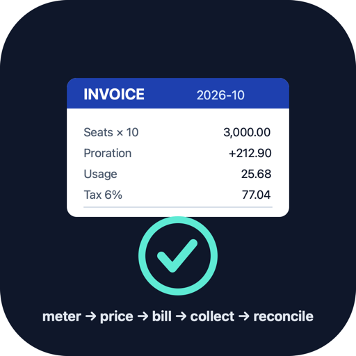
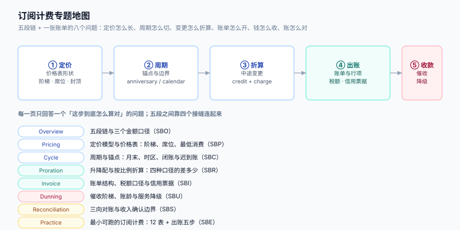

# 订阅计费与周期账单工程

一次性订单的钱是「算出来」的，订阅的钱是「**按期滚出来**」的。同一份价格表，会在 12 个月、36 个账期里被反复使用；期间客户升级、降级、加席位、暂停、退款、逾期，每一次变更都要在同一张账单上留下**可解释的一行**。所以订阅计费的核心不是定价公式，而是**周期边界、折算口径、账单结构、催收状态、对账基准**这五件事能不能自洽。

本专题只讲**从「本期用量与订阅状态」到「收到的钱」这一段链路**：价格表怎么长、周期怎么切、变更怎么折算、账单怎么开、钱怎么催、账怎么对。计量段的去重与迟到归期已经由[多租户 SaaS · 计量与账单](../MultiTenantSaaS/MeteringBilling/index.md)的 `MTR` 族讲透，本专题从它的输出（聚合结果）接手，不重复讲事件怎么去重。

::: tip 一句话理解
订阅计费的难点不在「这个月该收多少」，而在**同一份价格表被 12 个账期、上千次变更同时引用之后，每一分钱还能追回到「哪条规则、哪段时间、哪次变更」**。
:::

::: info 本专题与相邻专题的分工
- **事件去重、迟到归期、账单行可解释** → [多租户 SaaS · 计量与账单](../MultiTenantSaaS/MeteringBilling/index.md)：那页的 `MTR` 族管「计量准不准」，本专题管「拿计量结果怎么算钱、怎么开票、怎么收」。**本专题不重复讲 `event_id` 去重**，只在[周期与闭账](Cycle/index.md)里补「迟到事件到达之后，账单侧有哪两种处理，各自的代价是多少」。
- **单次订单的优惠叠加、最优券、分摊** → [营销计价与优惠分摊](../PricingPromotion/index.md)：那是「一次结算」，本专题是「周期性滚账」。两者共用金额精度与舍入纪律，但**折扣的作用域不同**：券作用于一张订单，合同折扣作用于一个订阅的所有账期。
- **复式记账、清结算、资金对账** → [账务与清结算](../Ledger/index.md)：那边管分录与结算周期，本专题只保证「交给记账的 `invoice_amount` 可分、可解释、可与收款对上」。
- **配额执行与租户生命周期** → [多租户 SaaS · 生命周期](../MultiTenantSaaS/Lifecycle/index.md)：升降配的**业务动作**在那边，本专题管「这个动作在账单上产生几行、每行多少钱」。
- **催收通知的通道与频控** → [消息通知与触达工程](../NotificationDelivery/index.md)：那边管「怎么把消息发出去且不被投诉」，本专题管「什么时候该发、发几轮、发完还没付就把服务降到哪一档」。
- **作业幂等与重放** → [幂等与状态机工程](../IdempotencyStateMachine/IdempotencyKey/index.md)：出账作业的幂等键形状在那边，本专题只讲「为什么出账必须可重跑、重跑的唯一键长什么样」。
- **云账单与成本分摊** → [容量与成本](../../Ops/CapacityCost/Overview/index.md)：那是**你付出的钱**，本专题是**你收到的钱**；两者的周期、税率、对账对象完全不同，混在一起算会把毛利算反。
:::

## 目录

- [总览：五段计费链与三个金额口径](Overview/index.md)
- [定价模型与价格表：阶梯、席位与封顶](Pricing/index.md)
- [周期与闭账：锚点、时区与迟到账](Cycle/index.md)
- [升降配与折算：四种口径差多少](Proration/index.md)
- [账单结构、税额口径与信用票据](Invoice/index.md)
- [催收阶梯、账龄与服务降级](Dunning/index.md)
- [三向对账与收入确认边界](Reconciliation/index.md)
- [实战：一个能跑起来的最小订阅计费](Practice/index.md)
- [常见问题与分诊](FAQ/index.md)

## 专题地图

## 判据纪律

沿用全库写法：**每页 8 条，编号形如 `SBO-A`**，逐页前缀唯一，可被 `utils/audit` 下的判据类巡检机械核对。每条判据回答四件事：**看什么现象、判成什么、不满足时改哪里**。

| 页 | 判据族 | 这一族管什么 | 条数 |
| --- | --- | --- | --- |
| 总览 | `SBO-A` ~ `SBO-H` | 五段链、三个金额口径、五个必失点、接缝归属 | 8 |
| 定价 | `SBP-A` ~ `SBP-H` | 价格表版本、阶梯形状、席位、最低消费、封顶、币种精度 | 8 |
| 周期与闭账 | `SBC-A` ~ `SBC-H` | 周期锚点、月末、时区、闭账时点、迟到账两法、出账批 | 8 |
| 折算 | `SBR-A` ~ `SBR-H` | 折算口径、credit/charge 双行、升降配、暂停、取消、退差 | 8 |
| 账单与票据 | `SBI-A` ~ `SBI-H` | 行项四类、税额口径、小计自洽、信用票据、红冲、状态机 | 8 |
| 催收与降级 | `SBU-A` ~ `SBU-H` | 阶梯、账龄、重试节奏、降级三档、恢复幂等、DSO | 8 |
| 对账 | `SBS-A` ~ `SBS-H` | 三向差集、归口、增量与全量、四态幂等、收入确认边界 | 8 |
| 实战 | `SBE-A` ~ `SBE-H` | 表结构、出账五步、负向验收、可重跑、验收 SQL | 8 |
| 常见问题 | `SBQ-A` ~ `SBQ-H` | 分诊表、误判、止血顺序、上线自查 | 8 |

合计 **9 族 72 条**。

## 事实与规格速览（2026-10 口径）

订阅计费没有「版本升级」这种说法，但下面这些事实会直接决定实现细节，写清楚以免被旧文误导：

| 事项 | 现状 | 对计费链路的影响 |
| --- | --- | --- |
| 金额最小单位 | ISO 4217 定义各币种 minor unit：人民币/美元 **2** 位、日元 **0** 位、科威特第纳尔 **3** 位 | 「乘 100 存整数」不是通解；币种表必须进价格表，不能写死 2 |
| 时间与时区 | 周期边界是**本地时间**的语义（客户理解的「每月 1 日」），存储必须是 UTC 时刻 | 换算必须显式带时区（IANA tzdata），不能用服务器默认时区——同一批作业在 UTC 与 UTC+8 机器上会切出不同的账期 |
| 折算精度 | 主流商用实现按**秒**折算（如 Stripe `proration_behavior` 文档明确「prorates to the second」） | 按天折算会把「不足一天按一天」的偏差放大到单笔几元；本机读数：16 日 23:00 变更，按天比按秒多收 **9.27 元**，见[折算](Proration/index.md) |
| 折算行为开关 | Stripe 的 `proration_behavior` 三值：`create_prorations`（默认，生成待开票项）/ `always_invoice`（立即开票并扣款）/ `none`（不折算，下期按新价全额） | 三值不是「精度选项」而是**商业条款**：选 `none` 就意味升级当月不多收，必须在合同里写明 |
| 预览与提交一致 | 同一份订阅变更，预览与提交必须传同一个折算时点（Stripe 用 `proration_date`） | 预览到提交之间跨越了秒级边界，金额就会差几分——客诉里「你页面写 212.91，扣我 212.93」全是这一类 |
| 发票与账单的关系 | 发票按**行**开具，行金额与税额必须逐行可核对；具体票种、税率以当地税务机关规定为准 | 税额按行算还是按总额算，会直接决定发票能不能与账单对上：本机 1,000 张账单里 **41.60%** 两种口径不一致，见[账单结构](Invoice/index.md) |
| 收入确认 | 《企业会计准则第 14 号——收入》（2017 修订）按履约义务分期确认 | 账单是「应收」，不等于「收入」；预收的年度费要按月摊销，这条边界写在[三向对账](Reconciliation/index.md) |

## 为什么这里没有版本目录

本专题**不建 `v1/` `v2/` 这类版本目录**，理由三条：

1. **换代的是产品，不是判据**。从「按月订阅」到「按用量 + 席位混合」再到「按结果计费」，变的是商业模型的形状；而「周期边界必须可预期」「变更要出两行」「账单小计必须由行项推出」这三类问题一字未变。判据跟着问题走，不跟着商业模式走。
2. **并存差异是条款，不是代际**。同一时期里，有人按自然月出账、有人按周年日出账；有人升级立即折算、有人下期生效——它们是**三种合同条款**，不是新旧版本。按版本建目录会把「条款对照」拆成「历史存档」，读者反而要跨目录才能比较。
3. **可验证的差异已收敛进表格**。凡是有「两种做法」的地方（按天 vs 按秒、按行税额 vs 按总额税额、重开账单 vs 滚下期），都用同一张表写清「什么时候用哪个、差多少」，并附本机读数。

作为对照，本库确实存在需要版本目录的主题：[Spring 5 / Spring 6](../Java/Frame/Spring/index.md)、[Vue 2 / Vue 3](../../Frontend/Frame/Vue/index.md)、[MySQL 5.7 / 8.4](../../DB/SchemaEvolution/index.md)——它们的共同点是**同一个产品的两代 API 不兼容且旧版仍在跑**，与本题不同。

## 三条底线

::: danger 三条不可让步的底线
1. **账单的 `total` 必须由行项推出，不能反过来「凑」**。行项是小计、税额、总额的唯一来源；一旦出现「总额定死、行项凑数」的写法，这张账单就再也无法解释。本机实测：按行算税额与按总额算税额，**41.60% 的账单**结果不同（最大差 0.03 元）——差额虽小，但发票是按行开的，对不上就是红冲。见[账单结构](Invoice/index.md)。
2. **出账作业必须可重跑，且有唯一键**。没有 `(tenant_id, period)` 唯一约束的出账作业，跑两遍就是两张账单：本机 1,000 个租户跑两遍，无唯一键得到 **2,000 张账单**，有唯一键仍是 **1,000 张**。见[实战](Practice/index.md)。
3. **对账不能只看「三方行数都在」**。20,000 张账单里，三方行都在但金额不等的有 **174 条**、净差 **−452.41 元**；只看行数的对账会把它们全部判成「已对平」。见[三向对账](Reconciliation/index.md)。
:::

## 阅读顺序

先读[总览](Overview/index.md)拿到五段链与三个金额口径，然后按手上的问题选主线：

- **客户投诉「这个月金额不对」** → [常见问题与分诊](FAQ/index.md) 的分诊表，再按指向跳
- **要设计价格表（阶梯 / 席位 / 封顶）** → [定价模型](Pricing/index.md)
- **搞不清「这个月到底哪几天算这个月」** → [周期与闭账](Cycle/index.md)
- **升级降级该收多少、为什么差了几块钱** → [折算](Proration/index.md)
- **账单与发票对不上、需要红冲** → [账单结构](Invoice/index.md)
- **逾期怎么催、什么时候停服** → [催收与降级](Dunning/index.md)
- **要证明「收的钱一笔不少」** → [三向对账](Reconciliation/index.md)
- **要从零搭一个能验收的最小系统** → [实战](Practice/index.md)，按 S1~S5 走

## 参考资料

- Stripe Billing 文档《Prorations》（`proration_behavior` 三值、按秒折算、`proration_date`）：<https://docs.stripe.com/billing/subscriptions/prorations>
- Stripe API 参考《Update a subscription》（`proration_behavior` 与 `proration_date` 参数语义）：<https://docs.stripe.com/api/subscriptions/update>
- ISO 4217 货币代码与最小单位（minor unit）表：<https://www.iso.org/iso-4217-currency-codes.html>
- ISO 8601-1:2019《日期与时间表示法》与 RFC 3339（时间戳与时区偏移）：<https://www.rfc-editor.org/rfc/rfc3339>
- IANA 时区数据库（tzdata，账单边界换算的事实来源）：<https://www.iana.org/time-zones>
- 财政部《企业会计准则第 14 号——收入》（2017 年修订，财会〔2017〕22 号）
- PostgreSQL 18 文档《Date/Time Types》与《Aggregate Functions》（`timestamptz`、`date_trunc`、`generate_series`）：<https://www.postgresql.org/docs/18/datatype-datetime.html>
