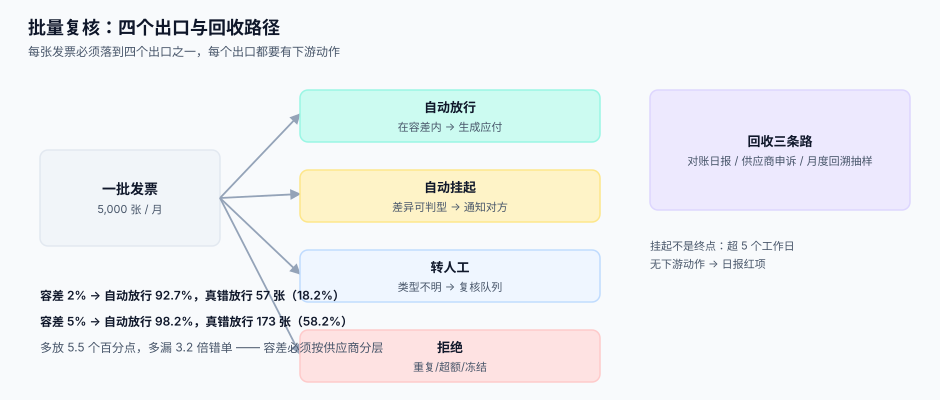

# 三单匹配的批量复核

<p style="text-align:center;"></p>

单张三单匹配的判据在[三单匹配与容差](../../ProcureToPay/InvoiceMatch/index.md)里已经讲完。这一页讲的是另一个问题：**当一个月有一万张发票、而你只能人工看其中几百张时，怎么保证剩下的九千多张没有放错。** 这不是匹配算法问题，是抽样与闸门问题。

::: tip 一句话理解
**批量复核的目标不是「一张都不错」，而是「错的那些一定能被回收」。** 前者做不到，后者可以设计。
:::

## 与单张匹配的分工

| 维度 | 单张匹配 | 批量复核 |
| --- | --- | --- |
| 输入 | 一张发票 + 对应订单 + 收货 | 一批发票（数千张） |
| 判定 | 匹配 / 不匹配 / 差多少 | 自动放行 / 挂起 / 转人工 |
| 容差 | 单张的绝对与相对容差 | **同一容差在批量下的放行率与漏放率** |
| 风险 | 单张判错 | **系统性放错**（一整类都被放过） |
| 兜底 | 人工看一张 | 抽样 + 事后回收 + 供应商申诉 |

## 容差设计：三个数一起看

容差不是「宽松一点省人力」，它同时决定三件事：自动放行率、漏放率、以及**争议成本**。

| 容差 | 自动放行率 | 真错被放行 | 占注入错误的 |
| --- | --- | --- | --- |
| 0% | 0.0% | 0 张 | 0.0% |
| 2% | **92.7%** | **57 张** | **18.2%** |
| 5% | **98.2%** | **173 张** | **58.2%** |

本机模拟：5,000 张发票、金额 200-20,000 元均匀分布；正常误差 `N(0, 0.9%)`；**6% 的发票被注入 0.4%-7% 的偏差**（视为真错）。判据「真错」= 注入且偏差 > 1%。

三个数读出来的结论很硬：**容差从 2% 放到 5%，自动放行只多 5.5 个百分点（92.7% → 98.2%），但真错放行多了 3.2 倍（57 → 173 张）**。省下的 275 张人工单，换来 116 张错单进账。所以容差的调整必须是**按供应商分层**的，不是全局一个数。

```sql
-- 容差按供应商分级：新供应商 0%、常规 2%、战略供应商 5%（需季度评审）
CREATE TABLE match_tolerance (
  id          INTEGER PRIMARY KEY,
  supplier_id INTEGER NOT NULL,
  tier        TEXT NOT NULL,            -- 'new' | 'regular' | 'strategic'
  abs_tol     NUMERIC(18,2) NOT NULL,   -- 绝对容差（元）
  pct_tol     NUMERIC(5,4) NOT NULL,    -- 相对容差（0.02 = 2%）
  valid_from  TEXT NOT NULL,
  approved_by TEXT NOT NULL,
  UNIQUE (supplier_id, valid_from)
);
```

::: danger 容差的三条纪律
1. **绝对容差与相对容差同时满足才算通过**：`|diff| <= abs_tol OR |diff| / base <= pct_tol` 是错的，应该是 `AND`。用 `OR` 时，一张 1,000 万的发票只要差 1 万元（0.1%）就自动放行，绝对容差形同虚设。
2. **容差必须带 `approved_by`。** 容差是「允许错多少」的授权，没有审批人的容差就是事故后的第一份证据。
3. **容差不许按「差额绝对值」一刀切。** 100 元的 5% 是 5 元，100 万的 5% 是 5 万——后者绝不可能是「允许的误差」。
:::



## 四个出口

批量处理的每一张发票必须落到四个出口之一，且**每个出口都要有下游动作**：

| 出口 | 条件 | 下游动作 | 谁负责 |
| --- | --- | --- | --- |
| **自动放行** | 三维匹配通过且在容差内 | 生成应付、进入付款排程 | 系统 |
| **自动挂起** | 有明确差异且可自动判定类型 | 生成差异单、通知供应商 | 系统 → 对方 |
| **转人工** | 差异存在但类型不明，或金额超阈值 | 进复核队列、按金额×风险排序 | 财务 |
| **拒绝** | 重复发票、超累计开票额、供应商被冻结 | 退回并记录拒绝原因 | 系统 |

::: warning 「挂起」不能是终点
大量系统里「挂起」只是把状态改成一个值，然后就再没人动它。**挂起超过 5 个工作日没有下游动作的，必须是日报里的红项**——因为它意味着这笔钱既没付也没拒，双方都在等对方。
:::

## 复核队列：排序比数量重要

人工只看得到几百张时，**先看哪一张**决定了复核的价值。

| 排序维度 | 权重来源 | 为什么 |
| --- | --- | --- |
| 金额（绝对） | 发票总额 | 大额错的代价最高 |
| 差异率 | `diff / base` | 找出「小金额大比例」的异常 |
| 供应商历史 | 该供应商近 90 天被拒率 | 老问题供应商优先 |
| 账期紧迫度 | 距折扣截止天数 | 快到期先看，避免丢折扣 |
| 重复度 | 同 `(supplier, invoice_no)` 出现次数 | 重复发票是最高频的严重错误 |

```sql
-- 队列排序：金额分位 + 差异率 + 历史被拒率 的加权分
SELECT i.id, i.invoice_no, i.amount, d.diff_amount,
       CASE WHEN d.base_amount = 0 THEN 0 ELSE ABS(d.diff_amount) / d.base_amount END AS diff_rate,
       s.reject_rate_90d
FROM invoice i
JOIN match_diff d ON d.invoice_id = i.id
JOIN supplier_score s ON s.supplier_id = i.supplier_id
WHERE i.status = 'manual_review'
ORDER BY (i.amount * 0.4
        + ABS(d.diff_amount) * 2.0
        + s.reject_rate_90d * 5000) DESC
LIMIT 50;
```

## 抽样：AQL 管的是「批」，不是「张」

如果某类差异必须靠人工判断，就必然要抽样。抽样的口径要写清楚，否则「我们抽了 30 张没问题」这句话没有任何证明力。

| 概念 | 含义 | 常见误用 |
| --- | --- | --- |
| 批量（lot） | 一次抽样的总体，如「某供应商本月全部发票」 | 把整月所有供应商当成一个批 |
| AQL | 可接受质量水平，允许的缺陷率上限 | 把 AQL 当成「目标缺陷率」 |
| Ac / Re | 判定数 / 拒收数：缺陷数 ≤ Ac 接收 | 只看比例不看 Ac |
| 检验水平 | 一般检验水平 I/II/III，决定样本量 | 随意定样本量（如「抽 30 张」） |

::: danger 抽 30 张能证明什么
在 1,000 张的批里抽 30 张、零缺陷，只能说明「缺陷率大概率低于 10% 左右」——**它证明不了「没有错」**。若你要求「缺陷率 ≤ 1%」，需要的样本量在几百张量级（具体按 GB/T 2828.1 的 AQL 表查，随批量与检验水平变化）。写验收标准时，把「抽查 30 张无异常」改成「按 AQL 1.0、水平 II 抽样，Ac=0」这类可复算的说法。
:::

## 事后回收

批量放行的错单只能靠事后发现，所以要设计三条回收路径：

1. **对账日报**：每日把「已放行但后续被红冲/调整」的单据单独列一行（见[对账日报](../ReconciliationDaily/index.md)）。
2. **供应商申诉**：门户里给对方一个「我认为这笔对不上」的入口，申诉单必须挂到具体发票行。
3. **月度回溯抽样**：从已放行批次里随机抽 1%，用全量匹配重跑一遍，统计「如果当时不放行，会有多少被拦下」——这个数就是容差的实际代价。

```sql
-- 回溯抽样：从已放行里抽 1%，重算严格匹配，统计会拦下多少
SELECT COUNT(*) AS sampled,
       SUM(CASE WHEN ABS(d.diff_amount) > 0.01 THEN 1 ELSE 0 END) AS would_block
FROM invoice i
JOIN match_diff d ON d.invoice_id = i.id
WHERE i.status = 'released'
  AND i.id IN (SELECT id FROM invoice WHERE status = 'released' ORDER BY id LIMIT
               (SELECT CAST(COUNT(*) * 0.01 AS INT) + 1 FROM invoice WHERE status = 'released'));
```

## 判据清单

| 编号 | 判据 | 怎么验 |
| --- | --- | --- |
| `SPB-A` | 每张发票必落四个出口之一，无「其他」状态 | `SELECT status, COUNT(*)` 只有四个值 |
| `SPB-B` | 绝对容差与相对容差是 `AND` 关系 | 构造「大额小比例」用例，必须被拦 |
| `SPB-C` | 容差记录带 `approved_by` 与生效期 | 查 `NULL` 计数为 0 |
| `SPB-D` | 挂起超过 5 个工作日必有下游动作 | 日报红项计数为 0 |
| `SPB-E` | 复核队列排序可复算（同一批数据两次排序结果一致） | 两次 `SELECT` 比对 |
| `SPB-F` | 重复发票在进入匹配前就被拦（`(supplier_id, invoice_no)` 唯一） | 重复插入必须失败 |
| `SPB-G` | 抽样方案写明批量、AQL、Ac/Re，可复算样本量 | 抽 3 份验收记录核对 |
| `SPB-H` | 回溯抽样每月至少跑一次，产出「本可拦下」数量 | 查最近 3 个月报告 |

## 验证方式

```shell
# 1) 出口分布：必须只有四个值
sqlite3 /tmp/sc.db "SELECT status, COUNT(*) FROM invoice GROUP BY status ORDER BY 2 DESC;"
```

预期四行：`released`、`held`、`manual_review`、`rejected`。

```shell
# 2) 容差 AND 关系：构造 800 万元、差 2 万元（0.25%）的发票，2% 相对容差 + 500 元绝对容差
sqlite3 /tmp/sc.db "
SELECT CASE WHEN ABS(20000) <= 500 AND ABS(20000) * 1.0 / 8000000 <= 0.02
            THEN 'released' ELSE 'held' END;"
```

预期 `held`。若返回 `released`，说明用了 `OR`，这类发票会被系统性放行。

```shell
# 3) 重复发票必须被拒
sqlite3 /tmp/sc.db "INSERT INTO invoice (supplier_id, invoice_no, amount) VALUES (7,'INV-2026-0001',100);" 2>&1
```

预期：`Error: UNIQUE constraint failed: invoice.supplier_id, invoice.invoice_no`。

## 参考资料

- [三单匹配与容差](../../ProcureToPay/InvoiceMatch/index.md)：单张匹配的判据与差异分类
- [供应商对账日报](../ReconciliationDaily/index.md)：放行后的回收路径
- [总览：六段协同链与三个「价格」](../Overview/index.md)：第 5 段（发票与复核）在链上的位置
- GB/T 2828.1（ISO 2859-1）：计数抽样检验程序、AQL 与 Ac/Re 表
- [批量数据交换工程](../../BulkDataExchange/AsyncJob/index.md)：大批量异步作业的进度与重跑语义
