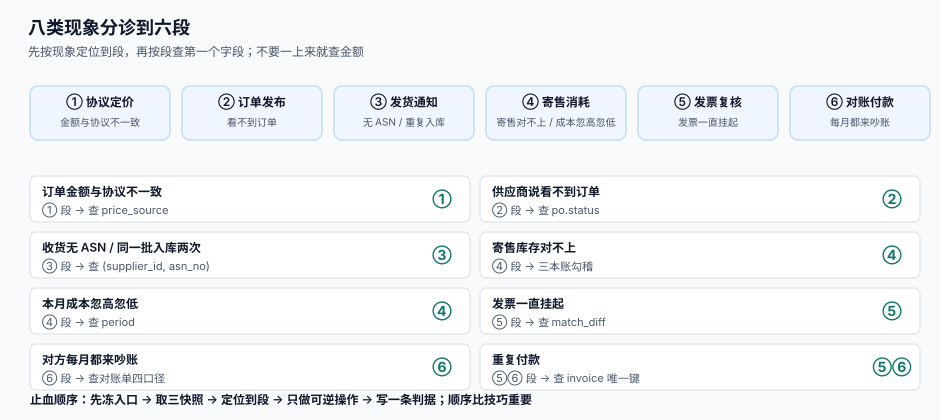

# 常见问题与分诊

<p style="text-align:center;"></p>

协同类问题的共同特征是**现象在你这头、原因在另一头**：你看到「金额不对」，原因可能是对方换了 SKU 编码；你看到「供应商说没收到订单」，原因是订单还在草稿状态。这一页给一张分诊表：先按现象定位到段，再按段给出三到五条可自查的动作。

::: tip 一句话理解
**先问「这条数据是谁产生的」，再问「它错在哪」。** 协同问题里有 62% 的根因落在「另一方产生的数据」，而我方的监控只看得到自己这一侧。
:::

## 八类现象分诊



| 现象 | 先怀疑哪一段 | 第一个要查的东西 | 常见根因 |
| --- | --- | --- | --- |
| 订单金额与协议不一致 | 协议定价 | 订单行 `price_source` 与 `agreement_id` | 协议过期、优先级并列、按行套档 |
| 供应商说看不到订单 | 订单发布 | `po.status` | 还是 `draft`，或范围层漏了工厂 |
| 收到货但系统无 ASN | 发货通知 | `asn` 表按 `(supplier_id, asn_no)` 查 | 对方先发货后补单，或补单失败 |
| 同一批货入库两次 | 发货通知 | `asn_line` 行数 | 无唯一键，重复提交 |
| 寄售库存对不上 | 寄售消耗 | 三本账勾稽 | 盘亏直接改了 `qty_on_hand` |
| 本月成本忽高忽低 | 寄售消耗 | `period` 与 `consumed_at` | 按结算时点记期间，跨月错记 |
| 发票一直挂起 | 批量复核 | `match_diff` 与 `todo` | 挂起无下游动作，没人认领 |
| 供应商每月都来吵账 | 对账日报 | 对账单表头四个口径 | 期间/含税口径不同 |

## 十二个高频问题

**Q1：协议价明明更新了，新订单还是用旧价？**
先查 `effective_from`。多数情况是新协议生效日在**未来**，而订单按下单时间解析，所以取到了旧协议。这是 `SPG-D` 的正确行为，不是 bug。要立即生效就把生效日改成今天，并留审批记录。

**Q2：同一个料号，两个采购员看到两个价？**
查是否有**同优先级且同生效日**的两条候选。按 `SPG-C`，这种情况必须告警而不是静默取一条；如果系统没告警，说明解析逻辑用了 `LIMIT 1` 吞掉了并列。

**Q3：阶梯价为什么按行算？我们要按单算。**
`tier_mode` 是协议行上的字段，改它必须走协议变更。**已经下过的订单不受影响**（快照已冻结），只影响新订单。若历史订单也要按新口径，那是商务谈判，不是系统改动。

**Q4：供应商提交 ASN 报 500，但我们日志里没记录？**
500 多半来自唯一键冲突后没做 `ON CONFLICT`。查 `asn` 表的唯一索引是否包含 `supplier_id`——只用 `asn_no` 单列时，两家供应商的 `ASN-001` 会互相冲突。

**Q5：门户列表翻到第 500 页很慢，还出现重复行？**
典型的 `OFFSET` 深分页。改用 keyset（`WHERE (created_at, id) > (?, ?)`）。本机读数：`OFFSET 20000` 是 **0.52 ms**、keyset 是 **0.012 ms**，且 keyset 不重不漏。

**Q6：寄售库存月末突然少了一批，没找到单据？**
查是否有直接 `UPDATE consignment_stock SET qty_on_hand = ...` 的代码。盘亏必须走调整单 + 责任方（`SPV-G`），直接改数会让对方库存凭空消失。

**Q7：对方说「你们消耗记到上月了」？**
查 `period` 的生成逻辑。若 `period` 取的是结算日而非 `consumed_at`，25 日之后发生的消耗会整体落到次月——本机模拟占 **20.2%**。

**Q8：容差 2% 已经很小了，为什么还有错单进来？**
2% 的容差在 5,000 张里放行 **92.7%**，其中真错 **57 张（18.2%）**。容差从来不是「防错」，是「成本权衡」。要降低漏放，只能靠事后回溯抽样 + 供应商分层容差。

**Q9：为什么挂起的发票永远没人处理？**
因为「挂起」在很多系统里只是状态值，没有下游动作，也没有 SLA。修法：挂起必须生成 `todo` 并带 `due_at`；超 5 个工作日进日报红项（`SPB-D`）。

**Q10：对账总额只差 0.1%，还要逐单查吗？**
要。本机模拟里总额差 **-0.130%**，逐单却 **120 条**差异，其中 15 条是重复——只看总额，这 15 条重复会一直重复下去。

**Q11：我们这边数对了，对方就是不认，怎么办？**
先对齐四个口径（期间/含税/单据状态/计量单位），再让对方**按你的口径重出一份**。九成的「不认」在口径对齐后消失。剩下的一成，逐单给出「我方单据号 + 金额 + 依据」，不要给汇总数。

**Q12：这套东西能不能先不上门户，只发邮件？**
可以，但要接受两个后果：① 没有幂等键，重复提交无法自动拦截；② 没有申诉入口，争议只能走电话，而电话不会留下可审计的记录。

## 止血五步

线上出问题时，顺序比技巧重要：

1. **先冻住入口**，不是先修数据。把该供应商的写接口或付款流程置为只读，防止问题继续扩大。
2. **取三个快照**：当前差异清单、最近一次正确的对账日报、涉事单据的完整变更历史。**先存证，再动手。**
3. **定位到段**：用上面的分诊表，一次只怀疑一段，不要同时改三处。
4. **只做可逆操作**：加调整单、加备注、加待办都可以；`UPDATE` 金额、删单据一律不做。
5. **写一条判据**：修完必须回答「下一次怎么自动发现」。写不出判据的修复，等于没修。

::: danger 五个绝对不能做的操作
1. 直接 `UPDATE` 历史发票金额「让它对上」。
2. 删掉重复的 ASN 行（应该冲销，保留痕迹）。
3. 打开已冻结期间改数（应该出调整单）。
4. 把容差临时调大到 100% 让批次跑完。
5. 用 `TRUNCATE` 清 `recon_diff` 表「重来一遍」。
:::

## 判据清单

| 编号 | 判据 | 怎么验 |
| --- | --- | --- |
| `SPQ-A` | 八类现象每条都能在 3 分钟内定位到段 | 让新人按表实操一次 |
| `SPQ-B` | 每个「常见根因」都有一个自动告警或日报项 | 逐条对应到监控或日报 |
| `SPQ-C` | 止血五步有书面 runbook，含冻住入口的具体命令 | 查 runbook 文件 |
| `SPQ-D` | 五个禁止操作在权限上被禁止（不只是文档禁止） | 用只读账号尝试，必须失败 |
| `SPQ-E` | 十二问的答案在本页可查，不需要问人 | 抽 5 问，5 分钟内找到答案 |
| `SPQ-F` | 每季度回看一次分诊表，补充新出现的现象 | 查最近一次修订日期 |
| `SPQ-G` | 分诊表里的现象名与监控告警名一致 | 名称逐个比对 |
| `SPQ-H` | 术语表覆盖本专题全部缩写，且与正文用词一致 | 抽查 10 个缩写 |

## 术语表

| 缩写 | 全称 | 一句话 |
| --- | --- | --- |
| VMI | Vendor Managed Inventory | 供应商管理库存，补货由对方决定 |
| ASN | Advance Shipping Notice | 发货通知，收货的前置单据 |
| MOQ | Minimum Order Quantity | 最小起订量 |
| MPN | Manufacturer Part Number | 制造商料号 |
| GTIN | Global Trade Item Number | 全球贸易项目代码 |
| GLN | Global Location Number | 全球位置码 |
| AQL | Acceptable Quality Level | 可接受质量水平 |
| 三单 | PO / GRN / Invoice | 订单、收货单、发票 |

## 验证方式

分诊表的价值只能靠「新人能不能用」来验，做法是三次实操而不是读一遍：

1. **盲测定位**：给一个只看到现象的同事三条现象（如「供应商说看不到订单」「同一批货入库两次」「本月成本忽高忽低」），要求他在 3 分钟内说出段名与第一个要查的字段。三条全对即通过（`SPQ-A`）。
2. **禁止项反测**：用只读账号执行止血五步里的危险操作，**五条必须全部失败**。若某条成功，说明禁止只写在文档里（`SPQ-D`）。
3. **答案可查**：随机抽 5 个问题，只允许查本页，5 分钟内必须找到答案。找不到的条目说明分诊表缺行，补行而不是补文档。

```shell
# 反测用：只读账号尝试改历史金额，必须被拒
sqlite3 -readonly /tmp/sc.db "UPDATE po_line SET unit_price = 1;" 2>&1
```

预期：`Error: attempt to write a readonly database`。

## 参考资料

- [总览：六段协同链与三个「价格」](../Overview/index.md)：分诊表的段划分依据
- [供应商门户与可见范围](../SupplierPortal/index.md)：越权与幂等类问题的完整排查
- [价格协议与阶梯价](../PriceAgreement/index.md)：Q1~Q3 的解析细节
- [VMI 与寄售](../VmiConsignment/index.md)：Q6~Q7 的期间与货权问题
- [供应商对账日报](../ReconciliationDaily/index.md)：Q10~Q11 的对账方法
