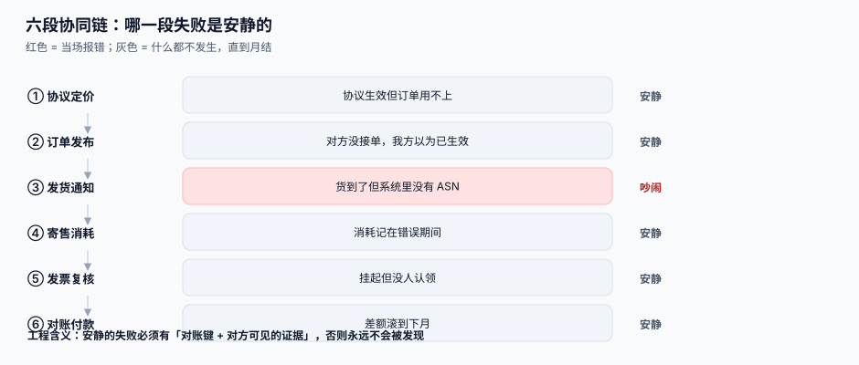

# 总览：六段协同链与三个「价格」

<p style="text-align:center;"></p>

这一页先把整条链摊开：一笔采购从「我方下决心买」到「对方确认收到钱」，中间有六段要跨组织边界。每一段都会失败，但**只有两段的失败会当场报错**，其余四段失败时什么都不发生——系统照常运行、日志一切正常、账也平，你要等到月结那天才知道少了一批货或者多付了钱。

::: tip 一句话理解
**协同系统的成熟度，取决于它能把多少「安静的失败」变成「吵闹的失败」。** 每加一段跨组织流程，先问一句：这一段失败的时候，谁会在多久之内知道？
:::

## 六段协同链

| # | 段 | 我方产出 | 对方动作 | 这一段失败时的样子 | 失败是否安静 |
| --- | --- | --- | --- | --- | --- |
| 1 | 协议定价 | 价格协议（头 + 行 + 阶梯） | 确认或提出异议 | 协议生效了但订单没用上，价格按目录价走 | **安静** |
| 2 | 订单发布 | 采购订单（带价格快照） | 接单 / 改期 / 拒单 | 对方没接单，我方以为已生效 | **安静** |
| 3 | 发货通知 | 收货单（GRN） | 提交 ASN（发货通知） | 货到了但系统里没有 ASN，收货成了「无源到货」 | 吵闹（收货时发现） |
| 4 | 寄售消耗 | 消耗流水 + 结算单 | 核对消耗明细 | 消耗记在错误期间，两边存货报表都错 | **安静** |
| 5 | 发票与复核 | 匹配结果（放行/挂起） | 开票、查看挂起原因 | 发票挂起但没通知，对方一直等付款 | **安静** |
| 6 | 对账与付款 | 对账日报 + 付款回单 | 确认对账单、收款 | 差额滚到下月，越滚越大 | **安静** |

六段里**四段失败是安静的**，而且安静的四段恰好都是「事后账」——它们不影响今天的业务，只影响月底的报表。这就是为什么本专题反复强调一件事：**每一段都要有一份对方能复核的证据**，而不是一份只有我方看得懂的日志。



## 三个「价格」必须分开存

同一批货在一次采购里会出现三个价格，很多系统只存一个字段，于是永远说不清「为什么金额不一样」。

| 价格 | 什么时候确定 | 谁负责 | 变了会怎样 |
| --- | --- | --- | --- |
| **协议价**（agreement price） | 签协议时 | 采购 + 供应商 | 改了不影响历史订单 |
| **订单价**（order price，快照） | 下单那一刻 | 采购员 | **永远不变**，它是法律上的要约价 |
| **结算价**（settled price） | 匹配或对账时 | 财务 | 只能通过「调整单」改，不能覆盖前两个 |

::: danger 三个真实踩过的坑
1. **只存协议价，订单不落快照。** 协议调价后，历史订单金额跟着变——本机 1,000 张历史订单按现价重算，**1,000 张（100%）金额都变**，累计绝对差 **752,895.52 元**。审计一问「上个月这笔为什么是这个价」，你只能答「因为现在协议价是 9.2」。
2. **用 `updated_at` 决定用哪条价格。** 同一料号同时存在供应商专属价、协议价、目录价三条候选时，按「最后修改时间最新」和按「生效日最大」选出的不是同一条——500 个料号里 **359 个（71.8%）** 结果不同。正确做法是先按**优先级**排，同优先级再按**生效日**排，`updated_at` 只用来做审计，不用来做决策。
3. **把「结算价」写回订单。** 一旦写回，订单就再也不能证明「当时说好多少钱」，而这是对账时唯一能拿来跟对方争的东西。
:::

## 四个必失接缝

| 接缝 | 为什么必失 | 需要的证据 |
| --- | --- | --- |
| 协议 → 订单 | 协议可能还没审批完、可能已过期、可能被更优先的价覆盖 | 订单行上的 `price_source` + `agreement_id` + `price_snapshot` |
| 订单 → 发货 | 对方可能拆批发货、可能先发后补单、可能改了数量 | `(po_id, line_no)` 维度的「已发 / 已收 / 未清」三个数 |
| 消耗 → 结算 | 消耗按天记、结算按月做、期间口径不同 | 消耗流水的 `consumed_at` 与结算单的 `period` 必须都存 |
| 发票 → 对账 | 对方按开票日算、我方按收货日算 | 两边各自的口径字段，而不是一个 `date` |

这四个接缝有一个共同点：**它们都需要「两个时间」而不是「一个状态」**。只要你的表里只有一个 `status` 字段，这四个接缝就一定会丢证据。

## 五个角色与各自的可见范围

| 角色 | 属于 | 能看 | 不能看 | 常见错误 |
| --- | --- | --- | --- | --- |
| 采购员 | 我方 | 自己负责的品类 + 全部供应商报价 | 别的小组的成本 | 把「品类权限」写成「全部可见」 |
| 供应商主账号 | 对方 | 本企业全部订单、对账单 | 其他供应商任何数据 | **漏写 `supplier_id` 过滤** |
| 供应商子账号 | 对方 | 按工厂/品类收窄 | 主账号的银行账户信息 | 子账号能改收款账号 |
| 财务 | 我方 | 全部金额与对账单 | 供应商的联系人与地址 | 只给「只读」导致无法处理差异 |
| 审计 | 双方 | 只读 + 全量留痕 | 无写权限 | 审计账号能改数据 |

**第 2 行是本专题最贵的一行。** 本机模拟 200 家供应商、20,000 张订单：列表查询漏写 `supplier_id` 条件时，一次请求返回 **20,000 行**，越权可见比例 **99.50%**。这类漏洞不会报错、不会变慢、测试也很难发现——因为它「工作得很好」，只是给错了人。

## 最小可用模型

六段链落到表上，核心是五张表加两张流水。这里只给形状，完整 DDL 见[实战](../Practice/index.md)。

```sql
-- 价格协议（头 + 行 + 阶梯）
CREATE TABLE price_agreement (
  id            INTEGER PRIMARY KEY,
  supplier_id   INTEGER NOT NULL,
  code          TEXT NOT NULL,
  currency      TEXT NOT NULL,           -- ISO 4217
  tax_mode      TEXT NOT NULL,           -- 'inclusive' | 'exclusive'
  effective_from TEXT NOT NULL,
  effective_to   TEXT,
  status        TEXT NOT NULL,           -- draft|active|expired|terminated
  version       INTEGER NOT NULL DEFAULT 1
);

-- 协议行：一个料号一行，阶梯单独存
CREATE TABLE price_agreement_line (
  id           INTEGER PRIMARY KEY,
  agreement_id INTEGER NOT NULL REFERENCES price_agreement(id),
  item_id      INTEGER NOT NULL,
  uom          TEXT NOT NULL,            -- 报价单位
  tier_mode    TEXT NOT NULL,            -- 'slab' | 'progressive'
  priority     INTEGER NOT NULL DEFAULT 100
);

-- 阶梯：区间边界用 [from_qty, to_qty)，to_qty 为 NULL 表示无上限
CREATE TABLE price_tier (
  id        INTEGER PRIMARY KEY,
  line_id   INTEGER NOT NULL REFERENCES price_agreement_line(id),
  from_qty  NUMERIC NOT NULL,
  to_qty    NUMERIC,
  unit_price NUMERIC NOT NULL,
  UNIQUE (line_id, from_qty)
);
```

::: info 为什么阶梯要单独一张表
因为「同一行有多个价」这件事必须能被 SQL 表达出来。把阶梯塞进一个 JSON 字段，你就再也写不出「找出所有跨档的订单行」这种查询，而跨档正是价格争议的第一大来源。
:::

## 判据清单

| 编号 | 判据 | 怎么验 |
| --- | --- | --- |
| `SPO-A` | 六段链每一段都有一个「对方可见的证据对象」，不是只有我方日志 | 逐段点名表名，缺一即不通过 |
| `SPO-B` | 三个价格分三列存，且订单价在下单后不可被任何流程改写 | 对 `po_line` 做 `UPDATE` 触发器的负向测试 |
| `SPO-C` | 每一段失败时，24 小时内必有一条可指派的待办 | 抽查近 30 天日志，每类失败都能落到 `todo` 表 |
| `SPO-D` | 四个接缝各有两个时间字段（发生时间 + 记账时间） | `grep` DDL 中 `*_at` 与 `period` 字段 |
| `SPO-E` | 任何跨组织查询都以 `supplier_id` 为第一个过滤条件 | 代码评审 + SQL 审计日志抽样 |
| `SPO-F` | 报价单位与库存单位分离，换算因子有唯一来源 | 同一料号在不同表出现两个因子即为违反 |
| `SPO-G` | 金额计算只有一条路径（同一个函数），没有「某处特殊处理」 | 全库搜 `* 0.13` 之类硬编码税率 |
| `SPO-H` | 每一段都能给出「这一段的对账键」，且键在全库唯一 | 六个键逐个 `git grep`，重复即违反 |

## 验证方式

在本地起一个 SQLite 库，把上面的 DDL 跑一遍，然后验证两件事：

```shell
sqlite3 /tmp/sc.db < schema.sql
sqlite3 /tmp/sc.db "SELECT name FROM sqlite_master WHERE type='table' ORDER BY name;"
```

预期输出（3 行，对应上面这段 DDL）：`price_agreement`、`price_agreement_line`、`price_tier`。完整的七张表（加 `po_line`、`consignment_stock`、`recon_diff`、`supplier_account`）见[实战](../Practice/index.md)的 `schema.sql`。

再验证「订单价不可改写」：

```shell
# 需要先按实战页建好 po_line 与 po_line_freeze 触发器
sqlite3 /tmp/sc.db "UPDATE po_line SET unit_price = 1 WHERE id = 1;" 2>&1
```

预期输出：`Error: po_line.price is frozen after confirm`（触发器 `RAISE(ABORT, ...)` 抛出的原文）。如果这条命令**成功**了，说明 `SPO-B` 没落地，后面所有对账都会失真。

## 参考资料

- [价格协议与阶梯价](../PriceAgreement/index.md)：三个价格的解析顺序与快照的完整实现
- [采购到付款（P2P）与三单匹配](../../ProcureToPay/index.md)：六段链在我方内部的那一半
- [对账与差错处理](../../Ledger/Reconciliation/index.md)：差额进入会计系统后的处理
- OASIS UBL 2.x：`Order` / `DespatchAdvice` / `Invoice` 三类报文与六段链的对应关系
- GS1 General Specifications：GTIN 作为「料号映射」的外部锚点
