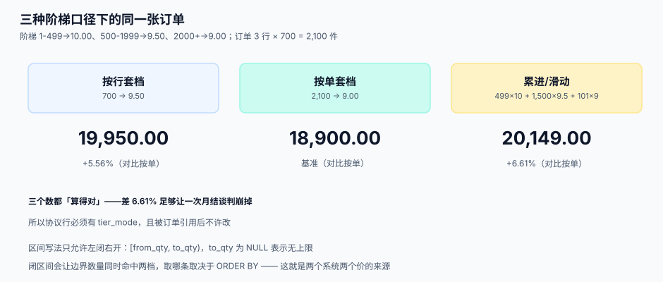

# 价格协议与阶梯价

<p style="text-align:center;"></p>

价格协议是协同链的第 1 段，也是最容易被当成「一张表」的一段。它真正的难点不在存价，而在**同一批货在三种不同算法下会得到三个不同的金额**，而这三个金额都「有据可查」——于是争议永远无法靠讲道理结束，只能靠事先约定口径。

::: tip 一句话理解
**阶梯价的争议不是「算错了」，而是「算的是哪一档」。** 所以协议里必须写死三件事：按行还是按单、区间还是累进、跨档时以哪个数量为准。
:::

## 协议模型：头、行、阶梯三层

| 层 | 存什么 | 为什么必须分开 |
| --- | --- | --- |
| 头（`price_agreement`） | 供应商、币种、含税口径、有效期、状态、版本 | 这些是**法律条款**，改一次就是新版本 |
| 行（`price_agreement_line`） | 料号、报价单位、阶梯模式、优先级 | 「这个料号在这个协议里怎么算」 |
| 阶梯（`price_tier`） | 数量区间与单价 | 同一行可以有多档，塞进 JSON 就查不动了 |

```sql
CREATE TABLE price_tier (
  id         INTEGER PRIMARY KEY,
  line_id    INTEGER NOT NULL REFERENCES price_agreement_line(id) ON DELETE CASCADE,
  from_qty   NUMERIC NOT NULL,          -- 含
  to_qty     NUMERIC,                   -- 不含；NULL 表示无上限
  unit_price NUMERIC(18,6) NOT NULL,
  UNIQUE (line_id, from_qty),
  CHECK (to_qty IS NULL OR to_qty > from_qty)
);
```

::: danger 区间表示法的三种写法，只有一种不会漏
1. **闭区间 `[from, to]` 且下一档从 `to` 开始**：`1-499` 与 `499-1999` 在 499 这个点上**两条都命中**，取哪条取决于 `ORDER BY`，这就是「同一张单两个系统算出两个价」的经典来源。
2. **开区间 `(from, to)`**：`1` 这个点谁都不命中，数量正好是 1 的单据全部掉进「无价」分支。
3. **左闭右开 `[from, to)`**（推荐）：任意数量**恰好命中一条**，`to_qty` 为 `NULL` 表示无穷大。上表的 `CHECK (to_qty > from_qty)` 与 `UNIQUE (line_id, from_qty)` 是这条规范的机械保障。
:::

## 三种阶梯口径

同一份阶梯表，三种算法给出三个总额。取一个真实形状：`1-499 → 10.00`、`500-1999 → 9.50`、`2000+ → 9.00`，订单为 **3 行 × 700 件 = 2,100 件**。

| 口径 | 算法 | 总额 | 与「按单」的差 |
| --- | --- | --- | --- |
| **按行套档**（line-level） | 每行 700 件各自落 500-1999 档 → 9.50 | **19,950.00** | **+1,050.00（+5.56%）** |
| **按单套档**（document-level） | 合计 2,100 件落 2000+ 档 → 9.00 | **18,900.00** | 基准 |
| **累进/滑动**（progressive） | 499×10 + 1,500×9.5 + 101×9 | **20,149.00** | **+1,249.00（+6.61%）** |

三个数都「算得对」，差额 6.61% 足够让一次月结谈判崩掉。所以协议行上必须有一个 `tier_mode` 字段，而且**一旦有订单引用了它就不许改**。

```sql
-- 按单套档：先把行数量加总，再找唯一命中档
WITH doc_qty AS (
  SELECT po_id, item_id, SUM(qty) AS q
  FROM po_line WHERE po_id = :po
  GROUP BY po_id, item_id
)
SELECT d.q, t.unit_price
FROM doc_qty d
JOIN price_tier t
  ON d.q >= t.from_qty AND (t.to_qty IS NULL OR d.q < t.to_qty)
WHERE t.line_id = :line;
```

::: warning 累进档的「档内数量」怎么算
累进档最容易写错的是每一档取多少件。正确写法是**从下往上扣减**：本档件数 = `MIN(剩余, 本档上限 - 本档下限)`；写错的典型是「按档位宽度乘单价再相加」，那样 2,100 件会算成 `499×10 + 1500×9.5 + 101×9` 之外的某个数，且**任何单测都测不出来**——因为它只在跨档时错。上面〔19,950 / 18,900 / 20,149〕三个数就是逐档扣减的结果，可直接作为单测的期望值。
:::



## 解析顺序：先优先级，再生效日

一个料号在任一天可能有 4 条候选价：供应商专属价、品类协议价、集团框架价、目录标准价。解析必须是**确定性的**，不能依赖数据库返回顺序。

| 步骤 | 规则 | 理由 |
| --- | --- | --- |
| 1 | 过滤 `status = 'active'` | 草稿与终止的协议不参与 |
| 2 | 过滤 `effective_from <= 下单时间 < effective_to` | **按下单时间判断，不按当前时间** |
| 3 | 按 `priority` 升序（数字小的优先） | 专属价 priority 更小 |
| 4 | 同优先级按 `effective_from` **降序** | 后生效的覆盖先生效的 |
| 5 | 仍然并列则**拒绝解析并告警** | 这就是数据缺陷，不许静默取一条 |

```sql
SELECT l.id AS line_id, l.priority, a.effective_from, a.version
FROM price_agreement_line l
JOIN price_agreement a ON a.id = l.agreement_id
WHERE l.item_id = :item
  AND a.status = 'active'
  AND a.effective_from <= :ordered_at
  AND (a.effective_to IS NULL OR :ordered_at < a.effective_to)
ORDER BY l.priority ASC, a.effective_from DESC, a.version DESC
LIMIT 2;   -- 取两条，用来判断是否存在并列
```

::: danger 用 `updated_at` 做决策会错七成
本机读数：500 个料号、每个 3 条候选，**按 `updated_at` 取最新**与**按 `effective_from` 取最大**，选出的不是同一条的有 **359 个（71.8%）**。原因是「补录一条历史价」会把 `updated_at` 刷新成今天，于是它反而「最新」。

`updated_at` 只用于审计与缓存失效，**永远不参与业务决策**。
:::

## 币种、税与汇率

| 维度 | 该存什么 | 常见错误 |
| --- | --- | --- |
| 币种 | 协议头存 `currency`（ISO 4217），订单行冗余一份 | 只在协议头存，订单改了币种后金额无法解释 |
| 含税口径 | 协议头存 `tax_mode`（`inclusive` / `exclusive`） | 用「金额 / 1.13」硬编码，税率一变全错 |
| 税率 | 订单行存 `tax_rate` 快照 | 结算时按现行税率重算，历史单据金额漂移 |
| 汇率 | 订单行存 `fx_rate` + `fx_date` | 用「当天汇率」重算历史，跨月单据永远对不上 |
| 金额精度 | 金额 2 位、单价 6 位、数量 3 位 | 单价只存 2 位，1 箱 7 个的场景下误差放大 |

::: danger 含税价折算的三条纪律
1. **折算式固定为 `不含税 = 含税 / (1 + 税率)`**，不是 `含税 × (1 - 税率)`。13% 时后者少算 1.69 个百分点。
2. **先折算到不含税，再做阶梯判断**。用含税金额判断档位，会在税率不同的两批货上产生不同档位。
3. **金额只在一处四舍五入**（行小计），不要在单价、税、总额上各舍一次。
:::

## 价格快照：订单价为什么不能重算

```sql
CREATE TABLE po_line (
  id           INTEGER PRIMARY KEY,
  po_id        INTEGER NOT NULL,
  item_id      INTEGER NOT NULL,
  qty          NUMERIC NOT NULL,
  uom          TEXT NOT NULL,
  unit_price   NUMERIC(18,6) NOT NULL,   -- 快照
  price_source TEXT NOT NULL,            -- 'agreement' | 'catalog' | 'manual'
  agreement_id INTEGER,
  tier_line_id INTEGER,
  tax_rate     NUMERIC(5,2) NOT NULL,
  fx_rate      NUMERIC(18,8),
  amount       NUMERIC(18,2) NOT NULL
);

-- 订单确认后价格冻结（SQLite 触发器写法；PostgreSQL 用 BEFORE UPDATE + RAISE）
CREATE TRIGGER po_line_freeze
BEFORE UPDATE OF unit_price, amount ON po_line
WHEN EXISTS (SELECT 1 FROM po WHERE po.id = NEW.po_id AND po.status <> 'draft')
BEGIN
  SELECT RAISE(ABORT, 'po_line.price is frozen after confirm');
END;
```

本机读数：1,000 张历史订单按**现价**重算，**1,000 张（100%）金额都变**，累计绝对差 **752,895.52 元**。这个数字说明的不是「重算会错」，而是「**只要允许重算，历史就不可解释**」。

## 判据清单

| 编号 | 判据 | 怎么验 |
| --- | --- | --- |
| `SPG-A` | 阶梯用左闭右开，任意数量恰好命中一条 | 对每个边界值 `from_qty` 与 `to_qty-ε` 各查一次，断言命中数 = 1 |
| `SPG-B` | 每一行协议必须显式声明 `tier_mode`，不许默认 | 查 `NULL` 计数，必须为 0 |
| `SPG-C` | 解析顺序为「状态 → 生效期 → 优先级 → 生效日降序」，且并列必告警 | 构造 5 条候选逐一断言 |
| `SPG-D` | 解析按下单时间，不按当前时间 | 用 30 天前的 `ordered_at` 解析，断言取到旧协议 |
| `SPG-E` | 订单行存 `price_source` + `agreement_id` + `tier_line_id` | 抽 10 行，逐个追到协议行 |
| `SPG-F` | 订单确认后 `unit_price` / `amount` 不可被 UPDATE | 触发器负向测试（必须报错） |
| `SPG-G` | 含税/不含税折算只有一条路径，无硬编码税率 | 全库搜 `1.13` / `0.13` / `* 1.0` |
| `SPG-H` | 同一订单在同一时点重算两次金额完全相同 | 幂等断言：两次 `SELECT` 的 `amount` 相等 |

## 验证方式

```shell
# 边界值：每个档位的下沿只能命中一条
sqlite3 /tmp/sc.db "SELECT count(*) FROM price_tier WHERE 499 >= from_qty AND (to_qty IS NULL OR 499 < to_qty) AND line_id = 1;"
sqlite3 /tmp/sc.db "SELECT count(*) FROM price_tier WHERE 500 >= from_qty AND (to_qty IS NULL OR 500 < to_qty) AND line_id = 1;"
```

预期：两次都是 `1`。若某次返回 `2`，说明区间写成了闭区间。

```shell
# 三口径对拍：2,100 件订单，三种算法各算一次
sqlite3 /tmp/sc.db ".read tier_line.sql"   -- 预期 19950.00
sqlite3 /tmp/sc.db ".read tier_doc.sql"    -- 预期 18900.00
sqlite3 /tmp/sc.db ".read tier_prog.sql"   -- 预期 20149.00
```

```shell
# 冻结校验：必须失败
sqlite3 /tmp/sc.db "UPDATE po_line SET unit_price = 1 WHERE po_id = (SELECT id FROM po WHERE status='confirmed' LIMIT 1);" 2>&1
```

预期：`Error: po_line.price is frozen after confirm`。

## 参考资料

- [总览：六段协同链与三个「价格」](../Overview/index.md)：三个价格的分工
- [料号、单位与价格主数据](../PriceMaster/index.md)：协议行的报价单位从哪来
- [VMI 与寄售](../VmiConsignment/index.md)：寄售消耗结算时用的是哪个价格
- [营销计价与优惠分摊](../../PricingPromotion/Overview/index.md)：面向消费者的价格链，可对照「阶梯 vs 优惠」的相似问题
- OASIS UBL 2.x `PricingReference`：价格引用在订单报文中的表达方式
