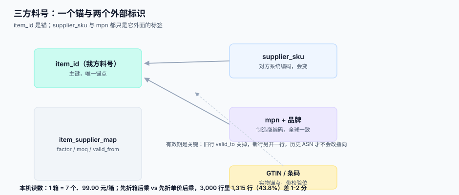

# 料号、单位与价格主数据

<p style="text-align:center;"></p>

价格算错的很大一部分原因，不在价格本身，而在**「1 箱」在两边不是同一种东西**。供应商说「一箱 7 个」，你系统里记「1 个」，采购员下单填「100」，于是三个不同的数在三个地方各自被解释了一遍。这一页讲的是价格下面那一层：料号怎么映射、单位怎么换算、舍入在哪一步做。

::: tip 一句话理解
**主数据不是「谁的数据更干净」，而是「谁有权改、改了谁知道」。** 三方料号并存是事实，不可消除，只能约定一个「锚」。
:::

## 三方料号：必须有一个锚

| 料号 | 谁在用 | 稳定性 | 能否作锚 |
| --- | --- | --- | --- |
| 我方内部料号（`item_id`） | 我方全部系统 | 高（但会因品类重组而改） | **可作锚** |
| 供应商料号（`supplier_sku`） | 对方系统、对账单、ASN | 中（对方换 ERP 就变） | 不可单独作锚 |
| 制造商料号（`mpn`）+ 品牌 | 全行业 | 高（同一 MPN 全球一致） | 可作为**跨供应商**的锚 |
| GTIN / 条码 | 零售与物流 | 高（有校验位） | 可作为**实物**的锚 |

推荐做法：**`item_id` 是主键、`mpn` 是第二锚、`supplier_sku` 是映射**。三者的关系放在一张映射表里，多对多，带生效期。

```sql
CREATE TABLE item_supplier_map (
  id           INTEGER PRIMARY KEY,
  item_id      INTEGER NOT NULL,
  supplier_id  INTEGER NOT NULL,
  supplier_sku TEXT NOT NULL,
  mpn          TEXT,
  uom_supplier TEXT NOT NULL,       -- 对方报价单位，如 'BOX'
  uom_stock    TEXT NOT NULL,       -- 我方库存单位，如 'EA'
  factor       NUMERIC(18,6) NOT NULL,  -- 1 个 uom_supplier = factor 个 uom_stock
  moq          NUMERIC(18,3),       -- 最小起订量（按 uom_supplier 计）
  increment    NUMERIC(18,3),       -- 下单增量（按 uom_supplier 计）
  valid_from   TEXT NOT NULL,
  valid_to     TEXT,
  UNIQUE (supplier_id, supplier_sku, valid_from),
  CHECK (factor > 0)
);
```

::: danger 三个映射表的典型死法
1. **`(supplier_id, supplier_sku)` 不加唯一键。** 同一个 SKU 映射到两个 `item_id`，于是同一批发货在系统里成了两种物料，库存永远对不上。**修法**：唯一键带 `valid_from`，同一时点只允许一条有效。
2. **映射不带生效期。** 供应商换了 SKU 编码，你直接 `UPDATE`，历史 ASN 全部指向新码——去年那批货的追溯链断了。**修法**：旧行 `valid_to` 置为变更日，新增一行。
3. **`mpn` 当唯一键用。** 同一个 MPN 可能由多个供应商供货，也可能一家供应多个包装规格。**修法**：`mpn` 只做查询与去重提示，不做唯一约束。
:::



## 单位换算与舍入顺序

这是全库最容易「看起来对、算出来错」的一处。同一行金额有两种算法，结果在近一半的行上差 1-2 分：

| 算法 | 表达式 | 3,000 行中相差 ≥1 分的行数 | 最大差 |
| --- | --- | --- | --- |
| 先折箱再乘（推荐） | `round(qty / factor × price_box, 2)` | 基准 | 0 |
| 先折单价再乘 | `round(qty × round(price_box / factor, 4), 2)` | **1,315 行（43.8%）** | **0.02 元** |

本机读数条件：`1 箱 = 7 个`、`99.90 元/箱`、数量 1~500 随机。43.8% 的行差 1-2 分，单看一行是「可忽略」，看一个月是**对账日报里几百条差异**——而它们全部是算法差，不是业务差。

::: danger 舍入的四条纪律
1. **只在最外层舍一次。** 单价保留 6 位、数量保留 3 位、**金额只在行小计处保留 2 位**。
2. **换算方向固定**：先用量化后的数量算金额，再折算单位；不要先把单价折成最小单位再乘。
3. **`factor` 只存一份**，不许在代码里出现 `* 7` 或 `/ 12`。全库搜 `factor` 之外的常量。
4. **除法必须确认能整除或有明确舍入规则**。`1 卷 = 3.5 米` 这种因子，按卷下单再按米发料，累计 120 卷就是 420 米——但如果中途按「每卷 3.5 米取整成 3 米」记账，十年后会少 60 米。
:::

## 最小起订量与增量

`moq` 与 `increment` 是采购侧最容易忽略的两个字段，它们不参与价格计算，却直接决定「这批货能不能下单」。

| 字段 | 含义 | 校验时机 | 不校验的后果 |
| --- | --- | --- | --- |
| `moq` | 一次下单至少多少（按报价单位） | 提交订单时 | 供应商拒单或加收小批量费 |
| `increment` | 必须是它的整数倍 | 提交订单时 | 对方按整箱发货，你按零数收货，产生数量差 |
| `min_pack` | 单个包装内含数量 | 收货时 | 拆包导致实物与单据不符 |
| `rounding` | 超量交货允差 | 收货时 | 允差内的超收被判成异常，仓库拒收 |

```sql
-- 下单前的三项校验：任意一项不通过都要给出「改成多少」的建议，而不只是报错
SELECT
  :qty                                   AS want,
  m.moq, m.increment,
  CASE WHEN :qty < m.moq THEN m.moq
       -- SQLite 没有 CEIL()，用整数除法上取整：(x + inc - 1) / inc
       ELSE m.moq + ((:qty - m.moq + m.increment - 1) / m.increment) * m.increment
  END                                    AS suggested
FROM item_supplier_map m
WHERE m.item_id = :item AND m.supplier_id = :sid
  AND m.valid_from <= :at AND (m.valid_to IS NULL OR :at < m.valid_to);
```

::: warning SQLite 与 PostgreSQL 的一个小分歧
`CEIL()` 在 PostgreSQL 是内置函数，在 SQLite 3.50 里**不存在**（会报 `no such function: CEIL`）。想让同一段 SQL 两边都能跑，用整数除法上取整 `(x + inc - 1) / inc`——它在两边语义一致，前提是三个操作数都是整数。
:::

::: warning 报错文案比校验本身更重要
`数量不符合最小起订量` 这句话会让人打电话问采购。`最小起订量 100 箱、增量 10 箱，建议改为 110 箱` 会让人直接点确认。同一个校验，两种文案的工单量差一个量级。
:::

## 价格主数据谁说了算

| 数据 | 权威方 | 变更流程 | 不这么做的后果 |
| --- | --- | --- | --- |
| 料号（`item_id`、描述、分类） | 我方 | 主数据委员会审批 | 一个物料两个码，库存翻倍 |
| 供应商料号 | **对方** | 对方在门户提交，我方确认 | 我方自己编，对方对账单永远对不上 |
| MPN 与品牌 | 制造商 | 我方录入，采购核对 | 同物异名导致比价失真 |
| 协议价 | **双方** | 协议签署 + 系统录入 + 双人复核 | 单人改价，无审计轨迹 |
| 目录价（参考价） | 我方 | 采购维护 | 与协议价混用，解析歧义 |
| 单位换算因子 | **双方** | 协议附件 + 系统录入 | 一方改因子，历史单据全变 |

六行里有两行是「对方权威」（供应商料号、协议价），这两行的变更**必须留下对方的确认凭证**（门户确认记录或签字件编号）。这是审计唯一认的东西。

## 判据清单

| 编号 | 判据 | 怎么验 |
| --- | --- | --- |
| `SPM-A` | 同一 `(supplier_id, supplier_sku)` 在任一时点只有一条有效映射 | 自连接查重叠区间，结果必须为空 |
| `SPM-B` | `factor` 在全库只有一个来源，代码中无硬编码换算 | 搜数字常量与 `* 7` / `/ 12` 类写法 |
| `SPM-C` | 金额只在行小计处舍入一次 | 三条路径（单价、税、总额）各自无 `ROUND` |
| `SPM-D` | `moq` / `increment` 校验返回「建议数量」而非仅报错 | 抽查 3 个下单接口的响应体 |
| `SPM-E` | 映射变更采用「关旧开新」，历史行不被 UPDATE | 变更前后 `valid_to` 与行数对拍 |
| `SPM-F` | `mpn` 不作唯一约束，仅作查询索引 | 查 DDL 中 `mpn` 上的约束 |
| `SPM-G` | 供应商料号与协议价变更都有对方确认凭证编号 | 抽 5 条变更记录，每条有 `confirm_ref` |
| `SPM-H` | 同一料号在门户、订单、对账单三处的单位可互算且结果一致 | 三处各取一行，换算后比对 |

## 验证方式

```shell
# 映射重叠检查：必须返回 0 行
sqlite3 /tmp/sc.db "
SELECT a.id, b.id FROM item_supplier_map a
JOIN item_supplier_map b
  ON a.supplier_id = b.supplier_id AND a.supplier_sku = b.supplier_sku AND a.id < b.id
WHERE a.valid_from < COALESCE(b.valid_to, '9999-12-31')
  AND b.valid_from < COALESCE(a.valid_to, '9999-12-31');"
```

```shell
# 换算顺序对拍：3,000 行随机数量，统计相差 >= 0.01 的行数
python3 - <<'PY'
import random; random.seed(20261031)
diff = 0
for _ in range(3000):
    q = random.randint(1, 500)
    a = round(q / 7 * 99.90, 2)
    b = round(q * round(99.90 / 7, 4), 2)
    diff += abs(a - b) >= 0.01
print(diff)   # 预期 1315
PY
```

预期输出 `1315`。若明显偏小，说明你的实现已经统一了顺序；若偏大，检查是否在单价上也做了舍入。

## 参考资料

- [价格协议与阶梯价](../PriceAgreement/index.md)：协议行上的报价单位与这里的关系
- [主数据与数据标准](../../../DB/DataGovernance/StandardsMasterData/index.md)：主数据治理的组织与流程
- [批量数据交换工程](../../BulkDataExchange/RowValidation/index.md)：价目表导入时的行级校验
- GS1 General Specifications：GTIN 校验位算法与包装层级（`GTIN-13` / `ITF-14`）
- OASIS UBL 2.x `Item` / `Price`：报文里料号与单位的表达位置
