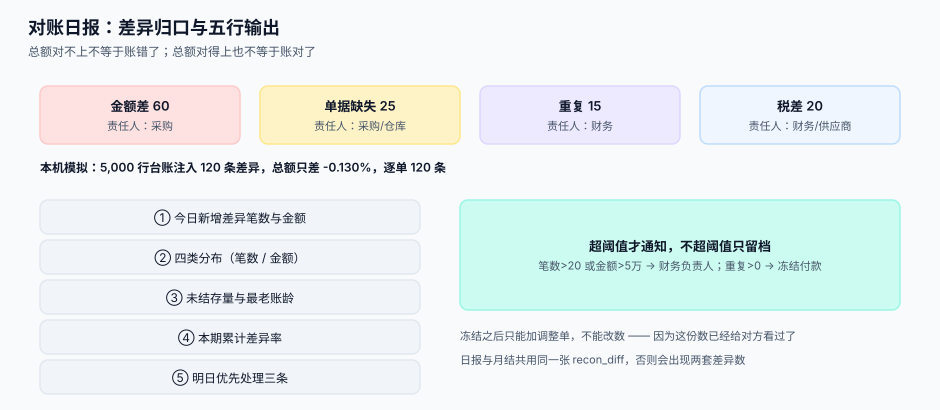

# 供应商对账日报

<p style="text-align:center;"></p>

对账日报是协同链的最后一环，也是唯一一环**由我方主动交给对方看**的东西。它每天只说五件事：今天差多少钱、差在几类、每类归谁、有没有变好、明天要先修哪一条。写不清楚这五件事，对账就会退化成「每月底两边财务打电话」。

::: tip 一句话理解
**总额对不上，不等于账错了；总额对得上，也不等于账对了。** 本机模拟里总额只差 **0.130%**，逐单却有 **120 条**差异——只看总额，这 120 条一条都发现不了。
:::

## 对账单的四个口径

两边数字对不上，九成是因为四个口径里至少有一个不同。日报的第一件事是**把四个口径写在表头**，而不是解释差额。

| 口径 | 常见两种写法 | 差异后果 |
| --- | --- | --- |
| **期间** | 按收货日 / 按开票日 | 月末在途单据归属不同月份 |
| **含税** | 含税金额 / 不含税金额 | 13% 商品直接差 13% |
| **单据状态** | 已确认 / 含已取消与草稿 | 草稿单据进了对账单 |
| **计量单位** | 按库存单位 / 按采购单位 | 差一个换算因子 |

```sql
CREATE TABLE recon_statement (
  id            INTEGER PRIMARY KEY,
  supplier_id   INTEGER NOT NULL,
  period        TEXT NOT NULL,            -- YYYY-MM
  basis_date    TEXT NOT NULL,            -- 'receipt' | 'invoice'
  tax_mode      TEXT NOT NULL,            -- 'inclusive' | 'exclusive'
  status_scope  TEXT NOT NULL,            -- 'confirmed_only' | 'all'
  total_amount  NUMERIC(18,2) NOT NULL,
  line_count    INTEGER NOT NULL,
  received_at   TEXT NOT NULL,
  UNIQUE (supplier_id, period, basis_date, tax_mode)
);
```

::: danger 口径不一致时，先对齐再找差
1. **不要用「差额」直接开会。** 先让对方按你的口径重出一份，差额往往从几万降到几百。
2. **口径要落在表头字段里**，不能只写在邮件里。三个月后没人记得当时用的是哪个口径。
3. **`UNIQUE` 必须包含口径字段**，否则同一期间只能存一份对账单，「换口径重出」会覆盖原件。
:::

## 四类差异

真实的对账差异可以全部归到这四类，每一类的处理动作完全不同：

| 类型 | 典型成因 | 判据 | 处理动作 | 责任人 |
| --- | --- | --- | --- | --- |
| **金额差** | 单价、折扣、运费、税率不同 | 单据存在，金额不等 | 逐单核对，出调整单 | 采购 |
| **单据缺失** | 对方没开票、我方没记收货 | 一方有、一方无 | 补单或冲销 | 采购 / 仓库 |
| **重复** | 重复开票、重复收货、重复导入 | 同键多条 | 立即冲销并冻结 | 财务 |
| **税差** | 含税口径、税率适用错误 | 不含税相等而含税不等 | 换开或调整 | 财务 / 供应商 |

本机模拟（5,000 行台账、注入 120 条差异）：`金额差 60 / 单据缺失 25 / 重复 15 / 税差 20`。注意**四类的分布不是均匀的**——金额差最多，但重复最危险，因为它通常是系统缺陷而不是人工失误。

```sql
-- 差异归口：一条 SQL 出四类计数与金额
WITH d AS (
  SELECT i.id, i.amount AS internal_amt, s.amount AS supplier_amt
  FROM ledger_line i
  LEFT JOIN statement_line s
    ON s.supplier_id = i.supplier_id AND s.doc_no = i.doc_no
  WHERE i.period = :period
)
SELECT
  SUM(CASE WHEN supplier_amt IS NULL THEN 1 ELSE 0 END)                    AS missing_in_statement,
  SUM(CASE WHEN supplier_amt IS NOT NULL AND ABS(supplier_amt - internal_amt) >= 0.01
           THEN 1 ELSE 0 END)                                              AS amount_diff,
  SUM(CASE WHEN supplier_amt IS NOT NULL AND ABS(supplier_amt - internal_amt) < 0.01
           AND ABS(supplier_amt * 1.0 / 1.13 - internal_amt * 1.0 / 1.13) >= 0.01
           THEN 1 ELSE 0 END)                                              AS tax_diff,
  SUM(CASE WHEN supplier_amt IS NOT NULL THEN supplier_amt - internal_amt ELSE 0 END) AS net_gap
FROM d;
```

::: warning 为什么「税差」这一列经常恒为 0
上面的税差判定只有在**两边存的是不同税基**时才会命中：如果两边都存含税金额且税率相同，剔除税率后必然相等，这一列永远是 0——那说明你的数据里根本没有区分税基，而不是「没有税差」。**先确认字段语义，再相信这个 0。**
:::



## 日报五行

一份能被人读完的日报只有五行，多一行就没人看：

| 行 | 内容 | 阈值（示例） | 超阈值时 |
| --- | --- | --- | --- |
| 1 | 今日新增差异笔数与金额 | 笔数 > 20 或金额 > 5 万 | 通知财务负责人 |
| 2 | 四类差异分布（笔数 / 金额） | 重复 > 0 | 立即冻结该供应商付款 |
| 3 | 未结差异存量与最老一笔天数 | 最老 > 30 天 | 升级到采购经理 |
| 4 | 本期累计差异率 | > 0.5% | 触发供应商绩效扣分 |
| 5 | 明日优先处理的三条（按金额×账龄） | — | 直接指派到人 |

```sql
-- 第 1、2 行：今日新增
SELECT date('now') AS d,
       COUNT(*) AS new_diffs,
       SUM(ABS(gap)) AS new_gap,
       SUM(CASE WHEN kind = 'dup' THEN 1 ELSE 0 END) AS dup_cnt
FROM recon_diff
WHERE created_at >= date('now') AND created_at < date('now', '+1 day');
```

```sql
-- 第 5 行：明日优先三条（金额 × 账龄 的排序，不是单纯按金额）
SELECT id, doc_no, kind, gap, julianday('now') - julianday(created_at) AS age_days,
       ABS(gap) * (1 + (julianday('now') - julianday(created_at)) / 30.0) AS score
FROM recon_diff
WHERE status = 'open'
ORDER BY score DESC
LIMIT 3;
```

## 月结与冻结

日报是日频，月结是月频，两者必须共用同一套差异表，否则会出现「日报说差 3 笔、月结说差 12 笔」。

| 阶段 | 动作 | 不可逆点 |
| --- | --- | --- |
| T+1 | 对方上传对账单，系统自动比对 | 无 |
| T+1~T+3 | 差异归口，双方在门户里逐条认领 | 无 |
| T+3 | 未认领的差异自动挂「待定」，进下月 | 无 |
| 月结日 | 冻结期间（`period` 关闭），之后只许冲销不许改 | **冻结后改数必须留调整单** |
| 付款前 | 冻结期间 + 未结差异 > 阈值 → 阻断付款 | 阻断必须可人工解锁并留痕 |

::: danger 冻结之后还能改数吗
**不能直接改，只能加调整单。** 冻结的本质是「这个期间的数已经给对方看过了」，直接改会让对方手里的那份对账单永久失效，而这是协同关系里最伤信任的一件事。调整单要带 `reason`、`approved_by`、`ref_doc`，并在下一期对账单里单独列一行「上期调整」。
:::

## 判据清单

| 编号 | 判据 | 怎么验 |
| --- | --- | --- |
| `SPT-A` | 对账单表头有四个口径字段，且 `UNIQUE` 包含它们 | 查 DDL 与唯一索引 |
| `SPT-B` | 差异只有四类，无「其他」 | `SELECT DISTINCT kind` 恰好四个值 |
| `SPT-C` | 每类差异有责任人与处理动作 | 查配置表，缺一即不通过 |
| `SPT-D` | 日报固定五行，超阈值自动通知 | 抽查 5 天日报结构一致 |
| `SPT-E` | 日报与月结共用同一张 `recon_diff` | 两条查询指向同一表 |
| `SPT-F` | 期间冻结后不允许直接改数，只允许调整单 | 冻结后 `UPDATE` 必须失败 |
| `SPT-G` | 未结差异超阈值时阻断付款，且阻断可留痕解锁 | 构造超阈值场景，验证阻断与解锁日志 |
| `SPT-H` | 差异率按「差异金额 / 本期总额」算，分母写死 | 抽查 3 天计算式 |

## 验证方式

```shell
# 1) 四类分布：必须只有四行
sqlite3 /tmp/sc.db "SELECT kind, COUNT(*), ROUND(SUM(ABS(gap)),2) FROM recon_diff GROUP BY kind;"
```

预期四行（示例）：`amount|60|...`、`missing|25|...`、`dup|15|...`、`tax|20|...`。

```shell
# 2) 总额对得上但逐单有差异（本机模拟的真实情形）
sqlite3 /tmp/sc.db "
SELECT ROUND((SELECT SUM(amount) FROM statement_line) - (SELECT SUM(amount) FROM ledger_line), 2) AS total_gap,
       (SELECT COUNT(*) FROM recon_diff WHERE status='open') AS line_diffs;"
```

预期：`total_gap` 在 `-20000` 量级（约 -0.13%），而 `line_diffs` 为 `120`。这个组合正是「只看总额会漏掉全部问题」的证据。

```shell
# 3) 冻结后改数必须失败
sqlite3 /tmp/sc.db "INSERT INTO recon_period(period, closed_at) VALUES ('2026-09','2026-10-05');"
sqlite3 /tmp/sc.db "UPDATE ledger_line SET amount = 1 WHERE period = '2026-09';" 2>&1
```

预期：`Error: period 2026-09 is closed; use adjustment instead`。

## 参考资料

- [总览：六段协同链与三个「价格」](../Overview/index.md)：第 6 段（对账与付款）
- [三单匹配的批量复核](../BatchReview/index.md)：放行后的回收路径依赖这份日报
- [对账与差错处理](../../Ledger/Reconciliation/index.md)：差额进入会计系统后的完整处理
- [VMI 与寄售](../VmiConsignment/index.md)：寄售消耗的期间归属直接影响本期对账
- ISO 20022 `camt.053`：银行对账单报文，可与供应商对账单的字段设计对照
