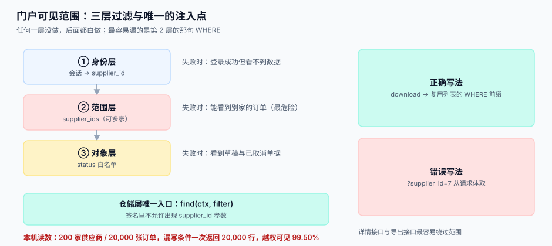

# 供应商门户与可见范围

<p style="text-align:center;"></p>

门户是协同链上唯一「对方直接用」的界面。它有个特殊性质：**你写的每一行查询都在向外部暴露数据**，而这个外部对象的组织边界、人员流动、权限粒度都和你内部不一样。所以门户的第一性问题不是「页面好不好看」，而是「这条 SQL 为什么只能返回这一家的行」。

::: tip 一句话理解
**门户的权限不是「能不能进」，而是「进来之后这一条 SQL 的 WHERE 里有没有 `supplier_id`」。** 前者挡君子，后者挡事故。
:::

## 三层过滤

一个请求要通过三层才能拿到数据，三层各自独立、互不替代：

| 层 | 管什么 | 失败时的样子 | 实现位置 |
| --- | --- | --- | --- |
| 1 身份层 | 你是谁（企业账号 → `supplier_id`） | 登录成功但看不到任何数据 | 会话中间件 |
| 2 范围层 | 你能看哪几家（一个账号可能代理多家） | 能看到别家的订单（**最危险**） | 仓储层的 `supplier_ids` 参数 |
| 3 对象层 | 这条单据你能不能看（草稿/已取消） | 看到不该看到的草稿订单 | 查询条件里的 `status` 白名单 |

三层的关系是**串联**：任何一层没做，后面都白做。而现实里最容易漏的是第 2 层，因为第 1 层在框架里、第 3 层在业务代码里显眼，第 2 层是一句 `WHERE`。

::: danger 三个必须写进评审清单的坑
1. **`supplier_id` 从请求体里取。** `GET /api/orders?supplier_id=7` 是最典型的越权入口——参数由客户端提供，等于把门钥匙交给对方。**正确写法**：`supplier_id` 只能来自会话，且仓储层方法签名里根本不允许传 `supplier_id` 参数，只接受 `ctx`。
2. **在控制器里过滤，在服务里漏掉。** 列表接口过滤了，详情接口 `SELECT ... WHERE id = ?` 忘了加范围——猜 ID 就能读。**正确写法**：范围条件下沉到 Repository 的唯一入口，详情查询也走同一个入口。
3. **导出接口绕过列表。** 列表做了过滤，导出用了另一条 SQL，于是「点一下导出」就把全库带出去了。本机模拟：200 家供应商、20,000 张订单，漏写条件时一次返回 **20,000 行**，越权可见 **99.50%**。
:::



## 账号模型

对方的组织结构和你的不一样：一家供应商可能有一到多个法人主体、多个工厂、多个对接人，而对接人会离职。账号模型必须能表达这四件事。

| 概念 | 建议建模 | 为什么不能省 |
| --- | --- | --- |
| 企业 | `supplier`（我方主数据） | 它是所有数据的归属锚点，不能与账号混为一谈 |
| 登录主体 | `supplier_account`（邮箱 + 密码/SSO） | 一人可能服务多家，一家可能多人登录 |
| 授权关系 | `supplier_account_scope(account_id, supplier_id, factory_id)` | **多对多**，一句 `JOIN` 决定可见范围 |
| 角色 | `role`（`admin` / `sales` / `finance` / `viewer`） | 角色管「能做什么」，范围管「能看什么」，两者正交 |

::: warning 离职与交接
对接人离职是这类系统最常见的「数据泄漏」来源，也是最容易被忽略的运维动作。必须做到：① 账号有 `disabled_at`，禁用后会话在 5 分钟内失效（而不是等 token 过期）；② 禁用不删数据，历史操作留 `actor_account_id`；③ 每季度对「90 天未登录但仍有 `admin` 角色」的账号出一份清单给人确认。
:::

## 可见对象矩阵

不是所有对象都该给门户看。下面是本专题建议的默认值，标 **✗** 的默认不给，需要单独申请。

| 对象 | 主账号 | 子账号 | 说明 |
| --- | --- | --- | --- |
| 采购订单（`PO`） | ✓ | ✓（按工厂） | 只给已确认的，草稿不给 |
| 订单变更历史 | ✓ | ✓ | 变更比当前状态更重要，**必须给** |
| 发货通知（`ASN`） | ✓ 可建 | ✓ 可建 | 见下节幂等 |
| 收货与质检结果 | ✓ | ✓ | 拒收原因必须可见，否则无法整改 |
| 寄售库存 | ✓ | ✓（按仓） | 只给「你的货在我仓里有多少」，不给库位成本 |
| 需求预测 | ✓ | ✗ 默认不给 | 预测是敏感信息，需要单独签保密条款 |
| 对账单 | ✓ | ✗ 默认不给 | 金额 + 银行信息，权限要窄 |
| 其他供应商的任何数据 | ✗ | ✗ | 包括「行业均价」这类聚合，聚合也可能反推 |
| 我方内部备注 | ✗ | ✗ | 内部评语、风险标签一律不出门 |

## 幂等提交：以 ASN 为例

对方提交发货通知时，网络会重试、人会连点、浏览器会重复提交。门户里所有写接口都必须幂等，而幂等的键要**由业务决定**，不能是数据库自增 ID。

```sql
CREATE TABLE asn (
  id          INTEGER PRIMARY KEY,
  supplier_id INTEGER NOT NULL,
  asn_no      TEXT NOT NULL,        -- 对方系统的单号，业务唯一
  po_id       INTEGER NOT NULL,
  shipped_at  TEXT NOT NULL,
  status      TEXT NOT NULL DEFAULT 'submitted',
  UNIQUE (supplier_id, asn_no)      -- 幂等的锚点
);

CREATE TABLE asn_line (
  id      INTEGER PRIMARY KEY,
  asn_id  INTEGER NOT NULL REFERENCES asn(id),
  line_no INTEGER NOT NULL,
  item_id INTEGER NOT NULL,
  qty     NUMERIC NOT NULL,
  UNIQUE (asn_id, line_no)          -- 行级幂等
);
```

本机读数：同一张 12 行的 ASN 提交 3 次，**没有唯一键**时表里留下 **36 行**（虚增 3 倍，收货时全部变成「待收」）；加了 `(supplier_id, asn_no)` + `(asn_id, line_no)` 后仍然是 **12 行**。

```sql
-- 幂等写入：冲突时什么都不做，而不是报错给用户
INSERT INTO asn (supplier_id, asn_no, po_id, shipped_at)
VALUES (7, 'ASN-9001', 1001, '2026-10-31T09:00:00Z')
ON CONFLICT (supplier_id, asn_no) DO NOTHING
RETURNING id;
```

::: danger 幂等键选错的两种典型
1. **用 `(asn_no)` 单列做唯一键。** 不同供应商会撞号（`ASN-001` 人人都用），第二家提交直接 500。
2. **用 `(supplier_id, asn_no, line_no)` 放在一张表里。** 头行混存导致「改一行就要重写整张单」，且行删除后无法表达。正确做法是头表一个唯一键、行表一个唯一键。
:::

## 列表分页：为什么必须用 keyset

门户的订单列表是最热的查询，也是最容易被「深分页」拖垮的查询。

| 方式 | 5 万行、单家 25,000 行 | 问题 |
| --- | --- | --- |
| `LIMIT 20 OFFSET 0` | **0.009 ms** | 首页很快，看着没问题 |
| `LIMIT 20 OFFSET 20000` | **0.52 ms**（**58 倍**） | 越翻越慢，且**翻页期间插入会重复/漏行** |
| keyset（`WHERE (created_at, id) > (?, ?)`） | **0.012 ms** | 速度恒定，且不重不漏 |

```sql
-- keyset 写法：游标是上一页最后一行的 (created_at, id)
SELECT id, po_no, created_at, amount
FROM po
WHERE supplier_id = :sid
  AND (created_at, id) > (:last_created_at, :last_id)
ORDER BY created_at, id
LIMIT 20;
```

排序键必须是**唯一且不可变**的组合（`created_at, id`）。只用 `created_at` 会在同一毫秒有多行时漏行；用 `amount` 这种可变字段会在翻页时重复。

::: warning count 的成本不对称
本机读数：单家 `count(*)` **0.727 ms**，全表 `count(*)` **0.019 ms**——带条件的计数反而慢 38 倍，因为它要先扫 25,000 条索引项。所以门户首页**不要**每次都算总数：把总数做成 5 分钟缓存，或者干脆改成「还有更多」。
:::

## 判据清单

| 编号 | 判据 | 怎么验 |
| --- | --- | --- |
| `SPP-A` | 仓储层方法签名不含 `supplier_id` 参数，只接受上下文对象 | 代码评审；`grep` 仓储方法签名 |
| `SPP-B` | 任一读接口在换一个 `supplier_id` 会话后，返回集合与前者交集为空 | 双账号对拍脚本，断言交集为 0 |
| `SPP-C` | 同一 `(supplier_id, asn_no)` 重复提交 3 次，行数不增 | 见上文本机读数：36 → 12 |
| `SPP-D` | 列表分页在翻页期间插入新行，不重不漏 | 边翻边插 20 行，断言总行数 = 原数 + 20 |
| `SPP-E` | 账号禁用后，已有会话在 5 分钟内失效 | 禁用后立即请求，断言 401 |
| `SPP-F` | 导出接口与列表接口共用同一段范围条件 | 对比两条 SQL 的 `WHERE` 前缀 |
| `SPP-G` | 每个写接口都有客户端可复用的幂等键，且键由业务字段组成 | 检查 4 个写接口的 `UNIQUE` |
| `SPP-H` | 门户返回的每个对象都能回指到「哪一条内部单据」 | 抽 10 条，逐个追到内部主键 |

## 验证方式

```shell
# 1) 建库并灌入两家供应商的样本
sqlite3 /tmp/sc.db < schema.sql && sqlite3 /tmp/sc.db < seed.sql

# 2) 越权对拍：同一查询换 supplier_id，断言交集为空
sqlite3 /tmp/sc.db "SELECT count(*) FROM po WHERE supplier_id = 7;"      -- 预期 25000
sqlite3 /tmp/sc.db "SELECT count(*) FROM po WHERE supplier_id = 8;"      -- 预期 25000
sqlite3 /tmp/sc.db "SELECT count(*) FROM po WHERE supplier_id IN (7,8);" -- 预期 50000
```

再验幂等：

```shell
for i in 1 2 3; do sqlite3 /tmp/sc.db < asn_insert.sql; done
sqlite3 /tmp/sc.db "SELECT count(*) FROM asn_line;"
```

预期：`12`。若为 `36`，说明 `UNIQUE` 没建在 `asn_line` 上，收货端会收到三倍待收量。

## 参考资料

- [总览：六段协同链与三个「价格」](../Overview/index.md)：门户在六段链里的位置
- [价格协议与阶梯价](../PriceAgreement/index.md)：门户上展示的价格从哪来
- [批量数据交换工程](../../BulkDataExchange/RowValidation/index.md)：文件型提交与门户提交的校验口径差异
- OWASP Top 10（2021）A01 Broken Access Control：越权访问的分类与防护要点
- GS1 General Specifications：GLN 作为「工厂级范围」的外部标识
