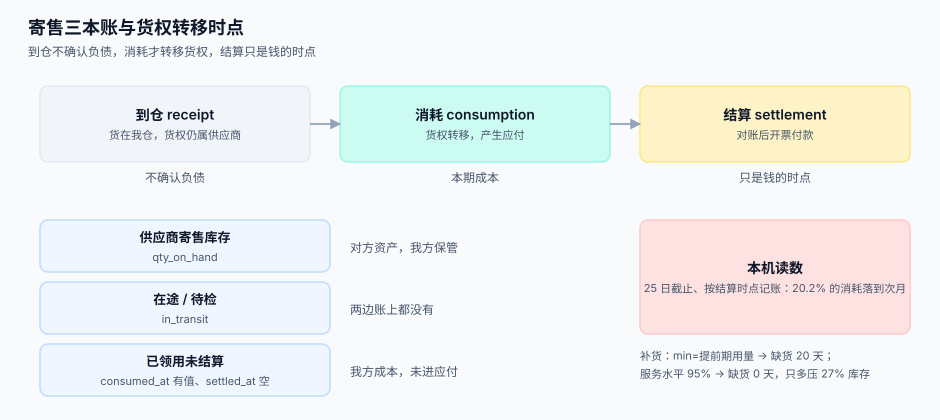

# VMI 与寄售

<p style="text-align:center;"></p>

VMI（Vendor Managed Inventory，供应商管理库存）与寄售（consignment）经常被混着说，但它们问的是两个不同的问题：VMI 问「**谁决定补多少**」，寄售问「**这批货是谁的**」。两者常常同时启用，于是系统里出现一种状态：货在我仓里、补货由对方定、账上不是我的资产。这一页把这件事拆成三个时点和三本账。

::: tip 一句话理解
**寄售的关键不是「货在哪」，而是「货权什么时候转」。** 时点定错一天，两家的存货报表和损益都错，而且审计最先发现。
:::

## 货权三个时点

| 时点 | 定义 | 货权 | 常见约定 |
| --- | --- | --- | --- |
| **到仓**（receipt） | 实物进入我方仓库 | 仍属供应商 | 寄售默认；此时**不确认负债** |
| **领用/消耗**（consumption） | 我方从寄售库领出使用 | **转移**给我方 | VMI 最常见；同时产生应付 |
| **结算/开票**（settlement） | 双方按月对账后开票 | 已转移 | 只是**记账与付款**时点，不是货权时点 |

三个时点里，**只有第二个是法律事实上的转移点**。第三个只是钱的时点。把「结算」当货权时点，会导致月末那批已经投产的货还在供应商的存货里——两边的存货周转率同时算错。

```sql
CREATE TABLE consignment_stock (
  id          INTEGER PRIMARY KEY,
  supplier_id INTEGER NOT NULL,
  warehouse_id INTEGER NOT NULL,
  item_id     INTEGER NOT NULL,
  qty_on_hand NUMERIC NOT NULL DEFAULT 0,   -- 在库（供应商资产）
  qty_reserved NUMERIC NOT NULL DEFAULT 0,  -- 已被生产计划锁定
  updated_at  TEXT NOT NULL
);

CREATE TABLE consignment_consumption (
  id           INTEGER PRIMARY KEY,
  stock_id     INTEGER NOT NULL REFERENCES consignment_stock(id),
  qty          NUMERIC NOT NULL,
  consumed_at  TEXT NOT NULL,      -- 事实发生时点（货权转移）
  period       TEXT NOT NULL,      -- 归属期间 YYYY-MM
  settled_at   TEXT,               -- 结算时点（钱的时点）
  unit_price   NUMERIC(18,6) NOT NULL,
  amount       NUMERIC(18,2) NOT NULL,
  settlement_id INTEGER
);
```

::: danger 三本账必须能分开查
1. **供应商寄售库存**（`qty_on_hand`）：属于对方资产，我方只有保管责任。
2. **我方在途/待检**：货已发未到、到了未检，既不在对方库存也不在我方可售库存。
3. **我方已领用未结算**（`consumed_at` 有值、`settled_at` 为空）：已经是我方成本，但还没进应付。

只维护一本「库存」的系统，在这三本账之间必然有一本对不上，而且**永远说不清差在哪**——因为差的那本账根本没建。
:::



## 补货阈值：min/max 与 (s, S)

VMI 的核心是一个补货规则。两种常见策略看起来差不多，读数差得不少：

| 策略 | 规则 | 360 天缺货天数 | 补货次数 | 平均库存 |
| --- | --- | --- | --- | --- |
| **min/max**，`min = 提前期用量` | 低于 160 补到 480 | **20 天** | 43 | 171 |
| **服务水平 95%**，`s = μ_L + 1.65σ_L` | 低于 219 补到 499 | **0 天** | 47 | 217 |

本机模拟条件：日需求 `N(40, 18)`、提前期 4 天、模拟 360 天。结论很干净：**只多压 46 个单位（+27%）的平均库存，就把 20 天缺货换成 0 天**。

::: danger 「min 设成提前期用量」为什么必然缺货
提前期内的需求是个随机变量，均值 `40×4 = 160`。把 `min` 设成 160，意味着**每次补货周期的期末库存期望正好是 0**——按正态分布，大约一半的周期会在到货前耗尽。`min` 必须是「均值 + 安全库存」，安全库存由 `z × σ_L` 决定，`z` 由服务水平查表（95% → 1.65）。
:::

### 补货量计算

```sql
-- 建议补货量 = 目标水位 - (在库 + 在途) ；结果按最小包装向上取整
SELECT
  c.item_id,
  c.qty_on_hand,
  COALESCE((
    SELECT SUM(t.qty) FROM consignment_in_transit t
    WHERE t.stock_id = c.id
  ), 0) AS in_transit,
  CASE WHEN c.qty_on_hand + COALESCE((
         SELECT SUM(t.qty) FROM consignment_in_transit t WHERE t.stock_id = c.id), 0
       ) >= c.min_level
       THEN 0
       ELSE c.max_level - (c.qty_on_hand + COALESCE((
            SELECT SUM(t.qty) FROM consignment_in_transit t WHERE t.stock_id = c.id), 0))
  END AS suggest_qty
FROM consignment_stock c
WHERE c.supplier_id = :sid;
```

**必须把在途算进去**，否则每次刷新页面都会建议再补一批——这是 VMI 系统最常见的重复补货来源，也是「供应商说我们乱下单」的真实原因。

## 消耗结算与期间归属

月末结算时最容易出的事不是算错钱，而是**把消耗记到了错误的月份**。

本机读数：1,000 次消耗随机分布在 1-30 日，其中 **9.5%** 发生在 29-30 日。若账期为每月 25 日截止、且按「结算时点」记账，有 **202 次（20.2%）** 被记到次月。

这 20.2% 带来的后果是：

| 受影响对象 | 表现 |
| --- | --- |
| 我方成本 | 当月成本偏低，次月偏高，毛利率月度波动 |
| 供应商收入 | 与实物消耗节奏不符，对方认为「你们少报了」 |
| 存货 | 已消耗但未结算的部分仍挂在「寄售在库」，虚增存货 |
| 对账 | 双方按不同期间取数，总额必然不等 |

**正确做法**：`consumed_at`（事实）与 `period`（归属）都存，`settled_at` 只记录钱的时点；报表一律按 `period` 出，追溯一律按 `consumed_at` 查。

```sql
-- 期间归属：以消耗发生日为准，跨月自动落到各自月份
UPDATE consignment_consumption
SET period = substr(consumed_at, 1, 7)
WHERE period IS NULL;

-- 月度结算：只结「已消耗未结算」，且按 period 过滤
SELECT period, SUM(amount) AS amount, COUNT(*) AS lines
FROM consignment_consumption
WHERE supplier_id = :sid AND settled_at IS NULL AND period = :period
GROUP BY period;
```

::: warning 盘点差异要怎么记
寄售库存盘亏时，责任在保管方（我方），但货权在对方——这笔差异**不能直接冲减对方库存**，要走「保管责任赔付」：先记 `consignment_adjust`（盘亏数量 + 责任方），再生成一张赔付单据。直接改 `qty_on_hand` 会让对方的库存凭空少一批，且没有任何单据能解释。
:::

## 判据清单

| 编号 | 判据 | 怎么验 |
| --- | --- | --- |
| `SPV-A` | 货权转移时点在协议里写明，且系统只有一个字段表达它 | 查协议条款与 `consumed_at` 的对应 |
| `SPV-B` | 到仓不确认负债，消耗才生成应付 | 月末对比「寄售在库」与「应付余额」的勾稽 |
| `SPV-C` | 三本账可分别查询，且三者之和等于实物总量 | 三个 `SUM` 相加与盘点数对拍 |
| `SPV-D` | 补货建议把在途计入，重复刷新不产生第二批建议 | 连续调用 3 次，断言建议量单调不增 |
| `SPV-E` | `min` 由「均值 + z×σ」算出，不是直接填提前期用量 | 查配置项来源与服务水平字段 |
| `SPV-F` | `consumed_at` 与 `period` 都存，报表按 `period`、追溯按 `consumed_at` | 两条查询各跑一次 |
| `SPV-G` | 盘亏走调整单 + 责任方，不直接改 `qty_on_hand` | 查 `UPDATE consignment_stock` 的调用点 |
| `SPV-H` | 结算单可按期间重出，且重出结果与首次一致 | 同一 `period` 结算两次，断言金额相等 |

## 验证方式

```shell
# 三本账勾稽：实数 = 在库 + 在途 + 已领未结
sqlite3 /tmp/sc.db "
SELECT (SELECT SUM(qty_on_hand) FROM consignment_stock)
     + (SELECT SUM(qty) FROM consignment_in_transit)
     + (SELECT SUM(qty) FROM consignment_consumption WHERE settled_at IS NULL);"
```

与仓库实盘数比对，差值应为 0。若不为 0，先查是否有「已领用但没写 `consumed_at`」的行。

```shell
# 期间归属：25 日截止口径下的跨月比例
sqlite3 /tmp/sc.db "
SELECT SUM(CASE WHEN CAST(substr(consumed_at,9,2) AS INT) > 25 THEN 1 ELSE 0 END) * 100.0 / COUNT(*)
FROM consignment_consumption;"
```

预期约 `20`（百分点）。这就是「按结算时点记账」会错记的比例。

## 参考资料

- [总览：六段协同链与三个「价格」](../Overview/index.md)：寄售消耗在六段链中的位置
- [价格协议与阶梯价](../PriceAgreement/index.md)：消耗结算用的是哪个价格
- [库存与预占](../../Ecommerce/Inventory/index.md)：为什么寄售库存不能进可售库存
- [对账与差错处理](../../Ledger/Reconciliation/index.md)：盘亏与差异的会计处理
- 《企业会计准则第 1 号——存货》：代管物资与寄售商品的确认条件
