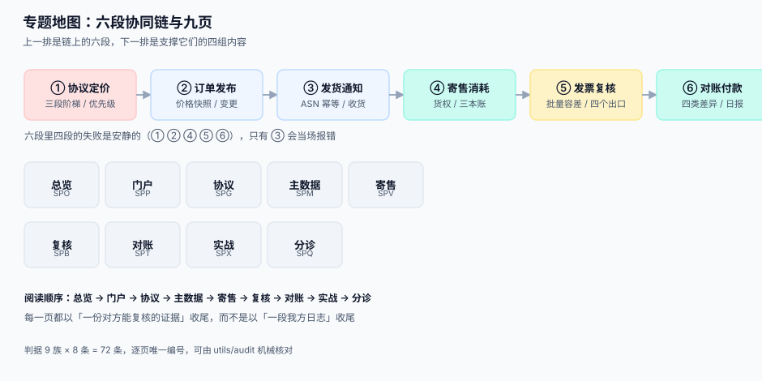

# 供应商协同与价格主数据工程

<p style="text-align:center;"></p>

采购方内部的流程走通之后，真正难的部分才开始：**同一件事，两个组织各记一本账，而这两本账永远不会自己对齐**。你这边「已收货 1,000 件」，供应商那边「已发货 1,020 件」；你按协议价 9.50 元算，他按报价单 9.80 元算；你 25 日关账，他 30 日才把对账单发来。这不是谁算错了，而是**两个组织的时钟、口径、单据形状天然不同**。

本专题讲的是这条边界上的工程：供应商在门户里能看到什么、能提交什么；价格协议怎么落到每一行订单；寄售与 VMI 的货权什么时候转移；批量复核怎么在不看每一张发票的前提下仍然守住金额；以及每天早晨那份对账日报怎么把差异归到人头上。

::: tip 一句话理解
**协同不是「给对方开个账号」。** 它是把「我方的一个判断」翻译成「对方能复核的一份证据」——对方看完能说出「这条我认 / 这条我不认，因为……」,否则那个账号只是个查询窗口，不是协同。
:::

## 与相邻专题的分工

| 专题 | 它回答的问题 | 本专题的回答 |
| --- | --- | --- |
| [采购到付款（P2P）与三单匹配](../ProcureToPay/index.md) | 采购方内部七段链怎么走：预算 → 寻源 → 订单 → 收货 → 匹配 → 付款 | 这条链**跨出组织边界**后的那一段：对方怎么看见、怎么提交、怎么争议 |
| [三单匹配与容差](../ProcureToPay/InvoiceMatch/index.md) | 单张发票与订单、收货怎么逐张比对 | 一万张发票怎么**批量**过闸，以及放行错了怎么回收 |
| [营销计价与优惠分摊](../PricingPromotion/index.md) | 对消费者的价格怎么算、优惠怎么分摊 | 对供应商的**协议价**怎么解析：阶梯、币种、生效期、优先级 |
| [主数据与数据标准](../../DB/DataGovernance/StandardsMasterData/index.md) | 主数据怎么建模、谁来治理 | 料号与价格这三张主数据**在协同场景里谁说了算** |
| [批量数据交换](../BulkDataExchange/index.md) | 文件怎么传、怎么校验、怎么给回执 | 价目表、ASN、对账单这三类文件的**业务判据** |
| [对账与差错处理](../Ledger/Reconciliation/index.md) | 两个账本对不上时怎么找差 | 差额的**外部来源**：供应商对账单与内部台账的四类差异 |
| [库存与预占](../Ecommerce/Inventory/index.md) | 面向消费者的可售库存怎么算 | 寄售库存的**货权**在谁手上，以及它为什么不进可售库存 |
| [合同演进](../ContractEvolution/index.md) | 接口与条款怎么版本化 | 价格协议版本与订单快照的关系：订单永远认**下单那一刻**的价 |

> 一句话记住边界：**P2P 假设「所有人都在同一家公司里」；本专题假设「对面那家公司有自己的账、自己的时钟、自己的律师」。**



## 十页导航

| 页 | 讲什么 | 读完能做什么 |
| --- | --- | --- |
| [总览：六段协同链与三个「价格」](./Overview/index.md) | 六段链、三个价格、四个必失接缝 | 判断自己的协同系统把「对方不认」丢在了哪一段 |
| [供应商门户与可见范围](./SupplierPortal/index.md) | 三层过滤、账号模型、幂等提交、列表分页 | 让「他能看见什么」变成一条可测的 SQL 条件 |
| [价格协议与阶梯价](./PriceAgreement/index.md) | 协议模型、三种阶梯口径、解析顺序、快照 | 让同一张订单在任何时候重算都得到同一个金额 |
| [料号、单位与价格主数据](./PriceMaster/index.md) | 三方料号映射、单位换算、MOQ 与增量 | 让「1 箱」在两边是同一种东西 |
| [VMI 与寄售](./VmiConsignment/index.md) | 货权三时点、三本账、补货阈值、消耗结算 | 说清「这批货是谁的」，并把结算归到正确期间 |
| [三单匹配的批量复核](./BatchReview/index.md) | 批量容差、四个出口、复核队列、抽样 | 在只看 3% 的单据时仍然守住金额 |
| [供应商对账日报](./ReconciliationDaily/index.md) | 对账单口径、四类差异、归口与阈值 | 每天早晨用五行数字说清「今天差在哪」 |
| [实战：本机跑通一条协同闭环](./Practice/index.md) | SQLite + Python 十步 + 三个负向用例 | 在本机复现「协议价 → 门户 → 寄售 → 对账」并验证四条不变式 |
| [常见问题与分诊](./FAQ/index.md) | 八类现象的分诊入口、二十项自查 | 三分钟内判断问题在价格、门户还是对账 |

## 判据纪律

| 页 | 判据族 | 这一族管什么 | 条数 |
| --- | --- | --- | --- |
| 总览 | `SPO-A` ~ `SPO-H` | 六段是否各有证据、三个价格是否分开存 | 8 |
| 供应商门户 | `SPP-A` ~ `SPP-H` | 可见范围是否可测、提交是否幂等、分页是否稳定 | 8 |
| 价格协议 | `SPG-A` ~ `SPG-H` | 阶梯口径唯一、解析顺序确定、金额可重算 | 8 |
| 价格主数据 | `SPM-A` ~ `SPM-H` | 料号可映射、单位可换算、舍入顺序固定 | 8 |
| VMI 与寄售 | `SPV-A` ~ `SPV-H` | 货权时点明确、三本账可分、结算不跨期错记 | 8 |
| 批量复核 | `SPB-A` ~ `SPB-H` | 容差可解释、放行可回收、队列有排序依据 | 8 |
| 对账日报 | `SPT-A` ~ `SPT-H` | 口径可比、差异可归口、阈值可触发 | 8 |
| 实战 | `SPX-A` ~ `SPX-H` | 十条命令与三个必须失败的反向用例 | 8 |
| 常见问题 | `SPQ-A` ~ `SPQ-H` | 八类现象的分诊入口是否可判定 | 8 |

每条判据回答三件事：**看什么现象、判成什么、不满足时改哪里**。编号逐页唯一，可被 `utils/audit` 下的判据类巡检机械核对。

## 三个必须先接受的前提

1. **对方永远比你晚知道。** 你改了交期、调了价、拒收了一批货，对方系统里还是昨天的样子。任何「改完就一致」的设计都会在第一次变更时崩掉；正确做法是**每次变更都产生一条对方可拉取、可确认、可争议的通知**，而不是指望对方实时同步。
2. **对不上不是错误，是常态。** 两边期间不同、含税口径不同、单据状态不同，只要有一项不同，总额就必然不等。一个把「总额不等」当异常告警的系统，第一周就会被静音；正确做法是**先对齐口径，再逐单找差**。
3. **货权是法律事实，不是数据库字段。** 寄售货放在你仓库里，但在被消耗之前它是供应商的资产、也是他的存货。这条一旦记错，两边报表都会错，而且**审计最先发现**。

## 版本组织说明

本专题**不建版本目录**（如 `SupplierCollaborationV2/`）。三条理由：

1. **换代的是接入方式，不是判据。** 从 EDI（X12 856 / EDIFACT DESADV）到门户 API 再到 CSV 上传，变的是「报文怎么来」，`SPP-C`「同一张 ASN 提交三次只能产生一批入库」在三种接入方式下一字不差。
2. **多代接入长期并存于同一批供应商。** 大供应商走 API、中小供应商还在传文件，这不是两个时代，而是**同一页里的两个分支**。
3. **真正需要按大版本组织的是「同一份代码的两套写法」**，比如 [`Spring5`/`Spring6`](../Java/Frame/Spring/index.md)。这里的差异可以在一张对照表里讲完，拆成两套内容线只会让读者不知道该信哪一份。

库内按大版本建目录的先例见 [`Spring5`/`Spring6`](../Java/Frame/Spring/index.md) 与 [SpringBoot `v2`/`v3`](../Java/Frame/SpringBoot/index.md)。

## 事实与口径速览

| 事项 | 口径 | 出处 |
| --- | --- | --- |
| 发货通知报文 | ANSI X12 **856**（ASN）、UN/EDIFACT **DESADV**、UBL **DespatchAdvice** | X12、UN/CEFACT、OASIS UBL 2.x |
| 商品标识 | **GTIN**（全球贸易项目代码）、**GLN**（全球位置码） | GS1 General Specifications |
| 发票报文 | UBL `Invoice` / PEPPOL BIS Billing 3.0；国内为数电票 XML/PDF | OASIS UBL、OpenPEPPOL、国家税务总局 |
| 增值税税率 | 现行三档 **13% / 9% / 6%**，另有零税率与征收率 | 《增值税暂行条例》及现行税率表 |
| VMI 补货策略 | 常见 min/max 与 **(s, S)** 两种；服务水平常用 **95%**（z≈1.65） | 库存管理通行做法，非强制标准 |
| 抽样验收 | **GB/T 2828.1**（等同 ISO 2859-1）的 AQL 抽样表 | 国家标准 |
| 付款报文 | ISO 20022 `pain.001` / `camt.053` | ISO 20022 报文目录 |
| 现金折扣 | `2/10 net 30`：10 天内付折 2%，否则 30 天内全额 | 商业惯例 |

::: info 本轮的核对方式
本轮运行环境**无外网**，上表的标准编号与法规名称按库内既有口径与公开常识书写，**未逐条在线复核**；涉及税率的句子一律写成「现行三档」这种可自行核对的形态，不给具体文号。文中的比例与耗时读数**均为本机实测**（Python 3.13.12 + SQLite 3.50.4，固定种子 `20261031`，脚本不入库），复现方式见[实战](./Practice/index.md)。
:::

## 验证方式

专题级的验收不看文章数量，看三件事能不能在本机复现：

```shell
# 1) 判据编号唯一、无撞号
python3 utils/audit/judgeidcheck.py | tail -1        # 预期 E=0

# 2) 页面收尾三件套齐全（验证方式 + 参考资料）
python3 utils/audit/tailcheck.py --root . | grep SupplierCollaboration   # 预期无输出

# 3) 相对链接全部可达
python3 utils/audit/linkexistcheck.py | grep SupplierCollaboration       # 预期无输出
```

三条全过，说明这十页在结构上「读得通、点得动、判得准」；内容是否正确，要靠[实战](./Practice/index.md)里那三个必须失败的反向用例来证明。

## 参考资料

- [采购到付款（P2P）与三单匹配工程](../ProcureToPay/index.md)：本专题的上游，七段链与四个时点的完整定义
- [批量数据交换工程](../BulkDataExchange/index.md)：价目表与对账单作为「文件」时的解析、校验与回执
- [对账与差错处理](../Ledger/Reconciliation/index.md)：差额的会计侧处理，本专题只负责把差额生出来
- GS1 General Specifications：GTIN / GLN 的编码规则与校验位算法
- OASIS UBL 2.x：`DespatchAdvice` / `Invoice` 的字段约束
- GB/T 2828.1（ISO 2859-1）：计数抽样检验程序与 AQL 表
- 中国《企业会计准则第 1 号——存货》：寄售与代管物资的确认条件
