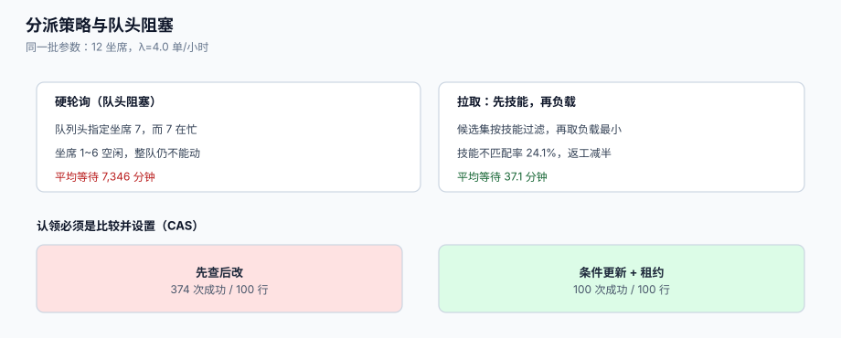

# 分派与认领：技能、负载与抢占

工单建好之后，它躺在池子里。池子里的每一步都「看起来正常」：工单数量在涨、状态是 `NEW`、SLA 在走——**唯一不对的是没有人在处理它**。分派要解决的就是这一件事：让每张单在**可接受的时间内**落到一个**有能力处理它**的人手上，并且**只有一个人**。

这一页讲三件事的取舍：分派策略（轮询 / 最小负载 / 技能优先）、认领的并发语义（先查后改为什么会双认领）、以及池子的边界（溢出、改派、老单饥饿）。



本页判据族 `STD-A` ~ `STD-H`，共 8 条。定义表在第七节。

## 一、分派的目标不是「平均」，是「最坏的那个」

排队系统的平均值几乎总是好看的，难看的是尾部。同一批参数（12 坐席、到达率 λ=4.0 单/小时、处理时长中位数 2.2 小时）下，三种策略的本机读数：

| 策略 | 平均等待 | p95 等待 | 技能不匹配率 | 主要问题 |
| --- | --- | --- | --- | --- |
| 硬轮询（`n % 12`） | **7,346 分钟** | **13,886 分钟** | 51.7% | 队头阻塞，整队等一个忙人 |
| 最小负载（不看技能） | **35.0 分钟** | **127.0 分钟** | 48.0% | 快，但一半的单给了不对的人 |
| 技能优先 + 最小负载 | **37.1 分钟** | **168.5 分钟** | **24.1%** | 稍慢一点，返工少一半 |

这张表的核心是**第二列与第四列的权衡**：技能优先让 p95 从 127 分钟涨到 168 分钟（多等 41 分钟），但技能不匹配率从 48.0% 降到 24.1%。而技能不匹配的代价不在等待里，在**返工**里——一张单被转两次，客户就要重复描述两次，这部分的成本不体现在任何等待指标上。

::: tip 一句话
**先按技能缩小候选集，再在候选集里取最小负载**。反过来（先取全局最小负载、不行再转）会把「分派」变成「转派」，客户体验的损失远大于那 41 分钟。
:::

## 二、硬轮询为什么会灾难

「下一个轮到的坐席」看起来最公平，实际是**队头阻塞**（head-of-line blocking）：队列头部的工单指定了坐席 7，而坐席 7 正在处理一张 3 小时的单，于是**整队不能动**——即使坐席 1 到 6 都空闲。

```python
# [dispatch/round_robin_bug.py]
def pick_rr(i, agents=12):
    return i % agents          # 语义：第 i 张单固定给第 i%12 个坐席

# 一旦被指定的坐席忙，队列只能等——这不是「慢」，是「卡」
```

本机读数：同一批参数下平均等待 **7,346 分钟**（约 5.1 天），p95 **13,886 分钟**（约 9.6 天）。而这不是「轮询」这个想法错，而是**「把人与单绑定」这件事错**：正确做法是「单进池子、人无事可做时来取」，即 **pull 模型**，而不是「把单推给某个特定的人」（push 模型）。

| 模型 | 语义 | 何时合适 |
| --- | --- | --- |
| push（指派） | 系统决定负责人，坐席照单执行 | 有强技能约束、单量可预测、坐席在线状态可靠 |
| pull（领取） | 单进队列，坐席主动领 | 坐席数量多、在线状态不稳、单量波动大 |
| 混合 | 系统给出「建议负责人」，坐席可领可改派 | 大多数客服台的实际形态 |

## 三、认领：先查后改必然双认领

「认领」是一个**比较并设置**（compare-and-set）动作，不是「读 + 写」。用先查后改实现，在并发下会出现「同一张单被三个人同时认领成功，最后一个人覆盖了前两个」：

```python
# [dispatch/claim_bad.py] —— 错误示范
row = conn.execute("select id from ticket where assignee_id is null limit 1").fetchone()
if row:
    conn.execute("update ticket set assignee_id=%s where id=%s", (me, row[0]))   # 没有守卫
    return "claimed"        # 三个人都会走到这里
```

本机读数（20 个坐席并发、100 张单、每个坐席最多尝试 60 次）：

| 实现 | 应用层记「认领成功」 | 表内实际认领行数 | 重复认领 |
| --- | --- | --- | --- |
| 先查后改（无守卫） | **374** | 100 | **274** |
| 条件更新（`where assignee_id is null`） | 100 | 100 | **0** |

```python
# [dispatch/claim_ok.py] —— 正确写法
cur = conn.execute(
    "update ticket set assignee_id=%s, assigned_at=now(), version=version+1 "
    "where id=%s and assignee_id is null",
    (me, tid),
)
if cur.rowcount == 1:
    return "claimed"
return "taken"      # 0 行：别人先抢先，重新取下一张
```

### 3.1 三道防线，不是一道

| 防线 | 做法 | 挡住什么 |
| --- | --- | --- |
| 条件更新 | `update ... where assignee_id is null`，用 `rowcount` 判定 | 并发双认领 |
| 唯一约束 | `create unique index ... on ticket(id) where assignee_id is not null` 无意义；应约束「一人一单」的**租约表** | 同一人无限领单（见下） |
| 租约（lease） | `claim(agent_id, ttl)` + `expires_at`，超时自动释放 | 坐席掉线后单被永久占住 |

租约是常被忽略的一环：条件更新解决了「两人抢同一张单」，但解决不了「有人领了之后**不处理**」。没有租约，一张单会被一个放假的人占三天。

```sql
-- [schema/claim.sql]
create table ticket_claim (
  ticket_id  bigint primary key references ticket(id),
  agent_id   bigint not null,
  claimed_at timestamptz not null default now(),
  expires_at timestamptz not null,          -- 租约到期，过期即可被他人领取
  version    int not null default 0
);

-- 一个坐席同时持有的租约数量上限（防止「全领走」）
create or replace function enforce_wip_limit() returns trigger language plpgsql as $$
begin
  if (select count(*) from ticket_claim
      where agent_id = new.agent_id and expires_at > now()) >= 10 then
    raise exception 'WIP limit reached for agent %', new.agent_id;
  end if;
  return new;
end $$;

create trigger trg_wip before insert on ticket_claim
for each row execute function enforce_wip_limit();
```

::: danger 注意
1. **不要用「`assignee_id` 非空」当作「有人在处理」**。有人认领之后掉线、请假、离职，单子会永久停在「有人负责」的状态——这是最隐蔽的积压：队列长度看起来正常，但那些单永远不会被处理。租约 + WIP 上限是唯一能把它暴露出来的机制。
2. **不要在应用层做「先查后改」的乐观锁**（读 `version` → 比较 → 写）。读到写之间仍然有窗口，除非写的时候把 `version` 也放进 `where`（那就是条件更新）。见[幂等与状态机工程](../../IdempotencyStateMachine/IdempotencyKey/index.md)里同一类错误的另一种形态。
3. **不要让「改派」绕过审计**。改派是最容易被用来「甩单」的动作，必须记 `from_agent`、`to_agent`、`reason`，并且进入[度量](../Metrics/index.md)的「转派次数」。
:::

## 四、池子的边界：溢出、改派与二线

池子不是一个，是一组。每张单只属于**一个当前池**，且池之间要有明确的路由规则：

| 池 | 进入条件 | 离开条件 | 超时兜底 |
| --- | --- | --- | --- |
| 一线池（按技能组） | 建单后按 `request_type` 路由 | 被认领 | 超过 `group_sla` 未认领 → 升级 |
| 二线池 | 一线标记 `need_escalation` | 二线认领或驳回 | 驳回必须写原因，否则回一线会立刻再升级 |
| 溢出池 | 技能组无人在线 / 队列超过阈值 | 有技能坐席上线 | **只能由系统进出**，不能由坐席手动塞 |
| 值班池 | 非工作时段 + 高优先级 | 值班人认领 | 值班结束后自动转回一线池 |

溢出池是最容易变成垃圾场的地方。两条纪律：

1. **进出都自动**。允许人工往溢出池塞单，它就会变成「我不想处理的单」的仓库。
2. **溢出池里的单仍计时**。SLA 不因为「没人有技能」而暂停——否则「不培训」就成了达标手段。

## 五、公平性：老单饥饿与大客户优先

最小负载策略有一个副作用：**老单饥饿**。新单进来时总是「负载最小的人」接，而老单因为「更复杂、更耗时」被反复跳过。三种常见补丁：

| 补丁 | 做法 | 代价 |
| --- | --- | --- |
| 队列内按「SLA 剩余时间」排序 | 剩余最少的最先被看到 | 需要准确的 SLA 快照 |
| 老单加权 | `score = 等待时长^α / 技能匹配`，α 调大偏向老单 | 参数难调，容易变成「谁老谁先」 |
| 硬性时限 | 超过 `X` 小时未认领的单**强制指派**给组长 | 组长负担上升，但饥饿被消灭 |

对大客户（`vip`）的优先要**显式**，不要靠「优先级字段被随手改成 HIGH」来实现：优先级是**承诺**（决定 SLA 目标），客户等级是**排序**（决定谁先被看到）。两者混用会让 SLA 报表彻底失真——所有 VIP 单都是 P1，于是 P1 的达标率没有意义。

## 六、本页判据

| 判据 | 看什么现象 | 判成什么 | 不满足时改哪里 |
| --- | --- | --- | --- |
| `STD-A` | 认领用条件更新，且用 `rowcount` 判定成功 | 无双认领 | 改写认领 SQL |
| `STD-B` | 分派是 pull 或「建议 + 可改」，不存在「单绑定固定坐席」 | 无队头阻塞 | 去掉 `i % n` 式指派 |
| `STD-C` | 候选集先按技能过滤，再按负载排序 | 返工率可控 | 调整排序键顺序 |
| `STD-D` | 认领有租约 `expires_at`，过期可被他人领取 | 掉线不占地 | 建 `ticket_claim` |
| `STD-E` | 每人同时在手单数有上限（WIP） | 防「全领走」 | 加触发器 |
| `STD-F` | 溢出池只由系统进出，且单仍计时 | 溢出不成为卸载手段 | 收紧权限 |
| `STD-G` | 改派必须写 `reason`，并计入「转派次数」 | 甩单可见 | 补审计与指标 |
| `STD-H` | 超过 `X` 小时未认领的单会被强制指派 | 老单不饿死 | 加超时任务 |

## 七、验证方式

```shell
# 1) 并发认领：20 个进程抢 100 张单，验证「成功次数 = 实际认领行数」
python3 - <<'PY'
import os, threading, psycopg
dsn = os.environ["DSN"]; ok = [0]; lock = threading.Lock()
def work(me):
    with psycopg.connect(dsn, autocommit=True) as c:
        for _ in range(60):
            r = c.execute("select id from ticket where assignee_id is null limit 1").fetchone()
            if not r: break
            n = c.execute("update ticket set assignee_id=%s where id=%s and assignee_id is null",
                          (me, r[0])).rowcount
            if n == 1:
                with lock: ok[0] += 1
ts = [threading.Thread(target=work, args=(i,)) for i in range(20)]
[t.start() for t in ts]; [t.join() for t in ts]
with psycopg.connect(dsn) as c:
    claimed = c.execute("select count(*) from ticket where assignee_id is not null").fetchone()[0]
print(f"成功 {ok[0]} 次 / 实际认领 {claimed} 行")
PY
```

预期输出：`成功 100 次 / 实际认领 100 行`。**两个数必须相等**；若成功次数远大于行数，说明更新条件里少了 `and assignee_id is null`。

```shell
# 2) 租约过期后单应可被他人领取
psql "$DSN" -c "update ticket_claim set expires_at = now() - interval '1 minute' where ticket_id = 1;"
psql "$DSN" -c "update ticket t set assignee_id = 2 from ticket_claim c \
  where c.ticket_id = t.id and c.expires_at < now() and t.id = 1;"
```

预期输出：第二条 `UPDATE 1`（若为 `UPDATE 0`，说明你的可领条件是 `assignee_id is null`，没有把过期租约算作可领）。

```shell
# 3) WIP 上限生效：同一坐席领第 11 张单必须失败
psql "$DSN" -c "select count(*) from ticket_claim where agent_id=1 and expires_at>now();"
```

预期输出：`<= 10`；跑一次超额领取的脚本应看到 `ERROR: WIP limit reached for agent 1`。

```shell
# 4) 队头阻塞不存在：不存在「有闲人但队列不动」的时段
psql "$DSN" -c "select count(*) from ticket t where t.assignee_id is null \
  and t.created_at < now() - interval '2 hours';"
```

预期输出：`0`（或与你的「可接受等待」阈值一致）。持续大于 0 说明池子里的单没有被取走的路径。

## 八、参考资料

- Atlassian《Queues in Jira Service Management》（队列即视图、按 SLA 剩余时间排序的做法）：<https://support.atlassian.com/jira-service-management-cloud/docs/use-queues/>
- Zendesk《Automatically assigning tickets with triggers and views》（自动分派与「按组路由」）：<https://support.zendesk.com/hc/en-us/articles/4408886890906>
- PostgreSQL 文档《UPDATE》（`rowcount` 与条件更新的语义）：<https://www.postgresql.org/docs/current/sql-update.html>
- PostgreSQL 文档《CREATE TRIGGER》（WIP 上限这类「跨行约束」的实现方式）：<https://www.postgresql.org/docs/current/sql-createtrigger.html>
- Little, J. D. C.《A Proof for the Queuing Formula: L = λW》：<https://doi.org/10.1287/opre.9.3.383>
