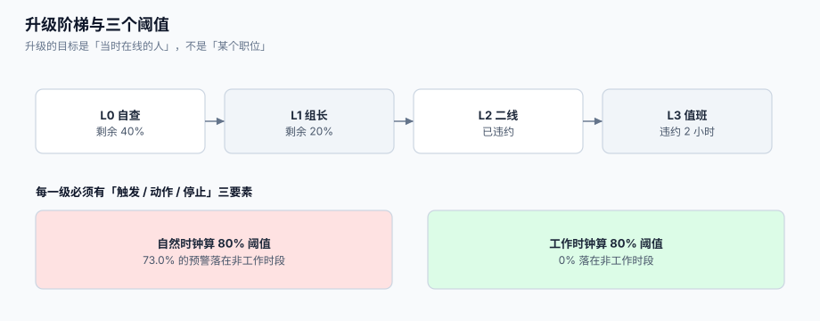

# 升级与值班：阶梯、阈值与误升级

SLA 只做了一件事：**把承诺变成一个会到期的时刻**。它不会让任何人行动。真正让承诺兑现的是升级——**在到期之前，把单交到更有权限的人手上**。而升级最常见的失败不是「没升级」，是「升级错了地方」：半夜把值班经理叫起来处理一个客户自己没回的单。

这一页讲升级的四个部件：**阈值**（什么时候升）、**阶梯**（升给谁）、**值班表**（谁在线）、**去重**（别打十个电话说同一件事）。



本页判据族 `STE-A` ~ `STE-H`，共 8 条。定义表在第八节。

## 一、两条轴：时间轴与严重度轴

升级有两条独立的路，混在一起就会出乱子：

| 轴 | 触发条件 | 升给谁 | 目的 | 典型动作 |
| --- | --- | --- | --- | --- |
| **时间轴**（SLA 升级） | 剩余时间低于阈值 | 组长 → 经理 → 值班 | 别违约 | 提醒、改派、加人 |
| **严重度轴**（严重性升级） | 影响面/金额/舆情达到条件 | 二线 → 专家 → 管理层 | 别让事故扩大 | 拉群、开事故、发通告 |

一条单可以同时被两条轴升级，但**动作不同**：时间轴升级的默认动作是「催办 + 改派」，严重度轴升级的默认动作是「拉人 + 通告」。把严重度升级做成「改优先级字段」，会让 SLA 报表彻底失效——所有事故单都变成 P1，P1 的达标率就没有意义了。

::: danger 注意
1. **不要用「改优先级」实现升级**。优先级决定 SLA 目标（Zendesk 与 JSM 都按优先级圈定目标），改优先级等于**改合同**。升级应该写 `escalation_level` 字段与事件，优先级只在「客户影响确实变了」时才动。
2. **不要用「加急标记」代替升级**。加急标记没有责任人、没有时限、没有停止条件，它只是一个让坐席焦虑的标签。
3. **不要让升级链断在「经理」**。每一级都必须有「若 N 分钟内无响应，自动进入下一级」的兜底，否则「升给经理」在经理休假时等于「归档」。
:::

## 二、阈值：80% 不是玄学，但按自然时钟算就是灾难

业界常见的做法是在**目标用时的 80%** 触发预警（剩余 20%），理由是留出「找人 + 处理 + 回复」的时间。这个数字本身没问题，问题出在**用什么时钟算 80%**。

本机读数（20,000 张单、8 小时承诺、9:00–18:00 工作日历）：

| 口径 | 80% 阈值触发点落在非工作时段的比例 |
| --- | --- |
| 自然时钟（`created + 0.8 × 8h`） | **14,595 / 20,000 = 73.0%** |
| 工作时钟（`add_business_hours(created, 6.4h)`） | **0%**（按定义只落在工作时段） |

也就是说：**用自然时钟算阈值的团队，四分之三的预警是在夜里、周末发出的**。这些预警会训练出一线的条件反射——「夜里的提醒不重要」——于是真正需要人的那次也被忽略。这就是「告警疲劳」在客服场景里的具体形态。

| 阈值 | 适用 | 代价 |
| --- | --- | --- |
| 50% | 高价值客户、事故类 | 预警量大，容易被忽略 |
| 80% | 默认 | 剩余 20% 常不足以完成「找人 + 回复」 |
| 剩余绝对值（如剩余 30 分钟） | 短承诺（≤4 小时） | 长承诺下不适用 |
| 双阈值（80% 提醒 / 95% 强制改派） | 推荐 | 需要两条规则与两套通知 |

::: tip 一条实用规则
**阈值用「剩余时间」而不是「已用比例」**。理由：30 分钟的承诺剩 6 分钟，与 3 天的承诺剩 14 小时，紧急程度完全不同；而「剩余 20%」在两者上给出一样的百分比，一线的判断成本更高。
:::

## 三、阶梯：每一级都要有「触发、动作、停止」

```text
L0 坐席自查（剩余 40%）   → 给自己提醒，不通知他人
L1 组长介入（剩余 20%）   → 检查是否卡在缺信息/缺权限，可改派
L2 二线/专家（已违约）     → 强制指派，必须给结论
L3 值班/经理（违约 2 小时）→ 拉群，评估是否客户沟通
```

| 级 | 触发 | 动作 | 停止条件 | 谁能做 |
| --- | --- | --- | --- | --- |
| L0 | 剩余 ≤ 40% | 站内提醒坐席 | 已回复 | 系统 |
| L1 | 剩余 ≤ 20% | 通知组长；组长可改派 | 组长确认或已改派 | 组长 |
| L2 | 已违约 | **强制指派**给二线；SLA 快照记 `escalated_at` | 二线给出结论 | 系统 + 二线 |
| L3 | 违约 ≥ 2 小时 | 拉群 + 客户沟通建议 | 客户已被告知 | 值班 / 经理 |

「停止条件」是最容易被漏掉的一列。没有停止条件的升级会**反复触发**：每分钟扫一次到期表，每次都发一次通知，一张单在违约 8 小时里发出 480 条消息。见下一节的去重。

## 四、值班表：谁在线，比阈值更重要

升级的目标是「一个**当时在线**的人」，而不是「一个职位」。值班表要回答三个问题：

| 问题 | 实现 | 常见错法 |
| --- | --- | --- |
| 现在谁值班？ | `oncall_shift(team, starts_at, ends_at, person_id)`，按时间查询 | 用「谁是组长」字段静态判断 |
| 交接怎么不丢单？ | 交接时把「已升级未处理」的单列成清单，逐条确认 | 只交接「未关闭的单」，漏掉「已升级但没人动」的 |
| 跨时区怎么排？ | 每个班次绑定一个 IANA 时区，按当地时间排 | 用 UTC 排班，导致「当地 9 点」变成「当地 3 点」 |

```sql
-- [schema/oncall.sql]
create table oncall_shift (
  id         bigserial primary key,
  team       text        not null,
  person_id  bigint      not null,
  starts_at  timestamptz not null,
  ends_at    timestamptz not null,
  tz         text        not null,              -- IANA，如 Asia/Shanghai
  check (ends_at > starts_at)
);

-- 同一团队同一时刻只允许一个值班人（避免「两个人都以为对方在」）
create extension if not exists btree_gist;
alter table oncall_shift add constraint no_overlap
  exclude using gist (team with =, tstzrange(starts_at, ends_at) with &&);
```

`exclude using gist` 这一条比任何应用层校验都可靠：它保证**排班不会重叠**。排班重叠的后果是「两个人都以为对方处理」，排班空洞的后果是「没人处理」——前者更常见，因为它通常在系统里完全看不出来。

## 五、去重：一次升级只应产生一条通知

到期扫描一次可能发现 5 万条违约（见[SLA 时钟](../SLAClock/index.md)的 `limit 500`），如果把每条都变成一条通知，会同时触发三个后果：通道限流、值班人被淹、真正的严重单被淹没。

| 层次 | 做法 | 效果 |
| --- | --- | --- |
| **单条去重** | `(ticket_id, metric, level)` 唯一，已通知过的不再发 | 一张单在同一级只响一次 |
| **聚合** | 同组同级的违约合并为一条摘要（「你组有 37 张单已违约」） | 通知量从 N 降到 1 |
| **抑制** | 上游事故（如系统宕机）期间抑制下游单的升级 | 避免「一万张单同时升级」 |
| **静默** | 明确标记的维护窗口内不通知 | 需要审计（谁静的、为什么） |

```sql
-- [schema/escalation.sql]
create table escalation_event (
  id          bigserial primary key,
  ticket_id   bigint not null references ticket(id),
  level       int    not null,
  metric      text   not null,
  reason      text   not null,                  -- SLA_20 / SLA_BREACHED / SEVERITY / MANUAL
  notified_at timestamptz,
  acked_at    timestamptz,                      -- 有人确认（用于停止条件）
  created_at  timestamptz not null default now(),
  unique (ticket_id, level, metric)             -- 单条去重的关键
);
```

`acked_at` 是停止条件的载体：**只有被确认的升级才不再重复通知**。没有这一列，「已通知」与「已处理」就无法区分，系统只能在「重复打扰」与「静默丢失」之间二选一。

## 六、误升级：代价不在通知，在信任

| 误升级类型 | 表现 | 根因 | 修法 |
| --- | --- | --- | --- |
| 时钟误升级 | 夜里 3 点升级「客户未回」的单 | 阈值按自然时钟；`PENDING` 未排除 | 改时钟 + 排除等待客户的单 |
| 阈值误升级 | 长承诺单在还剩 14 小时就被升级 | 用「已用比例」而非「剩余绝对值」 | 双阈值 |
| 阶梯误升级 | 同一张单 8 小时内升到 L3 | 没有 `acked_at` 停止条件 | 加确认与去重 |
| 范围误升级 | 一个组的 200 张单同时升级 | 没有聚合 | 加聚合摘要 |
| 值班误升级 | 通知了「组长」而不是「当前值班人」 | 用职位而非排班 | 查 `oncall_shift` |

一次误升级的成本不是那条消息，而是**值班人对下一次通知的反应速度**。本库的经验是：误升级率超过 30% 之后，值班制度会在两周内名存实亡（大家开始静音）。

::: danger 升级不是惩罚
把升级做成「谁的单被升级谁扣分」，坐席就会**在阈值前把单关掉**。这是本专题见过的最普遍的指标操纵：`resolved_at` 在阈值前 3 分钟写入，客户第二天回来说「还是不行」——然后在重开统计里，它是一张「新问题」。

正确的口径是：升级衡量的是**流程有没有卡住**，不是**人有没有偷懒**。卡住的原因要能归到四类之一：缺信息、缺权限、缺技能、缺人手。归不到这四类的，才是人的问题。
:::

## 七、转派与仲裁：驳回必须带原因

二线驳回一线是正常动作，但**驳回不写原因**会让单一秒钟回到一线、一秒后被再升级——形成「乒乓」。

| 动作 | 必填 | 后果 |
| --- | --- | --- |
| 转派（transfer） | `to_group`、`reason` | 进入新组的队列，SLA 不重置 |
| 驳回（reject） | `reason`、`required_info`（缺什么） | 回原组，**升级计数 +1** |
| 拆单（split） | 新单关联 | 见[工单模型](../TicketModel/index.md) |
| 挂起（hold） | `hold_reason`、`expected_at` | 见[SLA 时钟](../SLAClock/index.md) 的暂停 |

「驳回三次必须仲裁」是一条便宜的规则：同一个组被驳回三次，说明**分类或技能映射错了**，而不是单有问题。仲裁人（通常是服务经理）的裁决结果要回写到**分类规则**里，否则下个月同样的事再来一次。

## 八、本页判据

| 判据 | 看什么现象 | 判成什么 | 不满足时改哪里 |
| --- | --- | --- | --- |
| `STE-A` | 阈值用「剩余时间绝对值」或双阈值，且按同一份日历计算 | 预警落在工作时段 | 改阈值计算 |
| `STE-B` | 升级写 `escalation_level`，不改 `priority` | 承诺不被改写 | 拆开两个字段 |
| `STE-C` | 每一级都有「触发 / 动作 / 停止」三要素 | 阶梯可执行 | 补配置表 |
| `STE-D` | `(ticket_id, level, metric)` 唯一，去重可验 | 不重复打扰 | 建唯一约束 |
| `STE-E` | 升级有 `acked_at`，未确认的会继续（有上限） | 停止条件存在 | 补确认动作 |
| `STE-F` | 值班人来自排班表（含时区），不是职位字段 | 通知到在线的人 | 建 `oncall_shift` |
| `STE-G` | 排班不重叠（`exclude using gist`） | 无双值班/空洞 | 加排除约束 |
| `STE-H` | 驳回必须带 `reason`，三次驳回触发仲裁 | 不乒乓 | 补校验与规则 |

## 九、验证方式

```shell
# 1) 阈值必须落在工作时段：统计「最近一周的 80% 预警中有多少在非工作时段」
psql "$DSN" -c "select count(*) filter (where not is_worktime(created_at + interval '6 hours 24 minutes')) as off_hours, \
                      count(*) as total \
               from sla_snapshot where metric='first_reply' and created_at > now() - interval '7 days';"
```

预期输出：`off_hours = 0`（或明确声明「我们 7×24 值班」时允许非零）。若 `off_hours` 接近 `total` 的 70%，说明阈值走了自然时钟。

```shell
# 2) 去重生效：同一张单在同一级只应有一条升级事件
psql "$DSN" -c "select ticket_id, level, metric, count(*) from escalation_event \
  group by 1,2,3 having count(*) > 1;"
```

预期输出：`0 rows`。若有行，说明唯一约束没建，或者 `level` 用了浮点/字符串导致「同一级」被判成不同值。

```shell
# 3) 排班不重叠
psql "$DSN" -c "insert into oncall_shift(team,person_id,starts_at,ends_at,tz) \
  values ('billing', 9, '2026-10-25 09:00+08', '2026-10-25 18:00+08', 'Asia/Shanghai');"
```

预期输出：第二条重叠插入报 `ERROR: conflicting key value violates exclusion constraint "no_overlap"`。

```shell
# 4) 升级不改优先级（审计里不应出现「升级导致 priority 变更」）
psql "$DSN" -c "select count(*) from ticket_event e join escalation_event x on x.ticket_id = e.ticket_id \
  where e.field='priority' and e.created_at between x.created_at and x.created_at + interval '1 minute';"
```

预期输出：`0`。

## 十、参考资料

- Atlassian《Set up SLA notifications》（SLA 预警与违约通知的配置）：<https://support.atlassian.com/jira-service-management-cloud/docs/set-up-sla-notifications/>
- Zendesk《SLA policies: escalation and breach》（违约与升级的行为说明）：<https://support.zendesk.com/hc/en-us/articles/4408822163738>
- PagerDuty《On-call schedules and escalations》（排班与升级策略的工业实践）：<https://support.pagerduty.com/docs/schedules>
- PostgreSQL 文档《Constraints》（`exclude using gist` 与 `btree_gist`）：<https://www.postgresql.org/docs/current/ddl-constraints.html>
- Google SRE Book《Alerting on SLOs》（多窗口多燃烧率告警，避免告警疲劳）：<https://sre.google/workbook/alerting-on-slos/>
