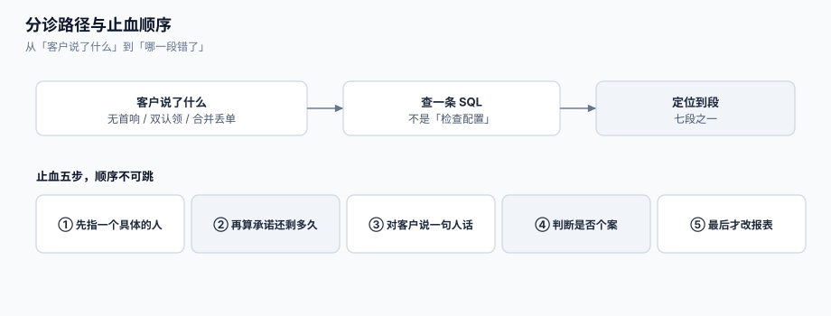

# 常见问题与分诊

客服系统的故障有一个共同点：**它看起来不像是故障**。队列在动、状态在变、报表在涨——只有客户在别处抱怨。这一页是一张分诊表：从「客户说了什么」出发，三步之内定位到「哪一段错了」，再跳到对应的页面。



本页判据族 `STR-A` ~ `STR-H`，共 8 条。定义表在第五节。

## 一、十二行分诊表

| 客户/同事说的话 | 先查什么（一条 SQL 或一个页面） | 最可能的段 | 跳转 |
| --- | --- | --- | --- |
| 「我提了三次，没人回」 | `select count(*) from ticket where requester_id=? and created_at > now()-interval '7 days'` | ② 归并失败，三条单各走各的 | [入口归并](../IntakeDedup/index.md) |
| 「你们承诺 8 小时，现在说 71 小时」 | 该单的 `sla_snapshot.metric` 与政策里的「营业/日历小时」 | ⑤ 时钟口径不一致 | [SLA 时钟](../SLAClock/index.md) |
| 「后台显示 96%，我们体感很差」 | 达标率的分母是「单」还是「分钟」；未命中的单有多少 | ⑦ 分母陷阱 | [度量口径](../Metrics/index.md) |
| 「单子挂在池子里一天了」 | `select count(*) from ticket where assignee_id is null and created_at < now()-interval '2 hours'` | ③④ 分派/认领 | [分派与认领](../Dispatch/index.md) |
| 「两个人都在处理同一张单」 | 认领是否条件更新；`ticket_claim` 是否存在重复 | ④ 认领竞态 | [分派与认领](../Dispatch/index.md) |
| 「客户一周没回，单子还挂着」 | `paused_total` 与暂停上限；是否有「无回复自动关单」策略 | ⑤ 暂停无上限 | [SLA 时钟](../SLAClock/index.md) |
| 「单子被自动关了，客户又炸了」 | `closed_at is not null and first_response_at is null` 的数量 | ⑥ 自动关单 | [工单模型](../TicketModel/index.md) |
| 「合并之后第二个问题没人管」 | `ticket_link` 里 `kind='MERGED'` 且两单 `biz_key` 不同 | ② 误合并 | [入口归并](../IntakeDedup/index.md) |
| 「值班半夜被叫起来」 | 预警触发点的分布（工作时间 vs 非工作时间） | ⑤ 阈值时钟 | [升级与值班](../Escalation/index.md) |
| 「CSAT 85 分，续约率在掉」 | CSAT 的回复率；是否只统计了回复者 | ⑦ 回复者偏差 | [度量口径](../Metrics/index.md) |
| 「二线一直驳回，单在我们组转圈」 | 同一单的 `reject` 次数；驳回是否带 `reason` | 升级路径 | [升级与值班](../Escalation/index.md) |
| 「国庆假期后所有单都违约」 | 日历的 `holidays` 是否包含该假期；是否只配了周末 | ⑤ 日历缺节假日 | [SLA 时钟](../SLAClock/index.md) |

## 二、止血五步（出事时按顺序做，不要跳步）

1. **先确认「有没有人正在处理」**。查 `assignee_id` 与最新公开回复时间。没有 → 立刻指派一个具体的人，**不要指派给组**。
2. **再确认「承诺还剩多久」**。查 `sla_snapshot` 的 `target_at` 与 `achieved_at`。若已经违约，进入第 3 步；若还有时间，进入第 4 步。
3. **对客户说一句人话**。违约的第一动作是**告知**，不是修复：「我们没在你期望的时间内回应，现在我们由 X 接手，预计 Y 时间给你结论。」——这句话本身就是承诺，所以 Y 必须是你敢兑现的。
4. **判断是否个案**。查同条件（同租户/同产品/同渠道）近 24 小时的单，若违约率显著高于基线，按事故处理（见[运维 · 故障响应](../../../Ops/IncidentResponse/index.md)）。
5. **修完再改报表**。永远不要先调指标再修问题——那只是让下一次更晚被发现。

::: danger 三个「止血时最容易做错」的动作
1. **批量改状态清队列**。它会让「未响应」变成「已解决」，而且是**不可逆**的证据销毁。
2. **临时关闭 SLA**。关闭期间的单没有目标，事后无法补算（Zendesk 的日程变更也不回溯已有工单）。
3. **把单统一改派给一个人**。这会制造新的单点：他一旦离线，整批单再次无人处理。
:::

## 三、十二个高频问题

### 3.1 「优先级字段能不能不填？」

不能。多数产品（Zendesk 明确如此）**没有优先级就没有 SLA 目标**，工单不进任何倒计时，也不进达标率的分母。允许为空等于允许「静默地不受承诺约束」。做法：建单时按「客户等级 × 请求类型」推导默认值，并在事件里记 `priority_auto_set`。

### 3.2 「客户不回，算不算我们超时？」

取决于**哪个目标**。Zendesk 的定义是：首响、下次响应、定期更新、总解决**四类在 `Pending` 下不暂停**；只有「客户等待类」目标暂停。听起来不近人情，但逻辑清楚：首响衡量的是「我们多久理客户」，与客户是否回复无关。

### 3.3 「暂停了，到期时间会往后推吗？」

**不会**（JSM 的官方定义：暂停不移动目标日期）。如果你的实现是「顺延」，那它与「暂停」是两种口径，必须在页面上写明；两者混用会让历史达标率不可比。

### 3.4 「一张单能不能有两个负责人？」

不能。可以有「协作人」（`watcher`），但**负责人唯一**。两个负责人的后果是：两人各回复一次、客户收到两个结论、SLA 归属算不清。

### 3.5 「合并会不会把 SLA 也合并掉？」

会，如果实现是「直接改 `merged_into`」。正确做法：合并时把主单的目标设为**两者中更早的**，并记一条 `sla_target_recalculated` 事件。否则「重复提交」反而成了延长承诺的手段。

### 3.6 「自动关单是不是必须的？」

必须有「无回复自动关单」的策略，但**必须留痕**：`resolution_type='AUTO_CLOSED'`，且进入「无首响即关闭」的单独统计。没有留痕的自动关单，本质上是把「没人处理」写成「已处理」。

### 3.7 「工单号要不要对客户可见？」

要。客户引用单号是最强的归并信号（正文里出现 `T-2026...` 就能直接命中主单）。不可见的内部 ID 会让客户只能说「我上次那个问题」，归并只能靠文本相似度。

### 3.8 「值班表用职位还是排班？」

排班。职位（「组长」）在休假时是一个空洞；排班（`oncall_shift`）能回答「此刻谁在线」，并且可以用 `exclude using gist` 保证不重叠。

### 3.9 「SLA 目标要不要按客户分层？」

要，但分层维度不要太多。建议三维：**请求类型 × 客户等级 × 影响面**。三个以上维度会产生几十条政策，没人能维护，且新增一条时容易漏配——漏配的单就是「未命中」，静默不计入。

### 3.10 「CSAT 能不能作为坐席 KPI？」

不建议。一旦挂钩，样本选择权就到了被考核者手上（只给满意的客户发问卷）。若必须用，配合**回复率**与**抽样规则**（系统随机发，不经过坐席）。

### 3.11 「工单能不能当 IM 用？」

不能。工单的语义是「一个诉求」，IM 的语义是「一次对话」。把工单做成聊天，会出现「一张单 400 条消息、状态永远 OPEN、SLA 永远在暂停与恢复之间跳」。实时对话用[实时协作工程](../../RealtimeCollaboration/index.md)的通道，结论回写工单。

### 3.12 「历史单的 SLA 要不要补算？」

只能**重算**，不能**补写**。前提是你的快照里存了「起点 + 日历版本 + 政策版本」；否则历史单的到期时间无法复现（日历改过、政策改过）。所以第一条纪律是：**到期时间必须落库为快照**，见[SLA 时钟](../SLAClock/index.md)。

## 四、术语表

| 术语 | 英文 | 一句话定义 | 常见误用 |
| --- | --- | --- | --- |
| 首响时长 | FRT (First Reply Time) | 提交 → 首个**公开**回复 | 把内部备注算作回复 |
| 解决时长 | TTR (Time to Resolution) | 提交 → 解决字段被设置 | 用「最后更新时间」代替 |
| 积压 | Backlog | 未关闭且未处理的单量 | 只看数量不看最老年龄 |
| 占用率 | Occupancy | 有效工作时长 / 在岗时长 | 与「利用率」（含空闲）混用 |
| 首次解决率 | FCR (First Contact Resolution) | 首次接触即解决且不重开 | 用「不重开」代替「解决」 |
| 客户满意度 | CSAT | 回复者的满意度评分 | 不报回复率 |
| 升级 | Escalation | 把单交给更有权限的人 | 用「改优先级」代替 |
| 在制上限 | WIP limit | 一人同时在手的最大单量 | 没有上限，导致「全领走」 |
| 营业小时 | Business hours | 日历内的工作时段 | 与「日历小时」混用 |
| 暂停 | Pause | 计时停走，**目标日期不变** | 与「顺延」混用 |
| 重开 | Reopen | 已解决的单回到进行中 | 用「新建单」代替，掩盖重开率 |
| 值班 | On-call | 某一时段内的第一响应人 | 用职位代替排班 |

## 五、本页判据

| 判据 | 看什么现象 | 判成什么 | 不满足时改哪里 |
| --- | --- | --- | --- |
| `STR-A` | 分诊表覆盖「无首响 / 双认领 / 误合并 / 时钟错 / 分母错」五类 | 常见故障可定位 | 补分诊行 |
| `STR-B` | 每条分诊都给出**可执行的查询**，不是「检查一下配置」 | 可自助排查 | 补 SQL |
| `STR-C` | 止血顺序固定为「先指人 → 再告知 → 再修」 | 不先调指标 | 写成 runbook |
| `STR-D` | 术语表覆盖 12 个高频词，且标出误用 | 团队语言一致 | 补术语 |
| `STR-E` | 「优先级可为空」在文档里被明确禁止 | 不漏单 | 改表单与 DDL |
| `STR-F` | 暂停与顺延的区别在文档与页面上都写明 | 口径唯一 | 补说明 |
| `STR-G` | 自动关单必须落 `resolution_type` | 自动关单留痕 | 补守卫 |
| `STR-H` | 历史 SLA 只能重算（有快照），不能补写 | 可复现 | 建快照表 |

## 六、验证方式

```shell
# 1) 分诊表的第一行必须能直接跑：查某请求人近 7 天的单
psql "$DSN" -c "select ticket_no, status, created_at, first_response_at \
  from ticket where requester_id = 42 and created_at > now() - interval '7 days' \
  order by created_at;"
```

预期输出：若返回 3 行以上且 `first_response_at` 多为空，说明「提了三次没人回」是**归并失败 + 无人认领**两个问题叠加，先修归并（[入口归并](../IntakeDedup/index.md)），再看认领（[分派与认领](../Dispatch/index.md)）。

```shell
# 2) 「自动关单」必须可数：这一条为 0 才能说「我们没有静默关单」
psql "$DSN" -c "select count(*) from ticket \
  where closed_at is not null and resolution_type = 'AUTO_CLOSED' and first_response_at is null;"
```

预期输出：一个具体数字。**大于 0 不算错**（策略允许），但必须出现在日报里；若这个查询报错（没有 `resolution_type`），说明自动关单没有留痕。

```shell
# 3) 节假日配置生效：假期内提交的单，到期时间必须跳过假期
psql "$DSN" -c "select target_at from sla_snapshot where ticket_id = ( \
  select id from ticket where created_at::date = '2026-10-01' limit 1);"
```

预期输出：`target_at` 的日期**不落在 2026-10-01 ~ 2026-10-07**（国庆假期）。若落在假期内，说明 `holidays` 没配或没被 `sessions()` 使用。

```shell
# 4) 排班无空洞：未来 7 天每小时都必须有人值班（7×24 团队）
psql "$DSN" -c "select count(*) from generate_series(now(), now() + interval '7 days', interval '1 hour') h \
  where not exists (select 1 from oncall_shift s where h >= s.starts_at and h < s.ends_at);"
```

预期输出：7×24 团队应为 `0`；工作时间值班的团队，这个数应等于「非工作小时数」，把它写进值班说明，而不是假装没有。

## 七、参考资料

- Zendesk《Troubleshooting common SLA issues》：<https://support.zendesk.com/hc/en-us/articles/22517697058460>
- Zendesk《Ticket statuses》：<https://support.zendesk.com/hc/en-us/articles/4408832790170>
- Atlassian《Configure SLAs》：<https://support.atlassian.com/jira-service-management-cloud/docs/configure-slas/>
- Axelos《ITIL 4》（术语对齐：事件 / 服务请求 / 服务台）：<https://www.axelos.com/certifications/itil-service-management>
- Google SRE Book《Managing Incidents》（止血与沟通顺序的工业实践）：<https://sre.google/sre-book/managing-incidents/>
