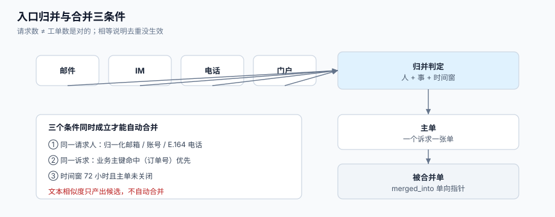

# 入口归并与重复合并

客户在微信里说了一句、又发了一封邮件、又在帮助中心点了一次提交——三次都是「同一件事」，但系统收到的是**三条请求**。不处理，三条请求会变成三张工单、三个负责人、三份回复；处理过头，两个**不同**的问题会被并成一张单，第二件事就此消失。

这一页讲「请求 → 工单」这一步的判定：请求人怎么识别、什么条件下可以合并、合并之后消息怎么路由、以及合并率这个指标为什么必须配一个「误合并率」一起看。



本页判据族 `STI-A` ~ `STI-H`，共 8 条。定义表在第七节。

## 一、「请求」与「工单」不是一回事

| 概念 | 定义 | 一次进线会不会产生 | 谁关心 |
| --- | --- | --- | --- |
| **接触**（contact） | 一次发声（一封邮件、一条 IM、一通电话） | 一定产生 1 条 | 容量与人力 |
| **请求**（request） | 一条进线消息 + 渠道元数据，**尚未判定归属** | 一定产生 1 条 | 接入层 |
| **工单**（ticket） | 一个**诉求**的容器，有负责人与时钟 | 可能 0 条（并入已有） | 服务经理、客户 |

本机读数：2,000 个真实诉求、其中 35% 会从第二个渠道再提一次，共产生 **2,666 条请求**；正确合并后仍然是 **2,000 张工单**，合并率 **25.0%**。不合并时队列虚高 **33.3%**，而这 33.3% 会同时污染三个指标：队列长度、人均产能、达标率分母。

::: tip 一句话
**合并率不是越高越好，误合并率必须是 0**。合并错的代价（第二个问题消失、客户被告知「你这个我们已经在处理了」）远高于合并少的代价（多一张单）。
:::

## 二、先解决「这是同一个人吗」

合并的前提是认出请求人。三个层次，从强到弱：

| 层次 | 依据 | 可靠性 | 典型失败 |
| --- | --- | --- | --- |
| 账号 | 已登录用户 `user_id` | 最强 | 企业客户多人共用一个账号 → 误合并 |
| 邮箱 | 归一化后的 `email` | 强 | 大小写、`+tag`、别名域（`gmail.com` vs `googlemail.com`） |
| 电话 | E.164 归一化 | 中 | 分机号、国家码缺失 |
| 无 | 匿名表单 | 弱 | 只能靠内容相似 + 人工确认 |

邮箱归一化至少要做四件事，少一件就会出现「同一个人两个身份」：

```python
# [intake/identity.py]
import re, unicodedata

def norm_email(raw: str) -> str:
    e = unicodedata.normalize("NFKC", raw).strip().lower()
    local, _, domain = e.partition("@")
    # ① 去掉 +tag（Gmail 与多数邮件系统支持）
    local = local.split("+", 1)[0]
    # ② Gmail 的点号不敏感
    if domain in {"gmail.com", "googlemail.com"}:
        local = local.replace(".", "")
        domain = "gmail.com"
    # ③ 常见企业别名域
    domain = {"hotmail.com": "outlook.com"}.get(domain, domain)
    # ④ 去掉零宽字符与全角字符（NFKC 已处理全角）
    return f"{local}@{domain}"
```

::: danger 注意
1. **不要用「姓名 + 手机号后四位」做身份键**。同名同尾号在企业客户里并不罕见，一旦合并错，两个人的历史对话会互相可见——这是**数据泄露级别**的事故，不是体验问题。
2. **不要跨租户合并**。企业版客服里 `tenant_id` 必须进所有唯一键；两个租户恰好有同一个邮箱（同一个人是两家公司的联系人）时，跨租户合并会把 A 公司的对话暴露给 B 公司。
3. **不要把「同一邮箱」当成「同一诉求」**。同一个人一天内提两件不同的事（改密码 + 发票重开）是常态；邮箱只解决「是谁」，不解决「是不是同一件事」。
:::

## 三、合并的三个条件：人、事、时间

合并判定必须**三个条件同时成立**，缺一不可：

| 条件 | 判据 | 反例（只看这一条会错） |
| --- | --- | --- |
| **同一请求人** | 归一化身份相等，或同租户内人工确认 | 企业共用账号 → 两个人被合成一个 |
| **同一诉求** | ① 渠道外键相同（`external_id` 相同/邮件线程 `In-Reply-To` 命中）② 或 归一化标题 + 正文相似度 ≥ 阈值 ③ 或 工单号被客户在正文中引用（`T-20261025-0007`） | 同一人同一天两个问题 → 被合成一个 |
| **时间窗** | 距主单 `created_at` 在 `W` 内（建议 72 小时），且主单未 `CLOSED` | 三个月后同一问题复发 → 被并进旧单，历史 SLA 全乱 |

时间窗的选择有实际后果：窗口太短（如 24 小时）会把「周五提、周一补一句」的重复漏掉；窗口太长（如 30 天）会把「复发」并进旧单，导致**新问题的首响时间被旧单的首次回复占掉**，看起来「秒回」，实际上没人处理。

```sql
-- [intake/find_duplicate.sql]
-- 候选集：同一请求人、72 小时内、未关闭、未被合并
with cand as (
  select t.id, t.ticket_no, t.subject, t.status, t.created_at,
         row_number() over (partition by t.requester_id order by t.created_at desc) as rn
  from ticket t
  where t.tenant_id   = $1
    and t.requester_id = $2
    and t.merged_into is null
    and t.status not in ('CLOSED')
    and t.created_at > now() - interval '72 hours'
)
select * from cand where rn <= 20;
```

### 3.1 相似度不能只看标题

真实语料里，同一诉求的三个渠道标题往往长这样：

```text
[mail]    Re: 我的订单 20261001 一直没发货
[im]      订单还没发
[portal]  发货问题 - 订单 20261001
```

朴素做法（`subject` 完全相等）命中率接近 0；只用「编辑距离」会把「订单没发货」与「订单发错货」判成相似。可用的组合是**结构化特征 + 文本特征**：

| 特征 | 提取方式 | 权重 | 说明 |
| --- | --- | --- | --- |
| 订单号/单号/手机号 | 正则抽取，命中即强信号 | 高 | 业务主键是最可靠的「同一件事」证据 |
| 主题归一化后相似度 | 去 `Re:` / `Fwd:` / 全角、转小写后算 trigram | 中 | `pg_trgm` 的 `similarity()` 可直接用 |
| 正文首 200 字相似度 | 同上 | 中 | 长正文会稀释相似度，截断更好用 |
| 时间接近度 | 差值 / 窗口 | 低 | 只做加权，不做门槛 |
| 渠道 | 是否跨渠道 | 低 | 跨渠道更像「重复」而非「追问」 |

```sql
-- [intake/similarity.sql]
create extension if not exists pg_trgm;

select a.id as main_id, b.id as dup_id,
       similarity(norm_subject(a.subject), norm_subject(b.subject)) as subj_sim
from ticket a
join ticket b
  on b.requester_id = a.requester_id
 and b.id > a.id
 and b.created_at between a.created_at and a.created_at + interval '72 hours'
where a.tenant_id = $1
  and similarity(norm_subject(a.subject), norm_subject(b.subject)) >= 0.45
order by subj_sim desc
limit 50;
```

::: warning 阈值是「建议」，不是「自动合并」
`similarity >= 0.45` 只应产出**候选**，用于「坐席侧边栏提示：可能有重复单」；自动合并只允许在「业务主键命中（订单号/单号相同）+ 同一请求人 + 时间窗内」这三者同时成立时发生。把文本相似度接成自动合并，是本专题见过的**最难排查的数据事故**之一：客户的两个问题被并成一个，第二个问题在系统里不存在。
:::

## 四、合并之后：消息必须被路由

合并只改指针，不解决「客户在旧线程里继续回复」。进线时必须先**解析归属**：

```python
# [intake/route.py]
def resolve_root(ticket_id: int, conn) -> int:
    """沿 merged_into 找到主单；限制深度，防止脏数据成环。"""
    seen = set()
    cur = ticket_id
    for _ in range(8):                     # 深度上限：正常最多 1 层
        if cur in seen:
            raise RuntimeError(f"merge cycle at {cur}")
        seen.add(cur)
        row = conn.execute("select merged_into from ticket where id=%s", (cur,)).fetchone()
        if row is None or row[0] is None:
            return cur
        cur = row[0]
    raise RuntimeError("merge chain too deep")
```

三条纪律：

1. **深度上限**：正常情况只有一层（B→A）。出现第二层说明有人在链式合并，应当先压平（把所有 `merged_into` 直接指向根）。
2. **成环即告警**：`resolve_root` 抛错时要**告警而不是静默返回原单**，否则消息会落到一个已关闭的单上，永远没人看到。
3. **消息仍记在原单上**：不要把消息「搬」到主单，而是在读取时按 `root` 聚合。搬家会丢时间戳顺序，也会让「客户在哪条线程里说的」无法追溯。

## 五、合并的度量：三个数一起看

| 指标 | 定义 | 用来看什么 | 本机读数（模拟） |
| --- | --- | --- | --- |
| **合并率** | `合并请求数 / 总请求数` | 渠道体验：哪个渠道的人最容易被逼重复提交 | 25.0% |
| **队列虚高** | `总请求数 / 工单数 − 1` | 队列与产能报表被高估多少 | 33.3% |
| **误合并率** | `被撤销的合并 / 总合并` | 阈值是否太松（唯一必须为 0 的指标） | 目标 0 |

还有一个反向指标常被忽略：**人均产能口径**。按「工单」算与按「接触」算，人效差 **35.0%**（2,700 接触 / 2,000 工单）。这不是数字游戏：按工单算会让管理层以为「每人每天 12 单很轻松」，实际每人每天处理 16 次对话。

::: danger 合并的四个反例
1. **不同产品线的同一句话**。「登录不上」在一个客户那里指 App，在另一个客户那里指后台管理端——同请求人、同标题、同时间窗，但**不是同一件事**。落法：把 `product`/`asset_id` 纳入合并条件。
2. **退款与换货**。「我要退款」与「我要换货」是互斥的处理路径，合并后只能执行其中一个。
3. **投诉与咨询**。情绪类工单（投诉）必须独立成单并单独计时，合并进咨询单会让投诉的响应承诺被咨询的宽松承诺吞掉。
4. **已升级到二线的单**。二线在处理 B，客户又提了一张 A，合并后 A 的 `assignee` 会被 B 的二线覆盖，A 的一线跟进断掉。
:::

## 六、去重的三个实现层次

| 层次 | 做法 | 成本 | 适用 |
| --- | --- | --- | --- |
| 硬去重 | `(tenant, channel, external_id)` 唯一约束 | 极低 | **必须有**。解决「同一条渠道消息重复投递」 |
| 软归并 | 同请求人 + 业务主键 + 时间窗 → 自动合并 | 中 | 有稳定业务主键（订单号、设备号）的场景 |
| 语义提示 | 相似度候选 + 坐席确认 | 高 | 无业务主键、文本为主的场景 |

三层不是替代关系：**硬去重保证不重复建单，软归并保证同一诉求只有一个负责人，语义提示降低人工发现成本**。只做第三层而不做前两层，是最常见的「上了 AI 去重，重复单反而更多」的原因——模型把该合并的合并了，但同一条消息仍然建了两张单。

## 七、本页判据

| 判据 | 看什么现象 | 判成什么 | 不满足时改哪里 |
| --- | --- | --- | --- |
| `STI-A` | 身份键落在 `(tenant_id, 归一化身份)` 上，且归一化有单测 | 认出同一个人 | 补 `norm_email` / E.164 归一化 |
| `STI-B` | 硬去重有唯一约束，重复投递返回已有 `ticket_id` | 渠道重投不重复建单 | 建 `ticket_intake` |
| `STI-C` | 自动合并必须同时满足：同请求人 + 业务主键命中 + 时间窗内 | 误合并为 0 | 把相似度从自动合并里摘掉 |
| `STI-D` | 合并写 `ticket_link`，含 `reason` 与操作者 | 可追溯、可撤销 | 补表与审计 |
| `STI-E` | 进线先 `resolve_root`，且深度上限 ≤ 8 | 消息不漏 | 补路由函数 |
| `STI-F` | 合并后 SLA 目标取「两者更早」并记事件 | 重复提交不能延长承诺 | 补 `sla_target_recalculated` |
| `STI-G` | 合并率、队列虚高、误合并率三个数同页展示 | 指标不片面 | 看板加两列 |
| `STI-H` | 撤销合并可用：`merged_into` 可置空且原单恢复 `OPEN` | 可回滚 | 补撤销流程 |

## 八、验证方式

```shell
# 1) 同一条邮件消息投递两次：只应有一张工单
psql "$DSN" -c "select count(*) from ticket where tenant_id=1 and subject='Re: 订单 20261001 未发货';"
python3 - <<'PY'
# 模拟渠道重投：同一 external_id 连发两次
import psycopg, os
dsn=os.environ["DSN"]
with psycopg.connect(dsn) as c:
    for _ in range(2):
        try:
            c.execute("insert into ticket_intake(tenant_id,channel,external_id,ticket_id) values (1,'mail','<m1@x>',1)")
        except Exception as e:
            print("conflict:", type(e).__name__)
PY
```

预期输出：第一条 SQL 为 `1`；脚本打印一次 `conflict: UniqueViolation`（第二次），且应用层返回 `ticket_id=1`。

```shell
# 2) 合并后消息必须路由到主单：给被合并单发一条消息，应出现在主单的会话里
psql "$DSN" -c "insert into ticket_message(ticket_id,author_type,channel,body) \
  values ((select id from ticket where ticket_no='T-DUP-1'),'requester','mail','还在吗');"
psql "$DSN" -c "select count(*) from ticket_message m join ticket t on t.id=m.ticket_id \
  where t.ticket_no='T-MAIN-1' and m.body='还在吗';"
```

预期输出：`1`。若为 `0`，说明消息落在了已合并的旧单上，`STI-E` 不满足。

```shell
# 3) 误合并必须为 0：不存在「一个主单下两个不同业务主键」的合并
psql "$DSN" -c "select count(*) from ticket_link l \
  join ticket a on a.id=l.src_id join ticket b on b.id=l.dst_id \
  where l.kind='MERGED' and a.biz_key is not null and b.biz_key is not null and a.biz_key<>b.biz_key;"
```

预期输出：`0`。

## 九、参考资料

- Zendesk《Merging tickets》（合并后的消息归属与通知行为）：<https://support.zendesk.com/hc/en-us/articles/4408832135706>
- Zendesk《About user identities》（渠道身份与用户档案的关联）：<https://support.zendesk.com/hc/en-us/articles/4408882236570>
- PostgreSQL 文档《pg_trgm》（`similarity()` 与三元组索引）：<https://www.postgresql.org/docs/current/pgtrgm.html>
- RFC 5322《Internet Message Format》（`Message-ID`、`In-Reply-To` 的语义）：<https://www.rfc-editor.org/rfc/rfc5322>
- ITU-T E.164《The international public telecommunication numbering plan》：<https://www.itu.int/rec/T-REC-E.164>
