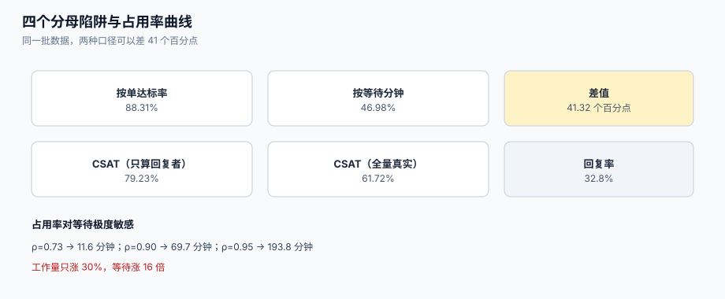

# 度量口径：四个分母陷阱

客服的报表有一个奇怪的属性：**几乎每个数字都能被调到「看起来不错」，而每个调法都合规**。把分母换成「已关闭的单」、把 CSAT 换成「回复者的满意度」、把时长换成「营业小时」、把重开算成「新问题」——四个动作全部不需要改一行业务代码，只需要改一句 SQL。

这一页讲四件事：**四个必须一起看的指标**、**四个分母陷阱**、**为什么均值会骗人**、以及**投入多少人**这个问题的定量回答。



本页判据族 `STT-A` ~ `STT-H`，共 8 条。定义表在第六节。

## 一、四个必须一起看的指标

| 指标 | 定义 | 分母 | 用来回答 | 单独看会错在哪 |
| --- | --- | --- | --- | --- |
| **首响时长** FRT | 提交 → 首个公开回复 | 有首响的单 | 有没有人理我 | 只算有首响的单，等于把「没人理」的那批删掉 |
| **解决时长** TTR | 提交 → 解决字段被设置 | 已解决的单 | 多久有结论 | 关闭但未解决的单被排除 |
| **SLA 达标率** | 未违约单 / 命中政策的单 | **命中政策的单** | 承诺兑现程度 | 未命中政策的单（无优先级、无政策）不进分母，等于消失 |
| **积压** backlog | 未关闭且无人处理的单 | 时间点 | 有没有在恶化 | 只看数量不看「最老的一张」 |

::: danger 分母决定结论
**未命中政策 ≠ 达标**。如果 30% 的单因为「没填优先级」而没有 SLA 目标，报表里的达标率只反映另外 70%。正确做法是把分母拆成三段：`命中且达标`、`命中且违约`、**`未命中`**，第三段单独列出来并按原因分组——它才是真正需要治理的部分。
:::

## 二、四个分母陷阱，各自的本机读数

### 2.1 按「单」还是按「等待分钟」

同一批 20,000 单（12% 违约、违约单的等待时长显著更长）：

| 口径 | 达标率 |
| --- | --- |
| 按**单数** | **88.31%** |
| 按**客户等待分钟** | **46.98%** |
| 差 | **41.32 个百分点** |

两个都对，但它们回答不同的问题：按单回答「多少客户遇到了违约」，按分钟回答「客户的等待时间里有多大比例是在违约状态」。CEO 问「客户体验如何」时，后者更接近答案；运营问「多少单出问题」时，前者更接近。

### 2.2 重开：首次解决率不是达标率

| 口径 | 计算 | 结果 |
| --- | --- | --- |
| SLA 达标率 | `1 − 12%` | 88.31% |
| 重开率 | 假设 9% | 9% |
| **首次解决率**（FCR 近似） | `88.31% × 91%` | **80.36%** |

重开率是客服里最容易被「优化掉」的指标：只要不提供重开入口，客户就会新建一张单，于是重开率变成 0，而问题数量不变。**这也解释了为什么「重开率低」通常不是好消息**——它可能只是「重开没被记录」。

### 2.3 CSAT：回复者偏差

20,000 单，真实满意度 61.72%（满意者 78% 会回复、不满意者 55% 会回复的加权结果）：

| 口径 | CSAT |
| --- | --- |
| 只统计回复者（回复率 30%） | **78.34%** |
| 全量（真实值） | **61.72%** |
| 差 | **16.61 个百分点** |

更贴近现实的模型是「满意的人更爱回复」（满意者回复率 42%、不满意者 18%）：此时回复率 32.8%，报告值 **79.23%**，与真实值差 **17.50 个百分点**。

::: danger CSAT 的三条纪律
1. **必须报回复率**。只报 CSAT 不报回复率，等于报「回复者的满意度」。
2. **不要用 CSAT 做个人考核**。一旦与绩效挂钩，坐席会学会「只给满意的客户发问卷」——样本选择权在被告身上。
3. **不要把它与 SLA 达标率画在同一张图上**。两者的分母（回复者 vs 命中政策的单）完全不同，放在一起会被读成因果关系。
:::

### 2.4 人效：按工单还是按接触

| 口径 | 数值 | 含义 |
| --- | --- | --- |
| 工单数 | 2,000 | 一个诉求一张单 |
| 接触数 | 2,700（35% 的诉求会从第二个渠道再来一次） | 一次发声一条记录 |
| 差 | **35.0%** | 「每人每天 12 单」与「每人每天 16 次对话」 |

按工单算人效会让排班偏松：你以为每人每天有 12 个活，实际是 16 次上下文切换——而上下文切换本身有成本（每次切回都要重读历史）。

## 三、均值会骗人：必须报分位数

服务时长是**右偏**分布（少数单拖很久），均值会被长尾拉高，中位数又掩盖了尾部。本机 50,000 条 TTR（对数正态，中位数 4 小时）：

| 统计量 | 值 |
| --- | --- |
| 均值 | **7.44 小时** |
| p50 | **4.03 小时** |
| p90 | **16.50 小时** |
| p95 | **24.85 小时** |
| p99 | **52.98 小时** |
| p99 / p50 | **13.1 倍** |

「平均 7.44 小时」这句话什么都没说：一半的单在 4 小时内解决，而最慢的 1% 要等两天多。**SLA 的目标应该定在分位数上**（如「p90 ≤ 24 小时」），而不是均值上——均值对尾部完全不敏感。

```sql
-- [metrics/percentiles.sql]
select
  percentile_cont(0.5)  within group (order by extract(epoch from (resolved_at - created_at))/3600) as p50_h,
  percentile_cont(0.9)  within group (order by extract(epoch from (resolved_at - created_at))/3600) as p90_h,
  percentile_cont(0.95) within group (order by extract(epoch from (resolved_at - created_at))/3600) as p95_h,
  avg(extract(epoch from (resolved_at - created_at))/3600)                                           as mean_h
from ticket
where resolved_at is not null
  and created_at >= now() - interval '30 days';
```

::: warning 分位数的两个坑
1. **不要平均分位数**。「每天 p95 的平均值」不等于「整月的 p95」，两者可以差很多。按月算，就把整月数据放在一起算一次。
2. **小样本的分位数没有意义**。一天只有 8 张单时，p95 就是「第二慢的那张」，会剧烈跳动。样本量小于 30 时改报最大值与中位数。
:::

## 四、投入多少人：占用率曲线

「人不够」是客服最常见的结论，也是最常被错用的结论。等待时间对**占用率**（ρ = 到达率 × 处理时长 / 坐席数）极度敏感。本机按 M/M/c 近似（12 坐席、单均处理 2.2 小时）：

| 到达率 λ（单/小时） | 占用率 ρ | 队列长度 Lq | 平均等待 Wq |
| --- | --- | --- | --- |
| 4.0 | 0.73 | 0.35 | **11.6 分钟** |
| 4.6 | 0.84 | 1.22 | **34.9 分钟** |
| 4.9 | 0.90 | 2.59 | **69.7 分钟** |
| 5.2 | 0.95 | 7.63 | **193.8 分钟** |

从 ρ=0.73 到 ρ=0.95，工作量只涨了 30%，等待涨了 **16 倍**。这条曲线的工程含义是：

1. **不要把人排到 95% 占用**。「省一个人」省下的是 8% 的成本，付出的是 3 小时的等待。
2. **降低 ρ 有两条路**：加人，或**减少单量**（合并重复、自助解决、减少返工）。后者往往更便宜——本库 35% 的重复提交如果被合并，等效于释放了 26% 的产能。
3. **利特尔法则**（`L = λW`）可以用来反推所需人数：如果业务要求「平均等待 ≤ 15 分钟、单均处理 2.2 小时、到达 5 单/小时」，则 `Lq ≈ 1.25`，`c` 需要 ≥ 12.5 → **13 人**（不含休假系数）。

## 五、日报只要五行

看板越多越没人看。一份能推动决策的客服日报只需要五行：

| 行 | 指标 | 口径 | 环比看什么 |
| --- | --- | --- | --- |
| 1 | 新增 / 关闭 / 净增 | 单数 | 净增连续为正 = 在恶化 |
| 2 | 达标率（三段式） | 命中达标 / 命中违约 / 未命中 | 未命中段的原因分布 |
| 3 | 首响 p50 与 p90 | 营业小时 | p90 涨得比 p50 快 = 长尾恶化 |
| 4 | 最老未关闭单的年龄 | 小时 | 超过 3 天要有人解释 |
| 5 | 升级次数与误升级率 | 次数 / 比例 | 误升级率 > 30% 时先修阈值 |

## 六、本页判据

| 判据 | 看什么现象 | 判成什么 | 不满足时改哪里 |
| --- | --- | --- | --- |
| `STT-A` | 每个指标都写明分母，且分母可被 SQL 复现 | 口径可复现 | 报表加「分母」列 |
| `STT-B` | 达标率按「命中 / 未命中」分段，未命中单列原因 | 失败可见 | 加 `no_policy` 维度 |
| `STT-C` | 首响、解决时长同时报 p50 与 p90 | 长尾可见 | 补分位数列 |
| `STT-D` | CSAT 与回复率成对出现 | 偏差可见 | 看板加一列 |
| `STT-E` | 「无首响即关闭」的单单独统计 | 自动关单不掩盖问题 | 加 `closed_without_response` |
| `STT-F` | 人效同时报「工单」与「接触」两个口径 | 排班不失真 | 加接触口径 |
| `STT-G` | 占用率与等待时间同图，标出 ρ=0.85 警戒线 | 容量决策有依据 | 加容量图 |
| `STT-H` | 分位数按月算，不平均日分位数 | 统计正确 | 改查询粒度 |

## 七、验证方式

```shell
# 1) 达标率三段式：三个数必须能对上总数
psql "$DSN" -c "with base as (select * from ticket where created_at >= now() - interval '30 days') \
  select count(*) filter (where sla_hit)  as hit, \
         count(*) filter (where sla_hit=false and sla_target is not null) as breached, \
         count(*) filter (where sla_target is null) as no_policy, \
         count(*) as total from base;"
```

预期输出：`hit + breached + no_policy = total`。若 `no_policy` 为 0 而你有大量历史单，先怀疑「未命中」被算进了 `hit`。

```shell
# 2) 分位数必须来自原始数据，不是日分位数的平均
psql "$DSN" -c "select round(avg(p95_daily)::numeric,2) as avg_of_daily, \
                       round(percentile_cont(0.95) within group (order by h)::numeric,2) as pooled_p95 \
                from (select date_trunc('day',created_at) d, \
                             percentile_cont(0.95) within group (order by extract(epoch from (resolved_at-created_at))/3600) p95_daily, \
                             extract(epoch from (resolved_at-created_at))/3600 h \
                      from ticket where resolved_at is not null group by 1, h) t;"
```

预期输出：`avg_of_daily` 与 `pooled_p95` **不相等**，且通常 `avg_of_daily` 更小。两个数都出现，正说明「平均日分位数」是一个会低估尾部的口径。

```shell
# 3) CSAT 必须带回复率
psql "$DSN" -c "select round(avg(case when score>=4 then 1.0 else 0 end)*100,2) as csat_pct, \
                       round(count(score)*100.0/(select count(*) from ticket where closed_at is not null),2) as response_pct \
                from survey where created_at >= now() - interval '30 days';"
```

预期输出：两个数都非空。若 `response_pct < 20%`，CSAT 应标注「样本偏差大」。

```shell
# 4) 无首响即关闭：这个数必须能算出来（而不是不存在）
psql "$DSN" -c "select count(*) from ticket where closed_at is not null and first_response_at is null;"
```

预期输出：一个具体数字（可以为 0，但**不能报错**）。查询报错说明模型里没有 `first_response_at`，也就意味着「有没有人理过客户」这件事从来没被记录。

## 八、参考资料

- Zendesk《Customer satisfaction (CSAT) reporting》（CSAT 的采集与限制）：<https://support.zendesk.com/hc/en-us/articles/4408888865306>
- Atlassian《SLA reports》（达标率与违约明细的官方口径）：<https://support.atlassian.com/jira-service-management-cloud/docs/view-sla-reports/>
- Google SRE Book《Service Level Objectives》（用分位数而非均值定义目标）：<https://sre.google/sre-book/service-level-objectives/>
- Little, J. D. C.《A Proof for the Queuing Formula: L = λW》：<https://doi.org/10.1287/opre.9.3.383>
- PostgreSQL 文档《Aggregate Functions》（`percentile_cont` 与有序集聚合）：<https://www.postgresql.org/docs/current/functions-aggregate.html>
