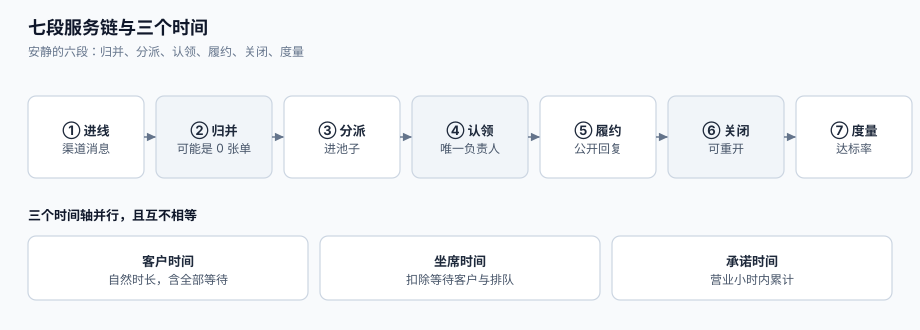

# 总览：七段服务链与三个时间

客服工单的难点不在「把消息存下来」，而在于**同一分钟里，有三个人在用三把不同的尺量「多久」**：客户量的是「我发出去到现在」，坐席量的是「我手上真正处理它的时间」，合同量的是「营业小时内的承诺」。三段链路上任何一个环节用错尺，报表就会显示「达标」，而客户已经在准备差评。

这一页给整条履约链的全局图，并回答三个所有客服事故都会回到的问题：**时间花在哪一段、哪一段的失败最安静、以及哪一段应该由谁负责**。



本页判据族 `STO-A` ~ `STO-H`，共 8 条。定义表在第六节。

## 一、七段服务链

| # | 段 | 输入 | 输出 | 谁的错算谁的 | 失败是否安静 |
| --- | --- | --- | --- | --- | --- |
| ① | 进线 | 邮件 / IM / 电话 / 门户表单 | 一条原始 message | 渠道层 | 否：收到就有记录 |
| ② | 归并 | 一条 message + 历史 | 新建工单，或合并进已有工单 | 接入层 | **是**：不合并也能建单 |
| ③ | 分派 | 工单 + 技能 + 负载 | 队列位置（或直接落到某个坐席） | 调度层 | **是**：进池子就算「已受理」 |
| ④ | 认领 | 队列 + 坐席动作 | `assignee`（唯一负责人） | 坐席 | **是**：两人都显示「我的」 |
| ⑤ | 履约 | 工单 + 会话 | 公开回复 / 内部备注 / 挂起 | 坐席与二线 | 半安静：回复了不等于解决了 |
| ⑥ | 关闭 | 解决结果 + 客户确认 | `RESOLVED` → `CLOSED`（可重开窗口） | 坐席 + 自动策略 | **是**：自动关单最安静 |
| ⑦ | 度量 | 事件流水 + SLA 快照 | 达标率 / 时长分布 / 积压 | 服务经理 | **是**：没人算就没人知道 |

「失败是否安静」这一列是整页的核心。**安静的六段（②③④⑥⑦ 加上 ⑤ 的一半）正好覆盖了绝大多数「服务态度」投诉**——客户说的「没人管我」，在系统里往往是「单子建了、在池子里、没人认领、第七天被自动关单」。

::: danger 注意
1. **不要用「工单已创建」当作「已受理」**。受理的定义是**有人认领并对客户做出可见回应**，不是行插入成功。把「已受理」绑在 `insert` 上，是 SLA 达标率虚高的第一个来源。
2. **不要用「状态变成 SOLVED」当作「已解决」**。工作流会漂移，坐席为了清空队列会批量改状态。判定「解决」要看**解决字段/解决类型 + 客户可见的结论**，两者缺一不可。
3. **不要用「自动关单」清理积压**。自动关单把「没人处理」变成「已处理」，并且**抹掉了未响应的事实**：`closed_at` 有了，`first_response_at` 仍然是空。本库的[度量口径](../Metrics/index.md)会把「无首响即关闭」单列一项，就是为了让这件事无法被平均数吞掉。
:::

## 二、三个时间：客户时间、坐席时间、承诺时间

同一个工单，三条时间轴并行，且**互不相等**：

| 口径 | 定义 | 起点 | 终点 | 谁在看 | 典型偏差来源 |
| --- | --- | --- | --- | --- | --- |
| **客户时间**（wall clock） | 从提交到拿到结论的自然时长 | 客户点「提交」 | 客户看到结论 | 客户、CSAT、舆情 | 夜里、周末、节假日全算 |
| **坐席时间**（handle time） | 坐席真正动手的累计时长 | 打开工单 | 关闭工单 | 排班、绩效、容量 | 挂起等待客户的时间**不该算** |
| **承诺时间**（SLA clock） | 合同/政策约定的计时 | 政策命中时刻 | 目标达成或违约 | 服务经理、合同 | 日历、暂停条件、重开策略 |

三者的关系不是「换算」，而是**三种独立的计算**：

```text
客户时间 = 自然时长（含全部等待）
坐席时间 = 自然时长 − 等待客户 − 排队等待 − 非工作时段
承诺时间 = 承诺工时内累计的「时钟运行时长」（受日历与暂停条件支配）
```

::: tip 一条口径纪律
**任何一张报表都要先声明它用的是哪把尺**。同一批 20,000 单，按「工单数」算达标率 **88.31%**，按「客户等待分钟」算 **46.98%**——差 **41.32 个百分点**。两个数字都可以是对的，但把其中一个叫作「客户满意度」就是错的。
:::

### 2.1 三个时间在一天里的样子

设想一个 9:00–18:00 工作、周末双休的团队，客户在**周五 17:00** 提交一个承诺 **8 小时**的请求：

| 时钟 | 到期时刻 | 真实经过 | 客户感受 |
| --- | --- | --- | --- |
| 客户时间（自然 8 小时） | 周六 01:00 | 8 小时 | 「半夜到期，没人理我」 |
| 承诺时间（8 营业小时） | 下周一 16:00 | 71 小时 | 「周一才有人回，但合同没违约」 |
| 坐席时间（实际动手） | —— | 约 40 分钟 | 「我们只花了 40 分钟」 |

同一个工单，三个「多久」差了 **两个数量级**。所以「响应慢」这句话在没有口径时**无法讨论**——这也是为什么本专题要把时钟单独写成一页（[SLA 时钟](../SLAClock/index.md)）。

## 三、四个必失接缝（带本机读数）

这四个接缝是结构性的：只要实现里少了对应的一条，履约就会安静地失守。读数来自本机 Python 3.13.12 标准库模拟（固定随机种子 `20261025`，非生产压测，脚本不入库、结论可复跑）。

| # | 接缝 | 现象 | 本机读数 | 详见 |
| --- | --- | --- | --- | --- |
| ① | 用自然时钟算承诺 | 到期点落在非工作时段，夜里「违约」 | 6,000 单、8 小时承诺：**72.52%** 的到期点落在非工作时段；同一批单自然时钟判超时 **91.97%**、工作时钟 **50.13%** | [SLA 时钟](../SLAClock/index.md) |
| ② | 不合并重复请求 | 同一诉求多条单，队列虚高 | 2,000 个诉求、四渠道 → 2,666 条请求；合并率 **25.0%**，队列虚高 **33.3%** | [入口归并](../IntakeDedup/index.md) |
| ③ | 先查后改地认领 | 同一单被多人「认领成功」 | 20 坐席、100 单：应用层记 **374 次成功**、表里 **100 行** → **274 次重复认领** | [分派与认领](../Dispatch/index.md) |
| ④ | 只报一个达标率 | 报表与体感差 40 个百分点 | 按单 **88.31%** / 按等待分钟 **46.98%**（差 **41.32 pp**）；再叠 9% 重开率，首次解决率 **80.36%** | [度量口径](../Metrics/index.md) |

::: warning 这四个接缝的共同点
**它们都不会抛异常**。自然时钟算出来的数是「合法」的；不合并建出来的单是「合法」的；先查后改写进去的行也是「合法」的；只报一个达标率的报表更是「合法」的。唯一的区别是：**客户那边不合法**。
:::

## 四、五个角色，与「谁的错算谁的」

| 角色 | 关心什么 | 他心里的「好」 | 他最容易做的错事 |
| --- | --- | --- | --- |
| **客户 / 请求人** | 有没有人管、什么时候有结论 | 别让我重复描述第三遍 | 同一问题多渠道重复提交（不是他的错） |
| **一线坐席** | 手上的队列、SLA 剩余时间 | 别把不属于我的单塞给我 | 先改状态再处理（为了清队列） |
| **二线 / 专家** | 上下文是否齐全 | 别让我问客户「你再说一遍环境」 | 只在内网回复，客户看不到 |
| **服务经理** | 达标率、积压、人力 | 报表能解释波动 | 用「按单达标率」汇报客户体验 |
| **值班 / 管理层** | 有没有正在烧的火 | 该找我时找我，不该找我时别叫我 | 阈值按自然时钟，半夜被叫醒 |

这张表最重要的一行是**一线坐席那一行**。「先改状态再处理」不是态度问题，而是**指标设计问题**：当「队列长度」被考核，「把单移出我的队列」就成了理性选择。要治它，只能让「改状态」与「客户可见的回应」**绑成同一个动作**（见[工单模型](../TicketModel/index.md)的状态机守卫）。

## 五、七个必失点，各自的代价

在专题首页列过这七条，这里给每一处**为什么会发生**，以及**它把成本转移给了谁**：

1. **自然时钟算承诺** → 成本转移给一线（夜里违约、白天背锅）。
2. **不合并重复请求** → 成本转移给二线（同一问题读三遍）与客户（重复描述）。
3. **硬轮询分派** → 成本转移给排在后面的客户（队头阻塞，本机平均等待 **7,346 分钟**）。
4. **先查后改认领** → 成本转移给客户（两个答案）与坐席（互相覆盖对方的处理）。
5. **升级按自然时钟** → 成本转移给值班的人（凌晨响铃）。
6. **达标率只报一个分母** → 成本转移给未来（问题被平均数掩盖，直到某天爆掉）。
7. **CSAT 只统计回复者** → 成本转移给沉默的不满者（他们不会投诉，只会离开）。

## 六、本页判据

| 判据 | 看什么现象 | 判成什么 | 不满足时改哪里 |
| --- | --- | --- | --- |
| `STO-A` | 每条工单都能落到七段链的某一段，且每段有明确的「完成」定义 | 链路完整 | 补段定义，尤其 ③ 与 ④ 的边界 |
| `STO-B` | 「已受理」的定义里含**认领人 + 客户可见回应**两个条件 | 受理语义正确 | 把受理绑到 `insert` 的地方改绑到首个公开回复 |
| `STO-C` | 「已解决」的判定用**解决字段/类型**，不只看状态名 | 解决语义正确 | 状态机加守卫：无解决类型不得进 `RESOLVED` |
| `STO-D` | 每条报表/看板都标注了时间口径（客户/坐席/承诺） | 口径可追溯 | 看板标题补口径，缺口径的指标下线 |
| `STO-E` | SLA 计算函数对同一输入**幂等**（重算结果一致） | 时钟可重算 | 把「当前时间」从计算里抽出来做参数 |
| `STO-F` | 合并与拆单都有审计行（谁、何时、从哪到哪、为什么） | 可追责 | 补 `ticket_link` 表与审计写入 |
| `STO-G` | 「无首响即关闭」的工单被单列统计，不混入达标率 | 失败可见 | 度量加一列 `closed_without_response` |
| `STO-H` | 值班通知的触发点在**工作时段内**（或明确声明 7×24 值班） | 升级不扰民 | 升级阈值改用同一份日历 |

## 七、验证方式

`STO-E`（时钟可重算）是最容易被忽略、也最容易验的一条。用两条命令就能证伪：

```shell
# 1) 同一个工单，用「创建时间」重算两次到期时间，输出必须完全一致
python3 - <<'PY'
from datetime import datetime, timedelta
def due(created, hours):
    return created + timedelta(hours=hours)   # 自然时钟版本（故意留作对照）
t = datetime(2026, 10, 9, 17, 0)
print(due(t, 8), due(t, 8))                   # 两次必须相同
PY
```

预期输出：同一行时间打印两次，且两次完全一致（`2026-10-10 01:00:00 2026-10-10 01:00:00`）。若你的实现里 `due()` 内部读了 `now()`，两次会不同——那就是不可重算，报表永远对不上账。

```shell
# 2) 把「自然时钟」与「工作时钟」并排打印，确认差异方向符合预期
python3 - <<'PY'
from datetime import datetime, timedelta
t = datetime(2026, 10, 9, 17, 0)
print("自然:", t + timedelta(hours=8))   # 周六 01:00
print("工作: 2026-10-12 16:00             # 8 营业小时，跨周末")
PY
```

预期输出第二行是 `2026-10-12 16:00`——**周一 16:00**（周一从 9:00 起算 7 小时，加上周五 17:00→18:00 的 1 小时）。如果你的实现给出周一 09:00 或周五 23:00，说明「跨日消耗」的循环写错了，见[SLA 时钟](../SLAClock/index.md)的 `STC-B`。

## 八、参考资料

- Zendesk《Defining and using SLA policies》：<https://support.zendesk.com/hc/en-us/articles/4408822163738>
- Atlassian《Configure SLAs》（目标/开始/暂停/停止四段）：<https://support.atlassian.com/jira-service-management-cloud/docs/configure-slas/>
- ISO/IEC 20000-1:2018：<https://www.iso.org/standard/70636.html>
- Axelos《ITIL 4》：<https://www.axelos.com/certifications/itil-service-management>
- Little, J. D. C.《A Proof for the Queuing Formula: L = λW》（1957 年原文，利特尔法则的来历）：<https://doi.org/10.1287/opre.9.3.383>
