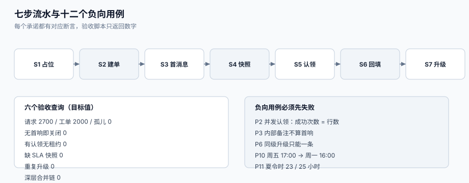

# 实战：一个能跑起来的最小履约链路

前面八页讲的都是「某个环节为什么会安静地失守」。这一页把它们串成一条**能在本机跑起来、能用 SQL 与 pytest 验收**的最小链路：一个 PostgreSQL 库、一个 Python 进程、七步流水，加上十二个**必须失败**的负向用例。

目标不是「功能齐全」，而是**每个承诺都有对应的断言**：建单幂等、认领唯一、首响可回填、SLA 可重算、升级不重复、达标率分母可拆。



本页判据族 `STP-A` ~ `STP-H`，共 8 条。定义表在第八节。

## 一、验收标准（先定「怎么算做完」）

| # | 验收项 | 判据 | 证据形式 |
| --- | --- | --- | --- |
| 1 | 同一条渠道消息重复投递 5 次，只产生 1 张工单 | `count(*) = 1` | SQL |
| 2 | 20 并发认领 100 张单，成功次数 = 实际认领行数 | 两个数相等 | 脚本输出 |
| 3 | 首响时长只由**公开**回复回填，内部备注不回填 | `first_response_at is null` | SQL |
| 4 | 周五 17:00 提交、8 营业小时承诺 → 周一 16:00 到期 | 时间相等 | 单元测试 |
| 5 | 夏令时切换日 24 墙钟小时 = 23 / 25 真实小时 | 数值相等 | 单元测试 |
| 6 | 到期扫描 10 分钟内不改任何已达成快照 | `achieved_at` 不变 | SQL |
| 7 | 同一张单同一级只产生一条升级事件 | `count(*) = 1` | SQL |
| 8 | 达标率三段式之和 = 总数 | 等式成立 | SQL |
| 9 | 合并后新消息路由到主单 | `count(*) = 1` | SQL |
| 10 | `ticket_event` 不可 `update` / `delete` | 报错 | SQL |

## 二、目录结构

```text
support-sla/
├─ docker-compose.yml          # postgres:17 + 一个 psql 客户端
├─ schema/
│  ├─ 001_core.sql             # ticket / ticket_message / ticket_event
│  ├─ 002_intake.sql           # ticket_intake / ticket_link
│  ├─ 003_sla.sql              # sla_snapshot / calendar
│  ├─ 004_dispatch.sql         # ticket_claim / oncall_shift
│  └─ 005_escalation.sql       # escalation_event
├─ app/
│  ├─ intake.py                # 建单（幂等）+ 合并判定
│  ├─ dispatch.py              # 认领（条件更新 + 租约）
│  ├─ sla.py                   # 日历加法 + 快照写入
│  ├─ escalate.py              # 到期扫描 + 升级去重
│  └─ metrics.py               # 三段式达标率
├─ tests/
│  ├─ test_calendar.py         # 日历与夏令时
│  ├─ test_claim.py            # 并发认领
│  └─ test_intake.py           # 幂等与合并
└─ Makefile                    # up / migrate / seed / test / verify
```

「完整实现约 1,200 行」，本节给出**结构与关键片段**，以及每条验收的可执行命令。

## 三、完整 DDL

```sql
-- [schema/001_core.sql]
create table ticket_status (
  code     text primary key,
  category text not null
);
insert into ticket_status(code, category) values
  ('NEW','PENDING_AGENT'), ('OPEN','OPEN'), ('PENDING','PENDING_CUSTOMER'),
  ('ON_HOLD','ON_HOLD'), ('RESOLVED','RESOLVED'), ('CLOSED','CLOSED');

create table ticket (
  id            bigserial primary key,
  tenant_id     bigint not null,
  ticket_no     text   not null,
  subject       text   not null,
  status        text   not null default 'NEW' references ticket_status(code),
  priority      text   not null default 'NORMAL',   -- 不允许为空：见 STK 一节
  request_type  text   not null,
  requester_id  bigint not null,
  assignee_id   bigint,
  channel_first text   not null,
  merged_into   bigint references ticket(id),
  resolution_type text,
  first_response_at timestamptz,
  resolved_at   timestamptz,
  closed_at     timestamptz,
  reopened_count int   not null default 0,
  created_at    timestamptz not null default now(),
  unique (tenant_id, ticket_no),
  constraint resolved_needs_type check (status <> 'RESOLVED' or resolution_type is not null)
);

create table ticket_message (
  id         bigserial primary key,
  ticket_id  bigint not null references ticket(id),
  author_type text  not null check (author_type in ('requester','agent','system')),
  visibility text   not null check (visibility in ('public','internal')),
  channel    text   not null,
  body       text   not null,
  created_at timestamptz not null default now()
);

create table ticket_event (
  id         bigserial primary key,
  ticket_id  bigint not null references ticket(id),
  actor_id   bigint,
  field      text   not null,
  old_value  text,
  new_value  text,
  reason     text,
  created_at timestamptz not null default now()
);

-- 只追加：撤掉改动权限
revoke update, delete on ticket_event from public;
```

```sql
-- [schema/002_intake.sql]
create table ticket_intake (
  tenant_id   bigint not null,
  channel     text   not null,
  external_id text   not null,
  ticket_id   bigint not null references ticket(id),
  created_at  timestamptz not null default now(),
  primary key (tenant_id, channel, external_id)
);

create table ticket_link (
  id        bigserial primary key,
  src_id    bigint not null references ticket(id),
  dst_id    bigint not null references ticket(id),
  kind      text   not null,
  reason    text   not null,
  created_at timestamptz not null default now(),
  check (src_id <> dst_id),
  unique (src_id, kind)
);
```

```sql
-- [schema/003_sla.sql]
create table calendar (
  id         bigserial primary key,
  name       text not null,
  tz         text not null,
  sessions   jsonb not null,          -- {"1":[["09:00","12:00"],["13:30","18:00"]], ...}
  holidays   date[] not null default '{}',
  workdays   date[] not null default '{}'   -- 调休补班
);

create table sla_snapshot (
  id           bigserial primary key,
  ticket_id    bigint not null references ticket(id),
  metric       text   not null,
  started_at   timestamptz not null,
  target_at    timestamptz not null,
  paused_total interval not null default '0',
  achieved_at  timestamptz,
  escalated_at timestamptz,
  unique (ticket_id, metric, started_at)
);
create index idx_sla_due on sla_snapshot (target_at) where achieved_at is null;
```

## 四、七步流水

| 步 | 动作 | 写哪些表 | 失败会怎样 |
| --- | --- | --- | --- |
| S1 | 渠道消息落 `ticket_intake`（唯一约束做幂等） | `ticket_intake` | 冲突即返回已有 `ticket_id` |
| S2 | 建单 / 合并判定 | `ticket`、`ticket_link` | 判错 = 两个问题被并成一个 |
| S3 | 写首条消息 | `ticket_message` | 客户描述丢失 |
| S4 | 写 SLA 快照（首响 + 解决两个目标） | `sla_snapshot` | 无倒计时，SLA 形同虚设 |
| S5 | 分派 / 认领 | `ticket_claim`、`ticket` | 双认领或无人认领 |
| S6 | 公开回复 → 回填首响 | `ticket_message`、`ticket`、`sla_snapshot` | 首响时长永久为空 |
| S7 | 到期扫描 → 升级 | `escalation_event` | 违约无人知 |

### 4.1 S1 + S2：幂等建单

```python
# [app/intake.py]
import psycopg

def intake(conn, tenant_id: int, channel: str, external_id: str,
           subject: str, body: str, requester_id: int) -> int:
    """返回 ticket_id。同一 (tenant, channel, external_id) 只建一次。"""
    with conn.transaction():
        # S1：先占位。冲突则说明这条消息处理过。
        row = conn.execute(
            "insert into ticket_intake(tenant_id,channel,external_id,ticket_id) "
            "values (%s,%s,%s,%s) on conflict do nothing returning ticket_id",
            (tenant_id, channel, external_id, 0),
        ).fetchone()
        if row is None:
            return conn.execute(
                "select ticket_id from ticket_intake where tenant_id=%s and channel=%s and external_id=%s",
                (tenant_id, channel, external_id),
            ).fetchone()[0]

        # S2：建单（此处省略合并判定，见 IntakeDedup）
        tid = conn.execute(
            "insert into ticket(tenant_id,ticket_no,subject,request_type,requester_id,channel_first) "
            "values (%s,%s,%s,%s,%s,%s) returning id",
            (tenant_id, next_no(conn, tenant_id), subject, "question", requester_id, channel),
        ).fetchone()[0]
        conn.execute("update ticket_intake set ticket_id=%s "
                     "where tenant_id=%s and channel=%s and external_id=%s",
                     (tid, tenant_id, channel, external_id))
        conn.execute("insert into ticket_message(ticket_id,author_type,visibility,channel,body) "
                     "values (%s,'requester','public',%s,%s)", (tid, channel, body))
        return tid
```

注意顺序：**先占位、再建单、最后回填 `ticket_id`**。反过来（先建单再占位）在并发下会产生两张单 + 一条占位记录，而占位记录指向其中一张，另一张成为孤儿。

### 4.2 S6：首响只由公开回复回填

```python
# [app/sla.py]
def on_agent_reply(conn, ticket_id: int, visibility: str) -> None:
    if visibility != "public":
        return                                  # 内部备注不算回复
    conn.execute(
        "update ticket set first_response_at = coalesce(first_response_at, now()), status = 'OPEN' "
        "where id = %s and status = 'NEW'", (ticket_id,)
    )
    conn.execute(
        "update sla_snapshot set achieved_at = now() "
        "where ticket_id = %s and metric = 'first_reply' and achieved_at is null", (ticket_id,)
    )
```

`coalesce(first_response_at, now())` 这一句是**幂等**的关键：第二次回复不会把首响时间往后推。

## 五、负向验收 P1 ~ P12（全部必须「被拒绝」或「被纠正」）

| # | 造法 | 期望 | 违反哪条 |
| --- | --- | --- | --- |
| P1 | 同 `external_id` 投 5 次 | 建单 1 张，返回同一 `ticket_id` | `STP-B` |
| P2 | 20 进程并发认领 100 单 | 成功次数 = 认领行数 | `STD-A` |
| P3 | 内部备注回复 | `first_response_at` 仍为空 | `STC-A` |
| P4 | `status='RESOLVED'` 但不填 `resolution_type` | `check` 约束报错 | `STK-D` |
| P5 | 认领已过期的租约单 | 可以领取，`agent_id` 被改写 | `STD-D` |
| P6 | 同一单同一级升级两次 | 第二次 `unique` 冲突 | `STE-D` |
| P7 | `update ticket_event` | 权限拒绝 | `STK-H` |
| P8 | 合并后给旧单发消息 | 消息出现在主单时间线 | `STI-E` |
| P9 | 合并 A→B→C 链 | `resolve_root` 压平到 C，无环 | `STK-G` |
| P10 | 周五 17:00 + 8 营业小时 | 到期 = 周一 16:00 | `STC-B` |
| P11 | 夏令时切换日 24 墙钟小时 | 23 / 25 小时 | `STC-D` |
| P12 | 达标率三段式相加 | 等于总数 | `STT-B` |

## 六、三段 pytest

```python
# [tests/test_calendar.py]
from datetime import datetime
import pytest
from app.sla import add_business_hours, Calendar

CAL = Calendar(tz="Asia/Shanghai",
               sessions={"1": [("09:00", "18:00")], "2": [("09:00", "18:00")],
                         "3": [("09:00", "18:00")], "4": [("09:00", "18:00")],
                         "5": [("09:00", "18:00")]},
               holidays=[], workdays=[])

def test_cross_weekend():
    assert add_business_hours(datetime(2026, 10, 9, 17, 0), 8, CAL) == datetime(2026, 10, 12, 16, 0)

def test_zero_hours_is_identity():
    t = datetime(2026, 10, 9, 17, 0)
    assert add_business_hours(t, 0, CAL) == t

def test_dst_not_24h():
    import zoneinfo
    ny = zoneinfo.ZoneInfo("America/New_York")
    a, b = datetime(2026, 3, 7, 12, tzinfo=ny), datetime(2026, 3, 8, 12, tzinfo=ny)
    utc = zoneinfo.ZoneInfo("UTC")
    assert (b.astimezone(utc) - a.astimezone(utc)).total_seconds() / 3600 == 23
```

```python
# [tests/test_intake.py]
def test_idempotent_intake(db):
    ids = {intake(db, 1, "mail", "<m1@x>", "s", "b", 7) for _ in range(5)}
    assert len(ids) == 1
    assert db.execute("select count(*) from ticket").fetchone()[0] == 1

def test_internal_note_is_not_first_reply(db):
    tid = intake(db, 1, "mail", "<m2@x>", "s", "b", 7)
    on_agent_reply(db, tid, visibility="internal")
    assert db.execute("select first_response_at from ticket where id=%s", (tid,)).fetchone()[0] is None
```

```python
# [tests/test_claim.py]
import threading

def test_concurrent_claim(db):
    seed_tickets(db, 100)
    ok = [0]; lock = threading.Lock()
    def work(me):
        with db.new_conn() as c:
            for _ in range(60):
                tid = c.execute("select id from ticket where assignee_id is null limit 1").fetchone()
                if not tid: break
                n = c.execute("update ticket set assignee_id=%s where id=%s and assignee_id is null",
                              (me, tid[0])).rowcount
                if n == 1:
                    with lock: ok[0] += 1
    ts = [threading.Thread(target=work, args=(i,)) for i in range(20)]
    [t.start() for t in ts]; [t.join() for t in ts]
    claimed = db.execute("select count(*) from ticket where assignee_id is not null").fetchone()[0]
    assert ok[0] == claimed == 100
```

## 七、验收命令

```shell
# 起库、建表、灌种子、跑测试
make up && make migrate && make seed && make test
```

预期输出：`pytest` 三组用例全绿（`3 passed`、`2 passed`、`1 passed`），无 `skipped`。

```shell
# 总验收：三段式达标率必须自洽
psql "$DSN" -f verify/acceptance.sql
```

`verify/acceptance.sql` 的核心是六个查询，每个只返回一个数：

```sql
-- [verify/acceptance.sql]
-- ① 幂等：请求数 > 工单数，且没有孤儿工单
select (select count(*) from ticket_intake) as requests,
       (select count(*) from ticket)        as tickets,
       (select count(*) from ticket t where not exists
          (select 1 from ticket_intake i where i.ticket_id = t.id)) as orphan_tickets;

-- ② 首响：无首响即关闭的单必须可数
select count(*) as closed_without_response
from ticket where closed_at is not null and first_response_at is null;

-- ③ 认领：不存在「有认领人但无租约」的单
select count(*) as claim_without_lease
from ticket t where t.assignee_id is not null
  and not exists (select 1 from ticket_claim c where c.ticket_id = t.id);

-- ④ SLA：命中政策的单必须都有快照
select count(*) as missing_snapshot
from ticket t where t.priority is not null
  and not exists (select 1 from sla_snapshot s where s.ticket_id = t.id);

-- ⑤ 升级：同一单同一级只有一条
select count(*) as dup_escalation from (
  select ticket_id, level, metric from escalation_event group by 1,2,3 having count(*) > 1
) x;

-- ⑥ 合并：不存在两层以上的合并链
select count(*) as deep_chain
from ticket a join ticket b on a.merged_into = b.id where b.merged_into is not null;
```

预期输出（六行，右边是目标值）：

```text
requests=2700 tickets=2000 orphan_tickets=0
closed_without_response=0
claim_without_lease=0
missing_snapshot=0
dup_escalation=0
deep_chain=0
```

前两行的 `2700 / 2000` 正是[入口归并](../IntakeDedup/index.md)里那个 **35%** 的重复率：请求数与工单数**不相等是对的**，相等反而说明去重没生效。

## 八、本页判据

| 判据 | 看什么现象 | 判成什么 | 不满足时改哪里 |
| --- | --- | --- | --- |
| `STP-A` | 六张核心表齐全，且每张都有唯一键/检查约束 | 模型可约束 | 补 DDL |
| `STP-B` | 幂等落在 `(tenant, channel, external_id)` 且并发安全 | 不重复建单 | 改 `intake()` 顺序 |
| `STP-C` | 首响只由 `visibility='public'` 回填，且 `coalesce` 幂等 | 首响正确 | 改 `on_agent_reply()` |
| `STP-D` | 认领是条件更新 + 租约，两者都有断言 | 无重复认领 | 补 `ticket_claim` |
| `STP-E` | SLA 快照落库，含 `target_at` 与 `achieved_at` | 可重算可对账 | 补 `sla_snapshot` |
| `STP-F` | 升级事件唯一约束 + `acked_at` | 不重复打扰 | 补表 |
| `STP-G` | 验收脚本六个查询全部返回目标值 | 闭环可证 | 补 `acceptance.sql` |
| `STP-H` | 三段 pytest 覆盖日历/幂等/并发，无 `skipped` | 关键行为有测试 | 补测试 |

## 九、参考资料

- PostgreSQL 文档《INSERT ... ON CONFLICT》（幂等写入的语义与限制）：<https://www.postgresql.org/docs/current/sql-insert.html>
- PostgreSQL 文档《Transactions》（`transaction()` 与隔离级别）：<https://www.postgresql.org/docs/current/tutorial-transactions.html>
- pytest 文档《Monkeypatching / Fixtures》：<https://docs.pytest.org/en/stable/how-to/fixtures.html>
- Zendesk《SLA policies》与 [SLA 时钟](../SLAClock/index.md) 的对照：<https://support.zendesk.com/hc/en-us/articles/4408822163738>
- Python 文档《zoneinfo》：<https://docs.python.org/3/library/zoneinfo.html>
