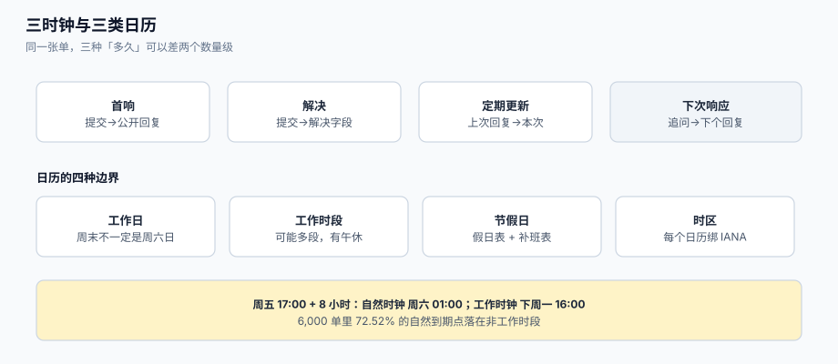

# SLA 时钟：工作日历、暂停与夏令时

「8 小时内响应」这句话，在系统里至少有**七种**不同的实现方式，每一种算出来的到期时间都不一样：自然小时、营业小时、暂停、顺延、跳过非工作时段、按交易日、按「结束时点」。更麻烦的是，**七种都能自称合规**——只要没写清是哪一种。

这一页把 SLA 时钟拆成四个可判的对象：**哪几个时钟**、**日历长什么样**、**什么条件下暂停**、**重开怎么算**；每一部分都给出本机读数与可直接落库的实现。



本页判据族 `STC-A` ~ `STC-H`，共 8 条。定义表在第七节。

## 一、三个时钟，不是一个

业界成熟的实现里，「SLA」不是一个数，而是**一组目标**，每个目标有自己的起止条件：

| 时钟 | 起点 | 终点 | 衡量什么 | 典型目标 |
| --- | --- | --- | --- | --- |
| **首响**（first reply time） | 客户提交 | 坐席**公开**回复 | 有没有人理我 | 8 营业小时 |
| **解决**（total resolution time） | 客户提交 | 解决字段被设置 | 问题多久有结论 | 3 营业日 |
| **定期更新**（periodic update） | 上次公开回复 | 本次公开回复 | 有没有被遗忘 | 每 48 小时 |
| **下次响应**（next reply time） | 客户最近一次未答的公开回复 | 坐席下一次公开回复 | 追问后多久回应 | 4 营业小时 |

四条时钟的**起止点都不是「状态变化」**，而是**消息事件**。这一点极其重要：

- 内部备注（`internal`）**不算**回复。Zendesk 的文档明确写着「私密评论不会激活回复目标」。
- 自动回复（机器人首响）**算不算**？默认不算——否则「首响达标率」会因为一个自动回复变成 100%。

::: danger 三个常见错法
1. **用「状态变成 OPEN」当首响**。状态可以被坐席手动推进，而客户什么都没收到。本库在[工单模型](../TicketModel/index.md)里给 `OPEN` 加了「必须有首个公开回复」的守卫，就是为了让这两件事无法分离。
2. **用「最后更新时间」当「解决时间」**。任何字段变更都会刷新时间戳，包括「加了个标签」。解决时间必须来自 `resolved_at`，由解决动作写入。
3. **把「关闭」当「解决」**。自动关单会让解决时间变成「定时任务跑的时间」，而不是「问题被解决的时间」。见[度量口径](../Metrics/index.md)里「无首响即关闭」那一列。
:::

## 二、营业小时 vs 日历小时：同一批单，两种结论

这是整个专题里最有说服力的一组读数。造 6,000 张单，到达时间均匀分布在**一周的自然时间**里（含夜间与周末），承诺 **8 小时**：

| 观察 | 读数 |
| --- | --- |
| 自然时钟的到期点落在**非工作时段**（夜间 / 周末） | **4,351 / 6,000 = 72.52%** |
| 同一批单的实际解决时刻，按**自然时钟**判定超时 | **91.97%** |
| 同一批单的实际解决时刻，按**工作时钟**判定超时 | **50.13%** |

两组数字的差（约 42 个百分点）不是「算法误差」，而是**「我们下班了」被算成了「我们违约」**。真实的 50.13% 才是「工时不够」的部分——它需要靠加人、减工作量或改承诺解决；而被误判的那 42 个百分点，只需要换一把尺。

一个具体到能贴进培训材料的例子：客户在**周五 17:00** 提交，承诺 8 小时，团队 9:00–18:00 工作、周末双休：

| 口径 | 到期时刻 | 真实经过 |
| --- | --- | --- |
| 自然时钟 | 周六 01:00 | 8 小时 |
| 工作时钟 | 下周一 16:00 | 71 小时 |

::: tip 一条产品事实
**Zendesk 的 SLA 徽标永远按日历小时显示剩余时间**，即使目标本身是营业小时。官方的解释是「让坐席实时判断谁的优先级更高」。所以一线的「还剩 36 小时」与报表里的「8 营业小时」不是矛盾，而是**两把尺**——培训材料必须写清，否则坐席会认为系统在骗他。
:::

## 三、暂停：三种语义，别混着用

「客户没回，凭什么算我超时」这句话，在实现上有三种完全不同的答案：

| 语义 | 做法 | 到期时间 | 谁在用 |
| --- | --- | --- | --- |
| **暂停**（pause） | 计时器停走，恢复后继续 | **不变**（目标日期不移动） | Jira Service Management 官方定义 |
| **顺延**（extend） | 到期时间加上暂停时长 | **后移** | 多数自研系统 |
| **不计入**（exclude） | 计算「有效时长」时剔除某段 | 取决于累计口径 | 报表侧常用 |

三者的差别在「客户看到什么」上最明显：暂停语义下，客户看到「周一 16:00 到期」；顺延语义下，客户看到「周三 10:00 到期」。**同一条合同，两种客户体验**。

### 3.1 哪些目标可以暂停，厂商已经给了答案

Zendesk 的排障文档明确列出：**进入 `Pending` 时不会暂停**的四类目标是首响（First Reply Time）、下次响应（Next Reply Time）、定期更新（Periodic Update）、总解决（Total Resolution）；而可暂停的是 **Requester wait time**（`Pending` 暂停）、**Agent work time**（`Pending` 与 `On-hold` 都暂停）、**Pausable update**（`Pending` 暂停）。

这个设计不是随意的：首响的目标是「我们多久理客户」，客户回不回复与这个目标无关；而「客户等待时间」的目标是「客户等了多久」，客户自己不说话的那段时间当然不算我们让他等。

::: danger 暂停的三种误用
1. **用 `PENDING` 暂停一切**。于是坐席学会「把单挂成 PENDING 就不算超时」——这是最普遍的指标操纵手法，且完全合规（他没改任何数据，只是换了个状态）。正确的做法是：首响与解决**不因 PENDING 暂停**，只有「客户等待类」目标暂停。
2. **暂停没有上限**。客户 30 天不回，单子 30 天不超时，于是「积压」里最长的那批单永远不会出现在违约列表。做法：暂停累计时长设上限（如承诺时长的 3 倍），超限后强制回到计时并升级。
3. **暂停与顺延混用**。同一个系统里，首响用暂停、解决用顺延，报表里两个达标率不可比。「暂停不移动目标日期」与「顺延移动目标日期」必须**全库统一**，并在页面上写明。
:::

### 3.2 暂停到底省了多少违约

本机模拟 20,000 张单（等待时长对数正态、40% 的单有「等客户」阶段、该阶段占在途时间 35%）：

| 口径 | 超时率 |
| --- | --- |
| 挂起**全额计入** | **27.44%** |
| 挂起期**暂停** | **21.30%** |
| 差 | **6.14 个百分点** |

6 个百分点不算小，但也不足以解释「客户体感很差」。这说明**暂停不是万能药**：真正的大头在第一节的「营业小时 vs 日历小时」（42 个百分点）与「人手不足」（ρ 过高，见[度量口径](../Metrics/index.md)）。

## 四、日历的形状：四种边界

| 边界 | 例子 | 实现要点 | 出错后果 |
| --- | --- | --- | --- |
| 工作日 | 周一至周五 | 用「星期几集合」，不要用「周一到周五都工作」这种自然语言 | 中东、以色列的周末是周五周六 |
| 工作时段 | 9:00–18:00，午休 12:00–13:30 | 支持**多段**（上午/下午），不要假设连续 | 8 小时承诺在午休被「偷走」1.5 小时 |
| 节假日 | 法定假日、公司假日、**调休上班日** | 需要「假日表」与「补班表」两张，不能只有一张 | 春节调休把周六算成工作日，漏算或错算 |
| 时区 | 跨境团队多个班次 | 每个**日历**绑定一个 IANA 时区；不要给「工单」绑时区 | 用服务器本地时间算，容器换时区后全错 |

### 4.1 夏令时：墙钟 24 小时不等于 24 小时

这是唯一一类「差一小时但没人发现」的缺陷。IANA tzdata 2026 的纽约：

| 区间 | 墙钟差 | UTC 实际经过 |
| --- | --- | --- |
| 2026-03-07 12:00 → 2026-03-08 12:00 | 24 小时 | **23 小时** |
| 2026-10-31 12:00 → 2026-11-01 12:00 | 24 小时 | **25 小时** |

对「24 小时内响应」的承诺，切换日会**多给或少于**一小时。在 Python 里正确的算法只有一种：**用带时区的 `datetime` 做减法，并且显式处理不存在的时刻**（`fold` 参数）。

```python
# [sla/dst.py]
from datetime import datetime, timedelta, timezone
from zoneinfo import ZoneInfo

NY = ZoneInfo("America/New_York")

def elapsed_hours(a: datetime, b: datetime) -> float:
    """两个带时区时刻的真实经过小时数（自动跨越夏令时切换）。"""
    return (b.astimezone(timezone.utc) - a.astimezone(timezone.utc)).total_seconds() / 3600

a = datetime(2026, 3, 7, 12, 0, tzinfo=NY)
b = datetime(2026, 3, 8, 12, 0, tzinfo=NY)
print(elapsed_hours(a, b))     # 23.0，不是 24.0
```

::: danger 时区的三个坑
1. **`datetime.now()` 不带时区**。它返回的是「服务器本地时间」，容器换成 UTC 之后，所有历史数据的解释都变了。一律用 `datetime.now(timezone.utc)`。
2. **存储用 `timestamptz`，不要用 `timestamp`**。PostgreSQL 的 `timestamp without time zone` 会把「纽约 9:00」和「上海 9:00」存成同一个字符串，事后无法还原。
3. **不要「先算好到期时间再存成字符串」**。日历会被修改（新增节假日、调整班次），到期时间必须能从「起点 + 日历版本」**重算**出来，否则一次调班就让所有历史报表失真。
:::

## 五、重开与多周期：同一张单的第二条命

`RESOLVED` 之后客户回来说「还没好」，此时有三种处理，选择直接决定指标口径：

| 处理 | 实现 | 首响时钟 | 解决时钟 | 报表影响 |
| --- | --- | --- | --- | --- |
| **重开**（reopen） | 同单回 `OPEN`，`reopened_count += 1` | 不重启（已满足） | **重启**，以重开时刻为新起点 | 时长按「最后一次解决」算 |
| **新单**（new ticket） | 建新单并关联原单 | 重启 | 重启 | 原单达标、新单也达标 |
| **累计**（all cycles） | 同单，累计所有周期时长 | 不重启 | **累加**所有周期 | 时长最真实，但目标值也需要重新定义 |

JSM 的 SLA 插件里把第三种叫 **All Cycles**（把「开→解决→重开→再解决」的活跃时间全部累加），并明确建议「解决类 SLA 用它」。这个选择的理由是：客户体验的是**总耗时**，不是最后一段。

本机读数：8% 的重开率下，「首次解决率」从 **88.31%** 掉到 **80.36%**（`88.31% × 91%`）。重开率低的团队，往往只是**没有统计重开**——因为重开需要在 SLA 快照上做一次「重新计时」，而很多系统的实现是「把 `resolved_at` 清空」，历史就丢了。

## 六、实现：快照、计算、到期扫描

### 6.1 SLA 快照表（不要现算）

到期时间必须**在目标命中时落库**，因为日历会变、政策会改。Zendesk 的处理是：修改日程**不会**回溯更新已有工单的目标，只有该工单发生事件时才重算——这正好说明「快照 + 触发重算」是业界的默认做法。

```sql
-- [schema/sla_snapshot.sql]
create table sla_snapshot (
  id           bigserial primary key,
  ticket_id    bigint not null references ticket(id),
  metric       text   not null,              -- first_reply / resolution / next_reply / periodic
  policy_id    bigint not null,               -- 命中的政策版本
  calendar_id  bigint not null,               -- 命中的日历版本
  started_at   timestamptz not null,          -- 时钟起点（事件时间）
  target_at    timestamptz not null,          -- 到期时刻（按日历算出，落库）
  paused_total interval not null default '0', -- 累计暂停时长（暂停语义下不移动 target_at）
  achieved_at  timestamptz,                   -- 达成时刻（事件时间）
  breached     boolean generated always as
                 (achieved_at is null and target_at < now()) stored,
  unique (ticket_id, metric, started_at)
);

create index idx_sla_due on sla_snapshot (target_at) where achieved_at is null;
```

### 6.2 到期扫描：不要每分钟扫全表

| 做法 | 每分钟扫描行数（50 万行表） | 说明 |
| --- | --- | --- |
| `select * from sla_snapshot where target_at < now()` 全表 | **30,000,000** | 无索引，每分钟全扫 |
| 部分索引 `where achieved_at is null` + `target_at` | **≈2,271** | 只扫未达成的行 |
| 按分钟分桶的时间轮 | **≈3,600** | 每桶只取本分钟到期的单 |

```sql
-- [schema/sla_due.sql]
-- 每 30 秒执行一次；只取「已到期且未达成」的快照
select s.id, s.ticket_id, s.metric, s.target_at
from sla_snapshot s
where s.achieved_at is null
  and s.target_at <= now()
order by s.target_at
limit 500;
```

`limit` 不是性能优化，是**保护**：一次扫描发现 5 万条违约时，正确的动作是「先告警、再分批处理」，而不是把 5 万个升级通知同时打出去（见[升级与值班](../Escalation/index.md)的通知去重）。

### 6.3 工作日历的加法（可直接抄的实现）

```python
# [sla/calendar.py]
from datetime import datetime, timedelta, time

def add_business_hours(start: datetime, hours: float, cal) -> datetime:
    """在日历 cal 上把 hours 个「营业小时」加到 start 之后。

    cal 需要提供：is_workday(date) -> bool、sessions(date) -> [(time, time), ...]
    """
    cur, remain = start, hours
    guard = 0
    while remain > 1e-9:
        guard += 1
        if guard > 3650:                       # 防死循环：日历配错时必须炸，不能挂住
            raise RuntimeError("calendar misconfigured: no working session found")
        if not cal.is_workday(cur.date()):
            cur = datetime.combine(cur.date() + timedelta(days=1), time(0, 0), cur.tzinfo)
            continue
        moved = False
        for s, e in cal.sessions(cur.date()):  # 支持多段（上午/下午）
            s_dt = datetime.combine(cur.date(), s, cur.tzinfo)
            e_dt = datetime.combine(cur.date(), e, cur.tzinfo)
            if cur >= e_dt:
                continue
            if cur < s_dt:
                cur = s_dt
            take = min(remain, (e_dt - cur).total_seconds() / 3600)
            cur += timedelta(hours=take)
            remain -= take
            moved = True
            break
        if not moved:
            cur = datetime.combine(cur.date() + timedelta(days=1), time(0, 0), cur.tzinfo)
    return cur
```

三个细节值得注意：**多段工作时段**（午休）、**`guard` 防死循环**（日历配错时要抛错而不是挂住）、**时区随日期传递**（跨夏令时的日期必须重新计算偏移，`combine(..., tzinfo)` 在 `zoneinfo` 下会按日期自动取正确偏移）。

## 七、本页判据

| 判据 | 看什么现象 | 判成什么 | 不满足时改哪里 |
| --- | --- | --- | --- |
| `STC-A` | 每个 SLA 目标都声明了「营业小时 / 日历小时」与「暂停 / 顺延 / 不计入」 | 口径可读 | 政策表加两列枚举 |
| `STC-B` | 日历支持多段工作时段与两张假日表（假日 + 补班） | 日历正确 | 重写 `sessions()` 与假日表 |
| `STC-C` | 每个日历绑定 IANA 时区，计算全程用带时区时间 | 时区正确 | 改 `timestamptz` + `zoneinfo` |
| `STC-D` | 夏令时切换日的时长断言有单测（23h / 25h） | 边界可验 | 补测试 |
| `STC-E` | 首响与解决不因 `PENDING` 暂停；只有「客户等待类」目标暂停 | 暂停语义正确 | 改暂停条件 |
| `STC-F` | 暂停累计有上限，超限强制计时并升级 | 暂停不能滥用 | 加 `paused_total` 上限判断 |
| `STC-G` | 到期时间落库为快照，且可从「起点 + 日历版本」重算 | 可重算、可解释 | 建 `sla_snapshot` |
| `STC-H` | 重开时 `reopened_count` 与「累计口径」都落库 | 重开可见 | 补字段与事件 |

## 八、验证方式

```shell
# 1) 日历加法：跨周末 + 跨午休，应得到周一 16:00
python3 - <<'PY'
from datetime import datetime
# 假设实现里 cal 为「周一至周五 9:00-12:00、13:30-18:00」
print(add_business_hours(datetime(2026, 10, 9, 17, 0), 8, cal))
PY
```

预期输出：`2026-10-12 17:30:00`。推导：周五 17:00→18:00 消耗 1 小时，剩 7 小时；周一 9:00→12:00 消耗 3 小时（剩 4），13:30→17:30 消耗 4 小时。三种错误输出各有含义：`2026-10-12 13:00` = 把工作时段当连续 9:00–18:00（午休被跳过）；`2026-10-12 09:00` = 跨日循环写错，把剩余工时清零了；`2026-10-10 01:00` = 其实走了自然时钟。

```shell
# 2) 夏令时：同一墙钟 24 小时，真实经过必须不同
python3 - <<'PY'
from datetime import datetime
from zoneinfo import ZoneInfo
NY = ZoneInfo("America/New_York")
for a, b in [(datetime(2026,3,7,12,tzinfo=NY), datetime(2026,3,8,12,tzinfo=NY)),
             (datetime(2026,10,31,12,tzinfo=NY), datetime(2026,11,1,12,tzinfo=NY))]:
    print(a.date(), (b.astimezone(ZoneInfo("UTC")) - a.astimezone(ZoneInfo("UTC"))).total_seconds()/3600)
PY
```

预期输出：`2026-03-07 23.0` 与 `2026-10-31 25.0`。若两条都是 `24.0`，说明你在用 naive datetime 相减。

```shell
# 3) 到期扫描必须走索引（不能 Seq Scan）
psql "$DSN" -c "explain (analyze, buffers) select id from sla_snapshot \
  where achieved_at is null and target_at <= now() order by target_at limit 500;"
```

预期输出：计划里出现 `Index Scan using idx_sla_due` 或 `Index Only Scan`，`Buffers` 在两位数到三位数之间。若出现 `Seq Scan on sla_snapshot` 且 `Buffers read` 上万，说明部分索引没建或谓词写法不匹配。

```shell
# 4) 暂停上限：构造一张暂停超过 3 倍承诺的单，必须回到计时并升级
psql "$DSN" -c "select ticket_id, paused_total, target_at, now() from sla_snapshot \
  where metric='first_reply' and paused_total > interval '24 hours';"
```

预期输出：这些单要么 `breached = true`，要么已产生 `escalation_level >= 1` 的事件——**不能既没违约也没升级**。

## 九、参考资料

- Zendesk《Defining and using SLA policies》（营业小时/日历小时、暂停与重置、重开）：<https://support.zendesk.com/hc/en-us/articles/4408822163738>
- Zendesk《Why do I see differences in SLA target hours?》（徽标恒按日历小时显示）：<https://support.zendesk.com/hc/en-us/articles/215672297>
- Zendesk《Can I pause the SLA timer or reset it under certain conditions?》（可暂停/可重置的目标清单）：<https://support.zendesk.com/hc/en-us/articles/22531614918940>
- Atlassian《Configure SLAs》（暂停条件不移动目标日期）：<https://support.atlassian.com/jira-service-management-cloud/docs/configure-slas/>
- IANA Time Zone Database：<https://www.iana.org/time-zones>
- Python 文档《zoneinfo》（`fold` 与夏令时歧义）：<https://docs.python.org/3/library/zoneinfo.html>
- PostgreSQL 文档《Indexes》（部分索引与谓词匹配）：<https://www.postgresql.org/docs/current/indexes-partial.html>
