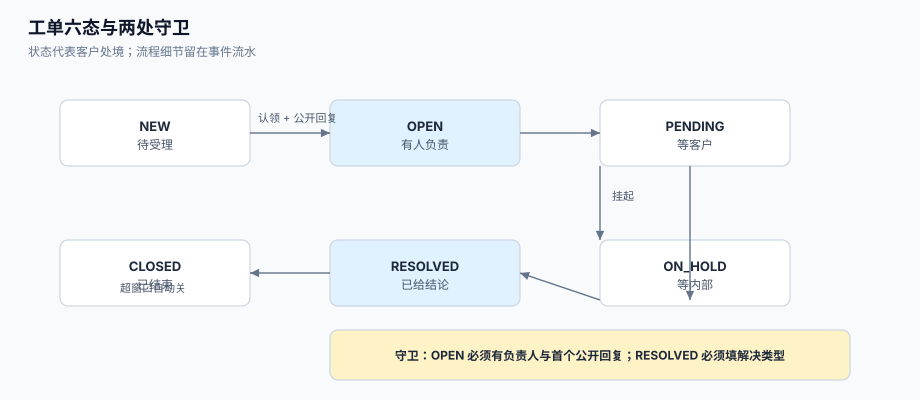

# 工单模型：六态、一会话与审计

工单模型的决定性选择不是「用几张表」，而是**「状态」到底代表什么**。多数团队把状态当成「流程走到哪一步」，于是 `RESOLVED` 变成「我想让它从我的队列里消失」的同义词；正确的做法是让状态代表**客户可见的处境**，而流程细节留在事件流水里。

这一页给出可直接落库的模型：六个状态与类别、工单与会话的分层、必填字段的代价、工单号与幂等、合并与拆单的指针、以及不可变审计。



本页判据族 `STK-A` ~ `STK-H`，共 8 条。定义表在第七节。

## 一、六个状态，与「类别」这一层

厂商普遍采用「状态 + 类别」两层：Zendesk 的 `New` / `Open` / `Pending` / `On-hold` / `Solved` / `Closed` 是**状态**，而自定义状态必须归到某个**状态类别**，SLA 按类别计算。自研时如果只有一层，必然在半年内长出 20 个自由字符串状态（`待处理`、`处理中`、`待客户`、`客户已回`、`等二线`……），然后没人能写出稳定的报表。

| 状态 | 类别 | 谁可以让它发生 | 客户能看到 | 「进入」的前置条件（守卫） |
| --- | --- | --- | --- | --- |
| `NEW` | 待处理 | 系统 | 已提交，等待受理 | 工单落库成功 |
| `OPEN` | 进行中 | 坐席 | 已有受理人 | **必须**有 `assignee_id` 且有首个公开回复 |
| `PENDING` | 等待客户 | 坐席 | 等你补充信息 | 必须有一条**面向客户的提问**（公开） |
| `ON_HOLD` | 暂停 | 坐席 / 系统 | 通常不展示细分 | 必须有 `hold_reason`（等二线/等厂商/等审批） |
| `RESOLVED` | 已解决 | 坐席 / 客户确认 | 已给结论 | 必须填 `resolution_type` |
| `CLOSED` | 已关闭 | 系统（定时）/ 客户 | 已结束 | 距 `RESOLVED` 超过重开窗口 |

::: danger 注意
1. **不要把 `NEW → RESOLVED` 当成快捷方式**。这条迁移让 `first_response_at` 永远是空值，而报表里它会被算成「已解决」。允许这条路径的唯一理由是「创建即解决」（例如自助操作已完成），此时必须同时写入 `resolution_type = SELF_SERVED` 并**显式跳过首响统计**——否则首响中位数会被这批单拖成一个假的好数字。
2. **不要允许 `PENDING` 而没有提问**。客户看到「等待您回复」，但他不知道要回复什么；这类单往往躺到自动关单。守卫写法：进 `PENDING` 前检查「存在一条 `visibility='public'` 且 `author_type='agent'` 的消息」。
3. **不要把 `ON_HOLD` 与 `PENDING` 混用**。两者的**等待对象不同**（客户 vs 内部），而这直接决定 SLA 是否暂停：Zendesk 的 `Agent work time` 在 `Pending` 与 `On-hold` 都暂停，但 `Requester wait time` 只在 `Pending` 暂停。混用会让「谁在拖」永远算不清。见[SLA 时钟](../SLAClock/index.md)。
:::

### 1.1 为什么是六个而不是十个

新增状态的唯一正当理由是「**客户体验不同**」或「**SLA 行为不同**」。两者都不满足时，它应该是一条**标签**（`tag`）或一个**原因字段**（`hold_reason`），而不是状态：

| 想要新增的状态 | 客户体验不同？ | SLA 行为不同？ | 正确落法 |
| --- | --- | --- | --- |
| 「等厂商回复」 | 否（仍是等待中） | 否（都暂停） | `ON_HOLD` + `hold_reason='VENDOR'` |
| 「待审批退款」 | 是（要说清在审批） | 否 | `ON_HOLD` + `hold_reason='REFUND_APPROVAL'` + 客户可见说明 |
| 「已升级到二线」 | 否 | 否 | `assignee` 变成二线组 + `escalation_level` 字段 |
| 「客户已确认解决」 | 是 | 是（停止计时） | `RESOLVED`（确认是 `CLOSED` 的前置，不是独立态） |

## 二、工单与会话必须分层

一个工单 = **一个诉求**；一条会话 = **一次发声**。二者是 1:N，且**渠道、语言、附件都挂在会话上**，不挂在工单上：

| 实体 | 职责 | 不该放什么 |
| --- | --- | --- |
| `ticket` | 诉求的当前处境：状态、负责人、优先级、SLA 快照、合并指针 | 消息正文、附件、渠道 |
| `ticket_message` | 一次发声：作者、可见性、渠道、正文、附件、时间 | 状态、负责人 |
| `ticket_event` | 一次变更：谁、何时、字段、旧值、新值、原因 | 正文（避免重复存储） |

把正文塞进 `ticket` 是最常见的偷懒，代价是**三个渠道的同一诉求无法并存**：邮件正文覆盖了 IM 正文，客户说「我在微信里发过截图」而系统里找不到。分层之后，「同一诉求的第 4 次发声」只是 `ticket_message` 的第 4 行。

```sql
-- [schema/ticket.sql]
create table ticket (
  id             bigserial primary key,
  tenant_id      bigint      not null,
  ticket_no      text        not null,                 -- 对客户可见的单号
  subject        text        not null,
  status         text        not null default 'NEW',
  status_category text       not null default 'PENDING_AGENT',
  priority       text,                                  -- 允许为空，但见 3.1
  request_type   text        not null,                  -- incident / question / request / refund …
  requester_id   bigint      not null,
  assignee_id    bigint,
  group_id       bigint,
  channel_first  text        not null,                  -- mail / im / phone / portal
  merged_into    bigint      references ticket(id),     -- 合并指针
  resolution_type text,                                 -- 进入 RESOLVED 必填
  first_response_at timestamptz,
  resolved_at    timestamptz,
  closed_at      timestamptz,
  reopened_count int         not null default 0,
  created_at     timestamptz not null default now(),
  updated_at     timestamptz not null default now(),
  unique (tenant_id, ticket_no)
);

create table ticket_message (
  id          bigserial primary key,
  ticket_id   bigint      not null references ticket(id),
  author_type text        not null,                     -- requester / agent / system
  author_id   bigint,
  visibility  text        not null default 'public',    -- public / internal
  channel     text        not null,
  body        text        not null,
  created_at  timestamptz not null default now()
);

create table ticket_event (
  id         bigserial primary key,
  ticket_id  bigint      not null references ticket(id),
  actor_id   bigint,
  field      text        not null,
  old_value  text,
  new_value  text,
  reason     text,
  created_at timestamptz not null default now()
);
```

## 三、必填字段：空值不是「以后再补」

| 字段 | 为空会发生什么 | 建议 |
| --- | --- | --- |
| `priority` | **SLA 无法命中**（Zendesk 与 JSM 都以优先级圈定目标），工单没有倒计时 | 建单时用「请求类型 + 客户等级」推导出默认值，禁止 `null` |
| `request_type` | 「事件」与「服务请求」混算，优先级矩阵失效 | 入口表单强制选择，且与 SLA 策略一一对应 |
| `resolution_type` | 「已解决」没有结论，重开时无法判断是否同一问题 | 进 `RESOLVED` 的守卫 |
| `assignee_id` | 进池子即「已受理」，首响时长永远为空 | 见[分派与认领](../Dispatch/index.md) |
| `channel_first` | 无法回答「哪个渠道最伤人」 | 由进线通道写入，后续消息不改它 |

### 3.1 优先级为空，SLA 就不存在

这是最隐蔽的一条：Zendesk 的官方排障文档明确写着「工单**必须有优先级**，SLA 目标才会生效；没有优先级就没有计时器」。自研系统里同样成立——如果你的 SLA 计算是 `join sla_policy on policy.priority = ticket.priority`，那么 `priority is null` 的工单会**静默地不参与任何统计**，达标率分母里没有它，看起来一切正常。

::: tip 一个可执行的兜底
建单时按 `客户等级 × 请求类型` 填一个**非空默认优先级**，并在事件流水里记一条 `priority_auto_set`。这样「SLA 未命中」的数量可以从事件流水里数出来，而不是从「感觉漏了一些单」里猜出来。
:::

## 四、工单号、外部单号与幂等

三种「号」要分清，混用会导致重复建单或对不上账：

| 号 | 谁生成 | 用途 | 唯一性范围 |
| --- | --- | --- | --- |
| `id`（内部主键） | 数据库 | 关联、外键 | 全库 |
| `ticket_no`（对外单号） | 业务（如 `T-20261025-0007`） | 客户沟通、口头引用 | `(tenant_id, ticket_no)` |
| `external_id`（渠道消息号） | 渠道方（`Message-ID`、IM `msg_id`） | **幂等**：同一条渠道消息只建一次 | `(tenant_id, channel, external_id)` |

**幂等键必须落在 `external_id` 上**，不能落在 `ticket_no` 上：`ticket_no` 是你自己生成的，重复消费同一条消息会生成两个不同的 `ticket_no`，于是「同一封邮件建了两张单」。正确做法：

```sql
-- [schema/ticket_idem.sql]
create table ticket_intake (
  tenant_id   bigint not null,
  channel     text   not null,
  external_id text   not null,      -- 邮件 Message-ID / IM msg_id / 表单提交号
  ticket_id   bigint not null references ticket(id),
  created_at  timestamptz not null default now(),
  primary key (tenant_id, channel, external_id)
);
```

入库流程是「先插 `ticket_intake`，冲突则直接返回已有 `ticket_id`」——**用唯一约束做幂等，不用先查后插**。先查后插在并发重投下会双双查空、双双插入，这与[分派与认领](../Dispatch/index.md)里 `STD-D` 是同一类错误。

## 五、合并与拆单：指针要单向，链要能追

- **合并**（merge）：把「重复的 B」并入「主单 A」。B 不删除，写 `merged_into = A`，状态置 `CLOSED`，`resolution_type = 'MERGED'`。
- **拆单**（split）：把「一单里的两个诉求」分开。新建 C，写 `ticket_link(B, C, 'SPLIT')`，原单 B 保留。
- **禁止**双向指针（A→B 且 B→A）：会出现环，任何「找到主单」的递归都死循环。

```sql
-- [schema/ticket_link.sql]
create table ticket_link (
  id         bigserial primary key,
  src_id     bigint not null references ticket(id),
  dst_id     bigint not null references ticket(id),
  kind       text   not null,        -- MERGED / SPLIT / RELATED / DUPLICATE
  created_by bigint,
  reason     text   not null,
  created_at timestamptz not null default now(),
  check (src_id <> dst_id),
  unique (src_id, kind)              -- 一张单只能被合并进一个主单
);
```

`unique (src_id, kind)` 这一条是**防环的关键**：它保证一个「被合并方」只有一条出边；再配一条查询约束（应用层校验 `dst` 的主单不是自己），环就不可能形成。

::: danger 合并的三个坑
1. **合并后两端都在回消息**。合并只改指针不够，必须把 B 的新消息**路由到 A**（进线时先解析 `merged_into`）。否则客户在旧邮件线程里回复，消息落到已关闭的 B 上，A 的坐席永远看不到。
2. **合并把 SLA 也合并了**。B 的承诺时间不能简单丢弃：正确做法是**取两者中更早的到期时间**作为 A 的新目标，并在事件流水里记一条 `sla_target_recalculated`。否则「重复提交」反而成了延长承诺的手段。
3. **合并不可撤销却没有审计**。合并要写 `ticket_link.reason`（`SAME_REQUESTER_SAME_ISSUE` / `SAME_EXTERNAL_ID` / `MANUAL`），并允许「取消合并」——把 `merged_into` 置空、B 恢复 `OPEN`，同时记事件。
:::

## 六、审计：只追加，不更新

`ticket_event` 必须是**只追加**的：任何 `update` / `delete` 都不允许（数据库层用 `revoke update, delete` 或触发器拦住）。它要能回答四个问题：

| 问题 | 需要的列 | 反例 |
| --- | --- | --- |
| 谁改的？ | `actor_id`（系统动作为 `0` 或 `null` + `actor_type`） | 只记 `updated_by` 在 `ticket` 上，被覆盖后查不到历史 |
| 何时改的？ | `created_at`（数据库时间，不用应用时间） | 用应用服务器时间，多机时钟漂移 |
| 从什么到什么？ | `old_value` / `new_value` | 只记新值，无法还原 |
| 为什么？ | `reason`（尤其是手工改优先级、手工暂停 SLA） | 没有原因，事后无法判断是否合规 |

**手工改 SLA 目标**是最需要审计的动作：它相当于「改合同」。建议单独一张表：

```sql
-- [schema/sla_override.sql]
create table sla_override (
  id          bigserial primary key,
  ticket_id   bigint not null references ticket(id),
  metric      text   not null,          -- first_reply / resolution / next_reply
  old_target  timestamptz not null,
  new_target  timestamptz not null,
  reason      text   not null,
  approved_by bigint not null,          -- 必须有人批，不能自己改
  created_at  timestamptz not null default now()
);
```

## 七、本页判据

| 判据 | 看什么现象 | 判成什么 | 不满足时改哪里 |
| --- | --- | --- | --- |
| `STK-A` | 状态取值受约束（外键表或 `CHECK`），不是自由文本 | 状态可统计 | 建 `ticket_status` 维表并加外键 |
| `STK-B` | 每个状态都有 `status_category`，报表只按类别聚合 | 类别层存在 | 补映射表，改报表 |
| `STK-C` | `OPEN` 守卫：`assignee_id` 非空且有公开回复 | 受理语义正确 | 状态机加守卫 |
| `STK-D` | `RESOLVED` 守卫：`resolution_type` 非空 | 解决可解释 | 同上 |
| `STK-E` | `PENDING` 守卫：存在面向客户的公开提问 | 等待有内容 | 同上 |
| `STK-F` | 幂等键是 `(tenant_id, channel, external_id)`，且有唯一约束 | 渠道重投不重复建单 | 建 `ticket_intake` |
| `STK-G` | `merged_into` 单向且每单最多一条出边 | 无环 | 加 `unique (src_id, kind)` |
| `STK-H` | `ticket_event` 无法被 `update` / `delete` | 审计不可篡改 | 撤权限或加触发器 |

## 八、验证方式

```shell
# 1) 状态取值必须受约束：尝试写入一个非法状态，必须失败
psql "$DSN" -c "insert into ticket(tenant_id,ticket_no,subject,request_type,requester_id,status) \
  values (1,'T-TEST-1','x','question',1,'处理中');"
```

预期输出：`ERROR: insert or update on table "ticket" violates foreign key constraint`（或 `check constraint`），**不是** `INSERT 0 1`。若插入成功，说明状态是自由文本，`STK-A` 不满足。

```shell
# 2) 同一渠道消息重复投递两次，只能有一张单
psql "$DSN" -c "insert into ticket_intake(tenant_id,channel,external_id,ticket_id) values (1,'mail','<abc@x>',1);"
psql "$DSN" -c "insert into ticket_intake(tenant_id,channel,external_id,ticket_id) values (1,'mail','<abc@x>',2);"
```

预期输出：第二条 `ERROR: duplicate key value violates unique constraint`。然后确认**应用层返回的是已存在的 `ticket_id`（1），而不是报错给用户**——唯一约束是防线，幂等是体验。

```shell
# 3) 审计表不可改：这条命令必须被拒绝
psql "$DSN" -c "update ticket_event set new_value='OPEN' where id=1;"
```

预期输出：`ERROR: permission denied for table ticket_event`（或触发器抛出的 `audit table is append-only`）。

```shell
# 4) 合并链最多一层：没有工单的 merged_into 指向一个「已被合并」的单
psql "$DSN" -c "select count(*) from ticket a join ticket b on a.merged_into=b.id where b.merged_into is not null;"
```

预期输出：`0`。

## 九、参考资料

- Zendesk《Ticket statuses》（六个状态与状态类别的对应、自定义状态归类别）：<https://support.zendesk.com/hc/en-us/articles/4408832790170>
- Zendesk《Troubleshooting common SLA issues》（无优先级则 SLA 不生效）：<https://support.zendesk.com/hc/en-us/articles/22517697058460>
- Atlassian《What is a resolution?》（用 Resolution 字段而非状态判定解决）：<https://support.atlassian.com/jira-service-management-cloud/docs/what-is-a-resolution/>
- PostgreSQL 文档《Constraints》（`check`、`unique`、外键）：<https://www.postgresql.org/docs/current/ddl-constraints.html>
- PostgreSQL 文档《CREATE TRIGGER》（用触发器实现只追加表）：<https://www.postgresql.org/docs/current/sql-createtrigger.html>
