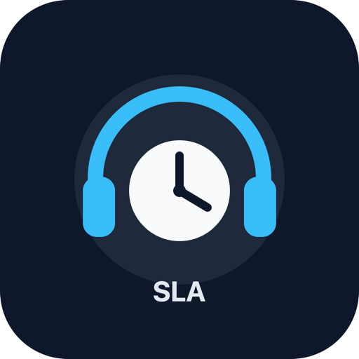
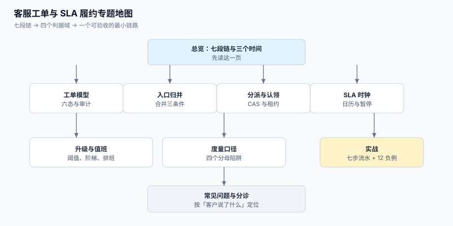

# 客服工单与 SLA 履约工程

一封邮件、一条 IM、一个电话、一次在帮助中心点的按钮——客户在四个地方说了同一件事，而你的系统里有四条记录、零个负责人、以及三份互相矛盾的「响应时长」。客服工单系统的工程量，不在于「把消息存下来」，而在于**把「一句话」变成「一个可承诺、可计时、可证明的承诺」**。

本专题讲**一个客户请求从进线到关闭的完整履约链**：工单怎么建模、重复请求怎么合并、分派与认领怎么做、SLA 时钟按什么日历走、超时怎么升级、指标口径为什么能差 40 个百分点。它不讲某个厂商后台怎么点（那是工具层的事），只讲**这条链路上哪些地方一定会安静地违约**。

::: tip 一句话理解
客服的失败**不报错**：工单建了、状态改了、后台「SLA 达标率 96%」——而客户在群里说「我等了三天没人回」。因为**「建了单」不等于「有人接」，「改了状态」不等于「客户的问题解决了」，「按单统计的达标率」也不等于「客户体验到的等待」**。
:::

::: info 本专题与相邻专题的分工
- **通用流程引擎与审批流** → [工作流引擎工程](../WorkflowEngine/index.md)：那边解决「任意流程怎么表达与执行」（BPMN、规则引擎、会签），本专题只处理**一种流程**——客户请求，且它的特殊性在于**流程的时钟要对客户可见、可承诺**。
- **风控案件与人工审核队列** → [实时风控决策 · 案件与人工审核](../RiskDecision/CaseReview/index.md)：那边也讲队列，但优化目标是「抓得准、误杀少」，本专题的优化目标是「**等得短、承诺不失守**」；那边的队列里是**嫌疑人**，这边是**付费客户**。
- **消息通知与触达** → [消息通知与触达工程](../NotificationDelivery/index.md)：那边管「一条事件该不该发、发给谁、会不会重复」，本专题把「通知」当作履约链的一段（受理回执、进度更新、升级提醒），不重复讲通道与频控。
- **内部事故响应** → [运维 · 故障响应](../../Ops/IncidentResponse/index.md)：那是**自己系统出故障**时的响应，SLA 对象是内部与合同；本专题的对象是**外部客户的请求**，两者的优先级矩阵与话术完全不同（事故通告可以「少说」，工单回复不行）。
- **单条请求的幂等键** → [幂等与状态机工程](../IdempotencyStateMachine/IdempotencyKey/index.md)：本专题的「重复」是**跨渠道的同一个客户诉求**，要靠合并（merge）而不是拒重（reject），语义不同。
- **多租户与配额** → [多租户 SaaS 工程](../MultiTenantSaaS/index.md)：企业版客服通常按租户隔离，隔离模型那边讲透，本专题只在[工单模型](TicketModel/index.md)里给 `tenant_id` 的落位建议。
- **协作与实时同步** → [实时协作工程](../RealtimeCollaboration/index.md)：客服台的「同一单两人同时看」属于那边讲的协同编辑范畴，本专题只处理**认领与改派的竞态**。
- **工程度量口径** → [工程度量 · 质量指标](../../Tools/EngineeringMetrics/QualityMetrics/index.md)：通用度量方法论在那边，本专题只讲**客服专有的四个分母陷阱**。
:::

## 目录

- [总览：七段服务链与三个时间](Overview/index.md)
- [工单模型：六态、一会话与审计](TicketModel/index.md)
- [入口归并与重复合并](IntakeDedup/index.md)
- [分派与认领：技能、负载与抢占](Dispatch/index.md)
- [SLA 时钟：工作日历、暂停与夏令时](SLAClock/index.md)
- [升级与值班：阶梯、阈值与误升级](Escalation/index.md)
- [度量口径：四个分母陷阱](Metrics/index.md)
- [实战：一个能跑起来的最小履约链路](Practice/index.md)
- [常见问题与分诊](FAQ/index.md)

## 专题地图

## 判据纪律

沿用全库写法：**每页 8 条，编号形如 `STO-A`**，逐页前缀唯一，可被 `utils/audit` 下的判据类巡检机械核对。每条判据回答三件事：**看什么现象、判成什么、不满足时改哪里**。

| 页 | 判据族 | 这一族管什么 | 条数 |
| --- | --- | --- | --- |
| 总览 | `STO-A` ~ `STO-H` | 七段链、三个时间、四个必失点、接缝归属 | 8 |
| 工单模型 | `STK-A` ~ `STK-H` | 六态与归类、一会话多消息、必填字段、工单号、合并指针、审计 | 8 |
| 入口归并 | `STI-A` ~ `STI-H` | 渠道归并、请求人识别、合并三条件、合并链、不可合并、分母 | 8 |
| 分派与认领 | `STD-A` ~ `STD-H` | 技能匹配、负载、队头阻塞、CAS 认领、溢出改派、公平性 | 8 |
| SLA 时钟 | `STC-A` ~ `STC-H` | 三时钟、日历、暂停、时区与夏令时、重开、快照 | 8 |
| 升级与值班 | `STE-A` ~ `STE-H` | 阈值、阶梯、值班表、误升级、仲裁、通知去重 | 8 |
| 度量口径 | `STT-A` ~ `STT-H` | 分母、分位数、积压、占用率、CSAT 偏差、人效 | 8 |
| 实战 | `STP-A` ~ `STP-H` | 表结构、七步流水、负向验收、可重跑、验收 SQL | 8 |
| 常见问题 | `STR-A` ~ `STR-H` | 分诊表、误判、止血顺序、上线自查 | 8 |

合计 **9 族 72 条**。

## 事实与规格速览（2026-10 口径）

这类工程的实现细节几乎全被**厂商行为与合同条款**决定，写清楚以免被「我们后台显示达标」误导：

| 事项 | 现状 | 对履约链的影响 |
| --- | --- | --- |
| Zendesk 的状态集合 | `New` / `Open` / `Pending` / `On-hold` / `Solved` / `Closed`；企业版可建**自定义状态**，但必须归到上述**状态类别**之一，SLA 按**类别**算 | 自定义状态不是自由字段，它是「类别 + 别名」。见[工单模型](TicketModel/index.md) |
| Zendesk 哪些目标在 `Pending` 不暂停 | **首响（First Reply Time）、下次响应（Next Reply Time）、定期更新（Periodic Update）、总解决（Total Resolution）** 四类**不暂停**；可暂停的是 Requester wait time（Pending 暂停）、Agent work time（Pending 与 On-hold 暂停）、Pausable update（Pending 暂停） | 「客户没回，凭什么算我超时」在首响上**不成立**——这是产品定义，不是 bug。见[SLA 时钟](SLAClock/index.md) |
| Zendesk 的剩余时间显示 | **徽标永远按日历小时显示**，即使目标是营业小时；且「已超时」的徽标不再折算营业时间 | 一线看到的「还剩 36 小时」与报表里的「营业小时 8 小时」不是同一把尺，必须写进培训材料 |
| Zendesk 的日程变更 | 修改日程（加减节假日）**不会回溯更新已有工单的 SLA 目标**，只有该工单发生事件（公开回复/状态/优先级/策略变更）时才重算 | 「补录一个节假日」并不能修正历史违约率 |
| Jira Service Management 的 SLA 三段 | 每个 SLA = **目标（JQL 圈定）+ 开始条件 + 暂停条件 + 停止条件**；官方明确「**暂停不改变目标日期**」（pause conditions stop tracking time but do not shift the target date） | 与「把到期时间往后推」是两种实现，报表差异巨大。见[SLA 时钟](SLAClock/index.md) |
| JSM 的解决判定 | 建议用 **Resolution 字段被设置**作为停止条件，而不是「状态变成 Done」——工作流会漂移，Resolution 字段更接近事实 | 这一条同样适用于自研：状态是流程的，解决是**语义**的 |
| ITIL 4 的定位 | ITIL 4（2019）把「服务台（service desk）」列为 34 项实践之一，与「事件管理」「服务请求管理」并列；ISO/IEC 20000-1:2018 是服务管理体系要求 | 术语对齐时不要把「事件（incident）」与「服务请求（service request）」混成一个工单类型——两者的 SLA 与优先级矩阵不同 |
| 排队论的两把尺 | 利特尔法则 `L = λW` 恒成立；等待时间对**占用率**极度敏感（M/M/c 近似下 ρ 从 0.73 涨到 0.95，等待时间涨十几倍） | 「人不够」不是靠加班解决的，是靠**降低 ρ 或加人**解决的。见[度量口径](Metrics/index.md) |
| 时区与夏令时 | IANA tzdata 是唯一可信来源；「墙钟 24 小时」在夏令时切换日是 **23 或 25 小时** | 跨境客服的「24 小时内回复」在切换日会差一小时。见[SLA 时钟](SLAClock/index.md) |

::: warning 两个「不能全信」
1. **不能全信后台的达标率**。绝大多数后台默认按**工单数**算达标率；而客户体感按**等待时长**算。本机同一批 20,000 单：按单 **88.31%**，按等待分钟 **46.98%**——差 **41.32 个百分点**。两者都不算错，错的是**只报一个**。
2. **不能全信「已解决」**。`Solved` 到 `Closed` 之间还有一个可重开窗口；本机按 9% 重开率折算，首次解决率从 **88.31%** 掉到 **80.36%**。重开率不高的团队，往往只是**没有统计重开**。
:::

## 七个必失点（本专题的全部理由）

这七条不是「注意一下」，而是**结构性的**：只要实现里缺少对应的一条，履约就会安静地失守。

1. **SLA 用自然时钟算**——本机 6,000 单、8 小时承诺，**72.52%** 的到期点落在非工作时段；同一批单按自然时钟判 **91.97%** 超时，按工作时钟判 **50.13%**（这 50.13% 是真正的「工时不够」，前者大半是「我们下班了」）。见[SLA 时钟](SLAClock/index.md)。
2. **不合并重复请求**——2,000 个真实诉求经四渠道进来变成 2,666 条请求；不合并时队列虚高 **33.3%**，而这 33.3% 会被算进「工作量」与「人均产能」。见[入口归并](IntakeDedup/index.md)。
3. **分派用「下一个轮到的坐席」**——硬轮询会让整队等一个忙人（队头阻塞），本机 12 坐席、λ=4.0 单/小时下平均等待 **7,346 分钟**；换最小负载后是 **35.0 分钟**。见[分派与认领](Dispatch/index.md)。
4. **认领用「先查后改」**——20 个坐席、100 单：应用层记 **374 次认领成功**，表里只有 **100 行**，也就是说 **274 次是同一单被多人同时「认领」**。见[分派与认领](Dispatch/index.md)。
5. **升级阈值按自然时钟**——80% 阈值在自然时钟下 **73.0%** 的触发点落在非工作时段，于是值班手机在凌晨响，而真正需要人的白天没人被提醒。见[升级与值班](Escalation/index.md)。
6. **达标率按单算**——同一批数据的两种口径相差 **41.32 个百分点**；再叠加 9% 重开率，首次解决率从 88.31% 掉到 80.36%。见[度量口径](Metrics/index.md)。
7. **CSAT 只统计回复者**——30% 回复率、满意者更爱回复时，报告 **79.23%**、真实 **61.72%**，虚高 **17.50 个百分点**；而且**不满的人恰恰最不回复**。见[度量口径](Metrics/index.md)。

## 为什么这里没有版本目录

本专题**不建 `v1/` `v2/` 这类版本目录**，理由三条：

1. **换代的是产品，不是判据**。从 Zendesk 换到 JSM 换到自研，变的是「字段叫 Pending 还是 Waiting for customer」；而「客户等的那一刻要能算出来」「暂停要有边界」「同一诉求只能有一个负责人」这三类判据一字未变。
2. **并存差异是选型，不是代际**。同一时期里，中小团队买 SaaS、大团队自建、混合用「SaaS 收单 + 自研履约」——它们是**三种部署形态**，不是新旧版本。按版本建目录会把「选型对照」拆成历史存档。
3. **可验证的差异已收敛进表格**。凡是有「两种做法」的地方（营业小时 vs 日历小时、暂停 vs 顺延、按单 vs 按时长），都用同一张表写清「什么时候用哪个、差多少」，并附本机读数。

作为对照，本库确实存在需要版本目录的主题：[Spring 5 / Spring 6](../Java/Frame/Spring/index.md)、[Vue 2 / Vue 3](../../Frontend/Frame/Vue/index.md)、[MySQL 5.7 / 8.4](../../DB/SchemaEvolution/index.md)——它们的共同点是**同一个产品的两代 API 不兼容且旧版仍在跑**，与本题不同。

## 三条底线

::: danger 三条不可让步的底线
1. **一个诉求必须只有一个负责人、一个时钟**。合并（merge）与拆单（split）都要落审计；「同一客户同一问题在两条单上推进」是最贵的缺陷——两边各回复一次，客户收到两个答案。本机实测：先查后改的认领在 20 并发下产生了 **274 次重复认领**。见[分派与认领](Dispatch/index.md)。
2. **SLA 必须声明「哪把尺」**：营业小时还是日历小时、暂停条件是什么、重开是否重算。这三项不写死，报表就不可比；本机同一批数据的两种口径差 **41.32 个百分点**。见[SLA 时钟](SLAClock/index.md)与[度量口径](Metrics/index.md)。
3. **每一次状态变更都要留下「谁、何时、从什么到什么、为什么」**。没有审计的工单系统只能回答「现在是什么状态」，回答不了「为什么客户说他已经说过三遍」。见[工单模型](TicketModel/index.md)。
:::

## 阅读顺序

先读[总览](Overview/index.md)拿到七段链与三个时间，然后按手上的问题选主线：

- **客户说「我提了三次没人回」** → [常见问题与分诊](FAQ/index.md) 的十二行分诊表，再按指向跳
- **要设计工单表结构与状态机** → [工单模型](TicketModel/index.md)
- **同一问题重复进线、队列虚高** → [入口归并与重复合并](IntakeDedup/index.md)
- **工单躺在池子里没人接** → [分派与认领](Dispatch/index.md)
- **SLA 到期时间算出来和客户理解不一致** → [SLA 时钟](SLAClock/index.md)
- **值班手机半夜响、白天没人管** → [升级与值班](Escalation/index.md)
- **老板问达标率为什么和客户体感差很多** → [度量口径](Metrics/index.md)
- **要从零搭一套能验收的最小链路** → [实战](Practice/index.md)，按 S1~S10 走

## 参考资料

- Zendesk《Defining and using SLA policies》（营业小时与日历小时、暂停与重置、重开后的行为）：<https://support.zendesk.com/hc/en-us/articles/4408822163738>
- Zendesk《Troubleshooting common SLA issues》（`Pending` 下不暂停的四类目标、徽标按日历小时显示）：<https://support.zendesk.com/hc/en-us/articles/22517697058460>
- Zendesk《Can I pause the SLA timer or reset it under certain conditions?》（可暂停/可重置的目标清单）：<https://support.zendesk.com/hc/en-us/articles/22531614918940>
- Atlassian《Understanding why an SLA is paused in a Jira Service Management ticket》（暂停条件与日历导致的暂停）：<https://support.atlassian.com/jira/kb/understanding-why-an-sla-is-paused-in-a-jira-service-management-ticket/>
- Atlassian《Configure SLAs》（目标、开始/暂停/停止条件、暂停不移动目标日期）：<https://support.atlassian.com/jira-service-management-cloud/docs/configure-slas/>
- ISO/IEC 20000-1:2018《Information technology — Service management — Part 1: Service management system requirements》：<https://www.iso.org/standard/70636.html>
- Axelos《ITIL 4》（服务台、事件管理、服务请求管理三项实践的定位）：<https://www.axelos.com/certifications/itil-service-management>
- IANA Time Zone Database（夏令时规则的唯一可信来源）：<https://www.iana.org/time-zones>
- Python 文档《zoneinfo》（`fold`、夏令时歧义时间的处理）：<https://docs.python.org/3/library/zoneinfo.html>
- PostgreSQL 文档《Constraints》（唯一约束、部分唯一索引、`EXCLUDE`）：<https://www.postgresql.org/docs/current/ddl-constraints.html>
