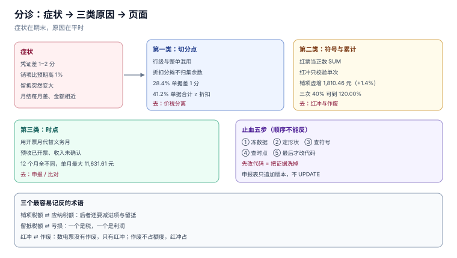

# 常见问题与分诊

税务问题的特点是「症状在期末、原因在平时」：月末对不上，往往是一张票在开票那天就错了。所以本页先给一张分诊表（从症状找页），再给十二个高频问答，最后是出事时的止血顺序。

本页判据族 `TIQ-A` ~ `TIQ-H`，共 8 条。



## 一、分诊表

| 症状 | 最可能的原因 | 去哪一页 |
| --- | --- | --- |
| 凭证差 1~2 分，借贷不平 | 折扣分摊逐行四舍五入、未归集余数 | [价税分离](../PriceTaxSplit/index.md) |
| 票面「金额 + 税额」不等于「价税合计」 | 行级与整单切分点混用 | [价税分离](../PriceTaxSplit/index.md) |
| 销项比预期高约 1% | 红票被当正数 `SUM` 进去 | [红冲与作废](../RedFlush/index.md) |
| 申报表有销项、账上没收入 | 预收已开票，收入未确认 | [比对](../Reconciliation/index.md) |
| 账上有收入、申报表没有 | 已发货未开票、未按义务时点申报 | [申报](../TaxFiling/index.md) |
| 留抵突然变大 | 集中采购、或进项重复勾选 | [进项抵扣](../InputDeduction/index.md) |
| 红冲报 `RED_OVER` | 历史上已红冲过一部分 | [红冲与作废](../RedFlush/index.md) |
| 红冲报「确认单不存在」 | 受票方已做用途确认，必须走确认单 | [红冲与作废](../RedFlush/index.md) |
| 差额征税票无法部分红冲 | 政策限制，只能全额红冲 | [税目与税率](../TaxCatalog/index.md) |
| 开票报 `QUOTA_EXCEEDED` | 月度不含税额度不足 | [开具](../InvoiceIssue/index.md) |
| 税率报 `RATE_NOT_EFFECTIVE` | 补开旧票用了新税率，或台账没分段 | [税目与税率](../TaxCatalog/index.md) |
| 税号校验不通过 | 18 位校验位错，或含 `I/O/S/V/Z` | [开具](../InvoiceIssue/index.md) |
| 混合销售被多征税 | 把兼营当混合销售，整单套高税率 | [税目与税率](../TaxCatalog/index.md) |
| 月结差异每月都在、金额相近 | 时点差异未登记，次月未验证抵消 | [比对](../Reconciliation/index.md) |

## 二、十二问

**问 1：为什么单张票都对，汇总差几分？**
因为取整发生在「行」还是「整单」是两种切法。[价税分离](../PriceTaxSplit/index.md) 实测 1,000 单里 **284 单（28.4%）**两种切法差 1 分。做法是：定一个切分点，落库声明，汇总时按同一个切。

**问 2：含税 99 元，不含税应该是多少？**
13% 时是 **87.61 + 11.39**；6% 时是 **93.40 + 5.60**。公式是 `round(99 × 100 ÷ 113)`，不要用「99 × 0.87」估。

**问 3：红票为什么不能直接减？**
能减，但必须带符号。红票在库里存正数、用 `kind='RED'` 表示方向，任何裸 `SUM` 都会把它加进去——本机因此虚增销项 **1,810.46 元（+1.4%）**。

**问 4：红冲一定要对方确认吗？**
看对方有没有做用途确认或入账确认。没做，开票方直接红冲；做了，必须走《红字发票信息确认单》，且发起后 **72 小时**未确认自动作废（公告 2024 年第 11 号）。

**问 5：为什么红冲之后销项还是没降？**
两种可能：红票开在了下一期（本期不动，下期减），或受票方尚未转出。前者正常，后者要催——受票方已抵扣的，应暂依确认单税额从当期进项税额中转出。

**问 6：额度是按含税还是不含税算？**
不含税。用含税比额度会提前 13% 撞墙。剩 500 元额度时来一张 800 元的票，应拆成 500 + 300，而不是整张拒绝。

**问 7：税率改了，历史票要重算吗？**
不要。税率台账按生效期分段，开票时按 `issue_date` 取当时的税率；重算历史票等于篡改已申报数据。

**问 8：0% 和免税有什么区别？**
0% 有进项可退（出口），免税没有（进项要转出）。系统里必须是两个枚举值，不能都存 0。

**问 9：进项票超过一年还能抵吗？**
能。自 2019 年起已取消认证确认期限（国家税务总局公告 2019 年第 45 号）。写死「360 天」的系统会把合法进项挡在门外。

**问 10：为什么申报表全年对了，月度还是被预警？**
因为跨期差异在 12 个月里互相抵消。本机 3,000 笔里 508 笔跨月，全年销项一分不差，但 **12 个月全部不同**，单月最大差 **11,631.61 元**。

**问 11：账、票、税三套数，先对哪两个？**
先票税（同一批票，容易对），再账票（有合同与凭证，能定性）。反过来做会陷入「先解释收入、再找票」的循环。

**问 12：差异台账要记到什么程度？**
记到「能加总回原差额」：形状 + 金额 + 引用号 + 责任人 + 期限 + 结论。少一项，下个月还会重来。

## 三、止血五步

出事时（例如申报被预警、或发现销项异常），顺序不能反：

1. **先冻数据**：停止红冲与重开，避免差异继续扩大；导出当期票、账、申报三份快照。
2. **再定形状**：把差异按四种形状分类（仅账无票 / 仅票无账 / 金额不等 / 时点不同），先看哪一类占金额最大。
3. **后查符号**：第一时间排除「红票直加」——它一次性就能解释 1~2% 的偏差，且最容易验证（`naive − signed = 2 × 红票税额`）。
4. **再查时点**：把跨月票列出来，验证全年是否抵消；若某笔连续三个月都在，按漏票处理。
5. **最后改代码**：只有确认是规则缺陷才动约束。先改数据再改代码，等于把证据洗掉了。

::: danger 注意
不要在止血阶段直接改历史申报表。申报表是 append-only 的：更正走新版本（`revision`），留抵起点从更正期逐期重算。直接 `UPDATE` 会让「哪一版是真的」变成一个无法回答的问题。
:::

## 四、术语表

| 术语 | 一句话 | 易混于 |
| --- | --- | --- |
| 销项税额 | 自己开票产生的税 | 应纳税额（还要减进项与留抵） |
| 进项税额 | 采购票上可抵的税 | 采购成本（不可抵的部分才是成本） |
| 留抵税额 | 进项大于销项的差额，可结转或退还 | 亏损（一个是税，一个是利润） |
| 纳税义务发生时间 | 什么时候「该交税」 | 开票日（可能提前或延后） |
| 价税合计 | 客户付的钱 | 收入（要分离） |
| 红冲 | 开负数票冲原票 | 作废（数电票没有） |
| 用途确认 | 把票划入抵扣/不抵扣/出口退税 | 入账确认（标记已记账） |
| 差额征税 | 按「全部价款 − 扣除额」计税 | 差额开票（票面结构不同） |
| 混合销售 | 一项交易、主从关系、单一税率 | 兼营（多项交易、分别核算） |
| 征收率 | 简易计税的比率（3%） | 税率（一般计税的 13/9/6） |

## 五、本页判据

| 编号 | 判据 | 为什么要它 | 怎么验证 |
| --- | --- | --- | --- |
| `TIQ-A` | 每个症状都要能映射到一个页面与一条 SQL | 否则分诊表只是目录 | 任取一行，能找到对应判据与断言 |
| `TIQ-B` | 问答里的数字必须能在正文复现 | 数字漂移会让整册失去可信度 | 抽查三个数字，与对应页一致 |
| `TIQ-C` | 止血顺序必须「先冻数据、后改代码」 | 先改代码会洗掉证据 | 流程文档中步骤顺序固定 |
| `TIQ-D` | 术语表要区分「税」与「收入/利润」 | 两者混用会导致错误决策 | 术语表每行有「易混于」列 |
| `TIQ-E` | 申报表更正走新版本，不 `UPDATE` | 历史版本必须可追溯 | `tax_return.revision` 递增 |
| `TIQ-F` | 「政策已变」的结论必须带核对日期 | 税务政策每年都在变 | 文中事实均带「YYYY-MM-DD 核对」 |
| `TIQ-G` | 不给出「一定能退/一定能抵」的绝对结论 | 取决于凭证与用途 | 结论均附带条件 |
| `TIQ-H` | 分诊表覆盖本册全部八页 | 漏页意味着有问题无处可去 | 表格中出现 8 个不同页面链接 |

## 六、验证方式

```sql
-- 用一条 SQL 自查「是不是红票直加」
SELECT (SELECT SUM(tax_cents) FROM invoice WHERE direction='OUT') AS naive,
       (SELECT SUM(CASE kind WHEN 'RED' THEN -tax_cents ELSE tax_cents END)
          FROM invoice WHERE direction='OUT')                        AS signed,
       (SELECT 2*SUM(tax_cents) FROM invoice WHERE direction='OUT' AND kind='RED') AS expect_gap;
```

预期：`naive − signed = expect_gap`。本机为 `130,589.15 − 128,778.69 = 1,810.46`。

```sql
-- 用一条 SQL 自查「跨期是否抵消」
SELECT SUM(output_cents) AS year_total,
       COUNT(DISTINCT output_cents) AS distinct_months
  FROM tax_return;
```

预期：`year_total` 与按义务月汇总相等；`distinct_months` 接近 12（每月金额不同）。

## 七、参考资料

- [国家税务总局公告 2024 年第 11 号](https://www.gov.cn/zhengce/zhengceku/202411/content_6989164.htm)：红冲流程、72 小时确认单、进项转出
- [《中华人民共和国增值税法》](https://www.chinatax.gov.cn/chinatax/n810219/n810780/c5237361/content.html)：税率、征收率、留抵与纳税义务发生时间
- [国家税务总局公告 2019 年第 45 号](https://www.chinatax.gov.cn/)：取消扣税凭证认证确认期限
- [国家税务总局 12366 热线 2026 年 9 月热点问题](https://henan.chinatax.gov.cn/2026/10-14/142593.html)：差额征税蓝票不得部分红冲
