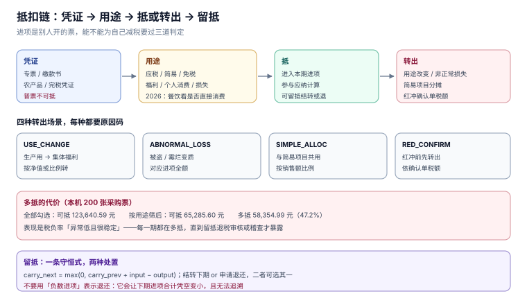

# 进项抵扣：勾选、转出与留抵

销项是自己开的，进项是别人开的——所以抵扣这件事的本质是**核对别人的票能不能为自己减税**。三件事决定了答案：凭证类型对不对、用途能不能抵、有没有在用途改变时转出。

三件事里最容易漏的是第三件。转出发生在「票已经抵了，后来用途变了」的时候，它没有新票、没有新号码、没有提醒，只在一张调整表里出现一次。

本页判据族 `TID-A` ~ `TID-H`，共 8 条。



## 一、抵扣链：环环相扣，缺一环就断

```text
应纳 = 销项 − 进项 − 上期留抵
```

这条式子的前提是「上一环已经交过税」。所以进项能不能抵，取决于上游那张票是否合法、是否用于应税项目：

| 环节 | 断掉的后果 |
| --- | --- |
| 凭证不合法（假票、抬头错、税号错） | 进项全额不可抵，已抵的要转出并可能罚款 |
| 用途不可抵（集体福利、个人消费） | 已抵的必须转出 |
| 上游享受免税（如农产品自产自销） | 你拿不到可抵的进项，税额进了成本 |
| 简易计税项目 | 该项目对应的进项一律不抵，已抵的转出 |

## 二、哪些凭证能抵

| 凭证 | 典型场景 | 备注 |
| --- | --- | --- |
| 增值税专用发票（含数电专票） | 绝大多数采购 | 需用途确认 |
| 海关进口增值税专用缴款书 | 进口货物 | 需比对/稽核 |
| 农产品收购发票或销售发票 | 向农业生产者收购 | 按买价×扣除率计算 |
| 代扣代缴增值税完税凭证 | 境外单位提供服务 | 完税凭证即扣税凭证 |
| 通行费电子发票 | 高速公路通行 | 按票面税额 |

**普通发票不能抵**（除农产品销售发票、通行费等特殊规定）。这条在系统里的落点是 `invoice.deductible_voucher` 标记，由票种推出，不由人工勾选。

## 三、用途确认与入账确认

数电票的抵扣要先在税务数字账户**确认用途**（抵扣 / 不抵扣 / 出口退税），再**入账确认**。两步的语义不同：

| 动作 | 作用 | 可逆性 |
| --- | --- | --- |
| 用途确认 | 把票划入某个用途，进入申报表 | 可申请更正，但已跨期的要调整 |
| 入账确认 | 标记这张票已记账 | 影响能否直接红冲（已确认的要走确认单） |

自 2019 年起，增值税扣税凭证**不再有认证确认期限**（国家税务总局公告 2019 年第 45 号，2026-11-07 核对）。系统里不要写「超过 360 天不可抵」这类硬编码——它是旧规则的残留，会把合法进项挡在门外。

## 四、不得抵扣：四类用途

| 用途 | 能否抵 | 依据 |
| --- | --- | --- |
| 用于简易计税项目 | 否 | 简易计税本身不产生销项抵扣链 |
| 用于免征增值税项目 | 否 | 同上 |
| 用于集体福利或个人消费 | 否 | 最终消费环节，链条终止 |
| 非正常损失（管理不善被盗、霉烂变质） | 否 | 已抵的要转出 |

2026 年有一处口径调整值得写进系统：购进**餐饮服务、居民日常服务、娱乐服务**的进项，由原来的「一律不得抵扣」改为「**购进并直接用于消费的**不得抵扣」（2026-01-01 施行的增值税法及配套公告，2026-11-07 核对）。也就是说，同样是餐饮票，用于员工食堂（集体福利）不能抵，用于生产经营（如外卖平台采购试吃用于选品）可能可以抵——判据从「服务类型」变成了「**用途**」。

::: danger 注意
不要用「发票品名含『餐饮』就不可抵」这种字符串规则。新口径下判据是用途，不是品名；写死品名会在政策调整后既多转出、又无法解释。
:::

## 五、进项转出：抵了之后又变了

转出发生在四种场景，每一种都要有**原因码**与**计算依据**：

| 场景 | 转出金额 | 原因码 |
| --- | --- | --- |
| 用途改变（生产用 → 集体福利） | 按账面净值或已抵税额比例 | `USE_CHANGE` |
| 非正常损失 | 对应进项全额 | `ABNORMAL_LOSS` |
| 简易计税项目共用 | 按销售额比例分摊 | `SIMPLE_ALLOC` |
| 红冲（销售退回） | 依确认单税额 | `RED_CONFIRM` |

第四条最容易漏：受票方已经把票抵了，销售方红冲时，受票方必须**先依确认单税额转出**，等红票到了再作凭证。系统里这一条落成 `deduction.transfer_out_cents` + `reason`，并用 `CHECK` 保证「有转出必有原因」。

```sql
CREATE TABLE deduction(
  id INTEGER PRIMARY KEY,
  invoice_id INTEGER NOT NULL UNIQUE REFERENCES invoice(id),
  period TEXT NOT NULL,
  tax_cents INTEGER NOT NULL,
  deductible INTEGER NOT NULL CHECK(deductible IN (0,1)),
  transfer_out_cents INTEGER NOT NULL DEFAULT 0,
  reason TEXT,
  CHECK(transfer_out_cents <= tax_cents),
  CHECK(transfer_out_cents = 0 OR reason IS NOT NULL)
);
```

## 六、多抵的代价：一个算例

本机 200 张采购票（其中 12 张为集体福利/个人消费用途），两种做法：

| 做法 | 可抵税额 | 差额 |
| --- | --- | --- |
| 全部勾选抵扣 | **123,640.59 元** | 多抵 **58,354.99 元（47.2%）** |
| 按用途筛后可抵 | **65,285.60 元** | — |

47.2% 不是小数误差，是**把不能抵的票全抵了**。它的表现是税负率异常低、且低得「很稳定」——因为每一期都在多抵。这类问题通常在稽查或留抵退税审核时才被发现，届时需要补税 + 滞纳金（0.05%/日）。

## 七、留抵：结转还是退还

当期进项大于销项时形成留抵。2026 年起留抵退税法定化：纳税人可以**选择结转下期继续抵扣，或申请退还**（增值税法，2026-11-07 核对）。

| 选择 | 现金流 | 账务 | 适用 |
| --- | --- | --- | --- |
| 结转 | 无现金流入，未来抵减 | 挂在「应交税费—待抵扣进项税额」 | 下期销项充足 |
| 退还 | 有现金流入，但要走审核 | 冲减留抵 | 长期留抵、扩产期 |

系统里只需要一条：`carry_next = max(0, carry_prev + input − output)`，退还时把 `carry_next` 减少并单独记一条 `refund` 记录。**不要**用「负数进项」表示退还——它会让下期的进项合计凭空变小，且无法追溯。

## 八、本页判据

| 编号 | 判据 | 为什么要它 | 怎么验证 |
| --- | --- | --- | --- |
| `TID-A` | 可抵凭证由票种推出，不由人工勾选 | 人工勾选必然出现普票抵扣 | `deductible_voucher` 由 `kind_code` 派生 |
| `TID-B` | 用途必须落库（应税/简易/免税/福利/损失） | 用途决定能否抵，且要能复算 | `deduction.purpose` 非空 |
| `TID-C` | 不得抵扣的四类用途，勾选时直接拒绝 | 抵了再转出会留下调整痕迹 | 福利类票勾选返回业务错误 |
| `TID-D` | 转出必须有原因码与金额上限 | 无原因的转出无法审计 | `transfer_out_cents ≤ tax_cents` 且 `reason` 非空（`N5`） |
| `TID-E` | 红冲前受票方先转出 | 两边不能同时减 | 红冲流程校验 `transfer_out` 已发生 |
| `TID-F` | 不得写死认证期限 | 2019 年起已取消 | 代码中无 360/180 天判断 |
| `TID-G` | 留抵只能用 `carry_next` 表达，不用负数进项 | 负数进项会污染下期合计 | 进项合计恒 ≥ 0 |
| `TID-H` | 餐饮等服务的判据是「是否直接用于消费」 | 2026 口径已从品名改为用途 | 同一品名两种用途得到不同结论 |

## 九、验证方式

```sql
-- 1) 转出必有原因（应为 0）
SELECT COUNT(*) FROM deduction WHERE transfer_out_cents > 0 AND reason IS NULL;

-- 2) 可抵税额合计（按用途）
SELECT SUM(CASE WHEN deductible = 1 THEN tax_cents - transfer_out_cents ELSE 0 END) AS deductible_total,
       SUM(CASE WHEN deductible = 0 THEN tax_cents ELSE 0 END)                     AS blocked_total
  FROM deduction;

-- 3) 留抵不为负
SELECT COUNT(*) FROM tax_return WHERE carry_next < 0;
```

预期：第 1、3 条返回 `0`；第 2 条在本机实战库给出 `5,469.86` 与 `0.00`（12 张不可抵票在入库时就直接记 `deductible=0`，没有走「先抵后转」）。

负向探针：

```sql
INSERT INTO deduction(invoice_id, period, tax_cents, deductible, transfer_out_cents, reason)
VALUES (2, '2026-01', 100, 1, 50, NULL);
-- 预期：CHECK constraint failed: transfer_out_cents = 0 OR reason IS NOT NULL
```

Python 复算留抵链（可直接跑）：

```python
out = [120_000, 90_000, 150_000]
inp = [100_000, 130_000, 80_000]
carry, rows = 0, []
for o, i in zip(out, inp):
    pay = max(0, o - i - carry)
    carry = max(0, carry + i - o)
    rows.append((pay, carry))
print(rows)     # [(20000, 0), (0, 40000), (30000, 0)]
```

预期输出：`[(20000, 0), (0, 40000), (30000, 0)]`。

## 十、参考资料

- [《中华人民共和国增值税法》](https://www.chinatax.gov.cn/chinatax/n810219/n810780/c5237361/content.html)：留抵结转或退还、进项抵扣范围（2026-01-01 施行）
- [国家税务总局：增值税抵扣链条更优化](https://www.chinatax.gov.cn/chinatax/n810219/n810780/c5248293/content.html)：餐饮等服务的抵扣口径调整
- [国家税务总局公告 2019 年第 45 号](https://www.chinatax.gov.cn/)：取消增值税扣税凭证认证确认期限
- [国家税务总局公告 2024 年第 11 号](https://www.gov.cn/zhengce/zhengceku/202411/content_6989164.htm)：用途确认、入账确认与红冲时的进项转出
