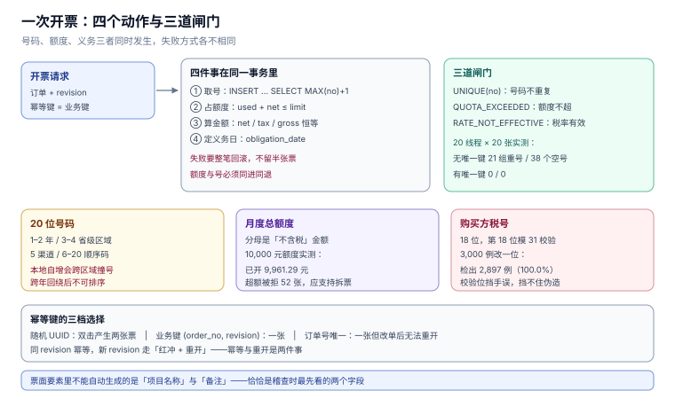

# 开具：号码、额度与要素

开票看起来是「把订单字段填进票面模板」，实际是三个不可回退的动作叠加：**占用一个号码、消耗一份额度、产生一条纳税义务**。三者都发生在同一次请求里，而三者的失败方式完全不同——号码撞了是唯一键报错，额度超了是业务拒绝，义务时点错了当时根本不报错。

本页把开票拆成「号码 / 额度 / 要素 / 幂等」四件事，并给出并发与校验的实测读数。

本页判据族 `TII-A` ~ `TII-H`，共 8 条。



## 一、票面要素：少一个就不能作废重开

数电发票的票面基本内容包括：发票名称、发票号码、开票日期、购买方信息、销售方信息、项目名称、规格型号、单位、数量、单价、金额、税率/征收率、税额、合计、价税合计、备注、开票人（国家税务总局公告 2024 年第 11 号，2026-11-07 核对）。

系统里能自动生成的是「金额 / 税率 / 税额 / 合计 / 价税合计」，**不能自动生成的是「项目名称」与「备注」**：

| 要素 | 来源 | 常见缺陷 |
| --- | --- | --- |
| 项目名称 | 税收分类编码 + 商品名 | 用内部 SKU 名（「A-1024 套装」）代替规范名称 |
| 规格型号 / 单位 | 商品主数据 | 单位写成「个」但数量是「箱」 |
| 备注 | 业务规则 | 建筑服务没写项目地址、差额征税没写扣除额 |
| 开票人 | 登录人 | 写成「管理员」，出问题找不到人 |

::: warning 说明
「不能自动生成」的字段恰恰是稽查时最先看的字段。备注栏不是自由文本，它承担着「这笔业务适用特殊政策」的举证责任（建筑服务、不动产、差额征税、代收代付）。
:::

## 二、20 位号码：别自己造

号码结构（公告 2024 年第 11 号）：

| 位置 | 1–2 | 3–4 | 5 | 6–20 |
| --- | --- | --- | --- | --- |
| 含义 | 公历年度后两位 | 开票方所在省级税务局区域代码 | 开具渠道等 | 顺序编码 |

这解释了三个「不能自己造」的理由：

1. **号段由平台按区域分配**，本地自增会在跨区域、跨渠道时撞号；
2. **年度会回绕**（`26` → `27`），用「年份 × 10^15 + 序号」拼出来的号在跨年时不可排序；
3. **号码与额度、申报期绑定**，作废后号码不回收，本地「删了重用」会造成号码空洞与重复。

## 三、并发：唯一键是唯一可信的守卫

本机用 20 线程 × 20 张跑号码分配，两种实现：

| 实现 | 写入 | 重号组 | 多占号 |
| --- | --- | --- | --- |
| `SELECT MAX(no)+1` 再 `INSERT`（无唯一键） | 400 | **21 组** | **38 个** |
| `INSERT … SELECT MAX(no)+1`（有 `UNIQUE(no)`） | 400 | **0** | **0** |

「多占 38 个」比「21 组重号」更值得注意：并发下两个线程读到同一个 `MAX`，一个成功、一个失败重试，失败的号就被跳过了。号码空洞在税务侧不是错误，但在**对账**时会被当成「有票未交付」，每次月结都要解释一遍。

正确写法（SQLite / PostgreSQL 都成立）：

```sql
-- 一条语句完成「取号 + 写入」，唯一键兜底
INSERT INTO invoice(no, kind, direction, issue_date, period, buyer_no,
                    net_cents, tax_cents, gross_cents)
SELECT printf('26%018d', COALESCE(MAX(CAST(SUBSTR(no, 3) AS INTEGER)), 0) + 1),
       'BLUE', 'OUT', :issue_date, :period, :buyer_no, :net, :tax, :gross
  FROM invoice;
```

失败重试时不要复用刚取到的号——重试要重新取号，旧号作废（这也是号码空洞的来源，属于**可接受的代价**）。

## 四、月度总额度：分母是不含税金额

额度是「一个自然月内开具总金额（**不含增值税**）的上限」。这一点最容易搞错：拿含税金额去比额度，会提前 13% 撞墙。

本机算例（额度 10,000.00 元，60 张随机票）：

| 指标 | 读数 |
| --- | --- |
| 已开（不含税） | **9,961.29 元** |
| 因超额被拒 | **52 张** |
| 恰好打满 | **0 张** |

「恰好打满 0 张」不是巧合：随机金额几乎不可能正好等于剩余额度，所以**额度检查必须是 `已用 + 本次 ≤ 额度`，而不是 `已用 < 额度`**，并且要允许「拆票」——一张 800 元的票在剩 500 元额度时，应拆成 500 + 300 两张，而不是整张拒绝。

```sql
-- 额度守卫：要么整张放行，要么整张拒绝，不允许「部分占用」
CREATE TRIGGER trg_quota_guard BEFORE INSERT ON invoice
WHEN NEW.direction = 'OUT' AND NEW.kind = 'BLUE'
BEGIN
  SELECT CASE WHEN (SELECT used_cents FROM quota WHERE period = NEW.period) + NEW.net_cents
              > (SELECT limit_cents FROM quota WHERE period = NEW.period)
  THEN RAISE(ABORT, 'QUOTA_EXCEEDED') END;
END;
```

## 五、幂等：同一个订单不能开两张票

开票请求的幂等键必须是**业务键**（订单号 + 开票请求版本），不能是客户端的随机 UUID——用户双击时生成的是两个 UUID，服务端看起来是两次不同请求。

| 方案 | 双击 | 网络重试 | 跨天重发 |
| --- | --- | --- | --- |
| 随机 `Idempotency-Key` | 两张票 | 一张（若客户端复用） | 两张 |
| 业务键 `(order_no, revision)` | 一张 | 一张 | 一张 |
| 订单号唯一索引 | 一张 | 一张 | 一张（但改单后无法重开） |

第三种最省事但最不灵活：订单改过一次（金额变了）就必须能重开，所以键要带 `revision`。这把「幂等」和「红冲重开」两件事分开了：**同 revision 幂等，新 revision 走红冲 + 重开**。

## 六、购买方税号：18 位与校验位

统一社会信用代码 18 位，第 18 位是校验位（模 31）。本机用 3,000 组合法代码各改一位，**检出率 100.0%（2,897 / 2,897，其余 103 例改成了同一个字符被跳过）**。

```python
CHARS = "0123456789ABCDEFGHJKLMNPQRTUWXY"          # 无 I O S V Z
W = [1, 3, 9, 27, 19, 26, 16, 17, 20, 29, 25, 13, 8, 24, 10, 30, 28]

def uscc_ok(s: str) -> bool:
    if len(s) != 18:
        return False
    try:
        total = sum(CHARS.index(c) * w for c, w in zip(s[:17], W))
    except ValueError:
        return False
    return CHARS[(31 - total % 31) % 31] == s[17]
```

校验位只能挡「手误」，挡不住「伪造」。所以它必须与**抬头名称一致性**一起用：税号合法但名称与工商登记不符，是更常见的开票退回原因。

## 七、交付与查验

| 动作 | 谁触发 | 系统要留什么 |
| --- | --- | --- |
| 自动交付 | 开票成功 | 交付时间、渠道、接收方 |
| 下载 / 打印 | 用户 | 次数（票面会标记「下载次数」「打印次数」） |
| 用途确认 | 受票方 | 确认时间、确认人、用途（抵扣 / 不抵扣 / 出口退税） |
| 入账确认 | 受票方 | 入账标识，红冲前必须查这个状态 |

**入账确认状态决定红冲流程**：未确认的由开票方直接红冲；已确认的必须走《红字发票信息确认单》并经对方确认。这一条在 [红冲与作废](../RedFlush/index.md) 展开。

## 八、本页判据

| 编号 | 判据 | 为什么要它 | 怎么验证 |
| --- | --- | --- | --- |
| `TII-A` | 发票号码必须 20 位且全局唯一 | 撞号会让两张票指向同一个申报口径 | `UNIQUE(no)` 存在；并发压测 400 张无重号 |
| `TII-B` | 号码不得本地自增，必须由平台号段或唯一键分配 | 跨区域/跨渠道会撞号 | 取号语句是单条 `INSERT … SELECT` |
| `TII-C` | 额度以不含税金额计，且允许拆票 | 用含税比额度会提前撞墙 | 额度检查用 `net_cents`；超额时给出可拆金额 |
| `TII-D` | 开票幂等键必须是业务键（订单 + revision） | 随机键挡不住双击 | 同一键连提两次只产生一张票 |
| `TII-E` | 红冲后重开必须用新 revision，不得复用旧键 | 复用会让幂等挡掉合法重开 | 改单后重开成功，旧票状态为 `RED_FLUSHED` |
| `TII-F` | 票面项目名称必须来自税收分类编码，不得用内部 SKU 名 | 名称不符会被退回 | 抽查 10 张票，`item_name` 可在编码表命中 |
| `TII-G` | 备注栏按业务类型强制填写（建筑/不动产/差额/代收代付） | 备注是适用特殊政策的举证 | 对应 `biz_type` 的票，`remark` 非空 |
| `TII-H` | 购买方税号必须过 18 位校验位，并与抬头名称比对 | 校验位挡手误、名称挡错配 | 改一位必被拒；名称不一致进人工复核 |

## 九、验证方式

```sql
-- 1) 号码唯一且 20 位
SELECT COUNT(*) FROM invoice WHERE LENGTH(no) <> 20;
SELECT COUNT(*) FROM (SELECT no FROM invoice GROUP BY no HAVING COUNT(*) > 1);
-- 预期：0 与 0

-- 2) 额度不超
SELECT period, used_cents, limit_cents FROM quota WHERE used_cents > limit_cents;
-- 预期：0 行

-- 3) 幂等：同一业务键只能有一张有效蓝票
SELECT order_no, COUNT(*) FROM invoice
 WHERE kind = 'BLUE' AND status = 'ISSUED'
 GROUP BY order_no HAVING COUNT(*) > 1;
-- 预期：0 行
```

并发复跑（Python，20 线程 × 20 张）：

```python
import sqlite3, threading

def worker(db, n=20):
    con = sqlite3.connect(db, timeout=30)
    for _ in range(n):
        con.execute("INSERT INTO invoice(no, kind, direction, issue_date, period, buyer_no,"
                    " net_cents, tax_cents, gross_cents)"
                    " SELECT printf('26%018d', COALESCE(MAX(CAST(SUBSTR(no,3) AS INTEGER)),0)+1),"
                    " 'BLUE','OUT','2026-11-06','2026-11','B',100,13,113 FROM invoice")
        con.commit()
    con.close()
```

预期：`SELECT COUNT(*) FROM (SELECT no FROM invoice GROUP BY no HAVING COUNT(*)>1)` 返回 `0`；本机 400 张写入耗时约 1 秒量级，无 `database is locked`（`timeout=30` + WAL）。

## 十、参考资料

- [国家税务总局公告 2024 年第 11 号](https://www.gov.cn/zhengce/zhengceku/202411/content_6989164.htm)：数电发票票面要素、20 位号码结构、总额度、交付方式
- [《中华人民共和国发票管理办法》](https://www.chinatax.gov.cn/)：发票开具与保管的基本义务
- [GB 32100-2015](https://openstd.samr.gov.cn/)：法人和其他组织统一社会信用代码编码规则（18 位与校验位）
- [RFC 9562](https://www.rfc-editor.org/rfc/rfc9562)：UUIDv7 作为请求幂等键的可排序方案
- [SQLite: UNIQUE constraints](https://www.sqlite.org/lang_createtable.html)：唯一约束与冲突处理
