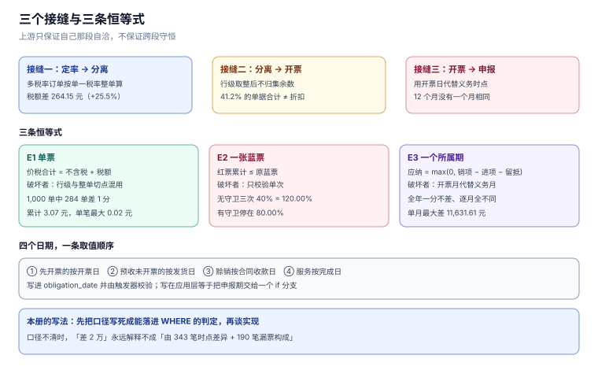

# 总览：七段链、三个「多少钱」与五个安静的失败

税务系统的复杂度不在「税率乘法」，而在**同一笔钱要同时满足三个口径、四个日期、两条恒等式**。把这三件事任意一件当成「顺手算一下」，得到的系统都能跑、都能出报表，只是每次对账时都解释不清差在哪。

本页把七段链拆开，把三个口径写成可验证的恒等式，把四个日期对应的规则列清楚，并给出五个「不报警的失败」的实测读数。后面九页都是这五条的展开。

本页判据族 `TIO-A` ~ `TIO-H`，共 8 条。



## 一、七段链与三个接缝

一条业务从定价走到缴税，要过七段。真正容易出错的不是段内，而是**段与段之间的三个接缝**：

| 接缝 | 上游给的 | 下游要的 | 典型错法 |
| --- | --- | --- | --- |
| 定率 → 分离 | 商品、数量、成交价（含税） | 不含税金额 + 税额 | 一个订单里既有 13% 也有 6%，却按一个税率整单算 |
| 分离 → 开票 | 不含税金额 + 税额 | 票面「金额 / 税率 / 税额 / 价税合计」 | 行级四舍五入后不归集余数，票面合计差 1 分 |
| 开票 → 申报 | 若干张票 | 一个所属期的销项合计 | 用开票日代替纳税义务发生日，跨月票落到错期 |

三个接缝的共同点：**上游只保证自己那段自洽，不保证跨段守恒**。所以每一段都要有一条独立的恒等式兜住，而不是指望「上一层算对了」。

::: tip 一句话理解
七段链上真正被复制的不是代码，是**取整**与**日期**——它们各自出现七次，任何一次口径不同，最后就差一个方向不明的数。
:::

## 二、三条恒等式

全册只围绕三条恒等式，每一页都在守其中一条：

| 编号 | 恒等式 | 在哪一层成立 | 谁破坏它 |
| --- | --- | --- | --- |
| **E1** | `价税合计 = 不含税 + 税额` | 单张票、单行 | 行级与整单的舍入切点不同 |
| **E2** | `红票累计 ≤ 原蓝票` | 一张蓝票的全部红冲历史 | 没有累计守卫，只校验单次 |
| **E3** | `应纳 = max(0, 销项 − 进项 − 上期留抵)` | 一个所属期 | 用开票月代替义务月、红票符号写反 |

E1 在单行上永远成立（它是 `CHECK`），但在**整单与行合计之间**会破：本机 1,000 单实测 **284 单（28.4%）**的整单不含税与行合计差 1 分，累计 **3.07 元**，单笔最大 **0.02 元**。差异不是 bug，是「先算整单还是先算行」的选择；错的是**同一张票的两处用了不同选择**。

E2 的破坏成本最高：红冲是唯一「钱已经出去还能把数改回来」的动作，没有上限就变成负数收入。三次 40% 的红冲在无守卫时累计 **120.00%**，有守卫停在 **80.00%**（第三次被拒）。

E3 的破坏最隐蔽：全年总额可以一分不差，但 12 个月没有一个月相同（本机单月最大差 **11,631.61 元**）。

## 三、四个日期与三套时点

| 日期 | 由谁产生 | 决定什么 | 写错后的表现 |
| --- | --- | --- | --- |
| 业务完成日 | 订单/履约系统 | 纳税义务是否发生 | 预收款被提前计税，或赊销被推迟 |
| 开票日 | 发票系统 | 发票所属期、额度占用、票号段 | 跨月票落到错期，月度申报两边都「有据」 |
| 收款日 | 资金系统 | 先开票情形下的义务时点 | 预收与开票顺序颠倒时口径打架 |
| 收入确认日 | 会计政策 | 利润表、账票差异 | 账票差被当成「漏票」追查 |

本册的取值顺序（写进 `tax_obligation` 表，见 [实战](../Practice/index.md)）：

1. **先开票的**，为开票当天；
2. **先收款（预收）且未开票的**，为货物发出当天；
3. **赊销的**，为合同约定收款日；未约定或不确定的，为货物发出当天；
4. **服务类**，为服务完成当天；分期确认的，按合同约定的结算日。

这四条不是「实现细节」，是 `obligation_date` 这一列的**生成规则**。把它写在应用层，等于把申报期交给某个 if 分支；写在表里并由触发器校验，才可能在月度比对时被查出来。

## 四、五个必失点

### 4.1 一个订单多个税率却整单套一个点

本机算例：含税 11,300.00 元的合同，货物 6,780.00 元（13%）、服务 4,520.00 元（6%）。

| 算法 | 税额 | 与分拆的差 |
| --- | --- | --- |
| 全额按 13% | **1,300.00 元** | +264.15 元（+25.5%） |
| 按兼营分拆 | **1,035.85 元** | — |

多出来的 264.15 元不是小数误差，是**把 6% 的业务按 13% 交了税**。这类错误在混合销售与兼营的判定上就会发生，详见 [税目与税率](../TaxCatalog/index.md)。

### 4.2 行级四舍五入后不归集余数

2,000 单折扣分摊实测：**824 单（41.2%）**逐行四舍五入的合计不等于折扣总额，最大差 **2 分**。凭证不平时的第一反应通常是「再补一张调整分录」，而正确做法是在分摊时就用**最大余数法**把余数归给金额最大的行。

### 4.3 红冲只校验单次，不校验累计

单次红冲 40% 永远合法，三次就是 120%。守卫必须写成「本次 + 历史 ≤ 原票」，并且放在数据库里——应用层的「先查再写」在并发下会被穿透（本机 20 线程实测，号码分配无唯一键时 **21 组重号 / 38 个多占号**）。

### 4.4 红票当正数直接求和

红字发票在库里通常存正数、用 `kind='RED'` 区分。任何一句 `SUM(tax_cents)` 都会把红票**加**进去而不是减掉：本机实战库销项因此虚增 **1,810.46 元（+1.4%）**，收入虚增 **20,821.10 元**。这个错误跑得通、报表能出，只有税负率会缓慢偏高。

### 4.5 按开票月申报

3,000 笔业务、其中 508 笔跨月开票：全年销项 **582,799.53 元**，两个口径一分不差；但 **12 个月全部不同**，单月最大差 **11,631.61 元**，这笔差额若迟 30 天缴纳，滞纳金 **174.47 元**（0.05%/日）。

## 五、一般计税还是简易计税

选哪种不是「哪个税少」，而是**能不能拿到进项票**：

| 维度 | 一般计税 | 简易计税（征收率 3%） |
| --- | --- | --- |
| 税率 | 13% / 9% / 6% | 3%（不区分行业） |
| 进项 | 可抵 | 不可抵，税额直接进成本 |
| 适用 | 进项充足、客户要专票抵扣 | 进项稀薄、小规模、特定应税行为 |
| 切换成本 | — | 36 个月内不得变更，且要重算合同报价 |

判断式只有一句：**可抵扣进项占销项的比例 > 1 − 3%/你的税率** 时，一般计税更省。以 13% 为例，临界点是 `1 − 3/13 ≈ 76.9%` 的进项覆盖率。

## 六、本页判据

| 编号 | 判据 | 为什么要它 | 怎么验证 |
| --- | --- | --- | --- |
| `TIO-A` | 三个金额（价税合计 / 不含税 / 税额）在库里必须是三列，不得只存两个 | 只存两个时第三个每次现算，取整点就有两个版本 | `SELECT` 表结构，三列齐全且 `CHECK` 恒等式存在 |
| `TIO-B` | 每条业务必须落一个 `obligation_date`，且由规则生成 | 申报期由它决定，不能事后补 | 抽查 10 条业务，`obligation_date` 可由四条规定复算 |
| `TIO-C` | 红冲必须以「原票 + 累计」校验，不得只校验单次 | 单次永远合法，累计才会越界 | 对同一蓝票连红三次，第三次被拒（`RED_OVER`） |
| `TIO-D` | 红票参与汇总时必须按 `kind` 取符号，不得直接 `SUM` | 直接求和会虚增销项 | 对比 `SUM(tax)` 与 `SUM(CASE kind…)`，差值应等于 `2 × 红票税额` |
| `TIO-E` | 一张票内只能有一个税率口径（要么全行明细，要么整单单税率） | 混用时票面合计对不上 | 票面 `税额` 等于按行求和，且等于按整单复算 |
| `TIO-F` | 申报口径必须按义务月，不得按开票月 | 跨月票会让 12 个月全错 | 同一批数据两种口径跑一遍，全年相等、逐月不等 |
| `TIO-G` | 混合销售与兼营必须在税目层判定，不得在开票时临时选 | 事后选税率等于事后改税负 | 每个税目有 `mixed_sale` 标记，开票时只读不选 |
| `TIO-H` | 所有金额以「分」为整数存储，禁用浮点 | 0.1 + 0.2 的误差会在红冲累计上放大 | 表结构中金额列类型为 `INTEGER`（或 `numeric`），无 `real`/`float` |

## 七、验证方式

三步，全部可在本地 `sqlite3` 上跑：

```shell
sqlite3 /tmp/tax.db < schema.sql
sqlite3 /tmp/tax.db "SELECT COUNT(*) FROM invoice WHERE gross_cents <> net_cents + tax_cents;"
```

预期：`0`。若不为 0，说明恒等式只写在应用层，没有落进约束。

```sql
-- 红票符号：两个口径的差应恰为两倍红票税额
SELECT
  (SELECT SUM(tax_cents) FROM invoice WHERE direction='OUT')                            AS naive_sum,
  (SELECT SUM(CASE kind WHEN 'RED' THEN -tax_cents ELSE tax_cents END)
     FROM invoice WHERE direction='OUT')                                                AS signed_sum,
  (SELECT 2 * SUM(tax_cents) FROM invoice WHERE direction='OUT' AND kind='RED')         AS expect_diff;
```

预期：`naive_sum − signed_sum = expect_diff`（本机实战库：`130,589.15 − 128,778.69 = 1,810.46`）。

```sql
-- 申报勾稽：应纳与留抵同时自洽
SELECT COUNT(*) FROM tax_return
 WHERE payable   <> max(0, output_cents - input_cents - carry_prev)
    OR carry_next <> max(0, carry_prev + input_cents - output_cents);
```

预期：`0`。

## 八、参考资料

- [《中华人民共和国增值税法》](https://www.chinatax.gov.cn/chinatax/n810219/n810780/c5237361/content.html)：价外税、三档税率、留抵结转或退还（2026-01-01 施行，2026-11-07 核对）
- [国家税务总局公告 2024 年第 11 号](https://www.gov.cn/zhengce/zhengceku/202411/content_6989164.htm)：数电发票的号码、额度与红冲规则
- [《中华人民共和国税收征收管理法》第三十二条](https://www.chinatax.gov.cn/)：滞纳金按日加收万分之五
- [PostgreSQL: Numeric Types](https://www.postgresql.org/docs/current/datatype-numeric.html)：金额列的精确类型选择
