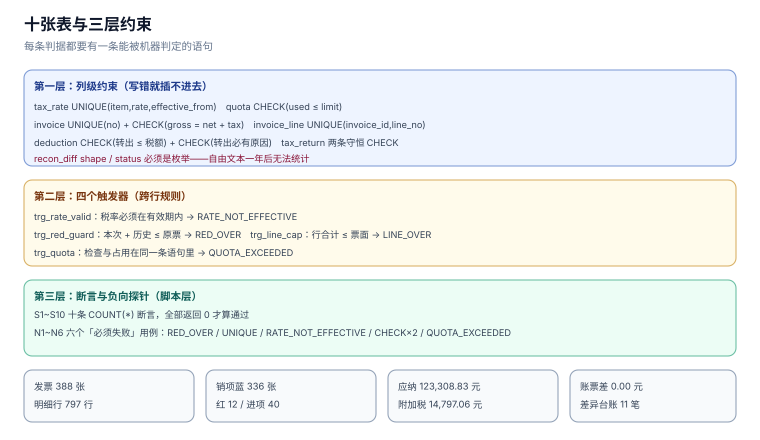

# 实战：十张表、十八条约束与十六项断言

本页把前八页的判据落成一个能跑的库。目标不是「建完十张表」，而是**让每一条判据都有一条能被机器判定的语句**：约束在库里，断言在脚本里，负向探针证明约束真的在拦。

全部内容可在本机 `sqlite3` 上复跑，不需要任何外部服务。规模：**388 张票 / 797 行 / 336 张销项蓝票 / 12 张红票 / 40 张进项票**，10 项正向断言全部 `0` 失败，6 个负向探针全部被拒。

本页判据族 `TIT-A` ~ `TIT-H`，共 8 条。



## 一、十张表的分工

| 表 | 回答什么 | 关键约束 |
| --- | --- | --- |
| `tax_rate` | 这个税目这个日期几个点 | `UNIQUE(item, rate, effective_from)` |
| `quota` | 这个月还能开多少（不含税） | `CHECK(used_cents <= limit_cents)` |
| `invoice` | 一张票的票面 | `UNIQUE(no)`、`CHECK(gross = net + tax)` |
| `invoice_line` | 票面明细 | `UNIQUE(invoice_id, line_no)`、行恒等式 |
| `red_confirm` | 红冲确认单状态与时限 | 状态枚举四态 |
| `deduction` | 进项能不能抵、转出多少 | 转出必有原因 |
| `tax_return` | 一期申报 | 应纳与留抵的守恒式 |
| `ledger` | 账上收入 | 与票比对的另一方 |
| `recon_diff` | 差异台账 | 形状枚举 + 责任人 + 期限 |
| `tax_obligation` | 纳税义务发生日 | 一票一条，规则可追溯 |

## 二、建表（可直接执行）

```sql
PRAGMA foreign_keys = ON;

CREATE TABLE tax_rate(
  id INTEGER PRIMARY KEY,
  item TEXT NOT NULL,
  rate INTEGER NOT NULL,
  method TEXT NOT NULL,
  effective_from TEXT NOT NULL,
  effective_to TEXT,
  UNIQUE(item, rate, effective_from)
);

CREATE TABLE quota(
  period TEXT PRIMARY KEY,
  limit_cents INTEGER NOT NULL,
  used_cents INTEGER NOT NULL DEFAULT 0,
  CHECK(used_cents <= limit_cents)
);

CREATE TABLE invoice(
  id INTEGER PRIMARY KEY,
  no TEXT NOT NULL UNIQUE,
  kind TEXT NOT NULL CHECK(kind IN ('BLUE','RED')),
  direction TEXT NOT NULL CHECK(direction IN ('OUT','IN')),
  orig_id INTEGER REFERENCES invoice(id),
  issue_date TEXT NOT NULL,
  period TEXT NOT NULL,
  buyer_no TEXT NOT NULL,
  net_cents INTEGER NOT NULL,
  tax_cents INTEGER NOT NULL,
  gross_cents INTEGER NOT NULL,
  status TEXT NOT NULL DEFAULT 'ISSUED',
  partial_red_allowed INTEGER NOT NULL DEFAULT 1,
  CHECK(gross_cents = net_cents + tax_cents)
);

CREATE TABLE invoice_line(
  id INTEGER PRIMARY KEY,
  invoice_id INTEGER NOT NULL REFERENCES invoice(id),
  line_no INTEGER NOT NULL,
  qty INTEGER NOT NULL,
  rate INTEGER NOT NULL,
  net_cents INTEGER NOT NULL,
  tax_cents INTEGER NOT NULL,
  gross_cents INTEGER NOT NULL,
  UNIQUE(invoice_id, line_no),
  CHECK(gross_cents = net_cents + tax_cents)
);

CREATE TABLE red_confirm(
  id INTEGER PRIMARY KEY,
  orig_id INTEGER NOT NULL REFERENCES invoice(id),
  state TEXT NOT NULL CHECK(state IN ('NONE','PENDING','CONFIRMED','EXPIRED')),
  deadline TEXT
);

CREATE TABLE deduction(
  id INTEGER PRIMARY KEY,
  invoice_id INTEGER NOT NULL UNIQUE REFERENCES invoice(id),
  period TEXT NOT NULL,
  tax_cents INTEGER NOT NULL,
  deductible INTEGER NOT NULL CHECK(deductible IN (0,1)),
  transfer_out_cents INTEGER NOT NULL DEFAULT 0,
  reason TEXT,
  CHECK(transfer_out_cents <= tax_cents),
  CHECK(transfer_out_cents = 0 OR reason IS NOT NULL)
);

CREATE TABLE tax_return(
  period TEXT PRIMARY KEY,
  revision INTEGER NOT NULL DEFAULT 1,
  output_cents INTEGER NOT NULL,
  input_cents INTEGER NOT NULL,
  carry_prev INTEGER NOT NULL,
  payable INTEGER NOT NULL,
  carry_next INTEGER NOT NULL,
  CHECK(payable = max(0, output_cents - input_cents - carry_prev)),
  CHECK(carry_next = max(0, carry_prev + input_cents - output_cents))
);

CREATE TABLE ledger(
  period TEXT PRIMARY KEY,
  revenue_cents INTEGER NOT NULL,
  tax_cents INTEGER NOT NULL
);

CREATE TABLE recon_diff(
  id INTEGER PRIMARY KEY,
  period TEXT NOT NULL,
  shape TEXT NOT NULL CHECK(shape IN ('ACCT_ONLY','INV_ONLY','AMOUNT','TIMING')),
  amount_cents INTEGER NOT NULL,
  ref_no TEXT,
  owner TEXT NOT NULL,
  due_date TEXT NOT NULL,
  status TEXT NOT NULL DEFAULT 'OPEN'
         CHECK(status IN ('OPEN','EXPLAINED','ADJUSTED','CLOSED')),
  note TEXT
);

CREATE TABLE tax_obligation(
  id INTEGER PRIMARY KEY,
  invoice_id INTEGER NOT NULL UNIQUE REFERENCES invoice(id),
  obligation_date TEXT NOT NULL,
  rule TEXT NOT NULL
);
```

## 三、四个触发器（判据变成硬约束的地方）

```sql
-- 1) 税率必须落在有效期内
CREATE TRIGGER trg_rate_valid BEFORE INSERT ON invoice_line
BEGIN
  SELECT CASE WHEN NOT EXISTS(
    SELECT 1 FROM tax_rate r JOIN invoice i ON i.id = NEW.invoice_id
     WHERE r.rate = NEW.rate AND i.issue_date >= r.effective_from
       AND (r.effective_to IS NULL OR i.issue_date <= r.effective_to))
  THEN RAISE(ABORT, 'RATE_NOT_EFFECTIVE') END;
END;

-- 2) 红冲累计不得超过原票
CREATE TRIGGER trg_red_guard BEFORE INSERT ON invoice WHEN NEW.kind = 'RED'
BEGIN
  SELECT CASE WHEN NEW.gross_cents + COALESCE(
      (SELECT SUM(gross_cents) FROM invoice WHERE orig_id = NEW.orig_id), 0)
    > COALESCE((SELECT gross_cents FROM invoice WHERE id = NEW.orig_id), 0)
  THEN RAISE(ABORT, 'RED_OVER') END;
END;

-- 3) 行合计不得超过票面
CREATE TRIGGER trg_line_cap AFTER INSERT ON invoice_line
BEGIN
  SELECT CASE WHEN (SELECT SUM(gross_cents) FROM invoice_line
                     WHERE invoice_id = NEW.invoice_id)
    > (SELECT gross_cents FROM invoice WHERE id = NEW.invoice_id)
  THEN RAISE(ABORT, 'LINE_OVER') END;
END;

-- 4) 额度守卫：占额度与拒票在同一条语句里
CREATE TRIGGER trg_quota BEFORE INSERT ON invoice
WHEN NEW.direction = 'OUT' AND NEW.kind = 'BLUE'
BEGIN
  SELECT CASE WHEN (SELECT used_cents FROM quota WHERE period = NEW.period)
                 + NEW.net_cents
    > (SELECT limit_cents FROM quota WHERE period = NEW.period)
  THEN RAISE(ABORT, 'QUOTA_EXCEEDED') END;
  UPDATE quota SET used_cents = used_cents + NEW.net_cents WHERE period = NEW.period;
END;
```

第 4 个触发器同时做了「检查」与「占用」两件事，这是刻意的：分成两条语句（先查再更新）时，中间的时间窗足够另一个请求插进来，额度会被超占——与 [开具](../InvoiceIssue/index.md) 的号码分配是同一个失效模式。

## 四、种子数据（最小可跑）

按「台账 → 额度 → 票 → 行 → 抵扣 → 申报」的顺序插：

```sql
INSERT INTO tax_rate(item, rate, method, effective_from)
VALUES ('货物', 13, 'GENERAL', '2026-01-01'),
       ('现代服务', 6, 'GENERAL', '2026-01-01'),
       ('小规模', 3, 'SIMPLE', '2026-01-01');

INSERT INTO quota(period, limit_cents, used_cents) VALUES ('2026-01', 20000000, 0);

-- 一张 1,130.00 元的销项票（1,000.00 + 130.00）
INSERT INTO invoice(id, no, kind, direction, issue_date, period, buyer_no,
                    net_cents, tax_cents, gross_cents)
VALUES (1, '26000000000000000001', 'BLUE', 'OUT', '2026-01-15', '2026-01',
        '91350100MA2Y0001X', 100000, 13000, 113000);

INSERT INTO invoice_line(invoice_id, line_no, qty, rate, net_cents, tax_cents, gross_cents)
VALUES (1, 1, 1, 13, 100000, 13000, 113000);

-- 一张进项票 + 抵扣登记
INSERT INTO invoice(id, no, kind, direction, issue_date, period, buyer_no,
                    net_cents, tax_cents, gross_cents)
VALUES (2, '26000000000000000002', 'BLUE', 'IN', '2026-01-10', '2026-01',
        '91350100MA2Y0002Y', 10000, 1300, 11300);

INSERT INTO deduction(invoice_id, period, tax_cents, deductible, transfer_out_cents, reason)
VALUES (2, '2026-01', 1300, 1, 0, NULL);

-- 申报一行：销项 13,000 − 进项 1,300 − 留抵 0
INSERT INTO tax_return(period, output_cents, input_cents, carry_prev, payable, carry_next)
VALUES ('2026-01', 13000, 1300, 0, 11700, 0);

INSERT INTO ledger(period, revenue_cents, tax_cents) VALUES ('2026-01', 100000, 13000);
INSERT INTO tax_obligation(invoice_id, obligation_date, rule) VALUES (1, '2026-01-15', 'SHIP');
```

## 五、十项正向断言

每一项都是一条 `SELECT`，返回 `0` 才算通过：

```sql
-- S1 票面恒等式
SELECT COUNT(*) FROM invoice WHERE gross_cents <> net_cents + tax_cents;
-- S2 行恒等式
SELECT COUNT(*) FROM invoice_line WHERE gross_cents <> net_cents + tax_cents;
-- S3 行合计 = 票面
SELECT COUNT(*) FROM invoice i
 WHERE i.gross_cents <> (SELECT SUM(gross_cents) FROM invoice_line l WHERE l.invoice_id = i.id);
-- S4 红冲累计 ≤ 原票
SELECT COUNT(*) FROM (
  SELECT orig_id, SUM(gross_cents) s FROM invoice WHERE kind='RED' GROUP BY orig_id
) r JOIN invoice b ON b.id = r.orig_id WHERE r.s > b.gross_cents;
-- S5 号码唯一
SELECT COUNT(*) FROM (SELECT no FROM invoice GROUP BY no HAVING COUNT(*) > 1);
-- S6 申报勾稽
SELECT COUNT(*) FROM tax_return
 WHERE payable   <> max(0, output_cents - input_cents - carry_prev)
    OR carry_next <> max(0, carry_prev + input_cents - output_cents);
-- S7 应纳与留抵不同时为正
SELECT COUNT(*) FROM tax_return WHERE payable > 0 AND carry_next > 0;
-- S8 转出必有原因
SELECT COUNT(*) FROM deduction WHERE transfer_out_cents > 0
   AND (reason IS NULL OR reason = '');
-- S9 额度不超
SELECT COUNT(*) FROM quota WHERE used_cents > limit_cents;
-- S10 税率在台账有效期内
SELECT COUNT(*) FROM invoice_line l JOIN invoice i ON i.id = l.invoice_id
 WHERE NOT EXISTS (SELECT 1 FROM tax_rate r WHERE r.rate = l.rate
                     AND i.issue_date >= r.effective_from
                     AND (r.effective_to IS NULL OR i.issue_date <= r.effective_to));
```

本机读数：**S1~S10 全部为 0**。

## 六、六个负向探针

正向断言全绿可能只是因为「数据根本没写进去」，所以每个关键约束都要有一条「必须失败」的用例：

| 探针 | 动作 | 期望 | 本机实际 |
| --- | --- | --- | --- |
| `N1` | 已红冲 30% 的票再红 100% | 拒绝 | `RED_OVER` |
| `N2` | 用已存在的号码插一张票 | 拒绝 | `UNIQUE constraint failed: invoice.no` |
| `N3` | 用 5% 税率开 2026 年的票 | 拒绝 | `RATE_NOT_EFFECTIVE` |
| `N4` | 票面金额 100 + 税额 13 = 合计 114 | 拒绝 | `CHECK constraint failed: gross_cents = net_cents + tax_cents` |
| `N5` | 转出 50 分但不填原因 | 拒绝 | `CHECK constraint failed: transfer_out_cents = 0 OR reason IS NOT NULL` |
| `N6` | 一张票占满当月额度 | 拒绝 | `QUOTA_EXCEEDED` |

`N6` 的写法值得单独看：它考的不是「金额大小」，而是「额度占用是否在拒绝之前发生」。如果触发器先 `UPDATE` 再判断，被拒的票会留下已占额度——额度只会越用越少，且无法解释。

## 七、本机读数

| 指标 | 读数 |
| --- | --- |
| 发票 / 明细行 | **388 / 797** |
| 销项蓝票税额 | **129,683.92 元** |
| 红票税额 / 净额 | **905.23 / 10,410.55 元** |
| 正确销项（蓝 − 红） | **128,778.69 元** |
| 裸 `SUM` 销项（错） | **130,589.15 元**，虚增 **1,810.46 元（+1.4%）** |
| 蓝票净额 / 裸 `SUM` 净额 | **1,415,872.00 / 1,426,282.55 元**，差 **20,821.10 元** |
| 可抵进项 | **5,469.86 元**（12 张不可抵票在入库即标 `deductible=0`） |
| 全年应纳 / 附加税 12% | **123,308.83 / 14,797.06 元** |
| 期末留抵 | **0.00 元** |
| 账簿收入 / 账票差 | **1,405,461.45 元 / 0.00 元**（带符号口径） |
| 差异台账 | **11 笔 / 234,051.07 元**（全部为 `TIMING`） |

两个数字要连起来读：账票差 `0.00` 与差异台账 `234,051.07` 并不矛盾——后者是**逐月**的时点差，12 个月里互相抵消。这正是 [比对](../Reconciliation/index.md) 强调「不要只看年度合计」的原因。

## 八、PostgreSQL 迁移：改三处

| SQLite | PostgreSQL | 原因 |
| --- | --- | --- |
| `id INTEGER PRIMARY KEY` | `id bigint GENERATED ALWAYS AS IDENTITY PRIMARY KEY` | 自增语义 |
| `CHECK(kind IN ('BLUE','RED'))` | 同写法，或建 `CREATE TYPE` | 枚举更严格 |
| `RAISE(ABORT, 'X')` | `RAISE EXCEPTION 'X'` | 触发器语法 |
| `max(0, a, b)` | `greatest(0, a, b)` | 标量函数名 |
| `printf('26%018d', x)` | `to_char(x, 'FM000000000000000000')` | 号码拼接 |

另外两处要注意：PostgreSQL 的 `CHECK` 里允许 `max()`（它是聚合也是标量函数），但写成 `greatest()` 更清晰；行合计校验在 PG 里可以用 `CONSTRAINT TRIGGER ... DEFERRABLE INITIALLY DEFERRED`，做到「事务结束时校验」而不是「插入时校验」——这对多行票更友好。

## 九、本页判据

| 编号 | 判据 | 为什么要它 | 怎么验证 |
| --- | --- | --- | --- |
| `TIT-A` | 每条判据都要有一条 `SELECT COUNT(*)` 断言 | 没有断言的判据只是建议 | 十项断言可一次跑完 |
| `TIT-B` | 每个关键约束都要有负向探针 | 正向全绿可能是没写数据 | 六个探针全部报错 |
| `TIT-C` | 额度占用与拒票在同一语句/触发器内 | 分离会产生「拒了还占」 | 被拒后 `used_cents` 不变 |
| `TIT-D` | 金额一律整数分 | 浮点在累计上放大 | 无 `real`/`double` 列 |
| `TIT-E` | 红冲、税率、行合计三条守卫在库里 | 应用层会被并发穿透 | 直接 `INSERT` 也被拒 |
| `TIT-F` | 申报表 append-only（`revision`） | 更正不能改历史 | 无 `UPDATE tax_return` |
| `TIT-G` | 差异台账形状为枚举且必有责任人 | 否则无法闭环统计 | `shape`/`owner` 非空 |
| `TIT-H` | 迁移到 PG 的差异要逐条列出 | 三处语法差异会导致「本地过、线上炸」 | 对照表五条可逐条验 |

## 十、验证方式

```shell
# 1) 建库并导入
sqlite3 /tmp/tax.db < schema.sql
sqlite3 /tmp/tax.db < seed.sql

# 2) 十项断言（应全部输出 0）
sqlite3 /tmp/tax.db "SELECT COUNT(*) FROM invoice WHERE gross_cents <> net_cents + tax_cents;"
sqlite3 /tmp/tax.db "SELECT COUNT(*) FROM tax_return WHERE payable <> max(0, output_cents - input_cents - carry_prev);"

# 3) 负向探针（应报错）
sqlite3 /tmp/tax.db "INSERT INTO invoice(no,kind,direction,issue_date,period,buyer_no,net_cents,tax_cents,gross_cents) VALUES('26000000000000000001','BLUE','OUT','2026-01-15','2026-01','B',100,13,113);"
```

预期：第 2 步输出两行 `0`；第 3 步输出 `Runtime error: UNIQUE constraint failed: invoice.no`。

```sql
-- 4) 红票符号差
SELECT (SELECT SUM(tax_cents) FROM invoice WHERE direction='OUT')
     - (SELECT SUM(CASE kind WHEN 'RED' THEN -tax_cents ELSE tax_cents END)
          FROM invoice WHERE direction='OUT') AS diff;
-- 预期：181046（即 1,810.46 元，两倍红票税额）
```

## 十一、参考资料

- [SQLite: CREATE TRIGGER](https://www.sqlite.org/lang_createtrigger.html)：`BEFORE`/`AFTER`、`WHEN`、`RAISE(ABORT)`
- [SQLite: Foreign Keys](https://www.sqlite.org/foreignkeys.html)：`PRAGMA foreign_keys` 必须显式开启
- [PostgreSQL: CREATE TRIGGER](https://www.postgresql.org/docs/current/sql-createtrigger.html)：约束触发器与延迟校验
- [《中华人民共和国增值税法》](https://www.chinatax.gov.cn/chinatax/n810219/n810780/c5237361/content.html)：应纳与留抵的法定口径
- [国家税务总局公告 2024 年第 11 号](https://www.gov.cn/zhengce/zhengceku/202411/content_6989164.htm)：号码、额度与红冲规则
