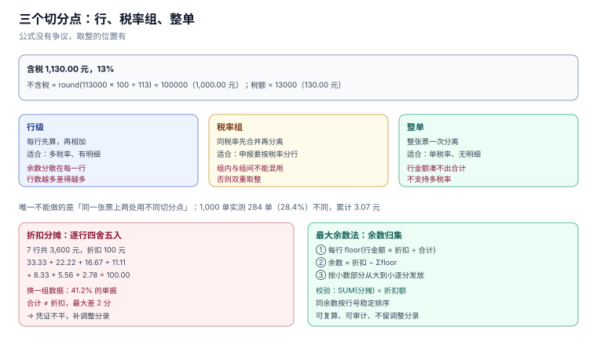

# 价税分离：切分点比公式重要

`不含税 = 含税 ÷ (1 + 税率)` 这行公式没有争议，争议全在**在哪里取整**。同一张票，行级取整与整单取整可以差 1 分；一张有折扣的票，逐行分摊折扣可以比折扣额少 2 分；一个三位小数的单价，乘数量之后可以对不上票面金额。

这些差都在「分」的量级，所以没人报警；但它们会在三个地方变成真问题：凭证不平、红冲累计超额、按税率汇总时对不上申报表。

本页判据族 `TIP-A` ~ `TIP-H`，共 8 条。



## 一、恒等式与三个切分点

一条金额可以切三次，每次切在不同位置，结果就不同：

| 切分点 | 做法 | 适用 | 风险 |
| --- | --- | --- | --- |
| **行级** | 每行先算不含税，再相加 | 票面有明细行、行税率可能不同 | 行数越多，余数越分散 |
| **税率组** | 同税率行先合并，再分离 | 多税率订单、需要按税率汇总 | 组内行级与组间整单混用会双重取整 |
| **整单** | 整张票一次分离 | 单税率、无明细 | 无法支持多税率，且行金额凑不出合计 |

**唯一不能做的是「同一张票上两处用不同切分点」**。本机 1,000 单实测：行级与整单的整单不含税有 **284 单（28.4%）**不同，累计差 **3.07 元**，单笔最大 **0.02 元**。差异本身是数学必然，不是 bug；bug 是票面「金额」按一种切法、汇总表按另一种切法。

::: tip 一句话理解
价税分离的正确答案不是一个数，是**一对数加一条声明**：这一对数是按哪个切分点算出来的。
:::

## 二、先算税还是先算不含税

两种写法：

```text
写法 A：不含税 = round(含税 × 100 ÷ (100 + 税率))，税额 = 含税 − 不含税
写法 B：税额 = round(含税 × 税率 ÷ (100 + 税率))，不含税 = 含税 − 税额
```

看起来会差 1 分，实际不会。本机对 4 档税率 × 30 万个金额（1 分 ~ 3,000.00 元）穷举 **120 万个组合**，两种写法的结果**完全一致，0 个不同**。

原因是两者互为补数：`round(x) + round(1−x) = 1` 在半数舍入下恒成立。**所以「先算税还是先算不含税」不是需要讨论的问题**——真正需要定的是切分点，以及舍入方式（四舍五入 / 银行家舍入）。

::: danger 注意
不要为了「让税额更准」而在同一张票上混用两种写法：一行按 A、一行按 B，虽然单行都自洽，但行合计与整单必然对不上，且差额方向不定。
:::

## 三、含税定价：从 99 元倒推

零售定价几乎都是含税价（99.00 元、199.00 元），财务要的是不含税收入。倒推表（四舍五入到分）：

| 含税价 | 税率 | 不含税 | 税额 | 校验 |
| --- | --- | --- | --- | --- |
| 99.00 | 13% | **87.61** | **11.39** | 87.61 + 11.39 = 99.00 |
| 199.00 | 13% | **176.11** | **22.89** | 176.11 + 22.89 = 199.00 |
| 1,000.00 | 13% | **884.96** | **115.04** | 884.96 + 115.04 = 1,000.00 |
| 1,060.00 | 6% | **1,000.00** | **60.00** | 正好整除 |
| 10,300.00 | 3% | **10,000.00** | **300.00** | 简易计税，基数含税 |

读法：**含税价越「整」，不含税越不整**。所以定价系统里不要试图让两个数都整——那是两个约束、一个自由度。如果业务坚持「不含税 100 元、含税 113 元」，就把含税价当派生值，别反过来倒推。

## 四、折扣分摊：余数必须归集

一张 7 行的票，折扣 100.00 元，按行金额比例分摊。逐行四舍五入的做法：

```text
行金额： 1,200  800  600  400  300  200  100   合计 3,600
比例：   1/3   2/9  1/6  1/9  1/12 1/18 1/36
分摊：   33.33 22.22 16.67 11.11 8.33 5.56 2.78  → 合计 100.00 ✓
```

换一组数据就崩：2,000 单随机算例里 **824 单（41.2%）**逐行四舍五入的合计不等于折扣额，最大差 **2 分**。差 2 分意味着凭证借贷不平，而会计的处理往往是「再补一张 0.02 元的调整分录」——补完之后，折扣分摊的历史就再也复算不出来了。

**正确做法：最大余数法**

1. 每行先取 `floor(行金额 × 折扣 ÷ 合计)`，得到分为单位的整数；
2. 计算 `余数 = 折扣 − Σfloor`；
3. 按小数部分从大到小，把余数逐分发给前 `余数` 行（同余数时按行号稳定排序）。

```sql
-- 余数归集后必须成立：分摊合计 = 折扣额
SELECT invoice_id, SUM(discount_cents) AS allocated, MAX(discount_total) AS target
  FROM invoice_line
 GROUP BY invoice_id
HAVING SUM(discount_cents) <> MAX(discount_total);
```

预期：`0 行`。

## 五、单价三位小数与「金额优先」

商品单价常保留 3~4 位小数（如 3.333 元/件），票面金额只到分。三个数（单价、数量、金额）里**只能有两个是自由变量**：

| 场景 | 自由变量 | 派生 | 说明 |
| --- | --- | --- | --- |
| 零售 | 单价（含税）、数量 | 金额 | 金额 = round(单价 × 数量) |
| 批发 | 金额、数量 | 单价 | 单价 = 金额 ÷ 数量（可多位小数） |
| 开票 | 金额、税额 | 价税合计 | 票面以金额为准，单价反算 |

错法是三个都存、三个都取整：`3.333 × 3 = 9.999`，票面写 `10.00`，单价栏写 `3.33`，于是 `3.33 × 3 = 9.99 ≠ 10.00`，查验时被判「票面不符」。

**纪律：金额是主，单价是从。** 存 `qty`、`unit_price_milli`（千分之一元，整数）、`gross_cents`，并在写入时校验 `|unit_price_milli × qty − gross_cents × 1000| ≤ qty`（允许每件 1 厘的舍入）。

## 六、存储：只用整数分

| 类型 | 0.1 + 0.2 | 100 万次累加误差 | 适用 |
| --- | --- | --- | --- |
| `float` / `double` | `0.30000000000000004` | 可达数元 | 禁用 |
| `numeric(18,2)` | `0.30` | 0 | PostgreSQL / MySQL |
| `INTEGER`（分） | `30` | 0 | SQLite、所有库通用 |

本册统一用**整数分**：`net_cents`、`tax_cents`、`gross_cents`。理由不是精度（`numeric` 也够），而是**整数让「恒等式」变成可以直接写的 `CHECK`**，而 `numeric` 的比较在不同驱动上仍有隐式转换的坑。

展示层再除 100，格式化时用 `Intl.NumberFormat` 或 `toFixed(2)`，不要在存储层做「元」的除法。

## 七、本页判据

| 编号 | 判据 | 为什么要它 | 怎么验证 |
| --- | --- | --- | --- |
| `TIP-A` | `价税合计 = 不含税 + 税额` 必须是数据库约束 | 应用层校验会被绕过 | 插入不等的一张票被拒（`N4`） |
| `TIP-B` | 同一张票只能声明一个切分点，并落库 | 两处混用必然对不上 | 票头有 `split_mode`，行与整单复算一致 |
| `TIP-C` | 折扣分摊必须归集余数 | 逐行四舍五入 41.2% 的票不平 | `SUM(discount) = discount_total` |
| `TIP-D` | 金额是自由变量，单价是派生值 | 三个都取整会票面不符 | `unit_price × qty` 与金额的差 ≤ 每件 1 厘 |
| `TIP-E` | 金额列只用整数分或 `numeric`，禁用浮点 | 浮点误差会在累计上放大 | 表结构无 `real`/`double` |
| `TIP-F` | 舍入方式全库统一（四舍五入或银行家舍入二选一） | 两种混用差 1 分且方向不定 | 全库只有一个 `round_money()` 实现 |
| `TIP-G` | 含税价是不含税的派生值，不倒推定价 | 倒推会让两个数都不整 | 定价表只存一个价，另一个由公式算 |
| `TIP-H` | 多税率票必须按税率分组汇总，且组和 = 整单 | 申报要按税率分行 | 按 `rate` 分组求和等于票面税额 |

## 八、验证方式

```sql
-- 1) 恒等式（应返回 0）
SELECT COUNT(*) FROM invoice WHERE gross_cents <> net_cents + tax_cents;

-- 2) 行合计 = 票面（应返回 0 张）
SELECT COUNT(*) FROM invoice i
 WHERE i.gross_cents <> (SELECT SUM(gross_cents) FROM invoice_line l WHERE l.invoice_id = i.id);

-- 3) 按税率分组求和 = 票面税额（应返回 0 行）
SELECT i.id, i.tax_cents,
       (SELECT SUM(tax_cents) FROM invoice_line l WHERE l.invoice_id = i.id) AS by_rate
  FROM invoice i
 WHERE i.tax_cents <> (SELECT SUM(tax_cents) FROM invoice_line l WHERE l.invoice_id = i.id);
```

Python 侧复算一张票（可直接跑）：

```python
from decimal import Decimal, ROUND_HALF_UP

def rh(x):  # 分为单位，四舍五入
    return int(Decimal(x).quantize(Decimal("1"), rounding=ROUND_HALF_UP))

def net_from_gross(gross_cents: int, rate: int) -> int:
    return rh(Decimal(gross_cents) * 100 / (100 + rate))

g, r = 113000, 13          # 1,130.00 元含税，13%
net = net_from_gross(g, r)
print(net, g - net)        # 100000 13000 → 1,000.00 + 130.00
```

预期输出：`100000 13000`。

## 九、参考资料

- [《中华人民共和国增值税法》](https://www.chinatax.gov.cn/chinatax/n810219/n810780/c5237361/content.html)：价外税与「交易凭证上单独列明税额」的法定要求
- [国家税务总局公告 2024 年第 11 号](https://www.gov.cn/zhengce/zhengceku/202411/content_6989164.htm)：票面「金额 / 税率 / 税额 / 价税合计」四栏的定义
- [Python: decimal — ROUND_HALF_UP](https://docs.python.org/3/library/decimal.html)：金额舍入的实现
- [PostgreSQL: Numeric Types](https://www.postgresql.org/docs/current/datatype-numeric.html)：`numeric` 的精度与舍入行为
