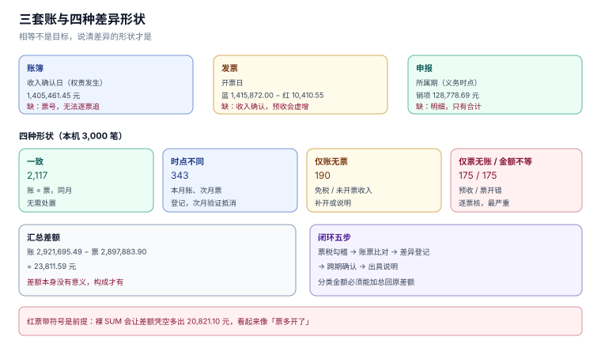

# 比对：账、票、税三套数

月末对税时，财务手上永远有三套数：**账上的收入**、**开出去的票**、**申报表上的销售额**。三套数各自都能自证——账有凭证、票有号码、申报表有回执——但它们很少相等。

相等不是目标，**说清差异的形状**才是目标。因为差异有四种完全不同的成因，处置方式也完全不同：有的是漏票，有的是时序，有的是金额错，有的是根本不该出现在这一期。

本页判据族 `TIX-A` ~ `TIX-H`，共 8 条。



## 一、三套账，三个时点

| 账 | 由什么驱动 | 时点 | 缺什么 |
| --- | --- | --- | --- |
| **账簿** | 会计凭证 | 收入确认日（权责发生） | 不含票号，无法逐票追 |
| **发票** | 开票动作 | 开票日 | 不含收入确认，预收开票会「凭空多收入」 |
| **申报** | 申报表 | 所属期 | 只有合计，没有明细 |

三者的关系可以用一条式子概括：

```text
申报销售额 ≈ 账簿不含税收入 + 已开票未确认收入 − 已确认未开票收入 + 调整项
```

`≈` 而不是 `=`，因为还有视同销售、差额征税扣除、免税项目等调整项。系统要做的不是消灭差异，而是**把差异拆到这四项里**。

## 二、四种差异形状

本机 3,000 笔业务的分类结果（固定种子，可复跑）：

| 形状 | 定义 | 笔数 | 处置 |
| --- | --- | --- | --- |
| 一致 | 账 = 票，同月 | **2,117** | 无需处置 |
| **时点不同** | 账在本月、票在次月（或反之） | **343** | 不调账，登记跨期台账，次月自动闭环 |
| **仅账无票** | 有收入、无票 | **190** | 确认是否应开票（免税/未开票收入），补开或说明 |
| **仅票无账** | 有票、无收入 | **175** | 预收、代开、或票开错，逐票核 |
| **金额不等** | 两边都有，金额不同 | **175** | 最严重，逐笔查合同与折扣 |

汇总层面：账 **2,921,695.49 元**、票 **2,897,883.90 元**、差 **23,811.59 元**。这个差额本身没有意义——有意义的是它由 343 + 190 + 175 笔构成，且其中「时点不同」的部分在下月会自动抵消。

::: tip 一句话理解
月结时不该问「为什么差 2 万」，该问「这 2 万由几笔、哪几种形状构成」。
:::

## 三、五种形状的识别 SQL

```sql
-- 仅账无票：本月有收入，本月及以前无对应票
SELECT l.period, SUM(l.revenue_cents) AS amount
  FROM ledger l
 WHERE NOT EXISTS (SELECT 1 FROM invoice i
                    WHERE i.direction='OUT' AND i.period = l.period)
 GROUP BY l.period;

-- 仅票无账
SELECT i.period, SUM(i.net_cents) AS amount
  FROM invoice i
 WHERE i.direction='OUT' AND i.kind='BLUE'
   AND NOT EXISTS (SELECT 1 FROM ledger l WHERE l.period = i.period)
 GROUP BY i.period;

-- 金额不等（按月比对）
SELECT l.period, l.revenue_cents,
       (SELECT SUM(CASE kind WHEN 'RED' THEN -net_cents ELSE net_cents END)
          FROM invoice WHERE direction='OUT' AND period = l.period) AS invoice_net,
       l.revenue_cents - (SELECT SUM(CASE kind WHEN 'RED' THEN -net_cents ELSE net_cents END)
          FROM invoice WHERE direction='OUT' AND period = l.period) AS diff
  FROM ledger l
 WHERE diff <> 0;
```

第三条里的 `CASE kind` 不是可选项：红票存正数，裸 `SUM` 会让「金额不等」凭空多出一倍的红色金额（本机实战库因此虚增 **20,821.10 元**）。

## 四、月度闭环：五步，每天都能跑

| 步 | 动作 | 通过标准 |
| --- | --- | --- |
| 1 | 票表勾稽（[申报](../TaxFiling/index.md) 的三条） | 全部 `0 行` |
| 2 | 账票比对（本页三种 SQL） | 差异全部有形状分类 |
| 3 | 差异台账登记（笔数、金额、责任人、期限） | 每笔都有 `owner` 与 `due_date` |
| 4 | 跨期项确认（时点不同的部分） | 次月验证已自动抵消 |
| 5 | 出具差异说明（给财务/税务各一份） | 金额可加总回原差额 |

第 4 步是闭环的关键：**时点不同的差异必须在次月被验证抵消**。如果连续三个月都有同一笔「时点不同」，那它不是时序问题，是漏开票。

## 五、差异台账：一张表管住所有形状

```sql
CREATE TABLE recon_diff(
  id INTEGER PRIMARY KEY,
  period TEXT NOT NULL,
  shape TEXT NOT NULL CHECK(shape IN ('ACCT_ONLY','INV_ONLY','AMOUNT','TIMING')),
  amount_cents INTEGER NOT NULL,
  ref_no TEXT,                       -- 票号 / 凭证号 / 订单号
  owner TEXT NOT NULL,
  due_date TEXT NOT NULL,
  status TEXT NOT NULL DEFAULT 'OPEN'
         CHECK(status IN ('OPEN','EXPLAINED','ADJUSTED','CLOSED')),
  note TEXT
);
```

四条纪律：

1. **`shape` 是枚举**，不允许自由文本（否则一年后没人能统计）。
2. **`ref_no` 必填**（除「仅账无票」可填凭证号），否则无法回溯。
3. **`status` 只能单向流转**：`OPEN → EXPLAINED → ADJUSTED/CLOSED`，不允许回到 `OPEN`。
4. **`CLOSED` 必须有 `note`**，写清结论（补票 / 调账 / 政策原因）。

## 六、证据链：四件套

每一笔差异的解释都要能落到四件东西上：

| 证据 | 证明什么 | 谁提供 |
| --- | --- | --- |
| 合同/订单 | 这笔业务真实存在、金额与税率 | 业务系统 |
| 发票（蓝/红） | 税额已经申报 | 发票系统 |
| 银行回单 | 钱确实收了/付了 | 资金系统 |
| 记账凭证 | 收入确认的时点与科目 | 财务系统 |

缺任何一件，差异就只能「解释」不能「证明」。本册的口径是：**没有四件套的差异，不允许标 `CLOSED`**，最多标 `EXPLAINED`。

## 七、容差：分位差异不追，累计差异必追

| 差异量级 | 处置 |
| --- | --- |
| ≤ 0.01 元/笔（分位） | 由[价税分离](../PriceTaxSplit/index.md)的切分点差异造成，登记不追 |
| 0.02 ~ 1.00 元/笔 | 逐笔看是否为折扣分摊余数，累计超过 100 元则排查规则 |
| > 1.00 元/笔 | 逐笔查，按「金额不等」处理 |

分位差异的累计不能忽略：本机 1,000 单的行级/整单差异累计 **3.07 元**，看起来无害；但如果单据量是 100 万单/月，同样的比例会累计到 **3,070 元/月**——足够触发税务系统的「申报与发票金额不符」提示。

## 八、本页判据

| 编号 | 判据 | 为什么要它 | 怎么验证 |
| --- | --- | --- | --- |
| `TIX-A` | 三套数必须能按「期 × 口径」同时取出 | 否则无法比对 | 一条 SQL 同时返回账/票/税三列 |
| `TIX-B` | 差异必须归入四种形状之一 | 自由文本无法统计与闭环 | `recon_diff.shape` 是枚举 |
| `TIX-C` | 时点差异必须在次月验证抵消 | 连续三月同一笔 = 漏票 | 同一 `ref_no` 连续两期出现则告警 |
| `TIX-D` | 红票参与比对必须带符号 | 裸 `SUM` 会虚增 | 比对结果与 `v_out_tax` 一致 |
| `TIX-E` | 每笔差异有 `owner` 与 `due_date` | 无主的差异永远不会闭环 | `owner`/`due_date` 非空 |
| `TIX-F` | `CLOSED` 必须有结论与证据 | 否则等于「点掉了」 | `status='CLOSED'` 时 `note` 非空 |
| `TIX-G` | 分位差异登记、累计超阈值升级 | 单笔无害、累计有害 | 月度累计 > 100 元触发排查 |
| `TIX-H` | 比对结果要能加总回原差额 | 否则分类不完整 | `SUM(diff.amount) = 账 − 票` |

## 九、验证方式

```sql
-- 1) 分类是否完整：各形状金额之和应等于账票总差
SELECT (SELECT SUM(revenue_cents) FROM ledger)
     - (SELECT SUM(CASE kind WHEN 'RED' THEN -net_cents ELSE net_cents END)
          FROM invoice WHERE direction='OUT') AS total_diff,
       (SELECT SUM(amount_cents) FROM recon_diff) AS classified;
-- 预期：两列相等

-- 2) 连续两期同一 ref_no（疑似漏票）
SELECT ref_no, COUNT(DISTINCT period) c FROM recon_diff
 GROUP BY ref_no HAVING c > 1;

-- 3) 已关闭但无结论
SELECT COUNT(*) FROM recon_diff WHERE status='CLOSED' AND (note IS NULL OR note='');
-- 预期：0
```

Python 侧复算形状分布（可直接跑）：

```python
shapes = {"仅账无票": 190, "仅票无账": 175, "金额不等": 175, "时点不同": 343, "一致": 2117}
total = sum(shapes.values())
print(total, round(shapes["一致"] / total * 100, 1))    # 3000 70.6
```

预期输出：`3000 70.6`——七成业务一致，三成需要分类，这就是月结工作量的真实来源。

## 十、参考资料

- [《中华人民共和国增值税法》](https://www.chinatax.gov.cn/chinatax/n810219/n810780/c5237361/content.html)：销售额与纳税义务发生时间
- [国家税务总局公告 2024 年第 11 号](https://www.gov.cn/zhengce/zhengceku/202411/content_6989164.htm)：发票与申报数据的归集（税务数字账户）
- [《企业会计准则第 14 号——收入》](https://www.mof.gov.cn/)：收入确认时点与发票时点的分离
- [SQLite: Conditional Expressions](https://www.sqlite.org/lang_expr.html)：`CASE` 在汇总中的用法
